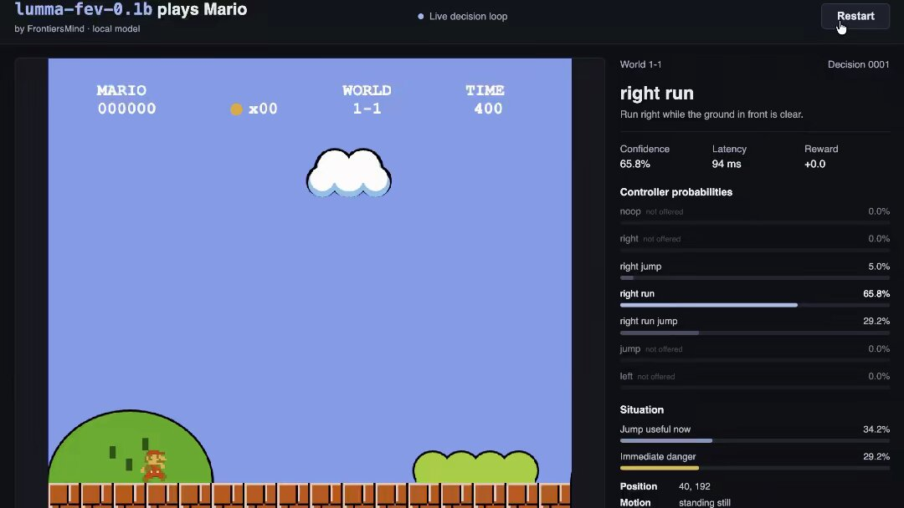

# 🚀 Today, we’re open-sourcing Lumma-fev-0.1B and updated Lumma-fev-0.6B!
> Source: https://x.com/FrontiersMind/status/2103536117765255272
> Author: FrontiersMind (@FrontiersMind)
> Posted: 2026-09-25T17:24:26+00:00
> Captured: 2026-10-15T09:02:28+00:00
> Stats at capture: 7,386 views · 131 likes · 4 replies · 26 reposts · 99 bookmarks · 1 quotes

## Post

🚀 Today, we’re open-sourcing Lumma-fev-0.1B and  updated Lumma-fev-0.6B!

These are our own Decision-Based Models trained on English & 10 𝐈𝐧𝐝𝐢𝐜 languages designed to make decisions and take actions rather than generate text:  https://huggingface.co/collections/FrontiersMind/lumma-decision-models

And the results are already exciting: Lumma-fev is beating Jev on several benchmarks. 📈

From playing games to classification, structured decision-making, and many other tasks where text generation isn’t necessary, Lumma-fev is built to act. ⚡🎮

🎮 Adding a video of our tiny Lumma-fev-0.1B playing Super Mario autonomously on Macbook M2 and actually winning the game!

🔥 And we’re just getting started.

Tomorrow, we’ll also be open-sourcing Lumma-fev-4B and Lumma-fev-9B.

#jev #llm #machinelearning #decisionModels

## Media

[Post media 1](media/video-01.mp4) — Source media: https://video.twimg.com/amplify_video/2103535933039816704/vid/avc1/1080x608/GgFSi54Jx_-bTZu8.mp4?tag=29
 — Post media 1 thumbnail. Source media: https://pbs.twimg.com/amplify_video_thumb/2103535933039816704/img/EPPiApQ-IPAAPb_K.jpg
[Reply 2110523541376667657 media 1](media/video-02.mp4) — Source media: https://video.twimg.com/amplify_video/2110522956669734912/vid/avc1/2540x1948/8ZxXlg9wanBDmt7A.mp4?tag=29
[Reply 2110124406156722455 media 1](media/video-03.mp4) — Source media: https://video.twimg.com/amplify_video/2110124155735568384/vid/avc1/1920x1080/zm33k-46SkeMsfwo.mp4?tag=29
[Reply 2110390124743970952 media 1](media/video-04.mp4) — Source media: https://video.twimg.com/amplify_video/2110388643684876288/vid/avc1/1920x1080/G81V76gvSg4fTgs3.mp4?tag=29
[Reply 2110375346046746649 media 1](media/video-05.mp4) — Source media: https://video.twimg.com/amplify_video/2110374180395098112/vid/avc1/576x1024/t-hXvst_5sBLVpTc.mp4?tag=29

## Comments

### extracsw ([@marwancsw8](https://x.com/marwancsw8/status/2103662750111085028)) — 2026-09-26T01:47:38+00:00

@FrontiersMind Interesting, what is the inference speed?
### Hova ([@Hovavayo](https://x.com/Hovavayo/status/2104258642543612266)) — 2026-09-27T17:15:30+00:00

@FrontiersMind Hey @grok fine tune edilibmi
### james ([@f82james](https://x.com/f82james/status/2103747907438674107)) — 2026-09-26T07:26:01+00:00

@FrontiersMind a 0.1b model that makes decisions instead of generating text is a pretty interesting tradeoff. the 10 indic languages is a nice detail too.

## Other returned timeline records

> The CLI did not expose reply relationships. These records do not start with a reply mention and were authored by someone other than the saved-post author. They may include recommendations or promoted posts; they are retained as source context, not verified replies.

### Caine Builds 🐧 ([@CaineArdayfio](https://x.com/CaineArdayfio/status/2110523541376667657)) — 2026-10-15T00:09:58+00:00

Mobile Use + Jev for audio = ULTRAFAST⚡️

10x faster and 20x cheaper than Gemini Live. 

It's our Audio Action model, Thud.

Thud listens and then does. It has a pre-built list of actions it can take on every page and listens for that action.

It's 2026. We don't need to transcribe every voice  command before spoon-feeding it to the AI. The AI is smart enough to just hear audio and do! It doesn't need text.
 — Source media: https://video.twimg.com/amplify_video/2110522956669734912/vid/avc1/2540x1948/8ZxXlg9wanBDmt7A.mp4?tag=29
### Niklas ([@niklaslenz_ai](https://x.com/niklaslenz_ai/status/2110124406156722455)) — 2026-10-13T21:43:57+00:00

🚨 This is huge. 

Fish Audio just opened the weights of Drama 3, and it's the first open TTS model that sounds close to perfect to me.

Other models can switch emotion mid-sentence. 
Drama 3 is the first one I've heard where it actually sounds right. 

Three tests against Qwen3-TTS, each on one DGX Spark at home: happy turning sad mid-sentence, a sad whisper, and pure excitement. Listen to where the mood drops.

I think this kills ElevenLabs for anyone who has their own compute.

The catch: it's a 35B model (3B active), a 41.5 GB download, and on the Spark it only just keeps up with real time: 10 s of audio take 9.7 s (Qwen3-TTS 7.6 s).
 — Source media: https://video.twimg.com/amplify_video/2110124155735568384/vid/avc1/1920x1080/zm33k-46SkeMsfwo.mp4?tag=29
### Ant Ling ([@AntLingAGI](https://x.com/AntLingAGI/status/2110390124743970952)) — 2026-10-14T15:19:49+00:00

Ling-3.1-flash is now open source: ~560B total parameters, ~25B active per token and up to 1M context. 
Built for real work, it can turn a rough brief into a page, mobile UI or interactive prototype teams can review and refine. See the demo. https://t.co/F0rQ7pJ5uq
 — Source media: https://video.twimg.com/amplify_video/2110388643684876288/vid/avc1/1920x1080/G81V76gvSg4fTgs3.mp4?tag=29
### Steven Cheng ([@stevencheng](https://x.com/stevencheng/status/2110375346046746649)) — 2026-10-14T14:21:06+00:00

Behold, the ESP32 ball. https://t.co/yx3PvWK7jb
 — Source media: https://video.twimg.com/amplify_video/2110374180395098112/vid/avc1/576x1024/t-hXvst_5sBLVpTc.mp4?tag=29

## Links

- https://huggingface.co/collections/FrontiersMind/lumma-decision-models
