# Chinese students just found the best way to use JEV for any LLM or AI agent - released a PDF research
> Source: https://x.com/0xCodila/status/2103554016315642100
> Author: codila (@0xCodila)
> Posted: 2026-09-25T18:35:34+00:00
> Captured: 2026-10-15T09:02:28+00:00
> Stats at capture: 98,148 views · 815 likes · 41 replies · 136 reposts · 1,497 bookmarks · 3 quotes

## Post

Chinese students just found the best way to use JEV for any LLM or AI agent - released a PDF research

the shift: I pasted it into Claude and GPT - and cut my costs by~63х

here’s what they found across 44 benchmarks:

1 → 7,193 responses, 10 types of failure. Jev was tested on hallucinations, prompt injections, data leaks, and other AI failures

2 → One simple question worked: 0.886 median AUROC, beating trained baselines on 25 of 31 benchmarks without task-specific training

3 → Context beat clever prompting - give Jev the source or rule it needs to check the answer against

4 → Keep the probability, not just "yes" or "no" - Fitting a threshold on 10 labeled examples raised median F1 from 0.706 to 0.793

5 → Among the 50% most confident decisions, median accuracy reached 0.933 - send uncertain cases for another review

6 → Jev even helped uncover labeling errors in three benchmarks. Sometimes the test’s "correct answer" was the problem

7 → 11.4 questions per call, with 0.31-second median latency - on 19 benchmarks, checking cost $0.30 vs $18.96 with LLM judges - roughly 63× cheaper

the result: It will made your setup CHEAPER and FASTER than what 95% of people are running

Copy the Jev setup researchers tested across 44 benchmarks - then read the full Jev architecture ↓

> Quoted post by codila ([@0xCodila](https://x.com/0xCodila/status/2100984487802708306)):
>
> Jev is the "Internet" moment for the AI industry
>
> It tells your agents and LLMs what to do next, in milliseconds and at almost zero cost
>
> If you set it up correctly, you will have the AI engineer’s stack for 2028
>
> In this article, I show you how https://x.com/i/article/2077744776565149697

## Quoted article: Jev Engineering: Full 10-Step Roadmap to Set Up and Use a New Brain for AI (from scratch)

The Jevons Paradox (he's on picture) is a rule stating that an increase in the efficiency of a resource's use does not reduce, but rather increases, its overall consumption

- That's the global problem for AI: LLMs and Agents 

And Jev by @typesafeai is built to save 101% of your money, time and will improve your efficiency of using AI

So trust me - this is the 2030 setup that you need to install right now
before the alpha -  subscribe to my substack for more fresh alpha - [https://substack.com/@0xcodila](https://substack.com/@0xcodila)

---

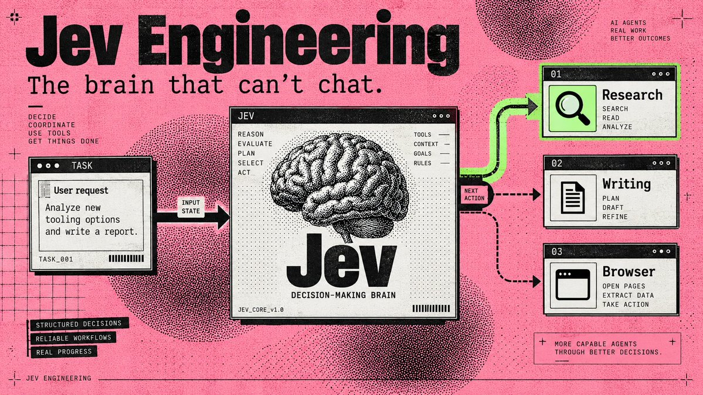

"Browser Use put Jev inside an agent that found flights in 7 seconds for $0.0039"

[Embedded post](https://x.com/i/status/2100411066966749359)

That gets interesting when you look at what your Chief of Staff does all day: choose a worker, check a result, decide whether to continue. Each fork can become another model call before any useful work happens

> Jev gives those decisions their own model
> 
>  Your writing agent keeps writing. Your research agent keeps researching. The small judgments between them become a separate component you can inspect, price, and change.

Start with a standalone task router: enter a job, let Jev choose its destination, and save the handoff on your computer. 
Then run Browser Use's complete browser agent. (The first needs one API key; the browser project needs two)

---

### 01. Find the part of your agent Jev can take over

Jev is TypeSafe AI's System One model: you provide information and predefined questions, it returns typed answers with probabilities. It cannot write your briefing, generate code, or explain its reasoning in prose. [TypeSafe's launch essay](https://typesafe.ai/blog/introducing-system-one-models-and-jev)

Start with a job like this:

> Research three new AI-agent tools and draft tomorrow's briefing. Save the draft for my review.

That job contains several decisions: Do we have enough sources? Which worker goes next? Is the draft ready for review?

Those are candidates for Jev. Fetching sources, writing paragraphs, and saving files still belong to your tools and generative models. An exact rule, such as stopping after ten actions, belongs in code.

For a GrokBot-style Chief of Staff, the saved handoff can feed an existing worker. Connecting that worker comes after the standalone setup below; you can complete the first run without an agent team.

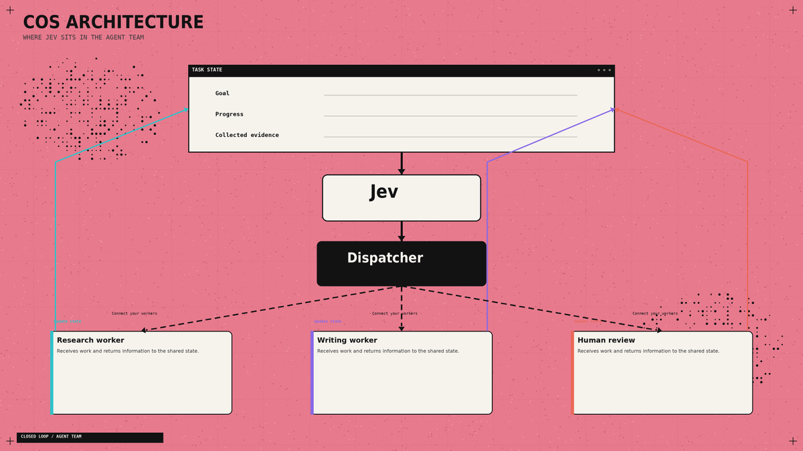

---

### 02. Give it one decision in the Playground

- Open the [TypeSafe Playground](https://console.typesafe.ai/playground). Sign in and complete the access process if your account requires it.

Use this as your state:

```
Goal: Compare three AI-agent tools in a morning briefing.
Completed work: No sources collected yet.
Available workers: Researcher, Writer.
Constraint: Save drafts for review. Do not publish.
```

Add a Choice question: "Which worker should act next?"

Define three options: research for missing evidence, write for drafting from sufficient evidence, and review for unclear requests or completed work.

Run it. Then replace the completed-work field with actual research notes and compare the decision. This is the basic interaction described in the [official Quickstart](https://docs.typesafe.ai/introduction/quickstart).

---

### 03. Connect the API once

You need a TypeSafe account with API access enabled and a key from [key settings](https://console.typesafe.ai/settings/keys). API calls are billed to that account. 

Install [Python](https://www.python.org/downloads/) 3.12 or newer, then open Terminal on macOS/Linux or PowerShell on Windows.

macOS / Linux:

```
mkdir jev-starter
cd jev-starter
python3 -m venv .venv
.venv/bin/python -m pip install --upgrade typesafe-sdk
```

Windows PowerShell:

```
mkdir jev-starter
cd jev-starter
py -3 -m venv .venv
.\.venv\Scripts\python.exe -m pip install --upgrade typesafe-sdk
```

These commands create an isolated environment and install the [official Python SDK](https://docs.typesafe.ai/sdk/python). Keep your key outside source files; the script below asks for it privately.

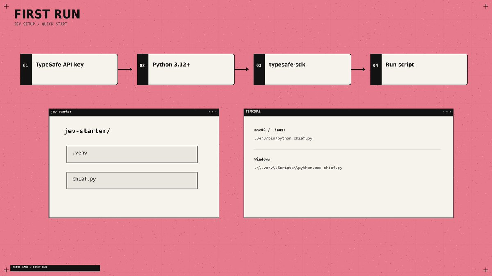

Using a coding agent? With Node.js/npm installed, add TypeSafe's official skill:

```
npx skills add typesafe-ai/skills --skill typesafe-ai
```

Select your supported agent when prompted. The skill gives it integration instructions; Jev itself runs through the API. [Official repository](https://github.com/typesafe-ai/skills)

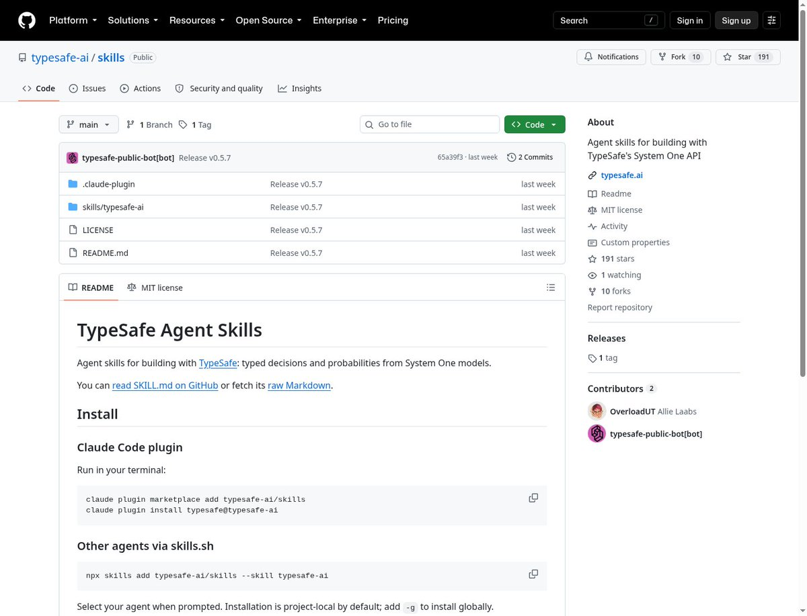

---

### 04. Turn a request into a saved handoff

Create chief.py inside jev-starter, outside .venv. Use a plain-text editor and save the exact filename, not chief.py.txt.

```
import json
import os
from getpass import getpass
from pathlib import Path
from uuid import uuid4
from typesafe_sdk import Choice, TypeSafeAPIError, TypeSafeClient

if not os.environ.get("TYPESAFE_API_KEY"):
    os.environ["TYPESAFE_API_KEY"] = getpass("TypeSafe API key: ").strip()

goal = input("Goal: ").strip()
if not goal:
    raise SystemExit("Enter a goal.")
notes = input("Completed work: ").strip() or "Nothing yet."
state = {"goal": goal, "completed_work": notes}

try:
    with TypeSafeClient(model="jev-1.13.0") as client:
        result = client.system_one(
            state=state,
            questions={
                "next_worker": Choice(
                    instructions="Choose the next step for a research briefing.",
                    criteria={
                        "research": "Collect evidence still needed for the goal.",
                        "write": "Draft the briefing from sufficient evidence.",
                        "review": "Goal unclear, outside scope, or work complete.",
                    },
                )
            },
        )
except TypeSafeAPIError as error:
    raise SystemExit(f"API error {error.status}; see Step 8.")

answer = result.choices["next_worker"]
destination = "review"
if answer.choice in {"research", "write"} and answer.confidence >= 0.85:
    destination = answer.choice

folder = Path(__file__).resolve().parent / "queue" / destination
folder.mkdir(parents=True, exist_ok=True)
job = folder / f"{uuid4().hex}.json"
payload = dict(state, choice=answer.choice, confidence=answer.confidence,
               destination=destination, status="queued")
job.write_text(json.dumps(payload, indent=2, ensure_ascii=False), encoding="utf-8")
print("Saved handoff:", job)
```

Run on macOS/Linux:

```
.venv/bin/python chief.py
```

Run on Windows:

```
.\.venv\Scripts\python.exe chief.py

```

Paste your API key when asked - the terminal hides it. 
For Goal, enter Compare three AI-agent tools for tomorrow's briefing. For Completed work, enter No sources collected yet.

Your result: a Saved handoff: message with a full file path. Open that JSON file: it contains your request, progress, Jev's choice, confidence, and destination. 
Each run creates a new file under queue/research, queue/write, or queue/review. These are local task queues; a saved job waits for a worker to consume it

The API call and error handling follow the [SDK usage guide](https://docs.typesafe.ai/sdk/python/usage). I set the initial review threshold to 0.85 - adjust it using labeled examples from your workflow. Confidence is not an accuracy percentage. [Confidence guidance](https://docs.typesafe.ai/confidence)

---

### 05. Ask questions that lead somewhere

Three answer types cover different jobs:

Jev gives you three question types, each built for a different kind of decision:

- Choice selects one option from a list. Use it for questions like: "Who should work next?" It returns the selected option, its probability distribution, and confidence.

- Score evaluates something against a scale you define. Use it for questions like: "How relevant is this source?" It returns a value on that scale, plus probabilities and confidence.

- Noul answers a yes-or-no question. Use it for questions like: "Does this request require publishing?" It returns the probability of “yes” from 0 to 1.

Define a relevance Score with three descriptions: unrelated, partially relevant, directly addresses the question. Its numeric result runs from 0 to 2, including fractions. A Noul near 0.5 means uncertainty about yes/no. [Score](https://docs.typesafe.ai/primitives/score) · [Noul](https://docs.typesafe.ai/primitives/noul)

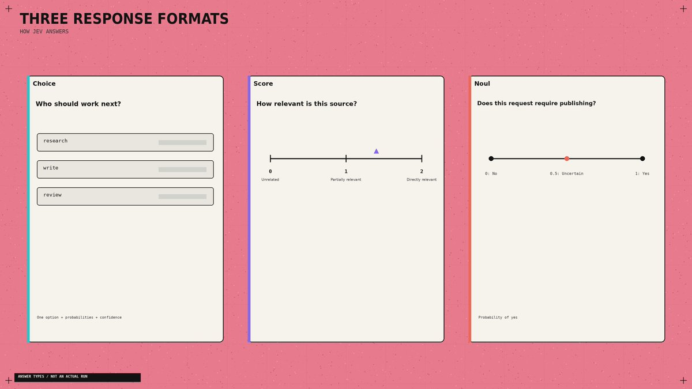

A useful detail: Jev does not see your question ID. Naming a field safe_to_publish contributes no instructions. Put the actual requirement in the question and describe each option clearly. [Choice documentation](https://docs.typesafe.ai/primitives/choice)

Also supply evidence. "The researcher finished" tells Jev less than the sources, findings, and remaining gaps. Keep those fields separate from the original request. [State documentation](https://docs.typesafe.ai/concepts/state)

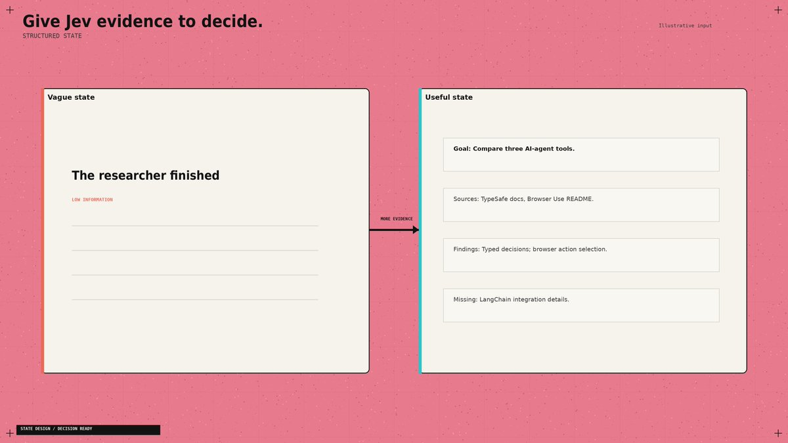

---

### 06. Steal Browser Use's best idea: rebuild the menu

A browser's available actions change after every click. Browser Use builds a fresh list of observed controls and lets Jev choose from that list. A small LLM generates text when an input field needs filling. [Decision implementation](https://github.com/browser-use/jev-ultrafast/blob/main/jev_ultrafast/model.py)

Apply that design to your Chief of Staff. Build the choices from workers that exist and are available now. Include the current source IDs when selecting research material. Refresh the options after a tool changes the state.

- Otherwise your decision model is choosing from yesterday's menu.

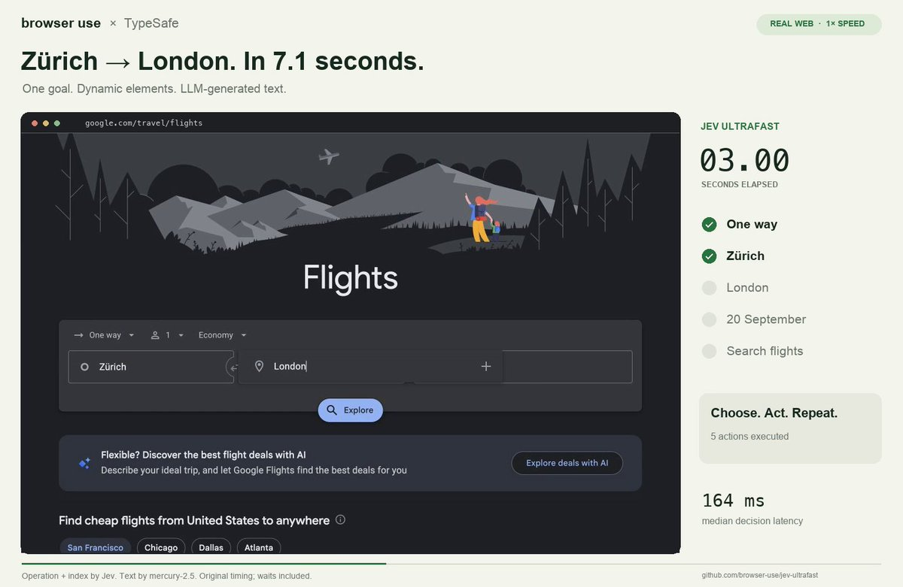

For large candidate lists, filter obvious mismatches in code, score the remaining items, then choose among the shortlist. Choice supports up to 255 options; TypeSafe describes this scoring-then-selection approach in its [launch examples](https://typesafe.ai/blog/introducing-system-one-models-and-jev)

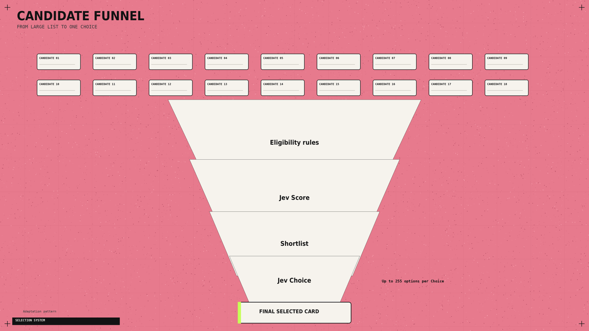

---

### 07. Stop paying for questions to wait on each other

Your dispatcher may need a worker, an urgency score, and an approval check. 
If all three can inspect the same state, send them together.

TypeSafe supports parallel questions and speculative branches: ask about possible next actions, then use only the answer relevant to the selected branch. 
Questions cannot read one another's answers. If a decision needs a fresh search result, perform the search first. [Parallel evaluation pattern](https://docs.typesafe.ai/patterns/fan-out)

The browser example exposes another bottleneck. Its optimized runtime reduced median browser protocol calls from 1,092 to 101, while median task time fell 25% across three matched pairs. Both versions used the same models.

The changes included collecting the page state in one read and avoiding fresh predictions for irrelevant animations. Inspect repeated tool calls before paying for a faster model. [Performance report](https://github.com/browser-use/jev-ultrafast/blob/main/docs/performance.md)

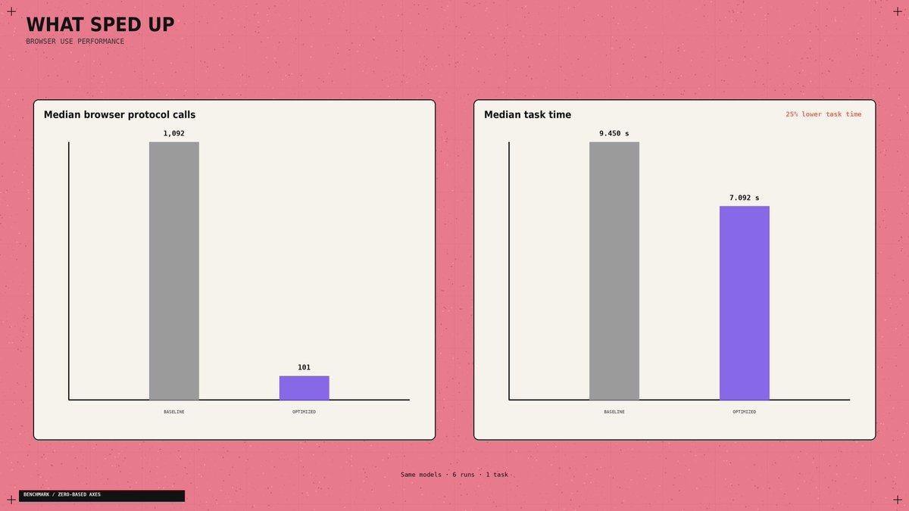

---

### 08. Give overnight work somewhere to stop

For a morning briefing, I'd allow source collection and draft creation, then stop at review. Publishing should require a separate permission check.

The application also needs an action limit, a spending limit, and saved progress. 
After an interruption, it should inspect the last completed action before repeating anything. A confident answer cannot prove that a file was saved or a message was sent.

Browser Use independently checks the outcome after Jev selects DONE. Borrow that separation for your own completion checks. [Agent loop](https://github.com/browser-use/jev-ultrafast/blob/main/jev_ultrafast/agent.py)

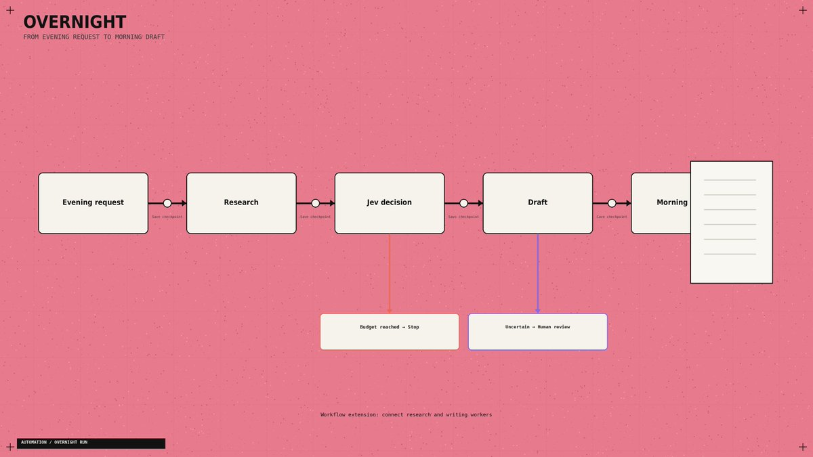

Once the local router works, use this brief to connect your existing agents:

> Read the TypeSafe skill and inspect my worker interfaces. Connect chief.py's JSON queues to existing research and writing handlers. Prevent duplicate processing. Save progress after each action. Add call and spending limits, review on uncertainty, and a draft-exists completion check. Keep publishing behind approval. Identify missing connectors explicitly.

If the starter fails, use the error to choose the fix:

- Python command missing: finish Python installation and reopen the terminal.

- Module missing: repeat the SDK install with the same .venv interpreter.

- 401: replace the API key and rerun.

- 422: check the named request field against the pasted code.

- 429 / 529: allow backoff; retry later if rate limiting or overload persists.

The SDK supplies retries; the script stops if an API error remains. [API reference](https://docs.typesafe.ai/api)

---

### 09. Know what the headline price actually buys

Jev 1.13 costs $0.042 per million input tokens, with no output-token charge. At 1,000 billed input tokens per decision, 10,000 decisions cost $0.42 for Jev inference. [Pricing](https://docs.typesafe.ai/models)

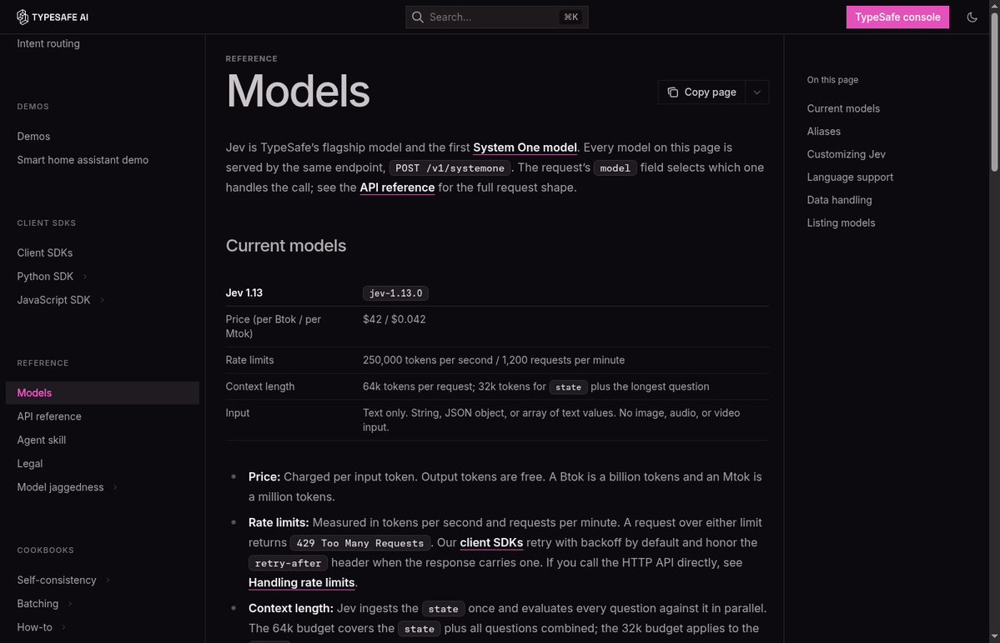

The flight demo's reported $0.0039 fits its recorded 90,558 Jev input tokens plus the text helper's reported charge. 
Browser costs sit outside that calculation. Its roughly seven-second clock starts after the initial page observation and excludes fresh post-run verification

- So it finds flight results; it does not book tickets. [Run measurements](https://github.com/browser-use/jev-ultrafast/blob/main/docs/performance.md)

For a different workload, Vercel's fx team reported roughly 5-18x faster safety classification than GPT-5.6-luna, alongside improved accuracy. 
That comparison concerns the classifier, not the duration of an entire agent run. [Original benchmark](https://x.com/fazxes/status/2100300097695232164)

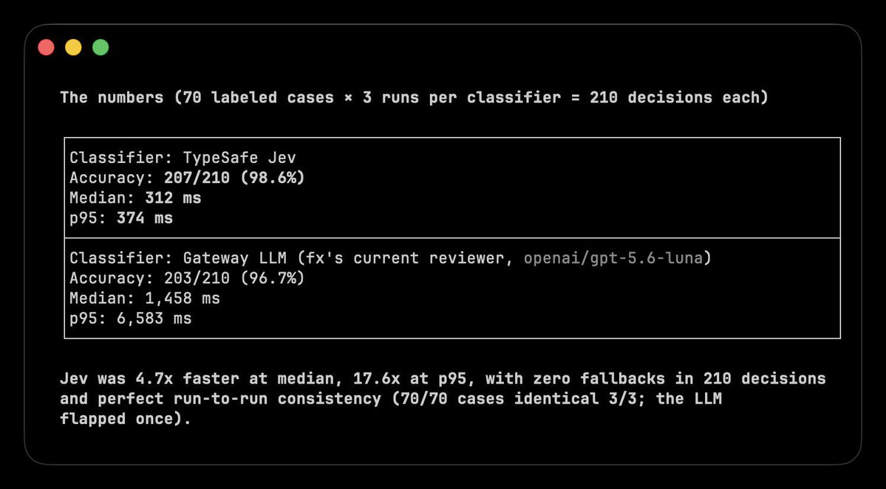

Track the bill per completed task. A cheap decision that sends a worker down the wrong branch can cost more than the decision itself.

---

### 10. Examples of Use

After the basic setup, Jev can already read the state of a task and choose between predefined options. Now you only need to decide which repeated decision to automate.

1. Control a Browser

Browser Use used Jev to select the next action and the correct page element. The agent found flights in 7 seconds for $0.0039.

[Embedded post](https://x.com/i/status/2100411066966749359)

[Open the code](https://github.com/browser-use/jev-ultrafast)

How to repeat it: run the official project, add your TypeSafe and OpenRouter keys, then give the agent a website and a goal. Jev selects the action and target, while the browser executes the decision.

2. Classify Research

Hassan used Jev to classify 1,018 AI research papers. The entire classification cost $0.08, with 256ms median end-to-end latency per paper

[Embedded post](https://x.com/i/status/2100426999546184123)

How to repeat it: send the title and summary of each paper to Jev, then define your topics as Choice options. Save the selected category and send the strongest papers to your writing agent.

3. Triage Your Inbox

Riley Brown demonstrated how Jev can classify incoming emails and decide what should happen next.

[Embedded post](https://x.com/i/status/2100404532119269426)

How to repeat it: pass each email as the state, then add reply, research, wait, and review as Choice options. Connect each answer to the corresponding folder or email agent.

4. Route Tasks Between Models

LangChain uses Jev to choose between cheaper and more capable models based on the task

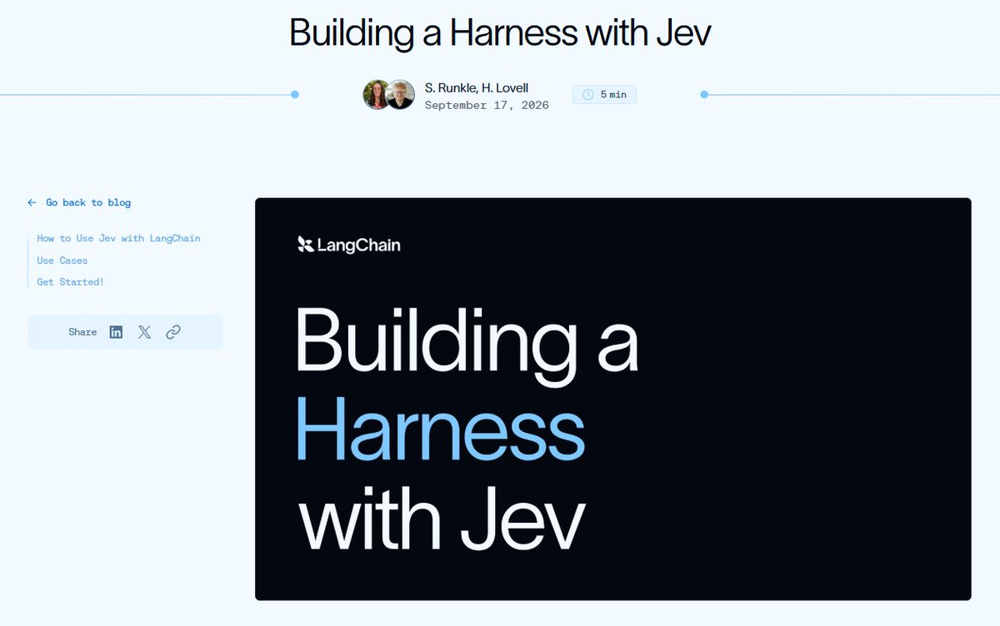

[Open the LangChain guid](https://www.langchain.com/blog/building-a-harness-with-jev)

How to repeat it: connect several models, describe what each one is best at, and send the incoming request to Jev. Route simple tasks to a cheaper model and complex tasks to a reasoning model.

And other cases:

[Embedded post](https://x.com/i/status/2100739055923425589)

[Embedded post](https://x.com/i/status/2100694549362553153)

---

### The shift

> An LLM creates the work → Jev decides what happens next.

Jev is not another chatbot

It is a fast decision layer that reads the current state of your system and chooses between the options you define

And the real alpha is not the 7-second flight demo or the $0.08 paper classification

The real alpha is realizing how many expensive LLM calls inside your agents never needed generation:

- Let the LLM research, plan, and write

- Let Jev route, score, approve, or escalate

- Let code execute the decision

That split changes the entire agent stack

You now have the setup, the working decision router, and four real ways to deploy it. Start with one repeated decision. Measure it. Then replace the next one.

Most builders will keep spending frontier-model tokens on every yes, no, route, and score

The few who separate thinking from deciding will build faster agents at a fraction of the cost.

> Bookmark this playbook before your next agent  → [@0xCodila](https://x.com/@0xCodila)

## Media

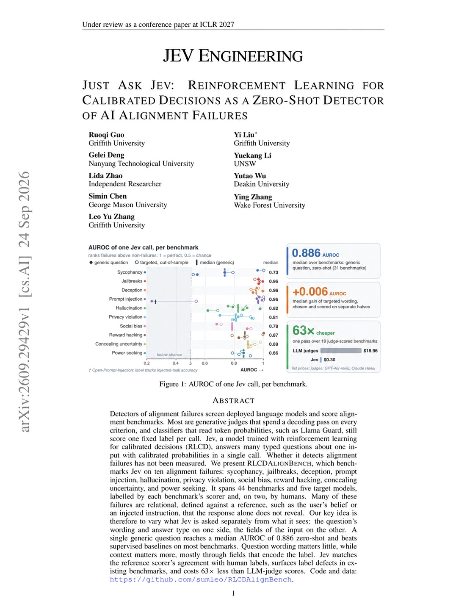 — Post media 1. Source media: https://pbs.twimg.com/media/HTFM72eWkAAgYla.jpg?name=orig
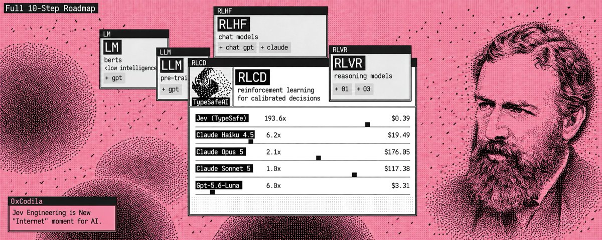 — Quoted article media. Source media: https://pbs.twimg.com/media/HSgY7VCXUAAWG9f.jpg
 — Quoted article media. Source media: https://pbs.twimg.com/media/HSgsuSvWMAAUmht.jpg
 — Quoted article media. Source media: https://pbs.twimg.com/media/HSgsVsUW4AALdJK.jpg
 — Quoted article media. Source media: https://pbs.twimg.com/media/HSgrRIYXQAA_qIm.jpg
 — Quoted article media. Source media: https://pbs.twimg.com/media/HSgtVN2XgAEydLO.jpg
 — Quoted article media. Source media: https://pbs.twimg.com/media/HSgs099XgAAw37r.png
 — Quoted article media. Source media: https://pbs.twimg.com/media/HSgotROWgAAjE5w.jpg
 — Quoted article media. Source media: https://pbs.twimg.com/media/HSgq7fkWMAAagx3.jpg
 — Quoted article media. Source media: https://pbs.twimg.com/media/HSgrIJEXYAAfX-k.jpg
 — Quoted article media. Source media: https://pbs.twimg.com/media/HSgs9sCXYAEaXNH.jpg
 — Quoted article media. Source media: https://pbs.twimg.com/media/HSgtBJgWgAEGBgE.jpg
 — Quoted article media. Source media: https://pbs.twimg.com/media/HSgtEigXYAAwQnH.png
 — Quoted article media. Source media: https://pbs.twimg.com/media/HSgsR3ZXIAA9iMp.jpg
 — Quoted article media. Source media: https://pbs.twimg.com/media/HSgtO1dWMAAgrsO.jpg
 — Reply 2103685042727952692 media 1. Source media: https://pbs.twimg.com/media/HTHKZQYbAAEhKS6.png

## Thread

### codila ([@0xCodila](https://x.com/0xCodila/status/2103554020514427021)) — 2026-09-25T18:35:35+00:00

https://t.co/pGOjvFeyMF
### codila ([@0xCodila](https://x.com/0xCodila/status/2103593422879617414)) — 2026-09-25T21:12:09+00:00

@Av1dlive it's all on architecture about Jev, so there are both topic from scratch
### codila ([@0xCodila](https://x.com/0xCodila/status/2103825720019648600)) — 2026-09-26T12:35:13+00:00

@sairahul1 true, it's another big game for LLMs and agents
### codila ([@0xCodila](https://x.com/0xCodila/status/2103555709648466267)) — 2026-09-25T18:42:18+00:00

@51bodila Yeee the research is super useful! just copy the pdf, it's worth this
### codila ([@0xCodila](https://x.com/0xCodila/status/2103609283346661458)) — 2026-09-25T22:15:10+00:00

@ArchiveExplorer yee, the document was released just yesterday, the students are really conducting useful tests that as many people as possible should see
### codila ([@0xCodila](https://x.com/0xCodila/status/2103592786247458915)) — 2026-09-25T21:09:37+00:00

@eng_khairallah1 thank you! absolutely worth to watch
### codila ([@0xCodila](https://x.com/0xCodila/status/2103557654866190438)) — 2026-09-25T18:50:01+00:00

@x_insider4 truee! absolutely worth to read
### codila ([@0xCodila](https://x.com/0xCodila/status/2103566298395431088)) — 2026-09-25T19:24:22+00:00

@ADLXBT to understrand it you should read document haha

## Comments

### Avid ([@Av1dlive](https://x.com/Av1dlive/status/2103580106560303424)) — 2026-09-25T20:19:14+00:00

@0xCodila Read this paper. It's close to Jev's engineering, but it is more about how Jev is allowing for better alignment to happen in models. Really good share, code. I really appreciate you giving this out.
### Rahul ([@sairahul1](https://x.com/sairahul1/status/2103825552046244281)) — 2026-09-26T12:34:33+00:00

@0xCodila Jev is another internet sensation
### bodila ([@51bodila](https://x.com/51bodila/status/2103555064556306605)) — 2026-09-25T18:39:44+00:00

@0xCodila oh wow! looks absolutely incredible
really interesting that students are already conducting experiments with Jev hehe

saved, and going to paste the research into Claude right now ty!
### Archive ([@ArchiveExplorer](https://x.com/ArchiveExplorer/status/2103593250682470680)) — 2026-09-25T21:11:28+00:00

@0xCodila chinese students are clearly ahead of their age

this document turned out to be really useful for me

recommend it to everyone
### Khairallah AL-Awady ([@eng_khairallah1](https://x.com/eng_khairallah1/status/2103582796551979471)) — 2026-09-25T20:29:56+00:00

@0xCodila this is super amazing my man
### INSIDER ([@x_insider4](https://x.com/x_insider4/status/2103557196583674160)) — 2026-09-25T18:48:12+00:00

@0xCodila Worth to pay attention
### ADL ([@ADLXBT](https://x.com/ADLXBT/status/2103563832019018188)) — 2026-09-25T19:14:34+00:00

@0xCodila they likely cache token embeddings from the prompt so the 7, 193 responses hit a precomputed matrix instead of recomputing the model each time, which cuts the token usage dramatically
### Wallchain Community Hub ([@quack_research](https://x.com/quack_research/status/2103790212245840313)) — 2026-09-26T10:14:07+00:00

@0xCodila saving 63x on api costs is insane
### Genius💡💹🧲 🤖 ([@GeniusPothead](https://x.com/GeniusPothead/status/2103925777125478767)) — 2026-09-26T19:12:48+00:00

@0xCodila jev cutting costs this hard could actually change how people prompt
### 安叫兽|Bird🕊️ 🔶 BNB ([@ajs6888](https://x.com/ajs6888/status/2103898767766491489)) — 2026-09-26T17:25:29+00:00

@0xCodila 63 倍这个数有点猛，想看看是怎么测的。
### Alex Lee ([@betty_mill50815](https://x.com/betty_mill50815/status/2104208639187906742)) — 2026-09-27T13:56:48+00:00

@0xCodila 63x cheaper?? yeah I’m stealing this setup 😂
### Crio Songo ([@shuizhuyu](https://x.com/shuizhuyu/status/2103661674515538108)) — 2026-09-26T01:43:22+00:00

@0xCodila 这个思路很巧妙，不用额外训练还能把成本砍这么多，有空我去搜一下这份研究PDF看看。
### Dubya ([@heyZeus131313](https://x.com/heyZeus131313/status/2103643302948139058)) — 2026-09-26T00:30:21+00:00

@0xCodila Jev type agent should be a 'skill' within your LLM harness, not something you have to think through and program. Maybe even completely combined within the LLM as a subroutine.
### Stanislav Sorokin ([@stas_sorokin_](https://x.com/stas_sorokin_/status/2103898464866206194)) — 2026-09-26T17:24:17+00:00

@0xCodila A 63x cut is great, but 0 dollars is lower: one free Python file found 328 hidden duplicate rows in Dolly 15k in 22 seconds. Most cost fights start at inference. The leak that surprised us sat somewhere else. Where do you look first?
### Tylr ([@tylr_r](https://x.com/tylr_r/status/2103685042727952692)) — 2026-09-26T03:16:13+00:00

@0xCodila https://t.co/hRgxtH1qaG
 — Source media: https://pbs.twimg.com/media/HTHKZQYbAAEhKS6.png
### Arindam Majumder 𝕏 ([@Arindam_1729](https://x.com/Arindam_1729/status/2104031886012285036)) — 2026-09-27T02:14:27+00:00

@0xCodila You can also check these usecases

https://t.co/gZhqtFmQq3
### Khairallah AL-Awady ([@eng_khairallah1](https://x.com/eng_khairallah1/status/2103583148898709700)) — 2026-09-25T20:31:20+00:00

@0xCodila well share mab
### David Arias, CFA ([@Davidariasfin](https://x.com/Davidariasfin/status/2104353471118078083)) — 2026-09-27T23:32:19+00:00

@0xCodila It has been very interesting testing Jev in tasks, it is also very efficient in comparison with agentic RAG in finance research:  https://t.co/2nktUS2X0s
### why ([@NullContex1s](https://x.com/NullContex1s/status/2103567615298007370)) — 2026-09-25T19:29:36+00:00

@0xCodila Do you have the PDF link? I’m curious how JEV handles long-context tasks and agent tool calls, not just standard LLM prompts.
### tim777 ([@0xTimQ](https://x.com/0xTimQ/status/2103651003430056435)) — 2026-09-26T01:00:57+00:00

@0xCodila 63x cheaper on 44 benchmarks, one prompt, no fine-tune. keep the probability, not just the yes/no, that's the whole cheat code fr.
### JeffersonNunn.eth ([@mindragon](https://x.com/mindragon/status/2103777828407746957)) — 2026-09-26T09:24:55+00:00

@0xCodila I checked. There are errors in the paper

Per-benchmark ECE 0.168 (null 0.074) — ranks well, base-rates miss hard. Threshold story weak without judged labels. Single checkpoint, 2–7B targets only. Genericity partly rephrases the scorer.
### Brjan | AI Builder ([@MrBrjan](https://x.com/MrBrjan/status/2103621679071342846)) — 2026-09-25T23:04:26+00:00

@0xCodila cutting costs by 63x with Jev is a massive leap for AI efficiency
### Kevin Rajan ([@_kvnloo](https://x.com/_kvnloo/status/2103911617519898873)) — 2026-09-26T18:16:33+00:00

@0xCodila bro I sent gpt this but it's not working
### Kevin Rajan ([@_kvnloo](https://x.com/_kvnloo/status/2103911501446656428)) — 2026-09-26T18:16:05+00:00

@0xCodila https://t.co/IC1P8ba8ib

can u help me setup some evals to test these claims?
### Catcher of your mind ([@Scratcherrrr](https://x.com/Scratcherrrr/status/2103556885714485333)) — 2026-09-25T18:46:58+00:00

@0xCodila i was sleeping and everybody talking about jev setup, would me try this? o skipp
### YOalphabet & AI ([@YOalphabet](https://x.com/YOalphabet/status/2103727712380563731)) — 2026-09-26T06:05:46+00:00

@0xCodila https://t.co/wu7gCzeePT
### ✊🏿✊🏾✊🏽✊🏼BLalwaysMattr‼️ ([@BLalwaysMattr](https://x.com/BLalwaysMattr/status/2103884214563491846)) — 2026-09-26T16:27:39+00:00

@0xCodila 👀
### blank ([@onebasedone](https://x.com/onebasedone/status/2103778681021698311)) — 2026-09-26T09:28:18+00:00

@0xCodila Jev nonsense is good for cleaning up  timeline from grifters


## Other returned timeline records

> The CLI did not expose reply relationships. These records do not start with a reply mention and were authored by someone other than the saved-post author. They may include recommendations or promoted posts; they are retained as source context, not verified replies.

### Starlink ([@Starlink](https://x.com/Starlink/status/2099964624648958223)) — 2026-09-15T20:52:36+00:00

Get fast, reliable home internet for seamless streaming, working from home, gaming, and more across multiple devices.

Order online in minutes.
### Starlink ([@Starlink](https://x.com/Starlink/status/2068115197718593741)) — 2026-06-19T23:34:21+00:00

Get connected with fast, reliable internet for streaming, video calls, online gaming and more.

Order online in minutes.
### Kevin Rajan ([@_kvnloo](https://x.com/_kvnloo/status/2103910967461421458)) — 2026-09-26T18:13:58+00:00

hey!!! thanks for sharing this bro. can you help me out? I am trying to actually implement this in my repo & I am having trouble w/ the evals, it wasn't really saving me money w/o performance degradations 

can u help me fix it, maybe I am making a mistake somehow?

https://t.co/1pJi1bAgHg

## Links

- https://x.com/i/article/2077744776565149697
- https://console.typesafe.ai/settings/keys
- https://x.com/fazxes/status/2100300097695232164
- https://console.typesafe.ai/playground
- https://github.com/typesafe-ai/skills
- https://docs.typesafe.ai/patterns/fan-out
- https://github.com/browser-use/jev-ultrafast/blob/main/jev_ultrafast/agent.py
- https://github.com/browser-use/jev-ultrafast
- https://docs.typesafe.ai/confidence
- https://github.com/browser-use/jev-ultrafast/blob/main/docs/performance.md
- https://typesafe.ai/blog/introducing-system-one-models-and-jev
- https://www.python.org/downloads/
- https://docs.typesafe.ai/api
- https://github.com/browser-use/jev-ultrafast/blob/main/jev_ultrafast/model.py
- https://docs.typesafe.ai/sdk/python
- https://docs.typesafe.ai/introduction/quickstart
- https://www.langchain.com/blog/building-a-harness-with-jev
- https://docs.typesafe.ai/models
- https://docs.typesafe.ai/concepts/state
- https://docs.typesafe.ai/sdk/python/usage
- https://docs.typesafe.ai/primitives/choice
- https://substack.com/@0xcodila
- https://docs.typesafe.ai/primitives/noul
- https://x.com/@0xCodila
- https://docs.typesafe.ai/primitives/score
