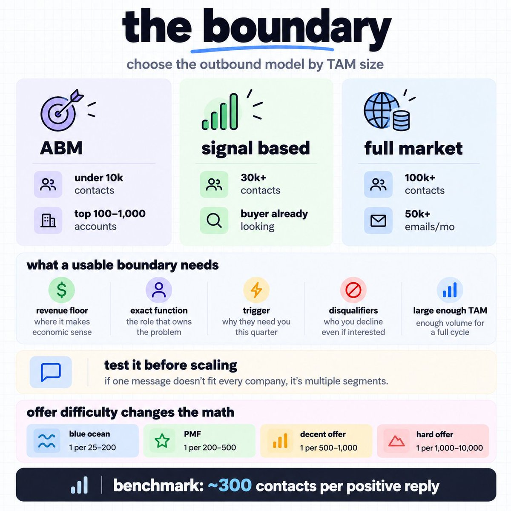
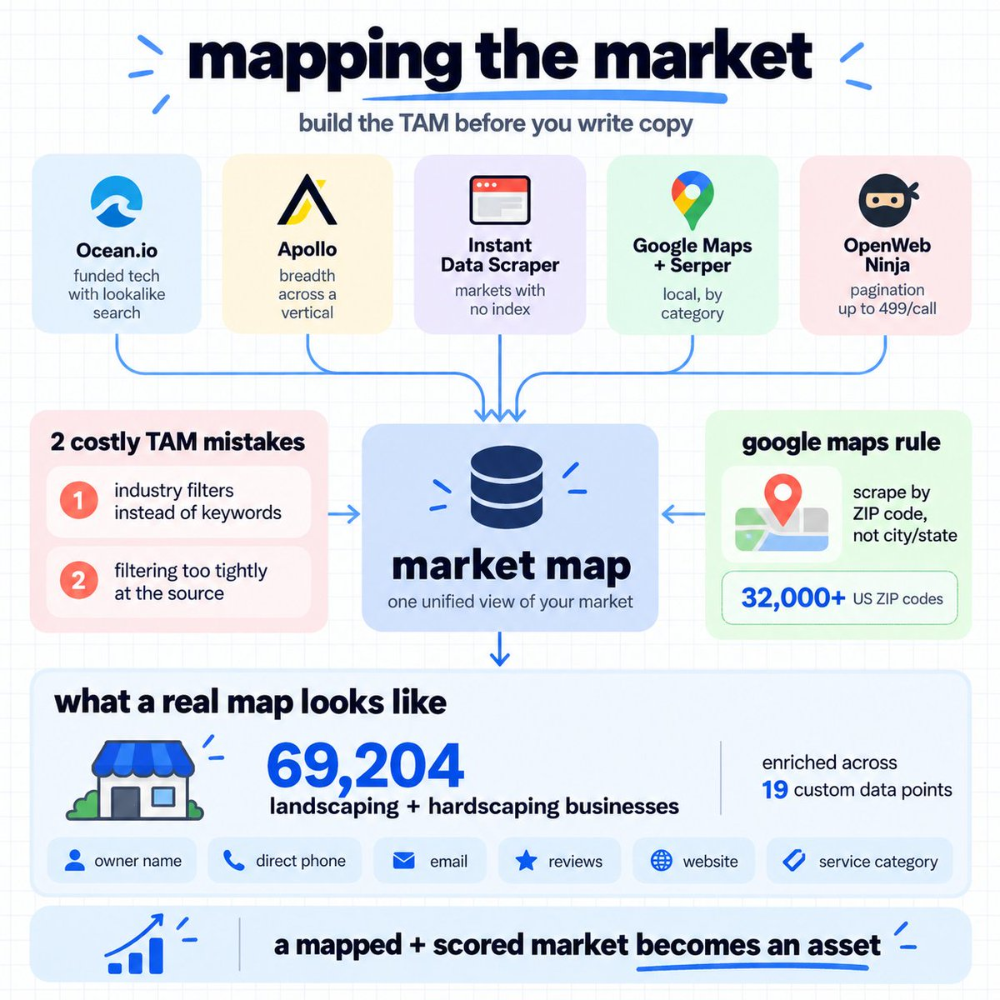
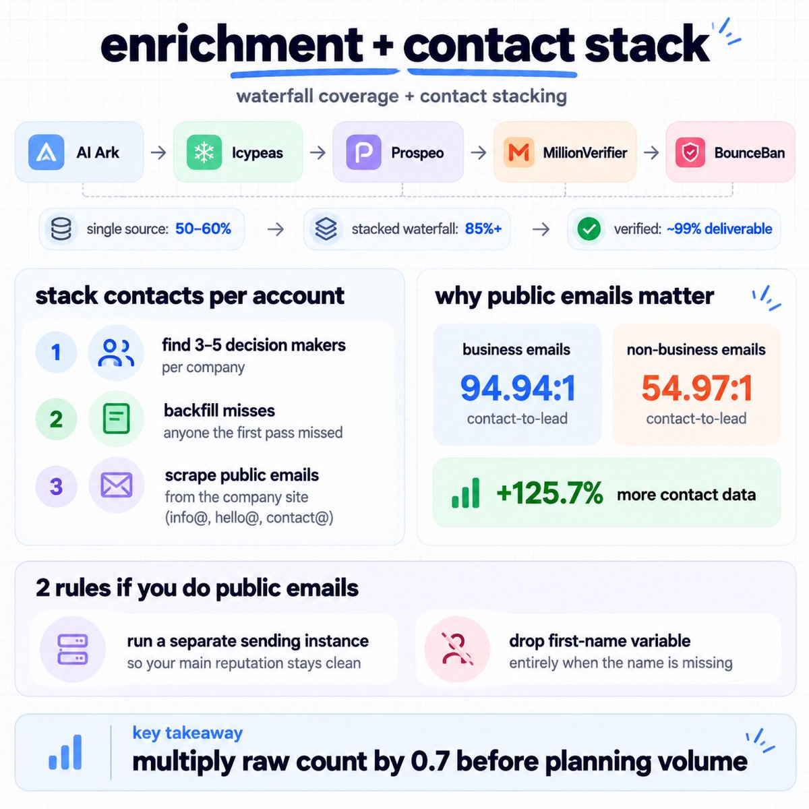
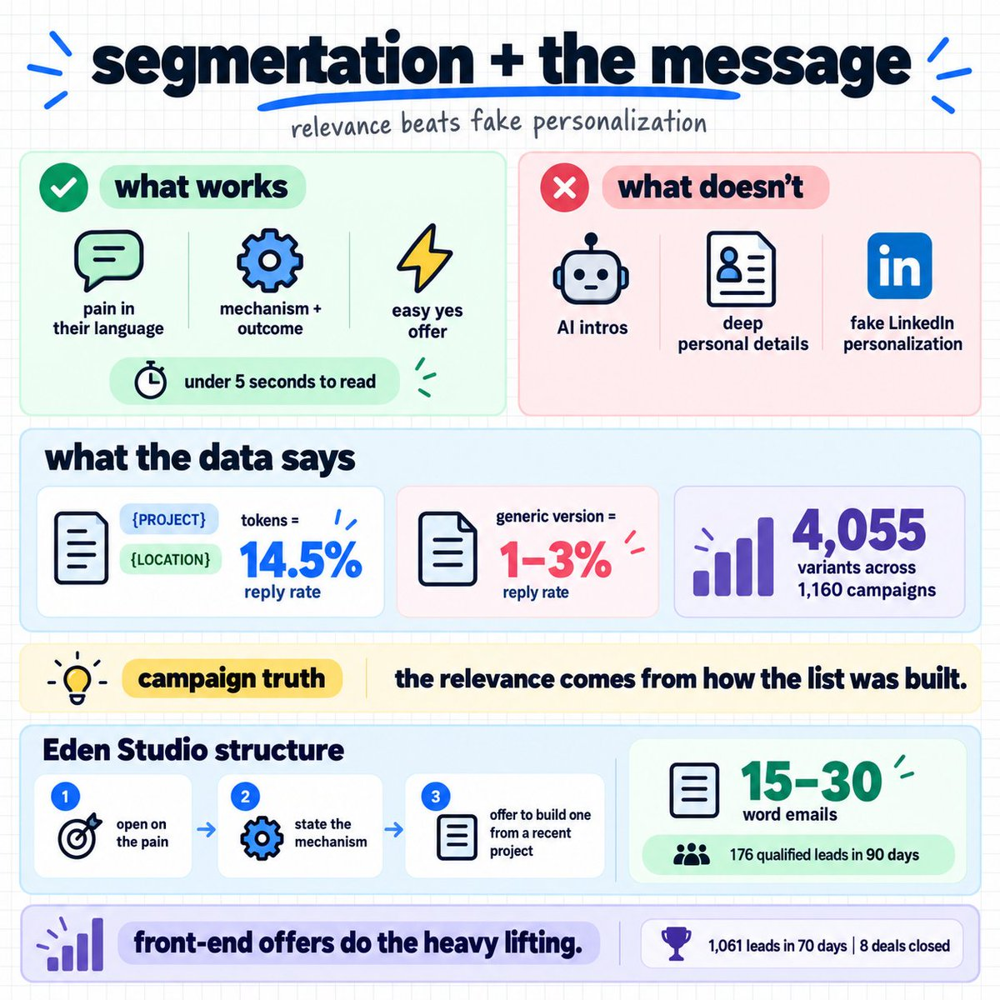
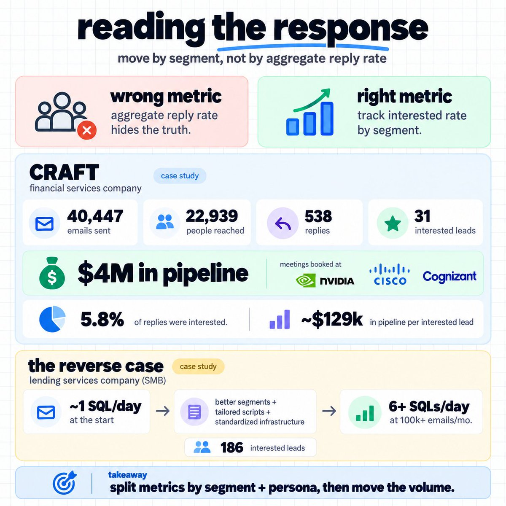
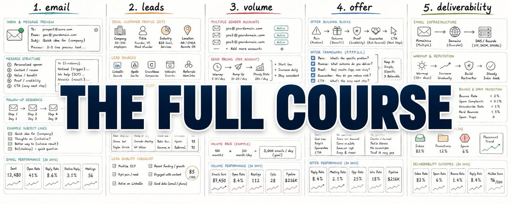
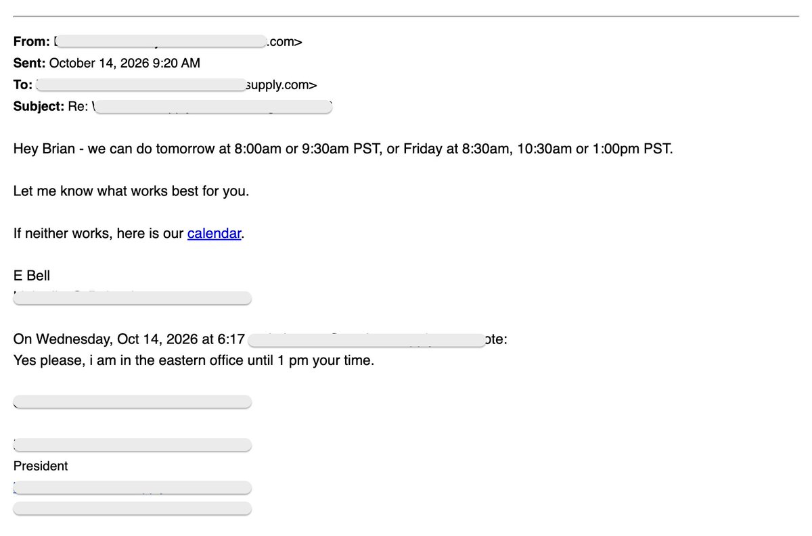
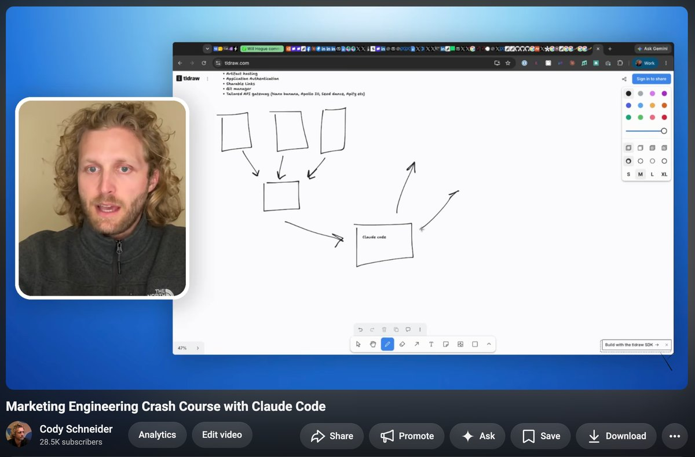

# The Most Valuable GTM Article Ever Written (Part 2)
> Source: https://x.com/coldemailchris/status/2103700886186848294
> Author: Christian (@coldemailchris)
> Posted: 2026-09-26T04:19:10+00:00
> Captured: 2026-10-15T09:02:28+00:00
> Stats at capture: 79,450 views · 266 likes · 8 replies · 25 reposts · 710 bookmarks · 2 quotes

## Post

https://x.com/i/article/2099316575006240776

## Article: The Most Valuable GTM Article Ever Written (Part 2)

We have sent 10,000,000+ cold emails, done 700,000 cold calls, and generated 30,000+ leads.

$70M+ in pipeline across 100+ B2B companies.

And I just put together the FULL COURSE on everything in GTM/outbound you need to know.

This is it:

---

### The model in one view:

Your entire addressable market, mapped once, scored, and contacted on a 90 day rotation.

Then contacted again with a sharper list than last cycle.

6 moving parts:

boundary → map → segment → send → read → re-cut

Get one layer working before you touch the next because loose boundary makes every layer after it more EXPENSIVE.

---

### Layer 1: the boundary:

3 ways to run outbound, and the right one is decided by the size of your market.

Full market coverage.

100k+ contacts, demand generation offer.

Base volume starts around 50k emails a month.

ABM.

Under 10k contacts, $50k+ LTV, long cycles.

Top 100 to 1,000 accounts, deep research, custom angle per account.

Signal based.

30k+ contacts, demand capture offer where the buyer has to already be looking.

Check the number before you choose:

- Under 10k contacts, ABM only

- 10k to 100k, automated outbound at 10k to 100k emails a month

- 100k+, high volume with 90% of the focus on deliverability, offer, and sales systems

What a usable boundary contains:

- The revenue floor where your offer makes economic sense

- The exact function that owns the problem

- The trigger saying they need you this quarter

- The disqualifiers, meaning who you decline even when they raise a hand

- A TAM large enough to sustain your volume for a full cycle

Spend the same care on disqualifiers as inclusions.

An AI qualification layer will happily return companies matching every filter that would never buy.

Without a written definition of what your ICP is not, the model invents reasons a company qualifies.

Test the definition before building on it.

Write one message and check it fits every company inside the segment.

If it does not, that is 2 segments and it needs 2 messages.

The offer decides whether any of this is worth running:

- Difficult offers like SEO, cyber security, and recruiting run 1 lead per 1,000 to 10,000 contacts

- Decent offers like email marketing and ad creative run 1 per 500 to 1,000

- Good offers with clear product-market fit run 1 per 200 to 500

- Blue ocean offers run 1 per 25 to 200

Our benchmark is roughly 300 contacts per positive reply.

500:1 is still solid. Above a 1% reply rate you are already doing fine.

What we did for some of our clients:

An agency targeting 7 figure ecom brands ran 266:1. CRAFT ran 740:1.

An enterprise focused B2B team ran 867:1. Eden Studio ran 875:1.

Real spread, and it maps directly to difficulty.

Enterprise costs you roughly 3 times the contacts per lead that a mid market ecom play does.

---

### Layer 2: mapping the market:

The first few thousand rows a database hands you is a slice, and every competitor pulled the same slice this quarter.

Where the accounts come from.

No single database covers a whole market.

- Ocean.io for funded tech, with lookalike search off a seed domain

- Apollo for breadth across a vertical

- Instant Data Scraper for markets nobody has indexed, meaning association lists, licensing directories, conference attendee pages

- Google Maps and Serper for local, pulled by category

- OpenWeb Ninja when pagination caps bite, at up to 499 results per call

Scrape Google Maps by zip code and not by city or state.

There are over 32,000 US zip codes and every query returns a result.

The 2 mistakes that cost most of the TAM.

Using industry filters instead of keywords.

Default filters return a Junior Marketing Coordinator when you asked for CMOs.

Ask Claude for 20 to 30 job title and industry keyword variations and run those.

Filtering too tightly at the source.

Every filter you stack removes accounts you would have qualified, and we have watched teams lose 70% of a reachable market this way.

What a real map looks like.

For Eden Studio, a landscape design technology company in San Francisco with no repeatable go-to-market motion at all,

we scraped 69,204 landscaping and hardscaping businesses across the West Coast.

Every account enriched across 19 custom data points:

> owner names, direct phone numbers, business and personal emails, Google review rating and count, service category, website status, all social media, Houzz URLs as an activity signal, portfolio gallery status, last Google review, Google profile URL, fit score, intent score, tiered accounts, score rationale, primary service, design orientation, and residential versus commercial targeting.

That map is a separate product line for us, priced by TAM size, because a mapped and scored market is an asset the client owns whether or not they keep running campaigns against it.

---

### Layer 3: qualification and scoring:

Qualify before you enrich.

This is the single biggest list quality unlock we run.

1. Add an AI company summary column reading each company's site and writing what they actually do

1. Add an ICP analysis column defining what your ICP is and what it is not, then score every account against both

1. Remove anything below an 80% match

1. Only now run the email enrichment waterfall

Raw database scraping runs 50 to 60% ICP fit.

This process runs 90 to 95%.

At 10,000 emails a day, that gap is roughly 4,000 emails a day landing on companies that were never going to buy.

Then score for intent and not just fit.

Here is the actual rubric we built for Eden Studio:

- 12 points — outsourced design footprint, meaning designed projects shown with no in-house designer on the team or on LinkedIn

- 10 — quote speed or "couldn't visualise" complaints in their reviews

- 10 — hiring a designer, estimator, or PM

- 10 — high-ticket portfolio with a small team

- 10 — review-velocity spike in the last 90 days

- 6 — running paid ads on Meta or Google

- 5 — manufacturer-certified hardscape installer

- 5 — entry-level or no design software

Every signal there is publicly observable and every one of them indicates the specific pain the product solves.

Build yours the same way.

Start from the problem, list what a company with that problem looks like from the outside, then weight by how strongly each signal predicts it.

Read the drop reasons in bulk.

When a few thousand accounts get cut for the same cause, your boundary needs adjusting, and you found that before spending a send.

---

### Layer 4: enrichment and the contact stack:

Single source enrichment gets you 50 to 60% valid email coverage.

A stacked waterfall gets 85%+. Verification takes it to roughly 99% deliverable.

Our order:

AI Ark, Icypeas, Prospeo, then MillionVerifier followed by BounceBan for catch-alls.

Stack the contacts per account.

1. Find 3 to 5 decision makers per company

1. Backfill anyone the first pass missed

1. Scrape the public emails off the company site, meaning info@, hello@, contact@

Layer 3 gets skipped on principle by most teams, and the data says it should not be.

On one local market list we found 3,621 business contacts and 4,553 non-business or no name contacts.

The business emails ran a 94.94:1 contact-to-lead ratio.

The non-business emails ran 54.97:1.

That is 125.7% more contact data converting at roughly twice the rate.

Public website emails generally return a 2 to 4% reply rate at 10 to 15% positive sentiment.

It is the easiest 2 to 3x reach multiplier in cold email and almost nobody runs it.

2 rules if you do.

Run them from a separate sending instance so your main reputation stays clean, and drop the first-name variable entirely when the name is missing.

We have 2 independent proofs of this play.

The foodservice disposables manufacturer used the same approach, building an agent to find personal and info@ emails when owner names were missing, and those campaigns still converted strongly.

Then multiply your raw count by 0.7 before you plan against it.

That is roughly what survives enrichment and double verification.

---

### Layer 5: segmentation and the message:

Industry and headcount are filters.

A segment is a group of companies sharing a problem specific enough that one message speaks to all of them.

This is also why we do not run AI personalization.

Campaigns with nothing beyond a first name variable have hit 10%+ reply rates for us.

Deeply personalized AI written intro lines have hit 0.27% on the same offer.

Personalization is a fugazi.

The relevance comes from how the list was built.

What the data actually says about variables.

We had Claude Code analyze 4,055 cold email script variants across 1,160 campaigns.

One campaign using {PROJECT} and {LOCATION} tokens hit a 14.5% reply rate against 1 to 3% for the generic version of the same script in the same workspace.

The distinction matters.

Those tokens are segment level facts and not scraped personal details.

A token that tells the reader you understand their situation works.

A line pretending you read their LinkedIn does not.

The winning message for our client Eden Studio, structurally:

Open on how the pain starts, in their language.

State the mechanism and what it produces.

Offer to build one from a recent project of theirs. Ask if it is worth a look.

Under 5 seconds to read, an offer they can say yes to immediately, and no pitch.

Shorter than you think, in crowded markets.

For an agency targeting 7 figure ecom brands we ran 15 to 30 word emails that led with the offer instead of the pitch,

and generated 176 qualified leads in 90 days from 46,790 contacts.

The best performing ecom email we have ever sent was a single line under 20 words.

Ecom brands get 20 to 100 cold emails a day and need to understand the whole thing in under 5 seconds.

Frontend offers do the heavy lifting.

The foodservice disposables manufacturer led with faster delivery, lower minimums, and a free logo mockup prospects could accept immediately.

That produced 1,061 leads in 70 days, with 86% qualifying in HubSpot and 8 deals closed.

In a market where trust is low, the party offering more value upfront wins.

---

### Layer 6: multi channel, and why calling still earns its place:

Most of the space has written off the phone.

Our own data says the opposite.

Eden Studio, by channel:

Cold email: 41,150 emails, 47 interested leads, 20 meetings

Cold calling: 32,577 dials, 2,991 connects, 33 meetings

Total: 73,727 touchpoints, 3,633 engagements, 53 meetings

Calling booked 62% of all meetings off 44% of the touchpoints.

9.2% connect rate.

Roughly 987 dials per meeting booked against roughly 2,058 emails per meeting.

53 meetings in 50 days from a standing start, at a 30+ meetings per month run rate.

Our base package at pipeline.tech is 25,000 emails a month plus 500 dials a day, producing 20 to 30 booked calls a month.

Calling also converts the replies email earns.

Our 4 touch sequence between a positive reply and a booked meeting produces 75%+ show rates.

Calling a positive reply instead of sending a calendar link takes show rate from roughly 40% to 90% in our experience.

---

### Layer 7: reading the response:

The aggregate reply rate is the least useful number in the campaign.

1 or 2 segments carry almost every campaign we run, and the aggregate hides which.

Split every metric by segment and persona, then move the volume.

Track interested rate when comparing segments, not reply rate.

A segment with a high reply rate and no interest is writing you polite rejections.

Low lead volume is not automatically failure.

For CRAFT, a financial services company building tax efficient products for concentrated wealth,

we sent 40,447 emails to 22,939 people and got 538 replies and 31 interested leads.

Only 5.8% of replies were interested.

A 2.35% reply rate per contact.

But, those 31 conversations produced $4M in pipeline, with meetings booked at Nvidia, Cisco, and Cognizant.

That is roughly $129,000 in pipeline per interested lead.

Run the ratio against your own ACV, not against someone else's benchmark.

The reverse case is just as instructive.

A lending services company selling to SMBs came to us at roughly 1 SQL per day.

Some traction, inconsistent resonance, and not enough to justify scaling.

We narrowed into better fit lending segments instead of blasting all SMBs, moved from broad scripts to tailored use cases, and standardized the infrastructure.

1 SQL per day to 6+ SQLs per day at 100k+ emails a month.

186 interested leads.

Most case studies start at zero.

That one started at working slightly, and it shows what testing discipline does to a campaign that is already alive.

---

### Layer 8: the maintenance cycle:

You will reach the end of the map so bookings drop and it looks like the copy stopped working.

What actually happened is you ran out of new people.

What you do then:

- Re-enrich the whole map monthly, since on a 6 month old list 30 to 50% of contacts have moved jobs or have new data available

- Rotate copy every 4 to 6 weeks and re-run the segment

- Contact the public and personal emails you skipped on the first pass

- Reach adjacent titles who can refer you internally

- Then expand the boundary into the next vertical

A maxed TAM is the point where the map starts paying you back.

---

### Where this is the wrong model:

- Under 10k contacts. Nothing to cover. Run ABM.

- Demand capture offers. The buyer has to already be looking, so volume does not create demand. Signal based is correct.

- Custom consulting where the message genuinely changes per prospect.

- Under $5k ACV. The cycle costs more than the deals return.

- Pre-product-market-fit. Volume amplifies a working motion and cannot create one.

---

### Where to start:

If you are running this for your own company, start where the leak is largest.

- Reply rate fine and volume small means build the map

- List large and reply rate under 1% means the boundary is too loose

- Both look right and nothing landing means run an inbox placement test first

Get 1 segment mapped, qualified, and running properly. Read what it tells you for a full 90 day rotation before widening the boundary.

If you are building this as a skill, the bottleneck is rarely information.

It is that you build something, it produces nothing, and you cannot tell which of the 8 layers caused it.

That is what my community, gtmu.io is for.

50+ modules, 3 live calls a week, and direct access to the operators running this at scale.

All going over exactly how to make money/scale with GTM and outbound

OR, If you want an in-house GTM team running this exact deliverability structure in a full outbound system that contacts your entire market every 90 days,

DM me "LIST" or book a call @ [cal.link/chris-article](https://cal.link/chris-article)

30,000+ meetings booked and $70M in pipeline across 100+ B2B companies.

- Christian

## Media

 — Direct article media. Source media: https://pbs.twimg.com/media/HTHYuONWoAAc9ym.jpg
 — Direct article media. Source media: https://pbs.twimg.com/media/HTHSq9CX0AAYozO.jpg
 — Direct article media. Source media: https://pbs.twimg.com/media/HTHSzB3XMAA2X3x.jpg
 — Direct article media. Source media: https://pbs.twimg.com/media/HTHSve4W4AAqbUE.jpg
 — Direct article media. Source media: https://pbs.twimg.com/media/HTHSs85WoAAAx_a.jpg
 — Direct article media. Source media: https://pbs.twimg.com/media/HTHSoC3XYAAsA7O.jpg
 — Reply 2110385107567820874 media 1. Source media: https://pbs.twimg.com/media/HUmYEaObQAA7Vfj.jpg
 — Reply 2110498434444636608 media 1. Source media: https://pbs.twimg.com/media/HUn_I-ZXIAA_Ro8.jpg

## Comments

### Flynn ([@scrollpsych](https://x.com/scrollpsych/status/2104582290261028866)) — 2026-09-28T14:41:33+00:00

@coldemailchris how would you steal customers off a competitor with outbound
### Aman Matharoo ([@aman_matharoo_](https://x.com/aman_matharoo_/status/2105043966286799275)) — 2026-09-29T21:16:06+00:00

@coldemailchris The disqualifier section stood out. A company can tick every box and still have no reason to buy.

What’s one disqualifier you only discovered after the replies came back?
### Big K ([@K_Black369](https://x.com/K_Black369/status/2104024069461147649)) — 2026-09-27T01:43:23+00:00

@coldemailchris Thanks for sharing
### Joel Ajayi ([@johelskii](https://x.com/johelskii/status/2103787887154135505)) — 2026-09-26T10:04:53+00:00

@coldemailchris Christian Palencia

## Other returned timeline records

> The CLI did not expose reply relationships. These records do not start with a reply mention and were authored by someone other than the saved-post author. They may include recommendations or promoted posts; they are retained as source context, not verified replies.

### Starlink ([@Starlink](https://x.com/Starlink/status/2068115197718593741)) — 2026-06-19T23:34:21+00:00

Get connected with fast, reliable internet for streaming, video calls, online gaming and more.

Order online in minutes.
### Termsheetinator ([@termsheetinator](https://x.com/termsheetinator/status/2110385107567820874)) — 2026-10-14T14:59:53+00:00

DATA BROKERING 101

HOW TO GET AHEAD OF EVERYBODY ELSE WITH THIS OFFER

Path A: Send cold emails. Hyperlink your micro1 or Polyshares referral link to everybody who replies. 

Hope the owner fills out the form, understands the opportunity, gets through that one buyer's process and your attribution holds up.

Path B: Book them into calls. Find out what the business actually has, what work is recorded in its systems and what the owner wants to do with it. 

Represent the seller, answer their questions and shop the opportunity to the licensors, direct buyers and brokers who actually want that kind of data. Stay in the deal through the handoff, the terms and the close.

We have a direct buyer we're running this process with right now. 

They gave us two ways to get paid:

Say their ceiling for a dataset is $500K, they'll come to us and give us the offer and we have control from there on the what WE OFFER the seller.

If the seller agrees to $400K, knowing we collect the $100K difference, the buyer can pay the seller $400K and pay us $100K at closing.

Or we can take no upfront spread. The buyer builds an environment from the data and sells it to a lab. 

If that sale is worth millions, we participate in 30% of the buyer's defined margin. That's the longer play, and it only pays when the buyer sells the environment and collects.

Path A is a referral link. 
Path B is a brokerage. 

Skip the "3rd World" method and meet with the business owners, represent them, hand them off the buyers and let them do the diligence and help you close the deals.
 — Source media: https://pbs.twimg.com/media/HUmYEaObQAA7Vfj.jpg
### Cody Schneider ([@codyschneider](https://x.com/codyschneider/status/2110498434444636608)) — 2026-10-14T22:30:12+00:00

new yt vid live 

marketing engineering crash course

you're going to learn 

what marketing engineering is: and why it pays $150k+ 

data pipeline + warehouse and why your agent shouldn’t hit the ads apis directly 

the whole tech stack you need including server, s3, postgres, cron, auth, git, api gateway 

how to give your whole stack to claude code in one install 

static ads creation with unified api to make 1080x1080 ads with chatgpt image 2.5 

meta api token creation system user, never expires facebook ads from 

claude code skills

upload ads, turn ads off one prompt across meta

data analytics of ga4, search console straight into a dashboard 

linkedin engagers to emails: scrape, waterfall enrich, million verifier 

seo strategy for saas - x vs y keywords + page 2 keywords from search console 

and then blog posts on autopilot: research to published with to your CMS seo plugin 

making AI avatar ugc ad scripts: reddit pain points via the exa api

Watch the video here and sub to my channel or I'll get greedy and keep these for myself - https://t.co/eaMVEmQiRX
 — Source media: https://pbs.twimg.com/media/HUn_I-ZXIAA_Ro8.jpg
### Alex Vacca ([@itsalexvacca](https://x.com/itsalexvacca/status/2110415145587581023)) — 2026-10-14T16:59:14+00:00

https://t.co/gYf6RUJYFJ
### Mitchell Keller ([@MitchellKeller_](https://x.com/MitchellKeller_/status/2110248739206312201)) — 2026-10-14T05:58:00+00:00

If you want in on the data broker thing, this is literally all it is

> sign up as a micro1 referral partner and a Polyshares partner so you have your own tracked links

> find a business with 30+ employees and years of records sitting in their systems

> check the Wayback Machine for 3+ years of company history before you email anyone

> send the owner your link

> let the buyer evaluate the company and price the deal

> get paid up to $50K per completed micro1 referral, or a share of deal value on Polyshares

We submitted 46 data deals in 3 weeks doing exactly this and 13 are moving to next steps

The article has the whole process, the email I send owners and the earnings math, so read it next if you want to capitalize on this. Links in the comments

## Links

- https://x.com/i/article/2099316575006240776
- https://cal.link/chris-article
