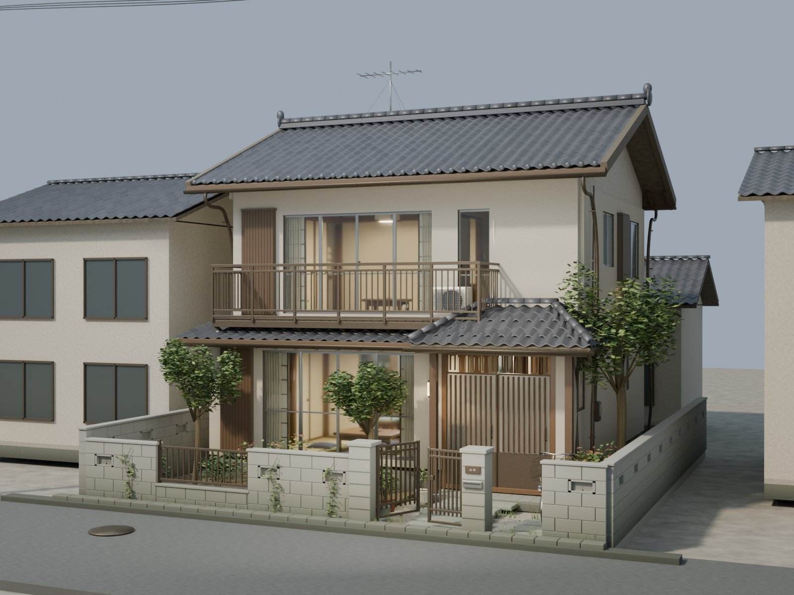
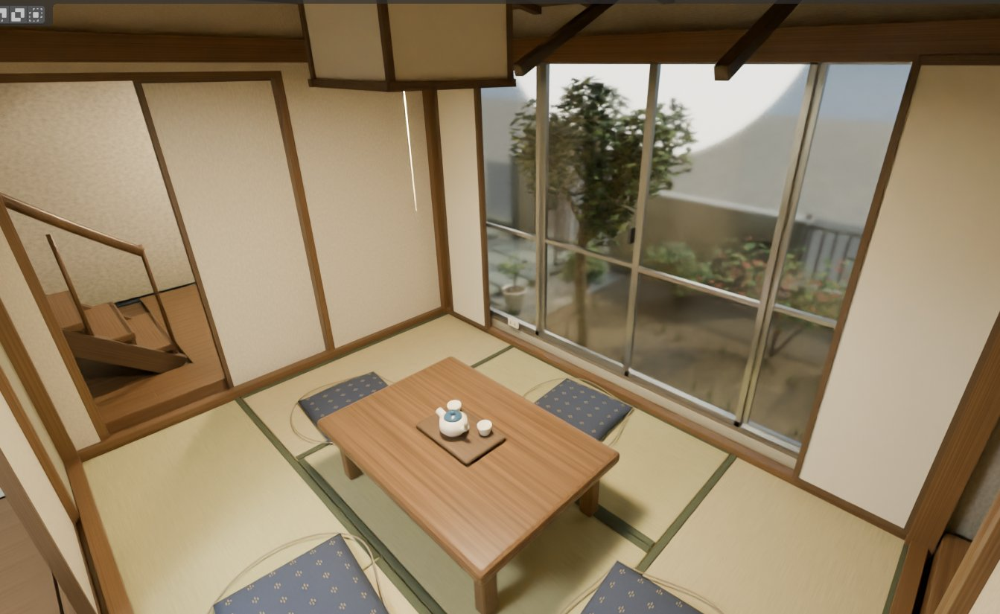
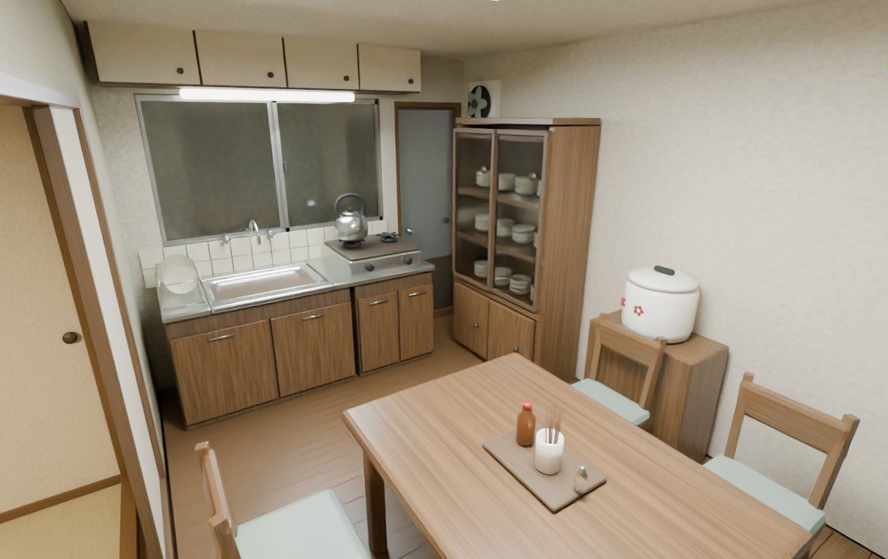
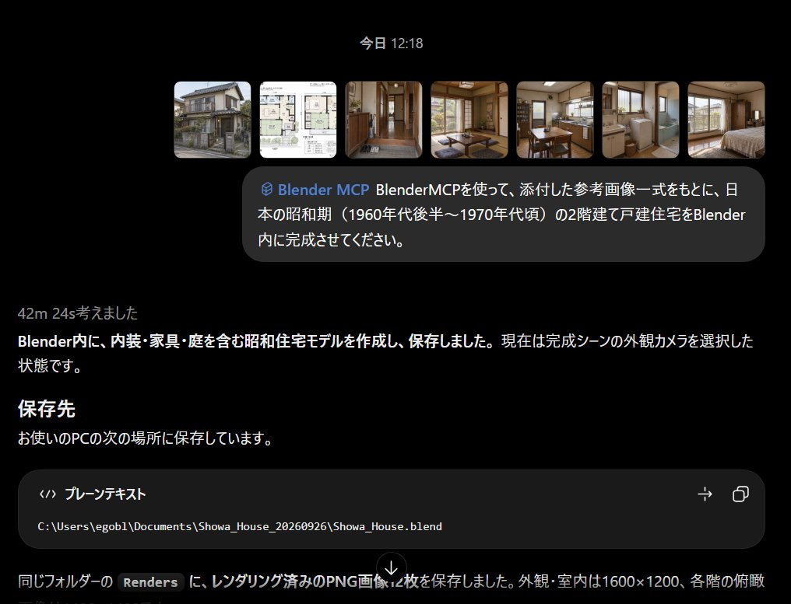

# AstraにBlenderで昭和の日本家屋をモデリングしてもらった。ただし、CodexじゃなくてChatで。セキュアMCPTunnelって機能でWebのChatGPTから僕の手元のPCのBlenderをMCPで操作できます。チャットのProでワンショット42分間作業してくれました。Pro200ドルプランなら1週間あたり200回Proとチャット出来ます。つまり
> Source: https://x.com/umiyuki_ai/status/2103729495618281838
> Author: うみゆき@AI研究 (@umiyuki_ai)
> Posted: 2026-09-26T06:12:51+00:00
> Captured: 2026-10-15T09:02:28+00:00
> Stats at capture: 407,620 views · 1,730 likes · 12 replies · 176 reposts · 1,886 bookmarks · 26 quotes

## Post

AstraにBlenderで昭和の日本家屋をモデリングしてもらった。ただし、CodexじゃなくてChatで。セキュアMCPTunnelって機能でWebのChatGPTから僕の手元のPCのBlenderをMCPで操作できます。チャットのProでワンショット42分間作業してくれました。Pro200ドルプランなら1週間あたり200回Proとチャット出来ま

## Media

 — Post media 1. Source media: https://pbs.twimg.com/media/HTHvaCga0AAPK0s.jpg?name=orig
 — Post media 2. Source media: https://pbs.twimg.com/media/HTHv4b3agAE6Gb3.jpg?name=orig
 — Post media 3. Source media: https://pbs.twimg.com/media/HTHv-DXbMAAcZqh.jpg?name=orig
 — Post media 4. Source media: https://pbs.twimg.com/media/HTHyNbDboAAEjll.jpg?name=orig
[Reply 2103816838140535216 media 1](media/video-01.mp4) — Source media: https://video.twimg.com/amplify_video/2103815517551382528/vid/avc1/1920x1080/ujg7uXxsdBgv4Gw4.mp4?tag=29

## Comments

### 平山秀樹@成田のふるさとづくり、街づくり、建物づくり ([@hidekihirayama](https://x.com/hidekihirayama/status/2103779383043653809)) — 2026-09-26T09:31:05+00:00

@umiyuki_ai ChatGPTが間取り図すら描けなかった三年目前とは世界線が違うんじゃないかと思うほどの進化ですね！

https://t.co/VKri8VZwyA
### ShadowAguy ([@shadowaguy](https://x.com/shadowaguy/status/2103743726405476838)) — 2026-09-26T07:09:24+00:00

@umiyuki_ai 42 minutes is the demo. Did it survive a Blender crash or a bad intermediate step, or was this one carefully staged path with manual rescue?
### 돌아온 시바이누 ([@82korea77](https://x.com/82korea77/status/2103816838140535216)) — 2026-09-26T11:59:55+00:00

@umiyuki_ai 이미 이렇게쓰고있지요 https://t.co/jJcPlP1dID
 — Source media: https://video.twimg.com/amplify_video/2103815517551382528/vid/avc1/1920x1080/ujg7uXxsdBgv4Gw4.mp4?tag=29
### oh Chadol ([@OhChadol](https://x.com/OhChadol/status/2103756703829500236)) — 2026-09-26T08:00:58+00:00

@umiyuki_ai Wow, can the quality really be this good?
### KnowAI ([@AIBVOTE](https://x.com/AIBVOTE/status/2103849116522672378)) — 2026-09-26T14:08:11+00:00

@umiyuki_ai 貴重な情報ありがとうございます！早速試したいです。
### Rin | AI大好き道産子 ([@WBXOw1lLVG14621](https://x.com/WBXOw1lLVG14621/status/2103760756533813701)) — 2026-09-26T08:17:04+00:00

@umiyuki_ai 素晴らしい！
### InsomniaLK ([@InsomniaLK](https://x.com/InsomniaLK/status/2103766537178108397)) — 2026-09-26T08:40:03+00:00

@umiyuki_ai That Secure MCP Tunnel is a game-changer running Blender from your browser like that? Genius.
### Jeremy Bosma ([@jeremybosma_](https://x.com/jeremybosma_/status/2103771119849177120)) — 2026-09-26T08:58:15+00:00

@umiyuki_ai the local bridge changes the ceiling
### Karthik Varma ([@Karthikvarmamkv](https://x.com/Karthikvarmamkv/status/2103785683525718380)) — 2026-09-26T09:56:08+00:00

@umiyuki_ai @umiyuki_ai @ChatGPT For that Blender run, did Secure MCP Tunnel keep file I/O local the whole 42 minutes?

## Other returned timeline records

> The CLI did not expose reply relationships. These records do not start with a reply mention and were authored by someone other than the saved-post author. They may include recommendations or promoted posts; they are retained as source context, not verified replies.

### Starlink ([@Starlink](https://x.com/Starlink/status/2068115197718593741)) — 2026-06-19T23:34:21+00:00

Get connected with fast, reliable internet for streaming, video calls, online gaming and more.

Order online in minutes.
