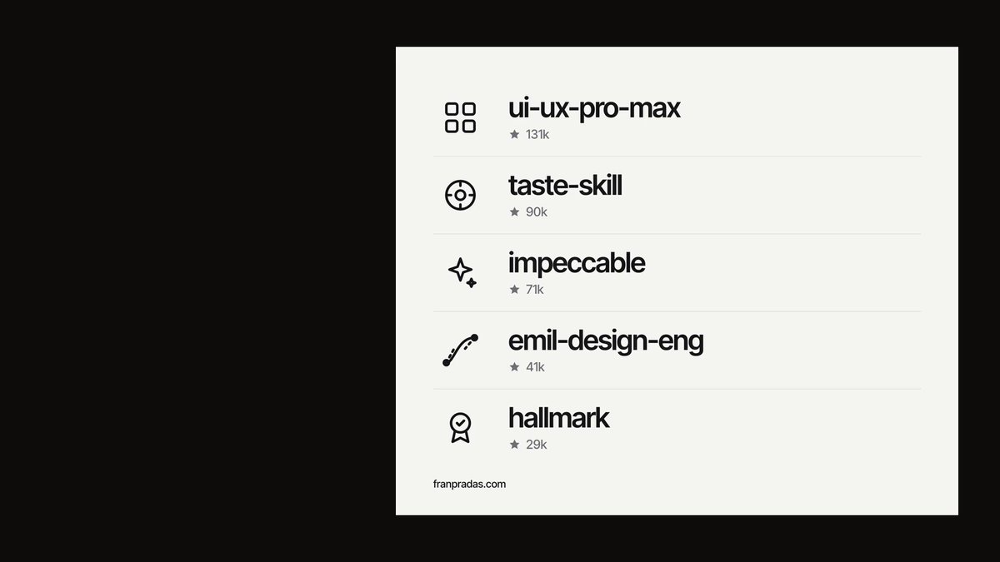
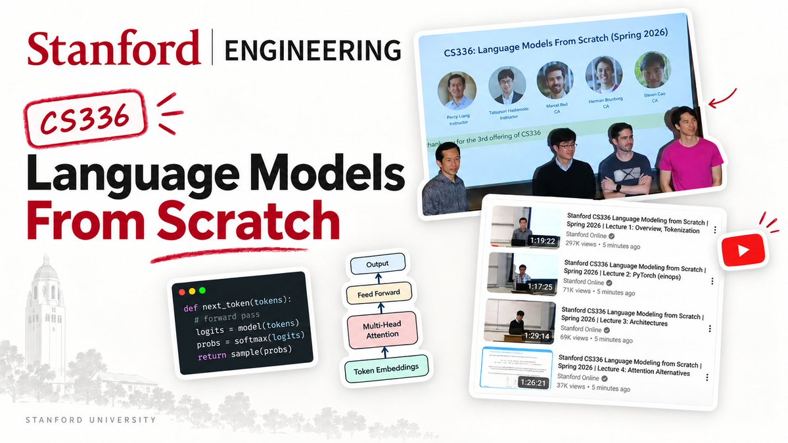

# 🔴 TU PAGINA WEB HECHA CON IA DA ASCO
> Source: https://x.com/franpradasAI/status/2103795257154687192
> Author: Fran Pradas | Ingeniero de IA (@franpradasAI)
> Posted: 2026-09-26T10:34:10+00:00
> Captured: 2026-10-15T09:02:28+00:00
> Stats at capture: 20,056 views · 310 likes · 3 replies · 44 reposts · 438 bookmarks · 0 quotes

## Post

🔴 TU PAGINA WEB HECHA CON IA DA ASCO

Haz que se vea x1000 veces mejor así: ↓↓

## Media

[Post media 1](media/video-01.mp4) — Source media: https://video.twimg.com/amplify_video/2103795230361427968/vid/avc1/1280x720/hyIGpDDYsKlrzzUZ.mp4?tag=16
 — Post media 1 thumbnail. Source media: https://pbs.twimg.com/amplify_video_thumb/2103795230361427968/img/Uve2PhpXJ3ZE5Tf6.jpg
 — Reply 2110355848669147420 media 1. Source media: https://pbs.twimg.com/media/HUl9dPfXYAAawfE.jpg
 — Reply 2110370591039443228 media 1. Source media: https://pbs.twimg.com/media/HUmK3ZjXoAAvUdN.jpg
 — Reply 2110560542230270113 media 1. Source media: https://pbs.twimg.com/media/HUnCFHeWsAApon8.jpg

## Thread

### Fran Pradas | Ingeniero de IA ([@franpradasAI](https://x.com/franpradasAI/status/2103795268953252284)) — 2026-09-26T10:34:13+00:00

1️⃣ Instala skills de diseño

Te ayudará a que la IA haga diseños más atractivos.

Usa estos:
→ ui-ux-pro-max
→ taste-skill
→ impeccable
→ emil-desing-eng
→ hallmark
### Fran Pradas | Ingeniero de IA ([@franpradasAI](https://x.com/franpradasAI/status/2103795281393521120)) — 2026-09-26T10:34:16+00:00

2️⃣ Copia componentes con su prompt

Hay varias páginas webs donde encuentras componentes o secciones de páginas web y copias los estilos con un prompt.

Usa estas:
→ 21st
→ Magic UI
→ React Bits
→ Aceternity UI
→ shadcn/ui
### Fran Pradas | Ingeniero de IA ([@franpradasAI](https://x.com/franpradasAI/status/2103795293150232602)) — 2026-09-26T10:34:19+00:00

3️⃣ Copia otras webs

Haz capturas de otras páginas y copia su HTML desde el inspector de elementos.

Luego usa este prompt:

"Te adjunto una captura y el HTML de una sección de otra web. Reproduce su distribución, jerarquía y espaciado con mi contenido, mis colores y mi tipografía. No copies textos, imágenes ni marca. Usa mis componentes existentes cuando encajen."
### Fran Pradas | Ingeniero de IA ([@franpradasAI](https://x.com/franpradasAI/status/2103795304936186177)) — 2026-09-26T10:34:21+00:00

4️⃣ Pide ideas a ChatGPT

Usa este prompt:

"Dame tres propuestas de interfaz para esta sección, como imagen, una por mensaje. Público: [quién la usa]. Contenido: [qué muestra]. Acción principal: [el botón]. Estilo: sobrio, sin degradados ni tarjetas genéricas, tipografía grande, mucho espacio."
### Fran Pradas | Ingeniero de IA ([@franpradasAI](https://x.com/franpradasAI/status/2103795316906672567)) — 2026-09-26T10:34:24+00:00

5️⃣ Anima con Motion o GSAP

Son librerías que te ayudan a que tu página web se vea más interactiva y fluida.

Usa este prompt:

"CSS para hover y cambios pequeños, Motion para entradas y cambios de estado en React, y GSAP con ScrollTrigger solo para una escena ligada al scroll. Transiciones de 200 a 400 ms, sin rebote. Una sola animación protagonista en la primera pantalla."
### Fran Pradas | Ingeniero de IA ([@franpradasAI](https://x.com/franpradasAI/status/2103795328667484581)) — 2026-09-26T10:34:27+00:00

6️⃣ Vídeo ligado al scroll

Esto es super fácil de hacer y hace que la web quede mucho más chula.

Te descargas un video (Pexels) o lo haces tú con IA (Runway o KlingAI)

Luego dale el vídeo al agente y pide que su avance vaya ligado al scroll.

"Reproducir al aparecer" y "controlar con el scroll" son efectos distintos: pide el segundo. Y una imagen fija para móvil y para quien tiene reducido el movimiento.
### Fran Pradas | Ingeniero de IA ([@franpradasAI](https://x.com/franpradasAI/status/2103795340369682644)) — 2026-09-26T10:34:30+00:00

‼️ RECUERDA ‼️

Si te gusta aprender sobre IA, subo mi mejor contenido en Instagram.

SÍGUEME: ↓↓↓↓

https://t.co/RRdnKh4N6c

## Comments

### hagotuweb.es ([@hagotuweb_es](https://x.com/hagotuweb_es/status/2104150737726943590)) — 2026-09-27T10:06:43+00:00

@franpradasAI Lo que más cambia, para mí: pasarle una web real que te guste como referencia y pedirle que copie el espaciado y la tipografía, no los colores. Y después quitar la mitad de los degradados 😅
### Sergio G. Gómez ([@esdotge](https://x.com/esdotge/status/2103914366534103255)) — 2026-09-26T18:27:28+00:00

@franpradasAI 0. Llama a @wearefloc

## Other returned timeline records

> The CLI did not expose reply relationships. These records do not start with a reply mention and were authored by someone other than the saved-post author. They may include recommendations or promoted posts; they are retained as source context, not verified replies.

### Starlink ([@Starlink](https://x.com/Starlink/status/2068115197718593741)) — 2026-06-19T23:34:21+00:00

Get connected with fast, reliable internet for streaming, video calls, online gaming and more.

Order online in minutes.
### Miguel Ángel Durán ([@midudev](https://x.com/midudev/status/2110355848669147420)) — 2026-10-14T13:03:37+00:00

La universidad de Stanford ha publicado su curso completo para crear tus propios modelos de IA.

✓ 18 vídeos con audio en Español
✓ Python, PyTorch y Machine Learning
✓ Tokenizar, datos, inferencia, post-entrenamiento

https://t.co/tmVIt65Iny https://t.co/gLgTj9ao5m
 — Source media: https://pbs.twimg.com/media/HUl9dPfXYAAawfE.jpg
### Brais Moure ([@MoureDev](https://x.com/MoureDev/status/2110370591039443228)) — 2026-10-14T14:02:12+00:00

Mañana jueves... Taller de Pi desde cero en directo!

Vamos a aprender a utilizar Pi, el agente con IA para programación del que tanto se está hablando. La alternativa minimalista, open-source, ligera y extensible a Claude Code, Codex y OpenCode.

18h España → https://t.co/DO9AVzDMf4
 — Source media: https://pbs.twimg.com/media/HUmK3ZjXoAAvUdN.jpg
### Maximiliano Firtman ([@maxifirtman](https://x.com/maxifirtman/status/2110480091922719140)) — 2026-10-14T21:17:19+00:00

El principito en aventura gráfica 3D hecha con Claude en dos semanas.
### Earth ([@earthcurated](https://x.com/earthcurated/status/2110560542230270113)) — 2026-10-15T02:37:00+00:00

As long as you’re trying to do better, better days will come.

You don’t need to have everything figured out. Just keep showing up, learning and moving forward.

Some days, simply not giving up is progress.

Be patient with yourself. The effort you’re putting in today will make a difference tomorrow.
 — Source media: https://pbs.twimg.com/media/HUnCFHeWsAApon8.jpg
