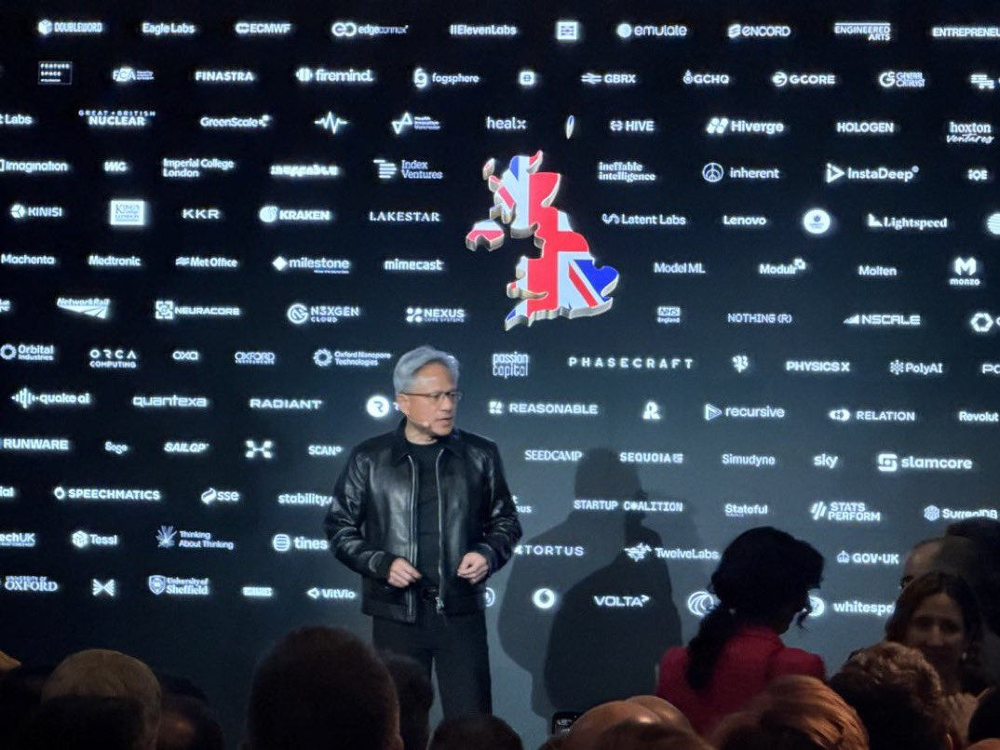
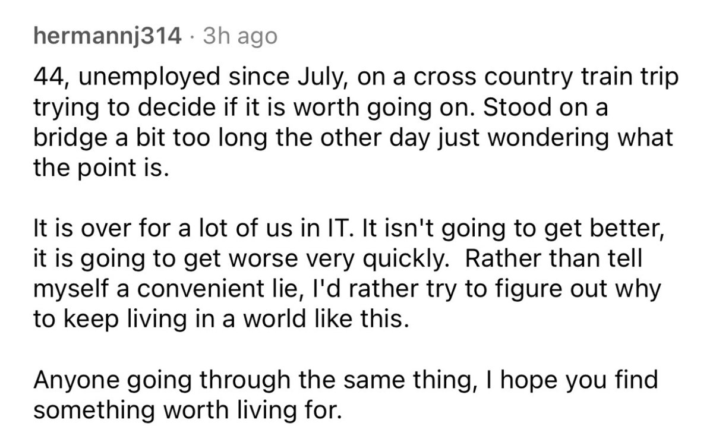
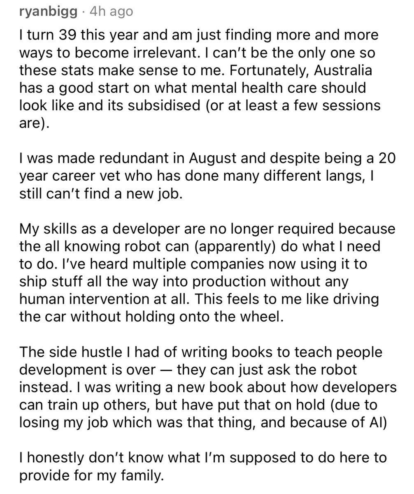
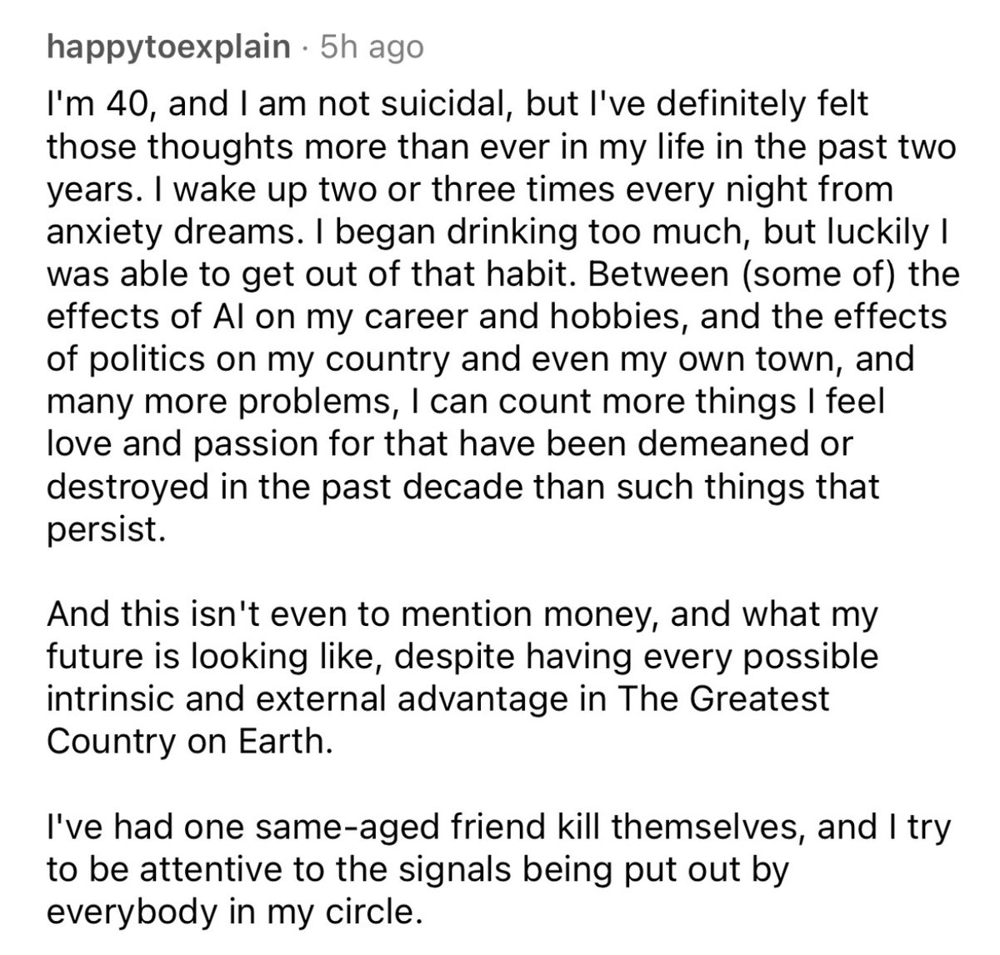

# Here's every free AI credit you can grab right now ↓
> Source: https://x.com/suraj_sharma14/status/2103854606069751880
> Author: Suraj Sharma (@suraj_sharma14)
> Posted: 2026-09-26T14:30:00+00:00
> Captured: 2026-10-15T09:02:28+00:00
> Stats at capture: 4,667 views · 51 likes · 7 replies · 8 reposts · 60 bookmarks · 1 quotes

## Post

Here's every free AI credit you can grab right now ↓

1/ Claude Code cloud sessions: $100–$250
Existing Claude subscribers get a one-time credit.
- $100 on Pro, $250 on Max
- Run /claim-credit in the CLI or claim at http://claude.ai/code
- GitHub must be connected
- Deadline: Oct 7
Cloud sessions keep Claude Code working even when your laptop is closed.

2/ Gemini API free tier: $0, no card
- Current Flash models, free in Google AI Studio
- No credit card needed
- The free tier doesn't expire
Best free way to prototype an AI app today.

3/ Google for Startups Cloud: up to $350K
- $2,000 if you're early and not funded yet (working MVP, founded in the last 24 months)
- Up to $200K for funded startups
- Up to $350K for AI-first startups
- Covers Gemini + Gemma
http://cloud.google.com/startup

4/ Microsoft for Startups: $1,000 to $5,000+
- $1,000 to start, $4,000 more after business verification
- Much more if you're investor-backed
- Credits work on Azure OpenAI models
The easiest way to run OpenAI models without paying upfront.

5/ OpenAI startup credits via Ramp: up to $2,500
- OpenAI's own credits only come through partner VCs
- No VC? Ramp customers can get up to $2,500 in API credits

Most builders pay for AI tools they could be using for free.
Claim the Claude one first. It's the only one with a hard deadline.

Bookmark this + send it to a builder who's still paying full price.

## Media

 — Reply 2103912278731149431 media 1. Source media: https://pbs.twimg.com/media/HTKZBncbcAAyoNg.jpg
[Reply 2110400987622265232 media 1](media/video-01.mp4) — Source media: https://video.twimg.com/amplify_video/2110248922111528961/vid/avc1/1820x1024/b3oPOkybBzhFW3mK.mp4?tag=29
 — Reply 2110441018113904772 media 1. Source media: https://pbs.twimg.com/media/HUnK67SXEAAUQAW.jpg
 — Reply 2110441018113904772 media 2. Source media: https://pbs.twimg.com/media/HUnK67MXMAAK7SU.jpg
 — Reply 2110542006124748814 media 1. Source media: https://pbs.twimg.com/media/HUomw8VbYAADMBm.jpg
 — Reply 2110542006124748814 media 2. Source media: https://pbs.twimg.com/media/HUomxH9a0AAySgP.jpg
 — Reply 2110542006124748814 media 3. Source media: https://pbs.twimg.com/media/HUomxSKacAA_WVu.jpg
 — Reply 2110414696037716372 media 1. Source media: https://pbs.twimg.com/media/HUmxH1EXsAAXxld.jpg
 — Reply 2110414696037716372 media 2. Source media: https://pbs.twimg.com/media/HUmxN20WgAAslAn.jpg
 — Reply 2110414696037716372 media 3. Source media: https://pbs.twimg.com/media/HUmxT7oXgAAM8_I.jpg

## Thread

### Suraj Sharma ([@suraj_sharma14](https://x.com/suraj_sharma14/status/2103865792483959115)) — 2026-09-26T15:14:27+00:00

@kepochnik 👍
### Suraj Sharma ([@suraj_sharma14](https://x.com/suraj_sharma14/status/2103868269199511984)) — 2026-09-26T15:24:18+00:00

@LlaMistral @AnthropicAI Why you commented this here lol
### Suraj Sharma ([@suraj_sharma14](https://x.com/suraj_sharma14/status/2103876376902467974)) — 2026-09-26T15:56:31+00:00

@ailearnerlf claim the offers
### Suraj Sharma ([@suraj_sharma14](https://x.com/suraj_sharma14/status/2103914965929426956)) — 2026-09-26T18:29:51+00:00

@yashkavaiya 👍

## Comments

### kepo ([@kepochnik](https://x.com/kepochnik/status/2103863227453145534)) — 2026-09-26T15:04:15+00:00

@suraj_sharma14 easy +$250 

thanks bro
### Mixtralmine ([@LlaMistral](https://x.com/LlaMistral/status/2103867388827521053)) — 2026-09-26T15:20:48+00:00

@suraj_sharma14 Claude sonnet 5 auto disabled my account since last 2 months while I was using Claude code , I have submitted an appeal for a Human review but nothing yet still be done, no feedback. Please any way out here?

@AnthropicAI
### Aziz Rehman ([@ailearnerlf](https://x.com/ailearnerlf/status/2103875384374874453)) — 2026-09-26T15:52:34+00:00

@suraj_sharma14 Interested
### Yash Kavaiya ([@yashkavaiya](https://x.com/yashkavaiya/status/2103912278731149431)) — 2026-09-26T18:19:10+00:00

@suraj_sharma14 Finally got it Thanks for post https://t.co/oJSxFaVauA
 — Source media: https://pbs.twimg.com/media/HTKZBncbcAAyoNg.jpg

## Other returned timeline records

> The CLI did not expose reply relationships. These records do not start with a reply mention and were authored by someone other than the saved-post author. They may include recommendations or promoted posts; they are retained as source context, not verified replies.

### Daanish Khazi ([@bertgodel](https://x.com/bertgodel/status/2110400987622265232)) — 2026-10-14T16:02:59+00:00

We are releasing Ultramarine 1 Flash, a frontier-class model built for knowledge work. It is open-source and achieves similar performance to Fable 5, while being 60x cheaper.

It was post-trained by a team of 5 for ~$300k all-in. Available on API now, with weights releasing in 2 weeks.
 — Source media: https://video.twimg.com/amplify_video/2110248922111528961/vid/avc1/1820x1024/b3oPOkybBzhFW3mK.mp4?tag=29
### Matt Turck ([@mattturck](https://x.com/mattturck/status/2110441018113904772)) — 2026-10-14T18:42:03+00:00

Twitter: “Europe is done.  No AI there”

Jensen: https://t.co/MIwlK0h066
 — Source media: https://pbs.twimg.com/media/HUnK67SXEAAUQAW.jpg
 — Source media: https://pbs.twimg.com/media/HUnK67MXMAAK7SU.jpg
### Paras Chopra ([@paraschopra](https://x.com/paraschopra/status/2110542006124748814)) — 2026-10-15T01:23:20+00:00

This hacker news thread is absolutely heart-breaking.

Whoever thinks “humans will find a way” ought I read it. https://t.co/nxzLm0nQnn
 — Source media: https://pbs.twimg.com/media/HUomw8VbYAADMBm.jpg
 — Source media: https://pbs.twimg.com/media/HUomxH9a0AAySgP.jpg
 — Source media: https://pbs.twimg.com/media/HUomxSKacAA_WVu.jpg
### GREG ISENBERG ([@gregisenberg](https://x.com/gregisenberg/status/2110414696037716372)) — 2026-10-14T16:57:27+00:00

I spent 48 hours in SF hanging out with billionaires, data labs and AI founders and execs running $1B to $100B companies.

My observations:

1. Sooo MANY stories of data brokers making like $2M a WEEK selling company data to labs. I can't tell if it's the beginning or a bubble, and I kept wondering which niches are left. Digging into it actively.

2. At dinner, someone asked the table, "If a new model drops next month, does your company get better or worse?" HALF the table went quiet! I think that's the best question to ask about any AI startup right now.

3. The bar people talk about now is hitting $1B in revenue in 12 months (I guess that's the new unicorn?). What I didn't hear much about is retention. AI revenue can come in fast and leave fast, and I think we're going to see a lot of stories of AI companies with huge revenue and terrible retention.

4. It's pretty clear we're living through the reinvention of the computer. The model is the CPU, the harness is the operating system, and skills and plugins are the apps. Thinking about it that way makes it easier to see where the whitespace is.

5. We're maybe 12 months from an agent that can watch you work for a week and then do your job without any instructions. The screen recording plus agent memory plus local model combination makes this possible right now.

6. Agent harnesses feel like the new GPT wrappers, in a good way, especially vertical ones. The best teams I talked to treat the model as swappable. One founder walked me through routing different models to different jobs: one for taste and visuals, a cheaper one for the everyday stuff, another for text. 

They use prompts they can move across models over fine-tuning, and A/B test the output on what users actually do with it: do they edit it, export it, share it? A vertical harness is basically four things: the connectors for that industry's data, evals written by people who know the work, rules for what the agent can and can't touch, and a clean screen for a human to review. The model is maybe 20% of it.

7. There's a lot of reverse engineering going on/cloning going on more than I've ever seen. People are decompiling software and rebuilding it with agents, and someone showed a suite of like 10 apps that are worth $5B+ each all that he cloned open source. Me and everyone are still thinking through what it means when software gets this easy to copy.

8. My guess is the value moves to data. If the software can be rebuilt quickly, what's worth paying for in a legacy SaaS company is the years of customer data and workflows inside it. Some SaaS companies are secretly data companies. 

Gets me thinking about how do you truly value data for this saas companies? Like if we were buying these dying saas companies at 2x ARR before (as example), maybe there is a better metric. Idk, just thinking out loud here.

9. It feels like a good chunk of legacy software won't make it to the agentic era, especially anything built around people clicking through a lot of screens.

10. Every company I talked to wants to pipe its internal data into one place and expose it to agents through MCP. Then they look at the data and realize it's a mess: five versions of the same customer, old Slack channels, PDFs nobody can search. Cleaning that up feels like a big consulting opportunity!

11. A lot of founders are building the basic building blocks for agents: APIs, data layers and tools. Some of the companies I saw barely have a UI because the main user is an agent. I really believe the startups that build primitives to this agentic era will do extremely well. Building blocks is the best way to think about it.

12. Labs can get plenty of training data, but it's harder to get real examples of agents failing inside companies. Whoever has those logs has something valuable.

13. Someone running a big consumer company told me the next fight is over memory. The model that remembers the most about you wins, and the smartest model matters less than people think.

14. Physical AI came up a lot. Astra I think was the first model that got people into AI can actually do CAD, and I think a lot of people are thinking what does vibe manufacturing really look like. The line I keep thinking about came from a robotics founder: the hardest problems in AI are deployment problems now, not research problems. Their robots work on their own, call a human when they get stuck, and every one of those calls becomes training data.

15. Cybersecurity companies are having a moment and are actually cool companies to build now, especially the ones that clean up after a breach. Every agent with access to your systems is a new door into your company, and a lot of those doors were left open. 

16. Some startups are worth more dead than alive now. A shutdown company with 5 years of Slack, email and code can get paid for licensing all of it. I wouldn't be surprised if founders start factoring that into when they shut down.

17. People are starting to talk about monetizing the agent web. It feels really early, but when the most popular user of the internet is an agent, what startups should you be building?

18. I think agent insurance is coming. Once an agent makes an expensive mistake, insurers will want audits before they cover anyone.

19. Several people said the hire they want most is someone with taste who can write evals. The models are getting good at generating ideas, so the hard part is judging which ones are good.

20. New trend I observed: startup raises VC, uses venture dollars to become a creator, startup fails, founder falls back on being a full-time creator and incubates other products bootstrapped.

21. Getting SIGNIFICANT distribution is HARD right now. Founders are sponsoring buses, buying billboards like crazy and throwing parties with famous DJs to get noticed. Kinda feels dotcom era in that sense. 

Attention is what's scarce! The growth guy going viral sharing his UGC strategy from Wispr Flow is a good example. It's the sauce everyone wants, and I truly believe there are probably only 50 people on the planet who know how to scale these types of businesses efficiently in this era.

Always good to get that dose of SF. I felt sooo lucky to have such an incredible trip during such an incredible time in building businesses. Surreal in so many ways. 

Happy to be home and locked in.

Until next time!
 — Source media: https://pbs.twimg.com/media/HUmxH1EXsAAXxld.jpg
 — Source media: https://pbs.twimg.com/media/HUmxN20WgAAslAn.jpg
 — Source media: https://pbs.twimg.com/media/HUmxT7oXgAAM8_I.jpg

## Links

- https://claude.ai/code
- http://claude.ai/code
- http://cloud.google.com/startup
