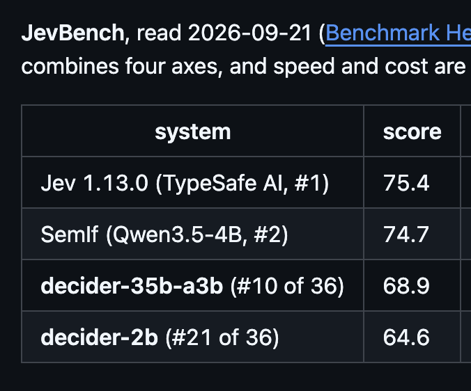

# An open source Jev (https://t.co/6JMiDBU9us) scored higher than Jev itself on JevBench.
> Source: https://x.com/digitalix/status/2103876355536654710
> Author: Alex Ziskind (@digitalix)
> Posted: 2026-09-26T15:56:25+00:00
> Captured: 2026-10-15T09:02:28+00:00
> Stats at capture: 30,651 views · 544 likes · 21 replies · 40 reposts · 595 bookmarks · 2 quotes

## Post

An open source Jev (https://github.com/Mapika/decider) scored higher than Jev itself on JevBench.

## Media

 — Reply 2104076819473502333 media 1. Source media: https://pbs.twimg.com/media/HTMup7uW4AAbDtU.png
 — Reply 2103915263162806518 media 1. Source media: https://pbs.twimg.com/media/HTKbVTEWQAAsAC2.jpg
 — Reply 2104187391644934516 media 1. Source media: https://pbs.twimg.com/media/HTOTR0jX0AANmJG.png

## Comments

### Florian S ([@airesearch12](https://x.com/airesearch12/status/2104311743702823365)) — 2026-09-27T20:46:30+00:00

@digitalix Yes. But it's complicated.

I'd appreciate everyone to read the whole story.

* author of JevBench here
### Sadok ([@yesadok](https://x.com/yesadok/status/2104313310644769067)) — 2026-09-27T20:52:44+00:00

@digitalix nothing like getting outscored on your own test
### Khaled ([@kzack91](https://x.com/kzack91/status/2104076819473502333)) — 2026-09-27T05:13:00+00:00

@digitalix interesting... https://t.co/wNnM8YNoLH
 — Source media: https://pbs.twimg.com/media/HTMup7uW4AAbDtU.png
### 0xNeoArch ([@0xNeoArch](https://x.com/0xNeoArch/status/2103911142586216578)) — 2026-09-26T18:14:39+00:00

@digitalix nice! thanks for sharing!
### nah ([@nahcmonpls](https://x.com/nahcmonpls/status/2103914542854271139)) — 2026-09-26T18:28:10+00:00

@digitalix I am always sceptical of results like this because it is very easy to benchmax a model on specific benchmarks and no offense but "Mapika" isn't exactly a famous or reputable name in the AI space.
### Dizzzank ([@dank0296](https://x.com/dank0296/status/2104001680442298543)) — 2026-09-27T00:14:25+00:00

@digitalix There is also Laya as well but you have to train it up.
### Abiram ([@abiram028](https://x.com/abiram028/status/2104199176720662592)) — 2026-09-27T13:19:12+00:00

@digitalix Nice going to use it as a router
### Ethan ([@ethanromero](https://x.com/ethanromero/status/2103977426053443603)) — 2026-09-26T22:38:03+00:00

@digitalix But does it work out of the box? Cause JEV is a pain in the @$$ to get set up.
### John Baima ([@JohnBaima](https://x.com/JohnBaima/status/2103899097585557635)) — 2026-09-26T17:26:48+00:00

@digitalix Excellent! Jev is a great idea but many businesses and people will want local.
### Mathias Heinke ([@ares_mheinke](https://x.com/ares_mheinke/status/2103926389502353755)) — 2026-09-26T19:15:14+00:00

@digitalix Fine print on JevBench v1.4.2: decider-4b v2 takes #1 on the composite, but Jev still out-reasons it (Intelligence 53.1 vs 49.4) and is better calibrated. The 4B wins on speed and cost. For a local decision router that's exactly the trade I'd take ;)
### Vikas ([@vikasdfghjl](https://x.com/vikasdfghjl/status/2103901874839773356)) — 2026-09-26T17:37:50+00:00

@digitalix did you check laya?
### Ahmed Ibrahim Hamdy ([@AhmedHamdy29189](https://x.com/AhmedHamdy29189/status/2103883512969400653)) — 2026-09-26T16:24:52+00:00

@digitalix Thats what I am talking about :) open source and open weight that can be fine tuned. Thanks for sharing.
### Alex Zhang ([@lzhzhng299565](https://x.com/lzhzhng299565/status/2103995321860972847)) — 2026-09-26T23:49:09+00:00

@digitalix Nice bro! I also make a better Jev-like model called decily, you could have a try! https://t.co/TZ8CqVD514
### Funky Beats ([@Luana1372](https://x.com/Luana1372/status/2103909011359969417)) — 2026-09-26T18:06:11+00:00

@digitalix Okay who will be first to make a knockoff and call it JEW
### Lord Iskandar ([@Lord_iskandar](https://x.com/Lord_iskandar/status/2103908627358855299)) — 2026-09-26T18:04:40+00:00

@digitalix use KEV
### Feed Latency ([@arbscannernyc](https://x.com/arbscannernyc/status/2104640939646136720)) — 2026-09-28T18:34:37+00:00

@digitalix benchmark containing its own subject, open copy beats the original. every eval gets gamed eventually, this is just the fastest version of it.
### Chen ([@chenzhangreal](https://x.com/chenzhangreal/status/2103896583649611881)) — 2026-09-26T17:16:48+00:00

@digitalix the open source clone beating the original on its own benchmark is chef's kiss chaotic energy
### Lucas ([@Livvux](https://x.com/Livvux/status/2104187391644934516)) — 2026-09-27T12:32:22+00:00

@digitalix tf https://t.co/2esnexPqgB
 — Source media: https://pbs.twimg.com/media/HTOTR0jX0AANmJG.png

## Other returned timeline records

> The CLI did not expose reply relationships. These records do not start with a reply mention and were authored by someone other than the saved-post author. They may include recommendations or promoted posts; they are retained as source context, not verified replies.

### Kneeanderthul ([@kneeanderthul](https://x.com/kneeanderthul/status/2104026763475259665)) — 2026-09-27T01:54:05+00:00

Here's the real story bro 

JEV was made A YEAR before the JEV that as made popular was released 

Yes, you read that right, one whole year. 

By a man named @Nandakishorm1 

His model was called Laya and it was open source back then 

All the research publish, model published and it wasn't until now people find it

What's even more impressive is he had open documents on how you can improve it for YOUR needs every time 

Worth looking into my G. I know you're not a slouch for the truth
### Starlink ([@Starlink](https://x.com/Starlink/status/2068115197718593741)) — 2026-06-19T23:34:21+00:00

Get connected with fast, reliable internet for streaming, video calls, online gaming and more.

Order online in minutes.
### Starlink ([@Starlink](https://x.com/Starlink/status/2099964624829640835)) — 2026-09-15T20:52:36+00:00

Get fast, reliable home internet for seamless streaming, working from home, gaming, and more across multiple devices.

Order online in minutes.
### Elon Salfati ([@ElonSalfati](https://x.com/ElonSalfati/status/2103915263162806518)) — 2026-09-26T18:31:02+00:00

Another one is coming tomorrow! already first on decision index at 60.42 25% into training (compared to decider-35 at 54.3)
 — Source media: https://pbs.twimg.com/media/HTKbVTEWQAAsAC2.jpg

## Links

- https://github.com/Mapika/decider
