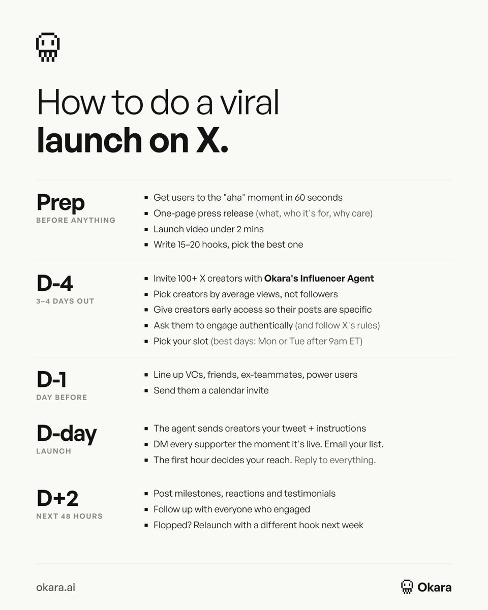

# Our launches have done 100M+ views with no agency and no ad spend
> Source: https://x.com/askOkara/status/2104562076446588937
> Author: Okara (@askOkara)
> Posted: 2026-09-28T13:21:14+00:00
> Captured: 2026-10-15T09:02:28+00:00
> Stats at capture: 7,150 views · 95 likes · 7 replies · 3 reposts · 122 bookmarks · 2 quotes

## Post

Our launches have done 100M+ views with no agency and no ad spend

This is the playbook we follow every time

## Media

 — Post media 1. Source media: https://pbs.twimg.com/media/HTToDAnbMAAWokD.jpg?name=orig
 — Reply 2110414696037716372 media 1. Source media: https://pbs.twimg.com/media/HUmxH1EXsAAXxld.jpg
 — Reply 2110414696037716372 media 2. Source media: https://pbs.twimg.com/media/HUmxN20WgAAslAn.jpg
 — Reply 2110414696037716372 media 3. Source media: https://pbs.twimg.com/media/HUmxT7oXgAAM8_I.jpg

## Thread

### Okara ([@askOkara](https://x.com/askOkara/status/2104563057850798218)) — 2026-09-28T13:25:08+00:00

We wrote the full handbook here: https://t.co/VfByk6eQgF

You can find, brief and pay creators with our influencer agent: https://t.co/A622ZCj5gO
### Okara ([@askOkara](https://x.com/askOkara/status/2104869025486667791)) — 2026-09-29T09:40:56+00:00

@mark_ppc you can check out their rates at okara

https://t.co/O9HytqJXcV

## Comments

### Marek Dąbrowski ([@mark_ppc](https://x.com/mark_ppc/status/2104831945184268332)) — 2026-09-29T07:13:36+00:00

@askOkara From your experience, what % of those influencers might want $$$ for engaging with launch?
### Hifinn ([@liuhifinn](https://x.com/liuhifinn/status/2104800879048269932)) — 2026-09-29T05:10:09+00:00

@askOkara @grok 把图片内容翻译给我
### Nick Launches ([@nicklaunches](https://x.com/nicklaunches/status/2104900336188379499)) — 2026-09-29T11:45:21+00:00

@askOkara Would love to see the playbook!
### Enid ([@0xenid_](https://x.com/0xenid_/status/2104692487206150365)) — 2026-09-28T21:59:26+00:00

@askOkara Hey team, been following Okara for a while, we are a ai agent / skill marketplace, Okara is a great product and we want to bring it to our platform(maybe an Okara agent or Okara skill?), let me know if you are interested in this!

## Other returned timeline records

> The CLI did not expose reply relationships. These records do not start with a reply mention and were authored by someone other than the saved-post author. They may include recommendations or promoted posts; they are retained as source context, not verified replies.

### Tyler Denk 🐝 ([@denk_tweets](https://x.com/denk_tweets/status/2110371582153748942)) — 2026-10-14T14:06:08+00:00

every week someone tells me they’re going to vibe-code their own @beehiiv alternative over the weekend.

wishing them the best, here’s the backlog of things to make sure to include:

> 99.3% email delivery rate (industry-leading)
> team of deliverability experts with decades of experience
> infrastructure to send 3M+ emails per minute
> validating every single email submission (1st and 3rd party)
> automated bot-detection to prevent spam signups
> registering for every mailbox provider’s feedback program
> ingesting data from said feedback loops and building suppression lists
> tagging every email so gmail reports complaint rates per newsletter
> classifying every bounce (hard, soft, mailbox full, DNS failure) and knowing which ones mean “try again” vs. “never again”
> three layers of suppression: global, per-publication, and transactional
> temporary suppressions that expire on their own, and permanent ones that never do
> one-click unsubscribe, the way gmail and yahoo now require it
> warming new IPs and domains on a schedule
> watching blocklists around the clock, and pulling an IP from rotation the moment it’s listed
> retrying deferred mail for 24+ hours before calling it a bounce
> blocking disposable, invalid, and typo’d addresses before they ever reach the list
> rate limiting every signup endpoint a bot can find
> filtering bot clicks out of every report (something we pay an ungodly amount of money for)
> an acquisition source on every subscriber
> engagement history for every reader, across every post
> multiple sender addresses for different emails
> custom domain configuration that is aligned with DKIM, SPF, DMARC
> a true WYSIWYG editor: what you write is what lands in the inbox, with no HTML required
> turning that editor into table-based, inline-styled email HTML that holds up in outlook
> real-time collaborative editing, so the whole team can work on the same issue at once
> dynamic content: different sections for different readers, all in a single send
> separate email and web versions of every post, from one draft
> free and premium versions of the same post, split by a paywall break
> merge tags that personalize every email, and a simulated subscriber to preview them before you send
> templates with saved colors, fonts, and spacing, plus a default style for every post
> columns, tables, buttons, blockquotes, sections, file attachments, and a table of contents with anchor links
> native embeds for X, youtube, tiktok, instagram, bluesky, stocktwits, and podcast episodes
> polls, referral blocks, recommendations, and ad slots, built right into the post
> an AI writer, AI images, and a built-in AI agent one keyboard shortcut away
> images resized and optimized automatically, however they’re uploaded
> a live email-size gauge that warns you before gmail clips your newsletter
> custom HTML blocks, cleaned so a stray script tag can’t break your post
> automatically hiding anything an inbox can’t handle (video, iframes, audio) in the email version, while keeping it on the web
> links and embeds made clickable even in outlook, which ignores links wrapped around tables
> vertical alignment in columns, because a layout that looks off by 4px looks broken to readers
> converting your newsletter to audio versions for readers who prefer to listen
> random cohort sends to randomly split your list to test different content and conversion
> slash commands: type “/” and insert any block without touching a menu
> markdown and keyboard shortcuts for people who never want to touch a mouse
> pasting from google docs with the formatting intact
> search and replace across the whole post
> comment threads right in the draft, so editors and writers stop living in google docs
> footnotes and citations that work in the inbox and on the web
> code blocks, for the technical newsletters
> an AI writer that rewrites, translates, and fixes spelling and grammar in place
> autosave, so a closed tab never costs you a draft
> subject line A/B testing, built into the send flow
> drag-and-drop images, from your computer, your media library, or a URL
> rich-text image captions, plus image titles and alt text for accessibility
> audio files that play inline
> file attachments, so a PDF can ride along with the issue
> sections with their own backgrounds, borders, and spacing
> blockquotes with custom borders, colors, and styles
> content breaks and dividers that render cleanly in every inbox
> a REST API for subscribers, posts, segments, automations, and more
> a send API to create and send newsletters programmatically
> creating, updating, and deleting subscribers in real time
> reading and writing custom fields on any subscriber
> tagging subscribers from your own app
> enrolling subscribers into automations via API
> pulling opens, clicks, and engagement for every post
> fetching post HTML rendered for free vs. premium, email vs. web
> creating posts from a template, then appending or prepending content
> fetching segments and every subscriber in them
> managing tiers and premium subscriptions
> pulling referral program data and milestones
> reading poll and survey responses
> pagination that holds up across millions of records
> rate limits that protect the platform without blocking real integrations
> API keys you can create and revoke anytime
> an MCP server so claude, chatgpt, and other AI tools can work inside beehiiv
> drafting and editing posts from an AI chat
> asking for open rates, CTR, and revenue in plain english
> comparing performance across dozens of posts in one request
> looking up any subscriber's full history and engagement
> building segments by describing them
> creating and editing automations
> generating AI images straight into your media library
> managing website pages, redirects, and SEO
> reading and replying to community posts and DMs
> reviewing ad offers and ad revenue reports
> managing podcast shows and episodes
> creating digital products, coupons, and promo codes
> running subscriber growth and earnings reports
> setting up subject line A/B tests
> deliverability by mailbox provider for any post
> searching docs without leaving the chat
> inviting teammates by email
> admin, member, and contributor roles
> admins who control billing, exports, integrations, payments, and domains
> members with full access minus admin permissions
> contributors limited to drafting posts and automations
> roles at the workspace or publication level
> multiple publications under one workspace
> workspace grouping and search for people on multiple teams
> multiple authors per post, with bylines
> guest authors for one-off contributors
> author profiles with bios, avatars, and social links
> community roles mapped to workspace roles (admin, manager, moderator)
> real-time collaboration and comment threads on every draft
> removing access the moment someone leaves
> publication transfers between owners, with written consent
> secure, single-use magic links to log in from desktop
> a no-code website builder on your own custom domain
> an AI website builder that works from plain-english prompts or screenshots
> AI custom elements for live widgets
> drag-and-drop editing, plus HTML access for full control
> site-wide theme tokens for fonts, colors, borders, and shadows
> global navbar, footer, and signup and login modals
> saving sections, blocks, and pages as reusable templates
> version history with one-click restore
> custom pages with their own SEO settings and paywalls
> redirects, so old links never break
> custom robots.txt
> auto-generated meta titles and descriptions for every post
> google news schema
> pages up to 80% faster on largest contentful paint
> image carousels and grids
> youtube blocks that update when you post new videos
> an automatic page for every podcast episode
> pop-ups and gated content to turn visitors into subscribers
> a visual automation builder, no code required
> triggers based on signup source, behavior, purchases, and engagement
> welcome sequences that start the second someone subscribes
> delays and wait steps
> branching logic based on subscriber attributes
> reusable condition sets across automations
> email steps built in the same editor as your newsletter
> webhook steps that call your own systems, with automatic retries
> enrolling subscribers via API
> per-subscriber journey tracking
> opens and clicks for every email in every flow
> editing a draft version while the live automation keeps running
> comparing draft vs. live before you publish changes
> reordering steps in bulk
> segment conditions based on whether an automation started
> product delivery and follow-ups triggered by purchases
> selling files, links, guides, templates, and ebooks
> memberships and time-based products
> 1:1 coaching sessions and appointments
> 0% platform fees on every sale
> a storefront on your beehiiv website
> products sold inside emails and automations
> free products that double as lead magnets
> product variants
> discount codes and promotion codes
> product reviews, with moderation
> product tags for organizing your catalog
> orders dashboard with buyer details
> sales totals per product
> duplicating a product in one click
> automatic delivery the moment someone buys
> payouts through stripe
> live webinars with up to 10,000 attendees
> ticket sales in 10 currencies
> native streaming with video, screen sharing, and chat
> no zoom required
> up to 5 automated reminder emails
> calendar invites sent automatically
> a recording of every session
> selling the replay as its own product
> 0% platform fees on tickets
> free webinars that grow your list
> discount codes on tickets
> 1:1 coaching bookings
> buyers linked to their subscriber profile
> promoting events in your newsletter and on your site
> orders and revenue reporting for every event
> a community built into your newsletter: channels, posts, and comments
> channels that are free or gated to paid tiers
> syncing newsletter posts into the community
> direct messages between you and members
> threaded comments
> pinned posts
> a moderation queue for reported posts and comments
> banning and unbanning members
> admin, manager, and moderator roles
> inviting subscribers, segments, or specific emails
> surfacing your most engaged subscribers to invite first
> community metrics: new members, posts, and activity
> notification emails with your own from name
> channel ordering and a default channel
> luma calendar integration for events
> discord integration that syncs roles with subscription tiers
> native podcast hosting with zero platform fees
> distribution to apple podcasts, spotify, and youtube
> an automatic webpage for every episode
> automatic transcripts
> IAB-standard analytics by country, app, and device
> bot filtering on downloads
> downloads and unique listeners per episode and per show
> private feeds for paying subscribers
> bundling your podcast with your paid subscription
> importing from other hosts with episode GUIDs preserved
> RSS redirects so listeners follow you over
> scheduled episodes
> apple podcasts categories and metadata
> podcast players embedded in your posts
> a full episode library on your site
> webhooks for episode and private-feed events
> segments built on behavior, attributes, and engagement
> dynamic segments that update automatically
> static segments that stay fixed
> filtering by acquisition source, including magic links
> filtering by custom fields and tags
> filtering by subscription tier and paid trial status
> filtering by whether an automation started
> reusable condition sets
> recalculating a segment on demand
> sending to a segment, or excluding one
> segments that power dynamic content inside a single post
> segments as automation conditions
> adding a whole segment to a newsletter list
> multiple newsletter lists in one publication
> exporting any segment
> webhooks for new, confirmed, and deleted subscribers
> upgrade, downgrade, pause, and resume events
> tier created, deleted, paused, and resumed events
> newsletter list subscribe and unsubscribe events
> post sent, scheduled, and updated events
> survey response events
> podcast episode published, updated, archived, and deleted events
> private podcast feed access events
> choosing exactly which events each endpoint receives
> a signing secret on every endpoint
> automatic retries on failed deliveries
> a log of every delivery attempt
> manually retrying any failed message
> disabling an endpoint without deleting it
> versioned payloads
> webhook steps inside automations
> survey forms with multiple question types
> polls that readers answer with one click, right in the inbox
> every answer tied to a real subscriber
> live poll results
> per-question response breakdowns
> aggregate results across every survey
> individual responses you can browse one by one
> webhooks the moment a survey is submitted
> survey and poll data available via API
> polls on the web and in email
> signup flows that send new subscribers through a survey
> surveys that tell you what to write next
> polls for picking topics, products, and pricing
> response data you can turn into segments
> no third-party form tool required
> a library of professionally designed post templates
> custom colors, fonts, and spacing on every template
> a default style applied to every new post
> content outlines baked into templates
> separate email and web styling
> theme design tokens per template
> duplicating templates in one click
> a custom email footer applied to every post
> templates with sponsor slots, referral blocks, and recommendations built in
> creating posts from templates via API
> template changes picked up instantly by API-created posts
> website templates
> saved sections, blocks, and pages for your site
> welcome email templates
> templates your whole team shares
> the largest native ad network for newsletters
> brands like netflix, hubspot, notion, and nike (and 525+ others)
> ads available to claim for your upcoming posts
> dropping an ad into a post with one click
> earnings and payouts reported for every placement
> ad revenue reports post by post
> a history of every opportunity you accepted or declined
> bot-filtered clicks advertisers can trust
> custom link parameters for advertiser attribution
> brand safety review on every campaign
> payouts to your beehiiv wallet
> direct sponsorships: selling your own placements
> sponsorship products with your own formats and pricing
> scheduled sponsor placements with advertiser details
> 0% platform fees on paid subscriptions
> multiple paid tiers
> monthly and annual plans
> free trials
> paid trials, like $1 for 30 days
> metered paywalls, new york times-style
> a paywall break inside any post
> discount offers
> gift subscriptions
> group subscriptions: one buyer, many seats
> custom group deals for teams and companies
> pausing and resuming subscriptions
> private podcast feeds and gated community channels as paid perks
> payouts through stripe connect
> recommendation network with 60K+ active newsletters
> getting recommended by thousands of other newsletters
> free, reciprocal recommendations
> paid recommendations: pay to grow, or get paid to recommend
> discovering newsletters to partner with
> AI-suggested recommendation partners
> applications for paid recommendations, with accept and reject
> engagement and spend insights for every partner
> pausing, resuming, or ending any partnership
> fraud detection on paid recommendations
> clawing back payouts for fake subscribers
> recommendations inside your newsletter, not just at signup
> attribution for every subscriber a partner sends you
> one-click subscribes powered by magic links
> one-click subscribe links, no form needed
> UTM parameters carried through on every link
> rate limiting on every request
> bot detection and honeypots
> a confirmation step only when a click looks suspicious
> double opt-in respected
> redirecting new subscribers straight to your site
> magic links as a filterable acquisition source
> links you can drop into other newsletters, socials, and ads
> login magic links so paid subscribers can read premium posts
> single-use tokens that expire in minutes
> rate limits on login requests
> protection against timing attacks
> logging in on desktop from a link sent to mobile
> faster logins across every beehiiv publication
> embeddable subscribe forms for any website
> full-width, fixed-width, and slim embeds
> an attribution script to track where signups come from
> custom colors, fonts, and styling
> theme design tokens per form
> a draft and publish workflow for form changes
> comparing draft vs. live before publishing
> multiple forms per publication
> custom success behavior: a message or a redirect
> pop-ups on your beehiiv site
> gating posts to subscribers only
> readers picking which newsletter lists to join
> signup flows that run right after subscribing
> bot protection on every submission
> forms that work on wordpress, webflow, and anywhere else
> a customizable link-in-bio page
> hosted on your own beehiiv site and domain
> a subscribe form built in
> your brand colors, fonts, and buttons
> social links for every platform
> links to your latest posts
> links to your products and paid tiers
> a linktree integration that captures newsletter signups
> every visitor a potential subscriber
> traffic from instagram, tiktok, and X turned into owned email subscribers
> visits tracked in your website analytics
> signups tagged with their acquisition source
> mobile-first design
> no third-party link tool required
> updated in seconds, from the same dashboard as everything else
> real-time website analytics, no third-party tools
> traffic by channel
> filters for location, device, OS, and referral source
> website and newsletter analytics in one place
> breakdowns by page, referrer, and more
> custom conditions to slice any report
> AI crawler and bot analytics: what was served vs. blocked
> control over which crawlers can index your site
> UTM tracking on every link
> custom link parameters at the publication level
> an acquisition source on every subscriber
> google analytics integration
> podcast analytics alongside your site
> trends over time
> website traffic connected to the subscribers it produced
> native integrations with linktree, hubspot, manychat, meta, and dozens of other apps
> human support team with a dozen experts ready to assist with whatever you need

oh, and besides having to manage all of this on your own indefinitely forever… your vibe-coded solution will still require paying for and stitching together a ton of software:

> email sending (sendgrid, amazon SES, postmark)
> web hosting (vercel, AWS, render)
> database + queue (supabase, neon, RDS)
> payments (stripe, memberful)
> auth (clerk, auth0, supabase auth)
> monitoring + alerting (sentry, datadog, pagerduty)
> workflow engine (inngest, temporal, upstash qstash)
> bot protection (cloudflare)
> email validation (zerobounce, kickbox)
> email rendering (litmus, email on acid)
> click verification (omnivery)
> media storage + CDN (S3, R2, vercel blob)
> product analytics (posthog, mixpanel)

…but at least you saved $59/mo not paying for @beehiiv anymore 🫡
### Ryan Doser ([@ryan_doser13](https://x.com/ryan_doser13/status/2110471378189312039)) — 2026-10-14T20:42:41+00:00

Lovable is a scam. 

So is Replit, Base44, Framer, and all AI website builders. 

These are for low IQ people who don’t know how to use AI and fall for SaaS marketing gimmicks. 

You are paying a premium for less usage, shittier models, shittier websites, and hand cuffing yourself to a SaaS ecosystem you don’t control. 

A $100/month Claude Max plan (or ChatGPT Pro) is a better solution BY FAR
### GREG ISENBERG ([@gregisenberg](https://x.com/gregisenberg/status/2110414696037716372)) — 2026-10-14T16:57:27+00:00

I spent 48 hours in SF hanging out with billionaires, data labs and AI founders and execs running $1B to $100B companies.

My observations:

1. Sooo MANY stories of data brokers making like $2M a WEEK selling company data to labs. I can't tell if it's the beginning or a bubble, and I kept wondering which niches are left. Digging into it actively.

2. At dinner, someone asked the table, "If a new model drops next month, does your company get better or worse?" HALF the table went quiet! I think that's the best question to ask about any AI startup right now.

3. The bar people talk about now is hitting $1B in revenue in 12 months (I guess that's the new unicorn?). What I didn't hear much about is retention. AI revenue can come in fast and leave fast, and I think we're going to see a lot of stories of AI companies with huge revenue and terrible retention.

4. It's pretty clear we're living through the reinvention of the computer. The model is the CPU, the harness is the operating system, and skills and plugins are the apps. Thinking about it that way makes it easier to see where the whitespace is.

5. We're maybe 12 months from an agent that can watch you work for a week and then do your job without any instructions. The screen recording plus agent memory plus local model combination makes this possible right now.

6. Agent harnesses feel like the new GPT wrappers, in a good way, especially vertical ones. The best teams I talked to treat the model as swappable. One founder walked me through routing different models to different jobs: one for taste and visuals, a cheaper one for the everyday stuff, another for text. 

They use prompts they can move across models over fine-tuning, and A/B test the output on what users actually do with it: do they edit it, export it, share it? A vertical harness is basically four things: the connectors for that industry's data, evals written by people who know the work, rules for what the agent can and can't touch, and a clean screen for a human to review. The model is maybe 20% of it.

7. There's a lot of reverse engineering going on/cloning going on more than I've ever seen. People are decompiling software and rebuilding it with agents, and someone showed a suite of like 10 apps that are worth $5B+ each all that he cloned open source. Me and everyone are still thinking through what it means when software gets this easy to copy.

8. My guess is the value moves to data. If the software can be rebuilt quickly, what's worth paying for in a legacy SaaS company is the years of customer data and workflows inside it. Some SaaS companies are secretly data companies. 

Gets me thinking about how do you truly value data for this saas companies? Like if we were buying these dying saas companies at 2x ARR before (as example), maybe there is a better metric. Idk, just thinking out loud here.

9. It feels like a good chunk of legacy software won't make it to the agentic era, especially anything built around people clicking through a lot of screens.

10. Every company I talked to wants to pipe its internal data into one place and expose it to agents through MCP. Then they look at the data and realize it's a mess: five versions of the same customer, old Slack channels, PDFs nobody can search. Cleaning that up feels like a big consulting opportunity!

11. A lot of founders are building the basic building blocks for agents: APIs, data layers and tools. Some of the companies I saw barely have a UI because the main user is an agent. I really believe the startups that build primitives to this agentic era will do extremely well. Building blocks is the best way to think about it.

12. Labs can get plenty of training data, but it's harder to get real examples of agents failing inside companies. Whoever has those logs has something valuable.

13. Someone running a big consumer company told me the next fight is over memory. The model that remembers the most about you wins, and the smartest model matters less than people think.

14. Physical AI came up a lot. Astra I think was the first model that got people into AI can actually do CAD, and I think a lot of people are thinking what does vibe manufacturing really look like. The line I keep thinking about came from a robotics founder: the hardest problems in AI are deployment problems now, not research problems. Their robots work on their own, call a human when they get stuck, and every one of those calls becomes training data.

15. Cybersecurity companies are having a moment and are actually cool companies to build now, especially the ones that clean up after a breach. Every agent with access to your systems is a new door into your company, and a lot of those doors were left open. 

16. Some startups are worth more dead than alive now. A shutdown company with 5 years of Slack, email and code can get paid for licensing all of it. I wouldn't be surprised if founders start factoring that into when they shut down.

17. People are starting to talk about monetizing the agent web. It feels really early, but when the most popular user of the internet is an agent, what startups should you be building?

18. I think agent insurance is coming. Once an agent makes an expensive mistake, insurers will want audits before they cover anyone.

19. Several people said the hire they want most is someone with taste who can write evals. The models are getting good at generating ideas, so the hard part is judging which ones are good.

20. New trend I observed: startup raises VC, uses venture dollars to become a creator, startup fails, founder falls back on being a full-time creator and incubates other products bootstrapped.

21. Getting SIGNIFICANT distribution is HARD right now. Founders are sponsoring buses, buying billboards like crazy and throwing parties with famous DJs to get noticed. Kinda feels dotcom era in that sense. 

Attention is what's scarce! The growth guy going viral sharing his UGC strategy from Wispr Flow is a good example. It's the sauce everyone wants, and I truly believe there are probably only 50 people on the planet who know how to scale these types of businesses efficiently in this era.

Always good to get that dose of SF. I felt sooo lucky to have such an incredible trip during such an incredible time in building businesses. Surreal in so many ways. 

Happy to be home and locked in.

Until next time!
 — Source media: https://pbs.twimg.com/media/HUmxH1EXsAAXxld.jpg
 — Source media: https://pbs.twimg.com/media/HUmxN20WgAAslAn.jpg
 — Source media: https://pbs.twimg.com/media/HUmxT7oXgAAM8_I.jpg
### Praetor ([@FourVork](https://x.com/FourVork/status/2110454982357221790)) — 2026-10-14T19:37:32+00:00

I knew a guy about a year ago, a roommate of a friend in San Francisco

He'd apply to these executive AI roles even though he was 23 years old. Didn't even look much younger.

He'd tailor his resume exactly to the job description, and totally fabricate his experience in the interview.

That man was a master bullshit artist. Truly elite, never seen anything like it since.

Last I checked LinkedIn he landed Head of AI Transformation gig at an a16z company, pulling $280k/year

His entire transformation program was a Claude subscription, some generic .md files and a slide deck about becoming "AI-first company."

And he'd casually drop "MoE," "test-time compute" and "harness moat" into conversations.

Active on linkedIn, always at conferences, partying with execs and telling them  to become an "AI-first company."

Just looked him up on LinkedIn. He's now the CEO of an a16z-backed startup building an "autonomous workforce."

That guy didn't even know how to run local models, and his AI alignment strategy was writing NEVER HALLUCINATE .md files.

Many such cases.
