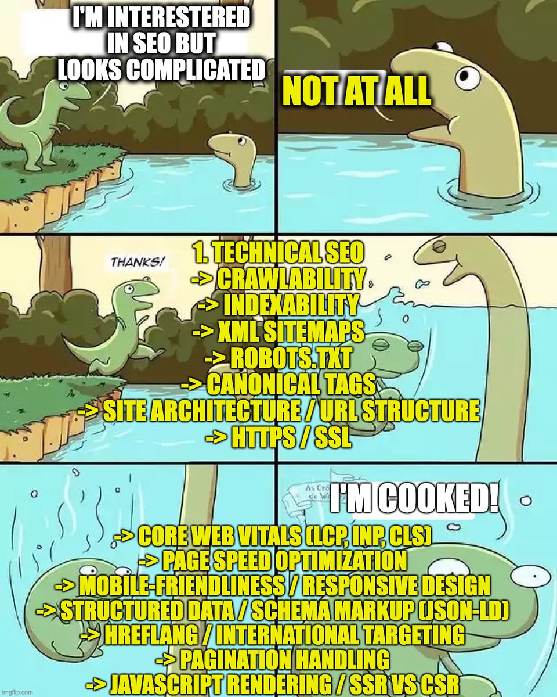
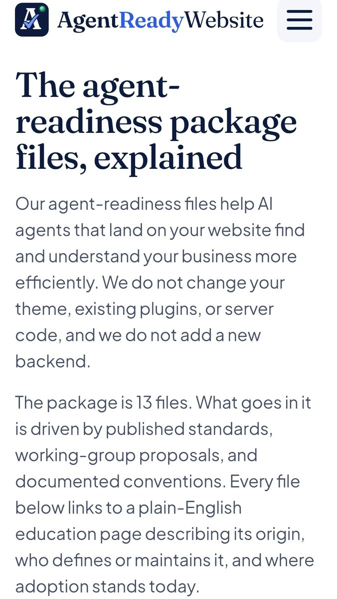

# Here's a list of literally everything you need to know about SEO:
> Source: https://x.com/ConnorShowler/status/2104574316104880415
> Author: Connor Showler | SEO & Marketing Master (@ConnorShowler)
> Posted: 2026-09-28T14:09:52+00:00
> Captured: 2026-10-15T09:02:28+00:00
> Stats at capture: 36,430 views · 590 likes · 39 replies · 85 reposts · 1,346 bookmarks · 6 quotes

## Post

Here's a list of literally everything you need to know about SEO:

1. Technical SEO
-> Crawlability
-> Indexability
-> XML sitemaps
-> Robots.txt
-> Canonical tags
-> Site architecture / URL structure
-> HTTPS / SSL
-> Core Web Vitals (LCP, INP, CLS)
-> Page speed optimization
-> Mobile-friendliness / responsive design
-> Structured data / schema markup (JSON-LD)
-> Hreflang / international targeting
-> Pagination handling
-> JavaScript rendering / SSR vs CSR
-> Duplicate content management
-> Redirect management (301, 302, chains)
-> HTTP status codes / error handling (404, 5xx)
-> Log file analysis
-> Crawl budget optimization
-> Faceted navigation control
-> CDN / hosting performance
-> Image optimization (compression, WebP, lazy loading)
-> Orphan page detection

2. On-Page SEO
-> Title tags
-> Meta descriptions
-> Header hierarchy (H1–H6)
-> Keyword placement / density
-> Content optimization
-> Internal linking
-> Anchor text optimization
-> Image alt text
-> URL slugs
-> Content freshness / updating
-> Semantic HTML
-> Featured snippet optimization
-> Table of contents / jump links
-> Outbound linking strategy
-> Content depth / comprehensiveness
-> Readability

3. Off-Page SEO
-> Link building
-> Digital PR
-> Guest posting
-> Broken link building
-> Sneaky backlinks
-> HARO / journalist outreach
-> Unlinked brand mention reclamation
-> Tiered link building
-> Link buying / selling
-> Social syndication
-> Backlink profile analysis
-> Spam link discovery
-> Anchor text distribution
-> Link velocity
-> Brand mentions / citations
-> Influencer collaboration
-> Podcast / interview placements
-> Resource page links
-> Private blog networks
-> Skyscraper technique

4. Keyword Research
-> Search intent classification (informational, navigational, commercial, transactional)
-> Search volume analysis
-> Keyword difficulty scoring
-> Long-tail keywords
-> Semantic / LSI keywords
-> Keyword clustering / topic grouping
-> Competitor keyword gap analysis
-> Seasonal / trending keywords
-> Question-based keywords (PAA mining)
-> Zero-volume keywords
-> Keyword cannibalization detection
-> SERP feature analysis per keyword

5. Content Strategy
-> Topical authority building
-> Content hubs / pillar pages / clusters
-> Editorial calendars
-> Content gap analysis
-> Content pruning / consolidation
-> Content refreshing
-> Content formats (guides, listicles, comparisons, tools)
-> Programmatic SEO
-> User-generated content
-> Author bios / entity building
-> Information gain / original data
-> Content briefs / SOP creation
-> Newsjacking

6. Local SEO
-> Google Business Profile optimization
-> NAP consistency (Name, Address, Phone)
-> Local citations / directories
-> Review generation & management
-> Local link building
-> Location pages / service area pages
-> Local pack / map pack ranking
-> Geo-targeted content
-> Local schema markup
-> Proximity / relevance / prominence signals

7. GEO / AI Search Optimization
-> LLM citation optimization (ChatGPT, Claude, Perplexity, Gemini)
-> AI Overviews optimization
-> Consensus manufacturing
-> Parasite SEO
-> Entity optimization / knowledge graph presence
-> Structured, extractable content formatting
-> Brand mention frequency across the web
-> llms.txt
-> Statistics / quotable data inclusion
-> Wikipedia / Wikidata presence
-> Reddit / forum visibility (LLM training sources)
-> Answer-first content structure

8. E-commerce SEO
-> Product page optimization
-> Collection page optimization
-> Product schema (price, reviews, availability)
-> Faceted navigation SEO
-> Out-of-stock page handling
-> Product review optimization
-> Merchant Center / Google Shopping feed
-> Duplicate product description handling
-> Internal search optimization
-> Competitor data extraction

9. SERP Features
-> Featured snippets
-> People Also Ask
-> Knowledge panels
-> Image packs
-> Video carousels
-> Sitelinks
-> FAQ / How-to rich results
-> Review stars
-> Top stories
-> Local pack

## Media

 — Reply 2104639294811906142 media 1. Source media: https://pbs.twimg.com/media/HTUuRhVXwAEYXHI.jpg
 — Reply 2104738867974688770 media 1. Source media: https://pbs.twimg.com/media/HTWI2HYXwAAAUkD.jpg
[Reply 2104715745582354481 media 1](media/animation-01.mp4) — Source media: https://video.twimg.com/tweet_video/HTVz0A8XwAAvjJV.mp4

## Thread

### Connor Showler | SEO & Marketing Master ([@ConnorShowler](https://x.com/ConnorShowler/status/2104574325818904846)) — 2026-09-28T14:09:55+00:00

10. SaaS SEO
-> SaaS keyword research
-> Product-led SEO
-> Programmatic SEO
-> Feature / use-case landing pages
-> Integration pages
-> Alternative / competitor pages
-> Comparison pages
-> Industry / persona pages
-> Template / tool pages
-> Free tools as SEO assets
-> Product-led content
-> Bottom-of-funnel content
-> Solution-aware vs problem-aware keywords
-> Customer journey keyword mapping
-> Trial / demo conversion optimization
-> SEO landing page architecture
-> Feature-to-keyword mapping
-> Use-case-to-keyword mapping
-> Integration SEO
-> API / developer documentation SEO
-> Knowledge base SEO
-> Help center SEO
-> Changelog / product update SEO
-> Product documentation indexing
-> Subdomain vs subdirectory SEO
-> Multi-product SEO architecture
-> Multi-language / international SaaS SEO
-> Scaled landing page generation
-> Template-based page generation
-> User-generated content
-> Customer case study SEO
-> Review site optimization
-> Software directory listings
-> Marketplace / app store SEO
-> Brand SERP optimization
-> Competitor displacement SEO
-> Competitor keyword gap analysis
-> Free-to-paid SEO funnels
-> Lead generation optimization
-> SEO attribution
-> Assisted conversions
-> SEO-to-product analytics
-> Search Console + product analytics integration
-> Content decay monitoring
-> Product-led internal linking
-> Topic clustering around product entities
-> Entity / Knowledge Graph optimization
-> AI search visibility for SaaS products
-> LLM citations and product recommendations
-> Software comparison queries
-> "Best [software category]" queries
-> "[Competitor] alternative" queries
-> "[Product] vs [Competitor]" queries
-> "[Use case] software" queries
-> "[Industry] software" queries
-> "[Feature] tool" queries

11. Forum & Directory SEO
-> Forum profile optimization
-> Community profile optimization
-> Directory submissions
-> Business directory optimization
-> Industry-specific directories
-> Local directories
-> Niche directories
-> Association directories
-> Chamber of Commerce listings
-> Review platforms
-> Software directories
-> Resource directories
-> Citation building
-> NAP consistency
-> Business description optimization
-> Category selection
-> Service/category mapping
-> Profile completeness
-> Business entity consistency
-> Brand mention building
-> Unlinked mention reclamation
-> Forum participation
-> Community reputation building
-> Question-and-answer platforms
-> Reddit SEO
-> Quora SEO
-> Industry forums
-> Community-generated content
-> Forum thread optimization
-> Forum thread discovery
-> Brand mention monitoring
-> Entity co-occurrence
-> Contextual brand mentions
-> Natural anchor text
-> Profile links
-> Contextual links
-> Citation links
-> No-follow / sponsored / UGC link attributes
-> Directory link quality assessment
-> Indexation monitoring
-> Duplicate directory listings
-> Incorrect listing suppression
-> Listing consolidation
-> Review profile optimization
-> Review response optimization
-> Forum reputation management
-> Community-driven brand discovery
-> User-generated content acquisition
-> Forum content syndication
-> Community content repurposing
-> Directory competitor analysis
-> Citation gap analysis
-> Forum visibility analysis
-> Spam directory identification
-> Toxic directory identification
-> Link reclamation
-> Brand SERP management
-> AI crawler visibility
-> LLM citation opportunities
### Connor Showler | SEO & Marketing Master ([@ConnorShowler](https://x.com/ConnorShowler/status/2104574331120504966)) — 2026-09-28T14:09:56+00:00

12. Affiliate SEO
-> Affiliate keyword research
-> Commercial investigation keywords
-> Product comparison keywords
-> "Best" keywords
-> "Top" keywords
-> "X vs Y" keywords
-> "X alternatives" keywords
-> "X review" keywords
-> "X pricing" keywords
-> "X coupon" keywords
-> "X discount" keywords
-> Buyer guides
-> Product reviews
-> Comparison tables
-> Product roundups
-> Buying guides
-> Product alternatives
-> Product category pages
-> Product selection tools
-> Product recommendation engines
-> Interactive calculators
-> Quizzes / product finders
-> Original product testing
-> First-hand experience
-> Expert reviews
-> Product photography
-> Original screenshots
-> Pros and cons analysis
-> Pricing analysis
-> Feature comparison
-> Specification comparison
-> Competitor comparison
-> Merchant / retailer comparison
-> Affiliate disclosure
-> Editorial independence
-> Affiliate link management
-> Link cloaking / redirect management
-> Sponsored / affiliate link attributes
-> Affiliate tracking
-> Conversion tracking
-> EPC analysis
-> Click-through rate optimization
-> Revenue per visitor
-> Revenue per thousand visitors
-> Affiliate program selection
-> Commission structure analysis
-> Cookie duration analysis
-> Recurring commissions
-> Product feed integration
-> API-driven product data
-> Product data freshness
-> Out-of-stock handling
-> Price change monitoring
-> Broken affiliate link detection
-> Expired product management
-> Expired offer redirects
-> Seasonal affiliate SEO
-> SERP competitor analysis
-> Affiliate content gap analysis
-> Information gain
-> Original research
-> Topical authority
-> Supporting informational content
-> Internal linking to money pages
-> Content-to-conversion funnels
-> Email capture
-> Retargeting funnels
-> Brand building
-> E-E-A-T optimization
-> Author expertise signals
-> Review authenticity
-> User-generated reviews
-> Affiliate site entity building
-> AI search visibility
-> LLM product recommendation visibility
-> Product citation optimization
13. SEO Monetization Methods
-> Affiliate marketing
-> Display advertising
-> Programmatic advertising
-> Google AdSense
-> Premium ad networks
-> Sponsored content
-> Sponsored posts
-> Direct advertising sales
-> Newsletter sponsorships
-> Lead generation
-> Lead selling
-> Qualified lead generation
-> Pay-per-lead models
-> Local lead generation
-> Rank-and-rent websites
-> Call generation
-> Call tracking / call monetization
-> Form lead monetization
-> SaaS subscriptions
-> Software trials
-> Freemium products
-> Paid tools
-> SEO tools
-> Calculators / generators
-> Digital products
-> Ebooks
-> Courses
-> Templates
-> Checklists
-> Paid reports
-> Research databases
-> Premium newsletters
-> Membership communities
-> Paid directories
-> Job boards
-> Classified listings
-> Marketplace commissions
-> Transaction fees
-> Booking commissions
-> Referral fees
-> Consulting leads
-> Agency leads
-> Professional services leads
-> E-commerce sales
-> Dropshipping
-> Print-on-demand
-> Product licensing
-> Software licensing
-> API monetization
-> Data licensing
-> Sponsored directories
-> Featured listings
-> Premium placements
-> Business profile upgrades
-> Subscription directories
-> Donation / membership models
-> Crowdfunding traffic
-> Brand sponsorships
-> Content licensing
-> Syndication revenue
-> Acquisition / website flipping
-> SEO asset portfolio building
-> Traffic arbitrage
-> Search-to-email funnels
-> Search-to-community funnels
-> Search-to-SaaS funnels
-> Search-to-lead funnels
-> Search-to-commerce funnels
-> Search-to-affiliate funnels
-> Search-to-subscription funnels
-> Revenue-per-session optimization
-> Conversion rate optimization
-> Average order value optimization
-> Customer lifetime value optimization
-> Monetization diversification
-> Traffic dependency management
-> Algorithm risk management
-> Revenue attribution
-> SEO ROI measurement

## Comments

### Fabrizio Bartoloni ([@f_bartoloni](https://x.com/f_bartoloni/status/2104639294811906142)) — 2026-09-28T18:28:04+00:00

@ConnorShowler https://t.co/eGrki3k3yo
 — Source media: https://pbs.twimg.com/media/HTUuRhVXwAEYXHI.jpg
### Elemental Badger ([@BadgerElemental](https://x.com/BadgerElemental/status/2104711586191659452)) — 2026-09-28T23:15:20+00:00

@ConnorShowler the majority of this is handled by the cms lol
### Balford - Deep Drawing ([@deepdrawingpart](https://x.com/deepdrawingpart/status/2104746434973368464)) — 2026-09-29T01:33:49+00:00

@ConnorShowler 一网打尽，资料太全面了，神贴
### Ayush Bansal ([@Ayush_095](https://x.com/Ayush_095/status/2104698425749168462)) — 2026-09-28T22:23:02+00:00

@ConnorShowler No need to worry about all this for your product. Azuqe(https://t.co/qqPCWgR7Ff) takes care of most of it automatically.
### Jamie ([@jamiejreach](https://x.com/jamiejreach/status/2104696041522221129)) — 2026-09-28T22:13:34+00:00

@ConnorShowler Save the list, then ignore 80% of it. Fix crawlability, own one topic cluster, and earn links with original data. Everything else is polish.
### jenosize ([@bankjenosize](https://x.com/bankjenosize/status/2104624232231821363)) — 2026-09-28T17:28:13+00:00

@ConnorShowler very easy for this AI Era
### AgentReadyWebsite ([@AgentReadyWeb](https://x.com/AgentReadyWeb/status/2104738867974688770)) — 2026-09-29T01:03:44+00:00

@ConnorShowler Great list @ConnorShowler! We analyze a customer's website to generate a custom:

From 1. Technical SEO:
-> XML sitemap
-> Robots.txt (update it)

From 7. GEO / AI Search Optimization:
-> llms.txt

Plus, 10 more agent protocol files: https://t.co/6Uje0c5n3U https://t.co/U5pD6NqcC2
 — Source media: https://pbs.twimg.com/media/HTWI2HYXwAAAUkD.jpg
### Olivia Hayes ([@WilsonChlo57314](https://x.com/WilsonChlo57314/status/2107224997781758433)) — 2026-10-05T21:42:44+00:00

@ConnorShowler Honestly, seeing Core Web Vitals listed right there with LCP, INP, and CLS makes me want to cry - how is anyone supposed to keep up with all of this?
### limitlessai ([@limitlessdeng](https://x.com/limitlessdeng/status/2104700764669329878)) — 2026-09-28T22:32:20+00:00

@ConnorShowler 第一部分最长，但真正卡收录的往往就几项。我们用 Loomaly 扫泡泡玛特美区站时，最伤的两条是 761 个页面缺 canonical，250 个页面只给搜索引擎做了预渲染，AI 爬虫看到的是空页面。先查这两类，再往下对清单。
### Alex Yarosh · AI expert · CEO of AI Studio ([@AleksejAros](https://x.com/AleksejAros/status/2105043731514617937)) — 2026-09-29T21:15:10+00:00

@ConnorShowler Worth keeping crawlability and indexability distinct: a page can be accessible to Google and still not make it into the index.
### Roger Medalis ([@RMedalis](https://x.com/RMedalis/status/2104670237404631160)) — 2026-09-28T20:31:02+00:00

@ConnorShowler @grok which of the 12 points are really worth it?
### Kimi Nguyen ([@kimindiehacker](https://x.com/kimindiehacker/status/2104856180741075306)) — 2026-09-29T08:49:54+00:00

@ConnorShowler how do you prioritize which technical SEO aspects to tackle first?
### Marco ([@BtwYuca](https://x.com/BtwYuca/status/2105024300914975056)) — 2026-09-29T19:57:57+00:00

@ConnorShowler unroll @threadreaderapp
### StoreCanary ([@StoreCanary_io](https://x.com/StoreCanary_io/status/2104626883325505794)) — 2026-09-28T17:38:45+00:00

@ConnorShowler Good list. On schema markup: we scanned 476 Shopify catalogs, found invalid JSON-LD on 7.4% and zero Product schema on 4%. The markup itself is often just broken. How do you usually catch that on client sites?
### 404Introvert ([@404Introvert](https://x.com/404Introvert/status/2104583231643283517)) — 2026-09-28T14:45:18+00:00

@ConnorShowler WOW!
### Agentic Adam - DeployAIWorkers.com ([@AdamAutomates](https://x.com/AdamAutomates/status/2104715745582354481)) — 2026-09-28T23:31:52+00:00

@ConnorShowler 😅 https://t.co/Lns9BCFZp4
 — Source media: https://video.twimg.com/tweet_video/HTVz0A8XwAAvjJV.mp4
### Anakimota ([@anakimota](https://x.com/anakimota/status/2105097463111593997)) — 2026-09-30T00:48:40+00:00

@ConnorShowler https://t.co/Er7KC69eOL
### Brennan Lee ([@mrbrennanlee](https://x.com/mrbrennanlee/status/2104911204330451145)) — 2026-09-29T12:28:33+00:00

@ConnorShowler Missing Query Fan Out
### Mia ai ([@mia_ai_a](https://x.com/mia_ai_a/status/2104763757641761267)) — 2026-09-29T02:42:39+00:00

@ConnorShowler Spot on insight! Really great breakdown. 🔥
### Mia ai ([@mia_ai_a](https://x.com/mia_ai_a/status/2104575025647173686)) — 2026-09-28T14:12:41+00:00

@ConnorShowler Spot on insight! Really great breakdown. 🔥
### Riley ([@RileyXReid1](https://x.com/RileyXReid1/status/2104794461285040513)) — 2026-09-29T04:44:39+00:00

@ConnorShowler Spot on insight! Really great breakdown. 🔥
### Riley ([@RileyXReid1](https://x.com/RileyXReid1/status/2104771779755753577)) — 2026-09-29T03:14:31+00:00

@ConnorShowler Spot on insight! Really great breakdown. 🔥Spot on insight! Really great breakdown. 🔥Spot on insight! Really great breakdown. 🔥
### Riley ([@RileyXReid1](https://x.com/RileyXReid1/status/2104658524219572318)) — 2026-09-28T19:44:29+00:00

@ConnorShowler Spot on insight! Really great breakdown. 🔥Spot on insight! Really great breakdown. 🔥
### Riley ([@RileyXReid1](https://x.com/RileyXReid1/status/2104598525673943388)) — 2026-09-28T15:46:04+00:00

@ConnorShowler Spot on insight! Really great breakdown. 🔥
### Hun ([@huninthebox](https://x.com/huninthebox/status/2104803190411796972)) — 2026-09-29T05:19:20+00:00

@ConnorShowler This is thorough, but nobody needs most of it at once. Pick the five things that actually match your site and go.
### Ryan ([@growwithnayeem](https://x.com/growwithnayeem/status/2104853135802146868)) — 2026-09-29T08:37:48+00:00

@ConnorShowler People don't need to hire anyone, this post says them everythings.

## Other returned timeline records

> The CLI did not expose reply relationships. These records do not start with a reply mention and were authored by someone other than the saved-post author. They may include recommendations or promoted posts; they are retained as source context, not verified replies.

### Starlink ([@Starlink](https://x.com/Starlink/status/2068115197718593741)) — 2026-06-19T23:34:21+00:00

Get connected with fast, reliable internet for streaming, video calls, online gaming and more.

Order online in minutes.
### Starlink ([@Starlink](https://x.com/Starlink/status/2099964624699261349)) — 2026-09-15T20:52:36+00:00

Get fast, reliable home internet for seamless streaming, working from home, gaming, and more across multiple devices.

Order online in minutes.
