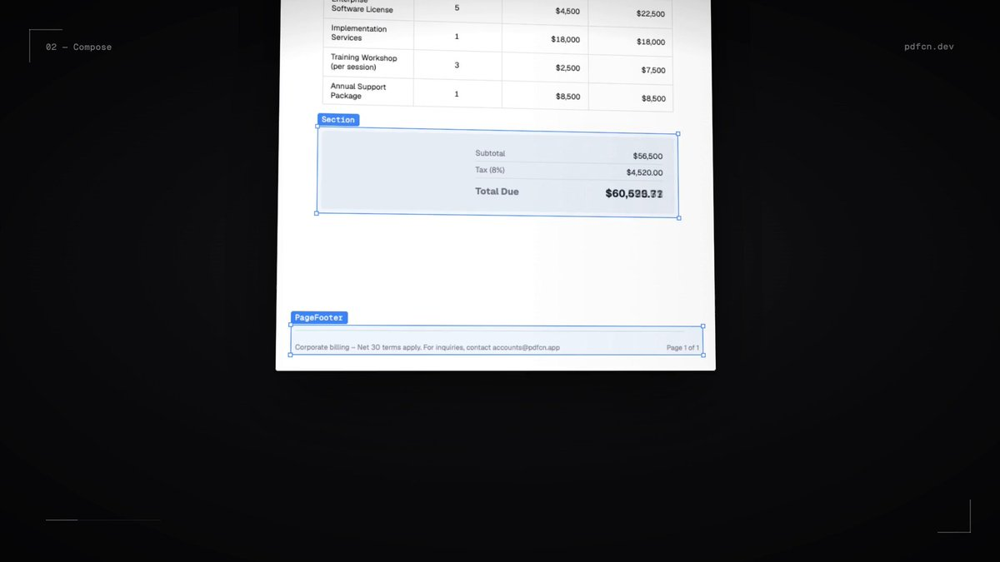

# Introducing pdfcn
> Source: https://x.com/shadcnlabs/status/2104840500847263794
> Author: Shadcn Labs (@shadcnlabs)
> Posted: Tue Sep 29 07:47:36 +0000 2026
> Captured: 2026-10-15T09:02:28+00:00
> Stats at capture: 176,013 views · 3,620 likes · 43 replies · 254 reposts · 4,250 bookmarks · 29 quotes

## Post

Introducing pdfcn

Build beautiful PDFs like you build your UI.

Powered by Takumi + Forme.
Pick from 10+ themes, 40+ components & blocks, then customize everything.

One command to get started. shadcn/ui compatible.

100% Free. Open source.

## Media

[Post media 1](media/video-01.mp4) — Source media: https://video.twimg.com/amplify_video/2104839168828551168/vid/avc1/1280x720/p-5qFVyd8w3P6BiI.mp4?tag=29
 — Post media 1 thumbnail. Source media: https://pbs.twimg.com/amplify_video_thumb/2104839168828551168/img/0j4S5p-56CTWZZZj.jpg
[Reply 2104902597681312057 media 1](media/animation-01.mp4) — Source media: https://video.twimg.com/tweet_video/HTYdv6RXQAAu5-_.mp4

## Thread

### Shadcn Labs ([@shadcnlabs](https://x.com/shadcnlabs/status/2104840503342792917)) — 2026-09-29T07:47:36+00:00

Try it here: https://t.co/SxSWfrfXhO
### Shadcn Labs ([@shadcnlabs](https://x.com/shadcnlabs/status/2104840505486143753)) — 2026-09-29T07:47:37+00:00

Give it a ⭐️ on GitHub: https://t.co/OWTcOfl4Un
### Shadcn Labs ([@shadcnlabs](https://x.com/shadcnlabs/status/2105245135323938892)) — 2026-09-30T10:35:28+00:00

@sebuzdugan Yep, that’s exactly why pdfcn doesn’t rely on Chromium/HTML for rendering. Pagination is handled by the PDF renderer, so Chromium version drift isn’t part of the equation.
### Shadcn Labs ([@shadcnlabs](https://x.com/shadcnlabs/status/2105243812033671529)) — 2026-09-30T10:30:12+00:00

@sangodbx About time PDFs got some design love
### Shadcn Labs ([@shadcnlabs](https://x.com/shadcnlabs/status/2105245496810107251)) — 2026-09-30T10:36:54+00:00

@csansoon Don’t give us ideas, lol
### Shadcn Labs ([@shadcnlabs](https://x.com/shadcnlabs/status/2105243933915898199)) — 2026-09-30T10:30:42+00:00

@GavinJaynes Fair concern, but we’ve been transparent from day one that we’re independent and not officially affiliated with shadcn.

We also have his blessing to keep building under Shadcn Labs :)
### Shadcn Labs ([@shadcnlabs](https://x.com/shadcnlabs/status/2105242908773556415)) — 2026-09-30T10:26:37+00:00

@gwevans6 @shadcn It’s clearly mentioned in our bio that we’re not affiliated with shadcn, and we already have his blessing to keep building under Shadcn Labs.
### Shadcn Labs ([@shadcnlabs](https://x.com/shadcnlabs/status/2105241846989586890)) — 2026-09-30T10:22:24+00:00

@pkost0v Feel free to raise an issue on GitHub with steps to reproduce it.
### Shadcn Labs ([@shadcnlabs](https://x.com/shadcnlabs/status/2105244321490551246)) — 2026-09-30T10:32:14+00:00

@0xDenzel @grandbusta Would love to see what you’re building too 👀
### Shadcn Labs ([@shadcnlabs](https://x.com/shadcnlabs/status/2105244634138181750)) — 2026-09-30T10:33:28+00:00

@AshvinUI All thanks to our chief and btw he just released his new product to create awesome videos like this.

Feel free to check it out.
https://t.co/lABlHDdr2j
### Shadcn Labs ([@shadcnlabs](https://x.com/shadcnlabs/status/2105244186249445600)) — 2026-09-30T10:31:42+00:00

@proxy_vector Yep! They can render server-side, so generating a PDF in a route handler and attaching it to an email is totally doable.
### Shadcn Labs ([@shadcnlabs](https://x.com/shadcnlabs/status/2105245434952434001)) — 2026-09-30T10:36:39+00:00

@_vincentlange PDFs deserve cinematic treatment too 😭
### Shadcn Labs ([@shadcnlabs](https://x.com/shadcnlabs/status/2105245074246516884)) — 2026-09-30T10:35:13+00:00

@baksoenaena It is built on Takumi, Forme which both are JSX to PDF solutions so ideally you would have to write that.
### Shadcn Labs ([@shadcnlabs](https://x.com/shadcnlabs/status/2105243007817818444)) — 2026-09-30T10:27:01+00:00

@proofandstate 100%. Reusability only matters if the output stays predictable. That’s exactly the kind of problem we’re trying to solve with pdfcn.
### Shadcn Labs ([@shadcnlabs](https://x.com/shadcnlabs/status/2105243070291910791)) — 2026-09-30T10:27:16+00:00

@geekly88 love seeing pdfcn used for real-world stuff like this. would love to see what you built 👀
### Shadcn Labs ([@shadcnlabs](https://x.com/shadcnlabs/status/2105245579324567578)) — 2026-09-30T10:37:14+00:00

@ares_mheinke Exactly the kind of edge case KeepTogether is meant for
### Shadcn Labs ([@shadcnlabs](https://x.com/shadcnlabs/status/2105242428546666693)) — 2026-09-30T10:24:43+00:00

@Sol_Survivr middle managers finally getting their own superpower
### Shadcn Labs ([@shadcnlabs](https://x.com/shadcnlabs/status/2105245212293689385)) — 2026-09-30T10:35:46+00:00

@its_meseba Appreciate it 🤝
### Shadcn Labs ([@shadcnlabs](https://x.com/shadcnlabs/status/2105243663681081833)) — 2026-09-30T10:29:37+00:00

@theyash14_ Yep! You can build fully custom resume templates with pdfcn and generate them as PDFs.
### Shadcn Labs ([@shadcnlabs](https://x.com/shadcnlabs/status/2105245706143605176)) — 2026-09-30T10:37:44+00:00

@ab0_alhasan_ Appreciate it 🤝
### Shadcn Labs ([@shadcnlabs](https://x.com/shadcnlabs/status/2105242240973250932)) — 2026-09-30T10:23:58+00:00

@DC3_AI Always 🫶
### Shadcn Labs ([@shadcnlabs](https://x.com/shadcnlabs/status/2105245658148155629)) — 2026-09-30T10:37:33+00:00

@flboelter Appreciate it 🤝
### Shadcn Labs ([@shadcnlabs](https://x.com/shadcnlabs/status/2105244409843568672)) — 2026-09-30T10:32:35+00:00

@mancerrss Yep! Resumes are a perfect use case for pdfcn.
### Shadcn Labs ([@shadcnlabs](https://x.com/shadcnlabs/status/2105245334834487369)) — 2026-09-30T10:36:16+00:00

@NeuralAA Our chief wanted to showoff his motion design skills :)

## Comments

### Sebastian Buzdugan ([@sebuzdugan](https://x.com/sebuzdugan/status/2105230657634873394)) — 2026-09-30T09:37:56+00:00

@shadcnlabs can pdfcn guarantee deterministic pagination across chromium versions because page break drift kills production templates
### Victor Sango ([@sangodbx](https://x.com/sangodbx/status/2104902071463936406)) — 2026-09-29T11:52:15+00:00

@shadcnlabs Pdf is finally getting some love from designers
### Sansón ([@csansoon](https://x.com/csansoon/status/2104880347888431538)) — 2026-09-29T10:25:56+00:00

@shadcnlabs can't wait for the first pdf with a skeleton loader
### Gavin Jaynes ([@GavinJaynes](https://x.com/GavinJaynes/status/2105054011510735008)) — 2026-09-29T21:56:01+00:00

@shadcnlabs You should change your name since you have zero official affiliation with Shadcn.
### gevans ([@gwevans6](https://x.com/gwevans6/status/2105163651577786439)) — 2026-09-30T05:11:41+00:00

@shadcnlabs It’s pretty shameless to be piggy backing off of @shadcn’s brand, how is this even allowed to happen
### kost0v ([@pkost0v](https://x.com/pkost0v/status/2105211250557014375)) — 2026-09-30T08:20:49+00:00

@shadcnlabs What happens with a table that spans 3 pages though, does it auto repeat headers or does row 47 just get sliced in half like every other pdf lib promises it won't.
### Denzel ([@0xDenzel](https://x.com/0xDenzel/status/2105049136433152442)) — 2026-09-29T21:36:38+00:00

@shadcnlabs @grandbusta isn't this what youre buildign?
### Ash - Building ShadcnDeck 🚧 ([@AshvinUI](https://x.com/AshvinUI/status/2104907954562678820)) — 2026-09-29T12:15:38+00:00

@shadcnlabs Nice video, man. 

How did you create it?
### Rohan ([@proxy_vector](https://x.com/proxy_vector/status/2104874084270313857)) — 2026-09-29T10:01:03+00:00

@shadcnlabs Can the components render on the server, for something like a route handler that emails a PDF?
### Vincent Lange ([@_vincentlange](https://x.com/_vincentlange/status/2104936827060666409)) — 2026-09-29T14:10:22+00:00

@shadcnlabs the sfx in this slap way too hard for a pdf builder ad
### Mimpi Dulu ([@baksoenaena](https://x.com/baksoenaena/status/2104869407474483210)) — 2026-09-29T09:42:27+00:00

@shadcnlabs But we can ask ai to create any invoice as html first then convert to pdf, right?
### Nîvå ([@nivamakes](https://x.com/nivamakes/status/2105218826942202157)) — 2026-09-30T08:50:56+00:00

@shadcnlabs A shared component surface is useful only when its rendering contract survives the output medium. PDF layout, pagination, fonts, and fallback behavior need explicit ownership or “reusable” becomes a new class of bug.
### Ahmed Alrashdy ([@geekly88](https://x.com/geekly88/status/2105039451361620471)) — 2026-09-29T20:58:09+00:00

@shadcnlabs I implemented pdfcn as report builder from datagrid to pdf with custom design, what users prefer
### Mathias Heinke ([@ares_mheinke](https://x.com/ares_mheinke/status/2104861262433898591)) — 2026-09-29T09:10:06+00:00

@shadcnlabs The KeepTogether component is the bit I'd try first: keep the total and approval line on 1 page when an invoice grows. A gorgeous theme won't help if the amount and sign-off drift apart ;)
### Aayush Khare ([@Sol_Survivr](https://x.com/Sol_Survivr/status/2105037015683399680)) — 2026-09-29T20:48:28+00:00

@shadcnlabs Gonna be a boon for middle management
### Semih ([@its_meseba](https://x.com/its_meseba/status/2105194275478622312)) — 2026-09-30T07:13:22+00:00

@shadcnlabs That's legit
### Yashwanth R ([@theyash14_](https://x.com/theyash14_/status/2104957745590047104)) — 2026-09-29T15:33:29+00:00

@shadcnlabs Can this be used to design resumes?
### AboAlhasan ([@ab0_alhasan_](https://x.com/ab0_alhasan_/status/2104902597681312057)) — 2026-09-29T11:54:21+00:00

@shadcnlabs https://t.co/e7w1B0eLvN
 — Source media: https://video.twimg.com/tweet_video/HTYdv6RXQAAu5-_.mp4
### DC3AI ([@DC3_AI](https://x.com/DC3_AI/status/2105130619454001287)) — 2026-09-30T03:00:25+00:00

@shadcnlabs very cool;  thanks for all the open source work!
### Florian Boelter ([@flboelter](https://x.com/flboelter/status/2104925379911893192)) — 2026-09-29T13:24:52+00:00

@shadcnlabs this is sick
### Steve ([@mancerrss](https://x.com/mancerrss/status/2104895570414539079)) — 2026-09-29T11:26:25+00:00

@shadcnlabs Please tell me this also works with Resumes
### adam ([@NeuralAA](https://x.com/NeuralAA/status/2104905593228034321)) — 2026-09-29T12:06:15+00:00

@shadcnlabs Introducing? I been using this for a while now lmao

Its good work
### Stewart Toubia ([@StewartToubia](https://x.com/StewartToubia/status/2105074239258952152)) — 2026-09-29T23:16:23+00:00

@shadcnlabs how did you build your marketing video

## Other returned timeline records

> The CLI did not expose reply relationships. These records do not start with a reply mention and were authored by someone other than the saved-post author. They may include recommendations or promoted posts; they are retained as source context, not verified replies.

### Starlink ([@Starlink](https://x.com/Starlink/status/2098108930060865671)) — 2026-09-10T17:58:44+00:00

Starlink offers fast, reliable internet in the most rural and remote locations. Portable and easy to set up, Starlink works wherever you are.

Order online in minutes.
### Starlink ([@Starlink](https://x.com/Starlink/status/2068115197718593741)) — 2026-06-19T23:34:21+00:00

Get connected with fast, reliable internet for streaming, video calls, online gaming and more.

Order online in minutes.
