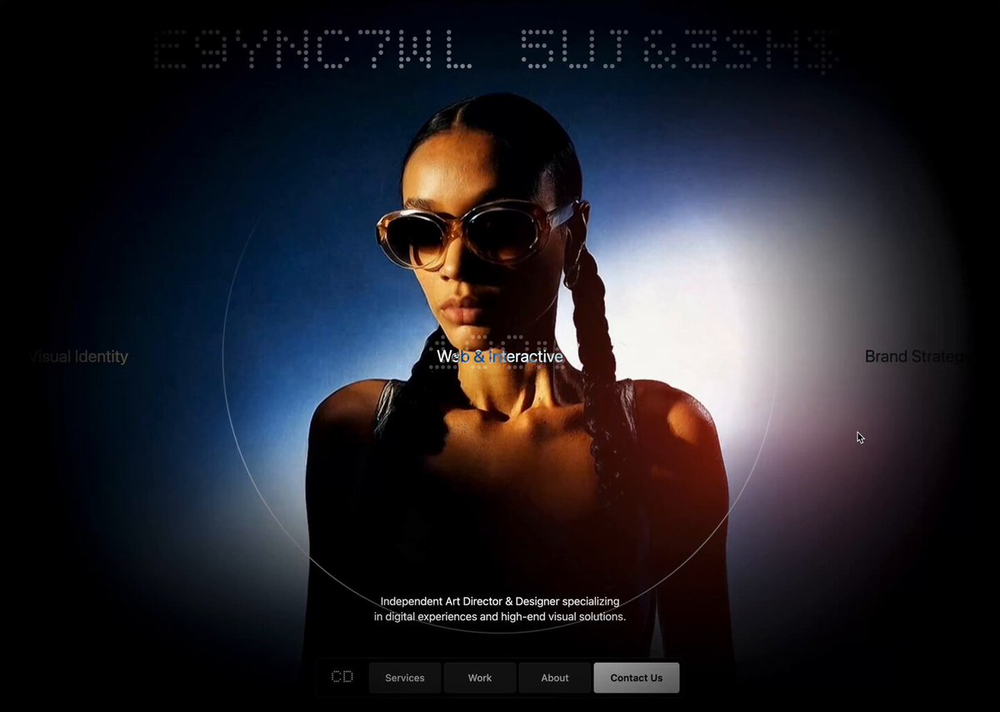
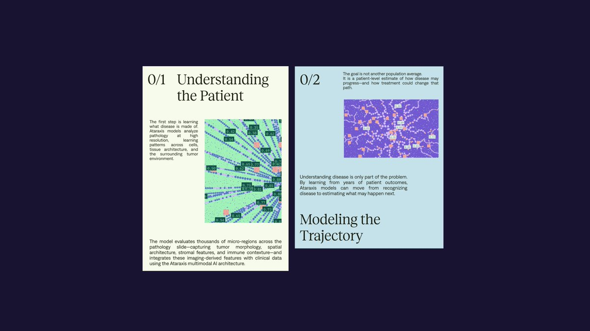
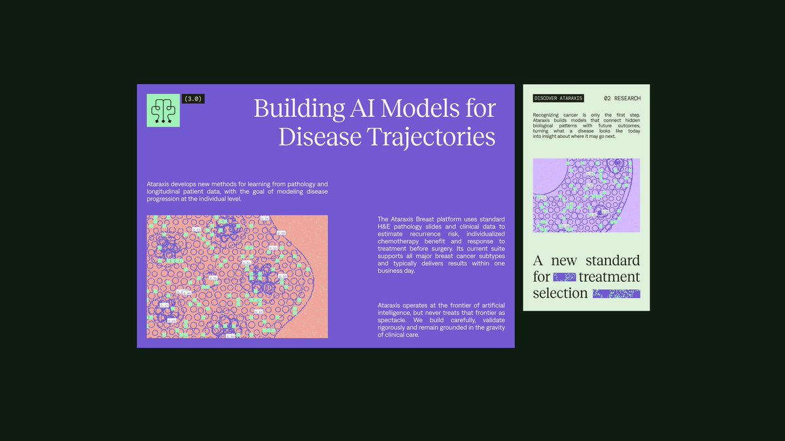
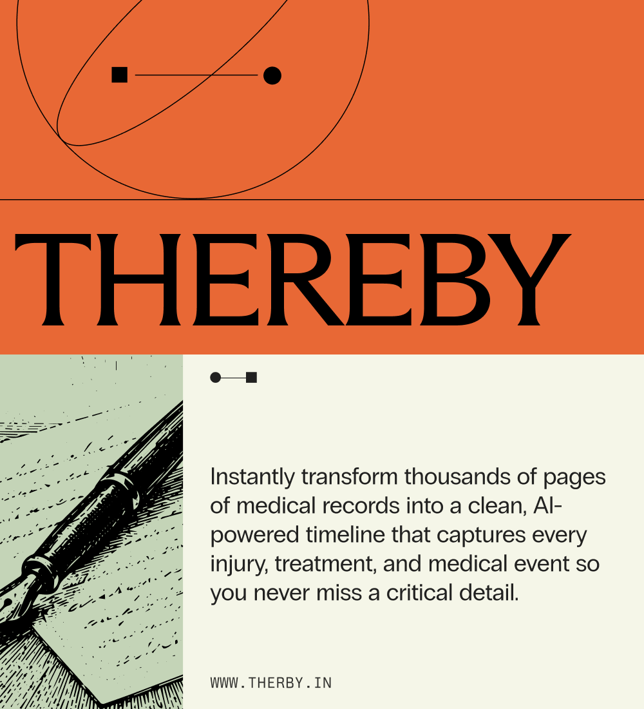
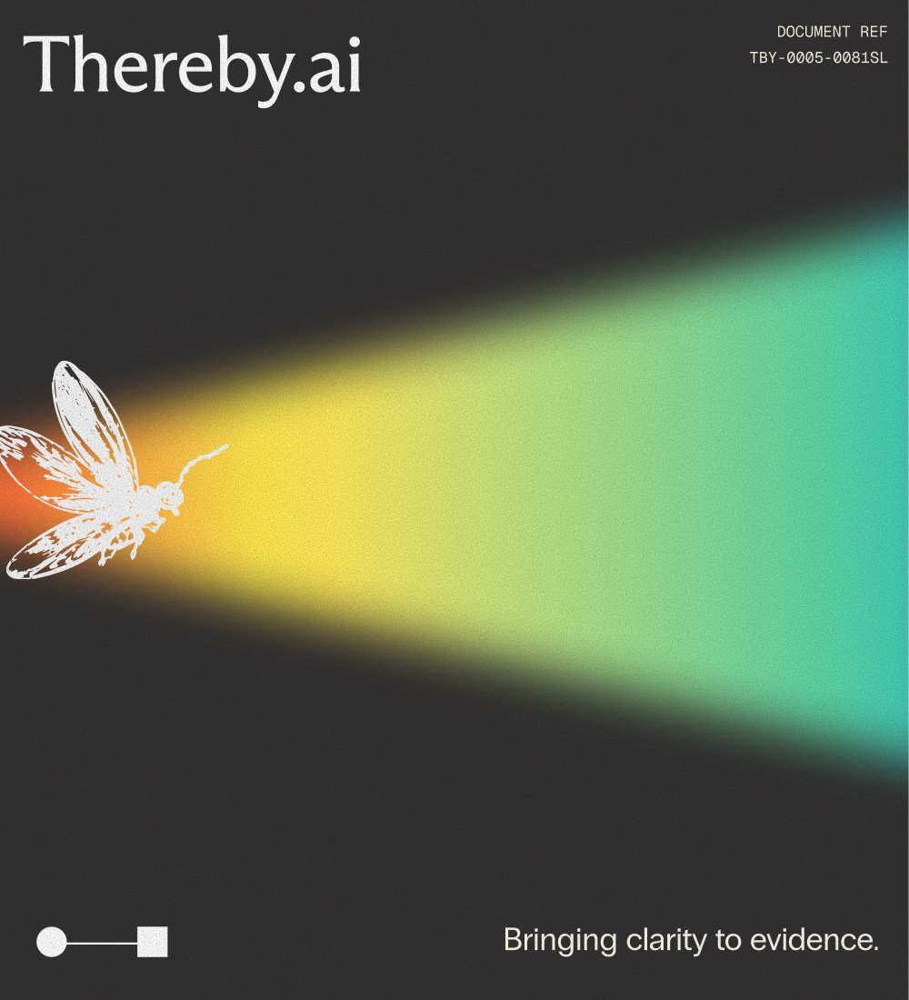
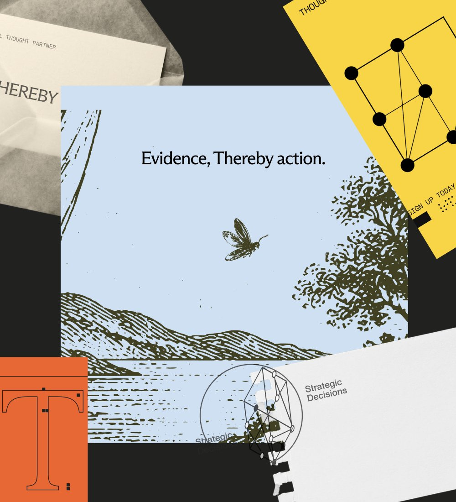
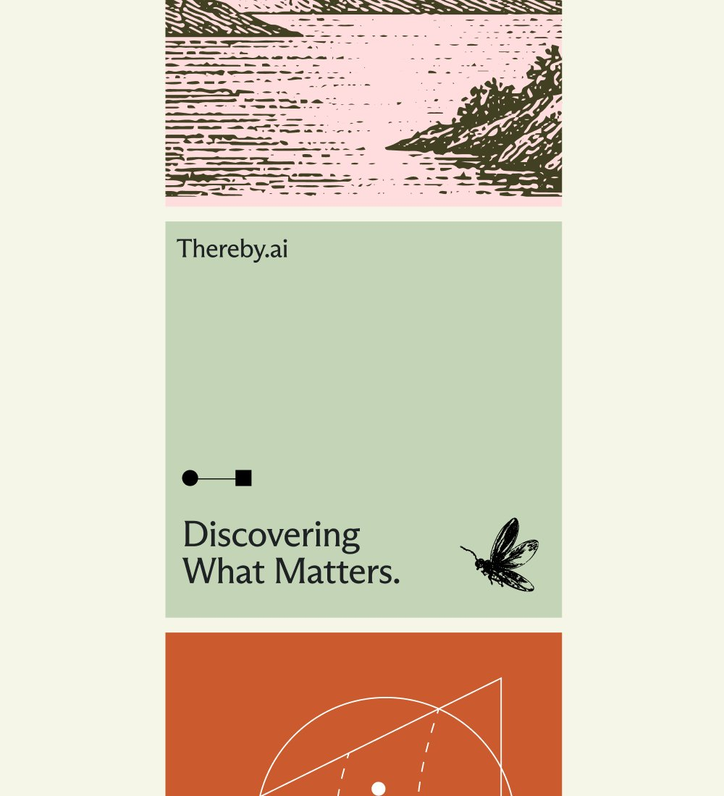
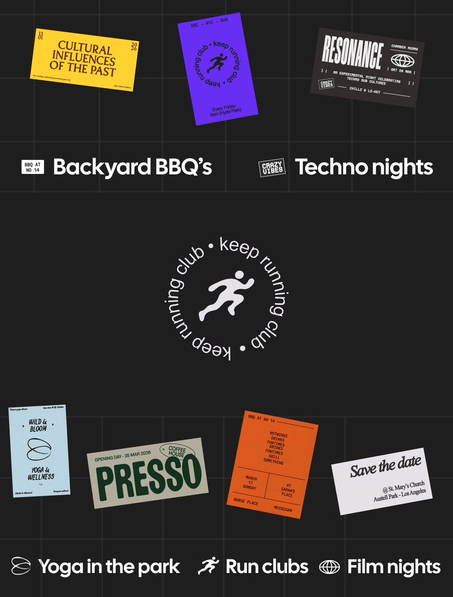
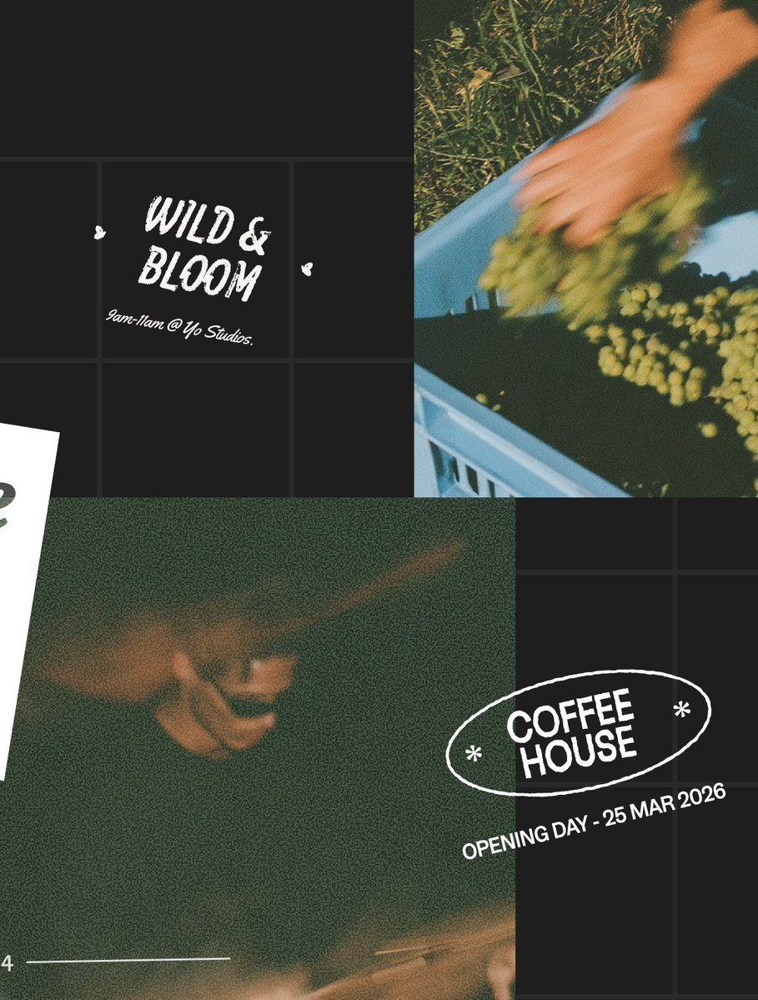
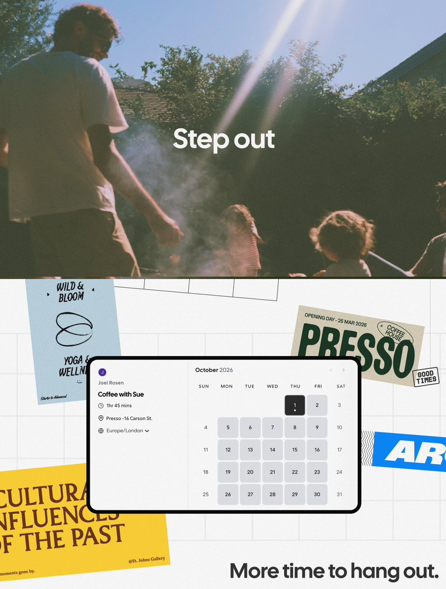

# Designers who think they won't get replaced: go run Claude Opus 5.5.
> Source: https://x.com/thedzianis/status/2105281624460157100
> Author: Dzianis Kravchu (@thedzianis)
> Posted: 2026-09-30T13:00:28+00:00
> Captured: 2026-10-15T09:02:28+00:00
> Stats at capture: 7,557 views · 74 likes · 5 replies · 1 reposts · 139 bookmarks · 0 quotes

## Post

Designers who think they won't get replaced: go run Claude Opus 5.5.

No references. One prompt. That's it.

Here's the output 💀

Prompt ↓

## Media

[Post media 1](media/video-01.mp4) — Source media: https://video.twimg.com/amplify_video/2105281588242382848/vid/avc1/1010x720/pyk-dNe6KwEciPAM.mp4?tag=29
 — Post media 1 thumbnail. Source media: https://pbs.twimg.com/amplify_video_thumb/2105281588242382848/img/1eMJPxi3NRmrbrdv.jpg
 — Reply 2110514612919587252 media 1. Source media: https://pbs.twimg.com/media/HUoNXuhW8AADP8n.jpg
 — Reply 2110514612919587252 media 2. Source media: https://pbs.twimg.com/media/HUoNXujWcAAPD7c.jpg
 — Reply 2110514612919587252 media 3. Source media: https://pbs.twimg.com/media/HUoNXukWgAAOJWO.jpg
 — Reply 2110599097665364161 media 1. Source media: https://pbs.twimg.com/media/HUpasBoakAAzo06.png
 — Reply 2110599097665364161 media 2. Source media: https://pbs.twimg.com/media/HUpasCsaAAALwvq.jpg
 — Reply 2110599097665364161 media 3. Source media: https://pbs.twimg.com/media/HUpasBoaQAASf3P.jpg
 — Reply 2110599097665364161 media 4. Source media: https://pbs.twimg.com/media/HUpasBubIAAm2__.jpg
 — Reply 2110511473080606756 media 1. Source media: https://pbs.twimg.com/media/HUoK2tJbAAEVRZC.jpg
 — Reply 2110511473080606756 media 2. Source media: https://pbs.twimg.com/media/HUoK3i0a0AAUT3a.jpg
 — Reply 2110511473080606756 media 3. Source media: https://pbs.twimg.com/media/HUoK-VzaYAAMFyt.jpg
 — Reply 2110511473080606756 media 4. Source media: https://pbs.twimg.com/media/HUoK_MsawAAU3d2.jpg
[Reply 2110258739085509062 media 1](media/video-02.mp4) — Source media: https://video.twimg.com/amplify_video/2110258631216365568/vid/avc1/1920x1080/boomEXUSQYjQb8FK.mp4?tag=29

## Thread

### Dzianis Kravchu ([@thedzianis](https://x.com/thedzianis/status/2105282243648434511)) — 2026-09-30T13:02:55+00:00

Access this as well as 500+ award-winning prompts at: https://t.co/bwA542tTFM

## Comments

### Brady Godwin ([@Godwin_UX](https://x.com/Godwin_UX/status/2105621816270106831)) — 2026-10-01T11:32:16+00:00

@thedzianis Replaced? No. But we will be expected to do significantly more work in radically compressed timelines. I’m here for it - designing and building with SI is a blast.
### Chen ([@chenzhangreal](https://x.com/chenzhangreal/status/2105508787805380623)) — 2026-10-01T04:03:08+00:00

@thedzianis i ran claude opus 5.5 with no references last week, it still can't fix my messy visual hierarchy.
### Rudra ([@rudraHQ](https://x.com/rudraHQ/status/2105351943124378039)) — 2026-09-30T17:39:53+00:00

@thedzianis Excellent work

## Other returned timeline records

> The CLI did not expose reply relationships. These records do not start with a reply mention and were authored by someone other than the saved-post author. They may include recommendations or promoted posts; they are retained as source context, not verified replies.

### Starlink ([@Starlink](https://x.com/Starlink/status/2092706810314858684)) — 2026-08-26T20:12:38+00:00

Starlink offers fast, reliable internet in the most rural and remote locations . Portable and easy to set up, Starlink Mini works wherever you are.

Order online in minutes.
### Adiel ([@adieldesign](https://x.com/adieldesign/status/2110514612919587252)) — 2026-10-14T23:34:29+00:00

love where we took this project for an clinical ai research lab https://t.co/bMwGnqX4k3
 — Source media: https://pbs.twimg.com/media/HUoNXuhW8AADP8n.jpg
 — Source media: https://pbs.twimg.com/media/HUoNXujWcAAPD7c.jpg
 — Source media: https://pbs.twimg.com/media/HUoNXukWgAAOJWO.jpg
### XchylerDrenth ([@xchylerdrenth](https://x.com/xchylerdrenth/status/2110599097665364161)) — 2026-10-15T05:10:12+00:00

https://t.co/nh86X1NCzb
 — Source media: https://pbs.twimg.com/media/HUpasBoakAAzo06.png
 — Source media: https://pbs.twimg.com/media/HUpasCsaAAALwvq.jpg
 — Source media: https://pbs.twimg.com/media/HUpasBoaQAASf3P.jpg
 — Source media: https://pbs.twimg.com/media/HUpasBubIAAm2__.jpg
### Ayush Soni ([@ayushsoni_io](https://x.com/ayushsoni_io/status/2110511473080606756)) — 2026-10-14T23:22:01+00:00

coming soon https://t.co/C611cnCia5
 — Source media: https://pbs.twimg.com/media/HUoK2tJbAAEVRZC.jpg
 — Source media: https://pbs.twimg.com/media/HUoK3i0a0AAUT3a.jpg
 — Source media: https://pbs.twimg.com/media/HUoK-VzaYAAMFyt.jpg
 — Source media: https://pbs.twimg.com/media/HUoK_MsawAAU3d2.jpg
### Nick ([@nickbakeddesign](https://x.com/nickbakeddesign/status/2110258739085509062)) — 2026-10-14T06:37:44+00:00

brand explorations # 2 for opentag YC S26 https://t.co/urfE6xt8xQ
 — Source media: https://video.twimg.com/amplify_video/2110258631216365568/vid/avc1/1920x1080/boomEXUSQYjQb8FK.mp4?tag=29
