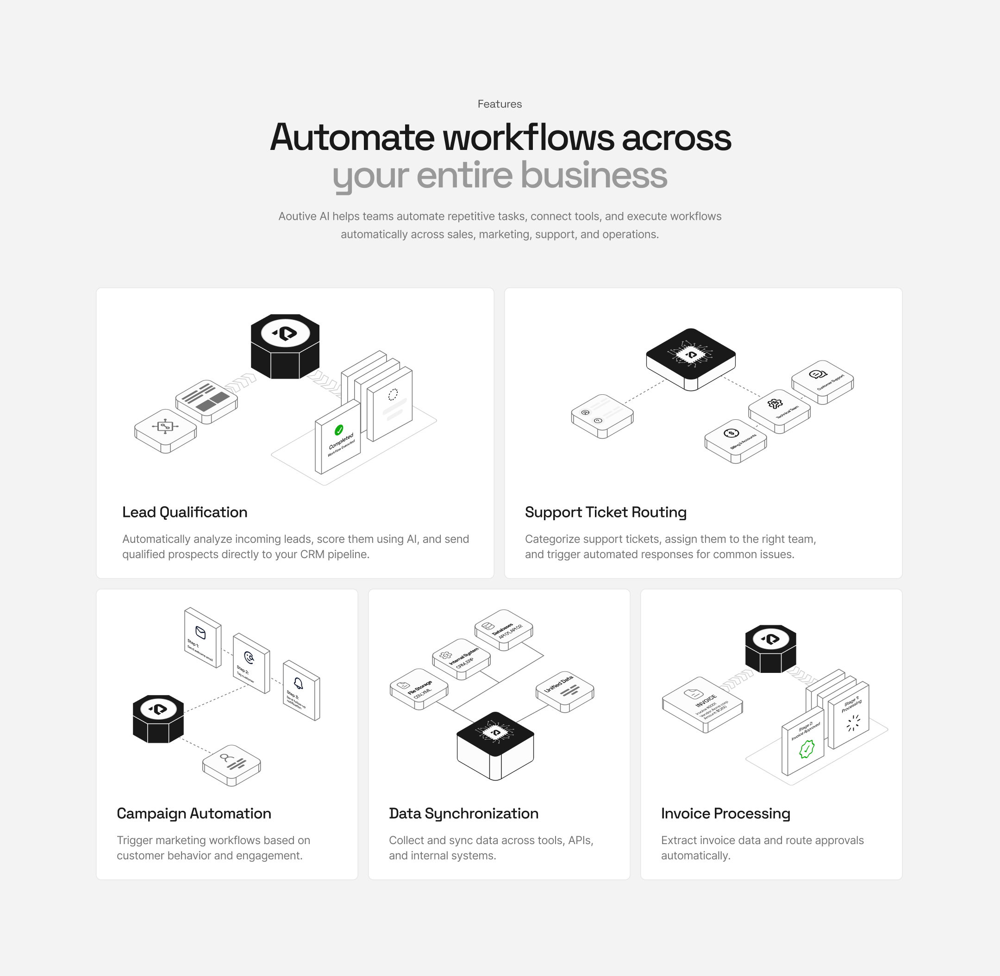

# Enterprise features section design. ✨ https://t.co/S7p6nonaLc
> Source: https://x.com/zahragr8r/status/2105326479441788943
> Author: Zahra (@zahragr8r)
> Posted: 2026-09-30T15:58:42+00:00
> Captured: 2026-10-15T09:02:28+00:00
> Stats at capture: 1,761 views · 84 likes · 9 replies · 1 reposts · 32 bookmarks · 0 quotes

## Post

Enterprise features section design. ✨

## Media

 — Post media 1. Source media: https://pbs.twimg.com/media/HTee7RZa8AAYD_C.png?name=orig

## Thread

### Zahra ([@zahragr8r](https://x.com/zahragr8r/status/2105491244357140757)) — 2026-10-01T02:53:25+00:00

@melfanzaa Appreciate it
### Zahra ([@zahragr8r](https://x.com/zahragr8r/status/2105628790311510126)) — 2026-10-01T11:59:58+00:00

@gwatsinthong Apricated it
### Zahra ([@zahragr8r](https://x.com/zahragr8r/status/2105587338609086968)) — 2026-10-01T09:15:16+00:00

@masuderrahaman9 Thanks
### Zahra ([@zahragr8r](https://x.com/zahragr8r/status/2105654353478767026)) — 2026-10-01T13:41:33+00:00

@Dymasalfin_UI Thanks
### Zahra ([@zahragr8r](https://x.com/zahragr8r/status/2105619691524006145)) — 2026-10-01T11:23:49+00:00

@_heyfaisal Thank you

## Comments

### Elfan ([@melfanzaa](https://x.com/melfanzaa/status/2105474247967842393)) — 2026-10-01T01:45:53+00:00

@zahragr8r Stunning illustration!
### Gwatsin ([@gwatsinthong](https://x.com/gwatsinthong/status/2105604548547203079)) — 2026-10-01T10:23:39+00:00

@zahragr8r genuinely love this
### Masuder Rahaman ([@masuderrahaman9](https://x.com/masuderrahaman9/status/2105557890119680028)) — 2026-10-01T07:18:15+00:00

@zahragr8r NICE WORK
### Dymasalfin.UI ([@Dymasalfin_UI](https://x.com/Dymasalfin_UI/status/2105643881157349636)) — 2026-10-01T12:59:56+00:00

@zahragr8r pure talent🤩
### Faisal Ahmed ([@_heyfaisal](https://x.com/_heyfaisal/status/2105610349143847407)) — 2026-10-01T10:46:42+00:00

@zahragr8r Outstanding work! 💯
### Sabbir Hasan ([@sabbirux7](https://x.com/sabbirux7/status/2105567052899701086)) — 2026-10-01T07:54:39+00:00

@zahragr8r Clean execution. Nicely done!
### Sergi Zal ([@sergizal](https://x.com/sergizal/status/2105589156768370988)) — 2026-10-01T09:22:29+00:00

@zahragr8r so clean Zahra
### Fahim Anando ([@Fahim_Anando](https://x.com/Fahim_Anando/status/2105576355522134478)) — 2026-10-01T08:31:37+00:00

@zahragr8r These illustrations are so consistent 👌
### Farhan Arfeen ([@Farhan_Arfeen](https://x.com/Farhan_Arfeen/status/2105692188164403602)) — 2026-10-01T16:11:54+00:00

@zahragr8r The isometric wireframe style works perfectly to reduce the cognitive load of complex workflows
