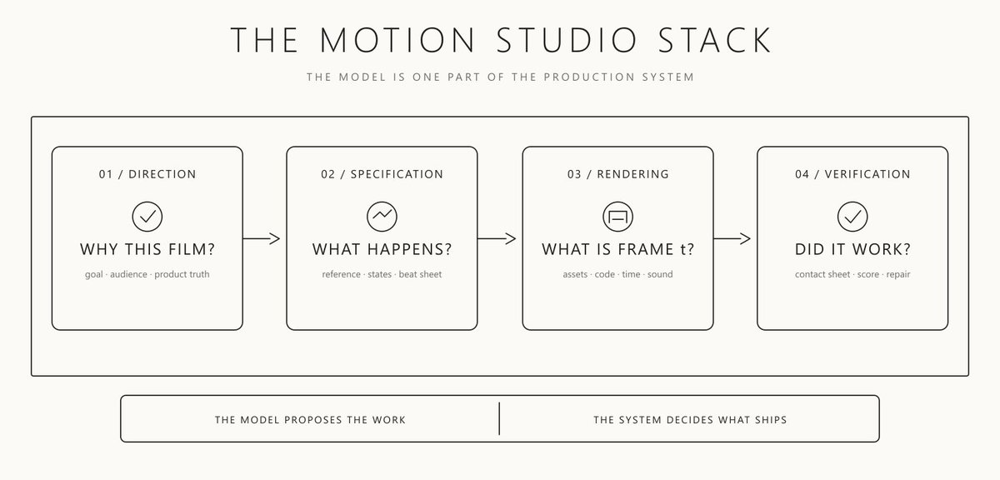
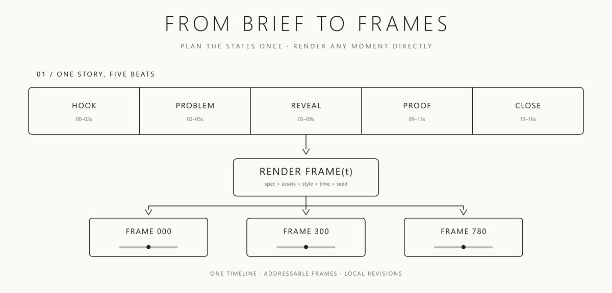
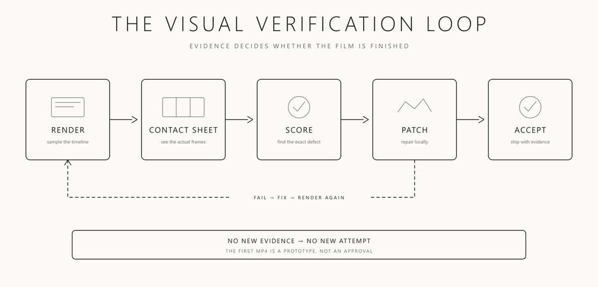
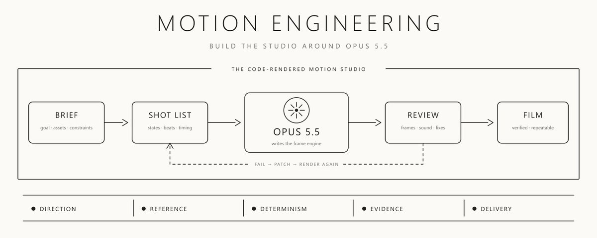

# Motion Engineering: Build a Video Studio Around Opus 5.5
> Source: https://x.com/0xwhrrari/status/2105643919119696297
> Author: rari (@0xwhrrari)
> Posted: Thu Oct 01 13:00:05 +0000 2026
> Captured: 2026-10-15T09:02:28+00:00
> Stats at capture: 695,482 views · 1,135 likes · 39 replies · 103 reposts · 3,972 bookmarks · 30 quotes

## Post

Opus 5.5 can make a video

The hard part is making the next one better

That takes a studio, not a prompt

I broke down how to build it ↓ https://x.com/i/article/2105626165704572928

## Article: Motion Engineering: Build a Video Studio Around Opus 5.5

Everybody is sharing videos made with Claude Opus 5.5

Some are excellent

Most look like the same demo

Large text in the center

A gradient behind it

Everything fades in

The logo appears at the end

The difference is not a secret prompt

It is the system around the model

Anthropic [released Opus 5.5 on September 22](https://www.anthropic.com/claude-opus-5-5)

Its coding and visual judgment make this workflow practical, but the model is only one part of it

[Embedded post](https://x.com/i/status/2102435511222890900)

The model writes the program

The program draws the frames

The renderer turns those frames into a film

The review loop decides whether anyone should see it

> A prompt can produce a clip. A studio can produce the next clip without rebuilding itself

This is how I would engineer that studio

> I publish practical breakdowns of AI agents, workflows, and production systems on Substack [Join the newsletter here](https://whrrari.substack.com/subscribe?next=https%3A%2F%2Fsubstack.com%2F%40whrrari%2Fnotes&utm_source=profile-page&utm_medium=web&utm_campaign=substack_profile&just_signed_up=true)

---

## What Opus is actually making

You ask for a video

Opus does not need to imagine every frame as a separate image

It can write code that answers a more useful question

```
What should the screen look like at time t?
```

That code becomes a frame function

```
function renderFrame(t, spec, assets) {
  // Draw the exact state of the film at time t
}

```

A renderer calls it across the timeline, captures frames, and encodes them into a video file

This changes the economics of revision

If a title enters too early, you change one time value

If a shape overshoots too far, you change one motion curve

If a product screen is wrong, you replace the asset and render again

You do not ask a video model to regenerate the whole shot and hope it remembers the previous version

Code-made motion is not the answer to every visual problem. Photoreal scenes, complex characters, and organic movement may still need footage or generated video

But for product films, UI motion, data stories, typography, diagrams, and launch explainers, a controllable frame function is a serious advantage

---

## The studio has five layers

Most people give Opus a description and judge the MP4

That skips almost every layer that determines the result

```
DIRECTOR       What is the film trying to say?
REFERENCE      What should it feel and look like?
TIMELINE       What changes at each beat?
RENDERER       How is every frame produced?
CRITIC         What failed, exactly where, and why?
```



The model can help with all five

It should not be allowed to collapse them into one uninspected step

That is where the generic output comes from

The model fills missing decisions with the safest visual defaults it knows

Your job is to remove the missing decisions before it starts rendering

---

### 1. Write a director's brief, not a vibe prompt

"Make an insane product video" leaves the important choices undefined

Thariq from the Claude Code team put the "one-shot" myth in perspective

[Embedded post](https://x.com/i/status/2102870353781641416)

- What is the product?

- What is the one thing the viewer should remember?

- Which visual reference is allowed to influence the work?

- Which elements must come from the real product?

- What would make the result unacceptable?

Give Opus a small production document before giving it a render task

```
FILM
One sentence: [the idea the viewer should remember]
Audience: [who this is for]
Duration: [seconds]
Formats: [16:9 / 9:16 / 1:1]

ASSETS
Real logo: [path]
Real UI screenshots: [paths]
Brand type and colors: [tokens]
Music or audio reference: [path]

VISUAL RULES
Keep: [specific traits from the reference]
Avoid: [specific visual clichés]
Never invent product screens or metrics

DELIVERABLES
Storyboard, contact sheet, final video, poster frame, source files
```

Notice what this does

It separates facts about the product from choices about the film

The model can invent camera movement

It cannot invent your dashboard

It can propose a stronger opening

It cannot quietly replace your logo

That boundary matters more than a longer adjective list

---

### 2. Give it a reference it can inspect

If you do not supply a visual grammar, the model supplies its own

That is why unrelated one-prompt reels often look related

Give it a frame, a short film, or a folder of previous work

Then make it write down what it learned

```
REFERENCE ANALYSIS
Palette: [actual colors, not “premium”]
Typography: [family, width, weight, scale]
Composition: [where the eye goes first]
Pacing: [average time between meaningful changes]
Motion: [snap, glide, overshoot, cut, hold]
Texture: [grain, paper, glass, none]

DO NOT COPY
Subjects, logos, copy, or product-specific imagery
```

The output should be a style guide, not a collage of borrowed shots

For a product film, also give Opus access to the real site and ask it to collect the exact screens it intends to animate

Review that asset list before production

If an asset is missing, the agent should stop and ask rather than draw a convincing fake

---

### 3. Turn the story into states and beats

A list of effects is not a storyboard

"Zoom in, then morph, then add particles" describes activity, not meaning

A stronger plan says what the viewer knows at each moment

```
00-02s   HOOK       One image that earns attention
02-05s   PROBLEM    Show the friction, not a paragraph about it
05-09s   REVEAL     The product enters through a real interaction
09-13s   PROOF      One screen or number demonstrates the claim
13-16s   CLOSE      A clean final state and a readable CTA
```

Each beat needs an entry state, an exit state, and a reason to exist

For UI motion, write a state list before drawing transitions

```
SEARCH -> RESULT -> DETAIL -> ACTION -> CONFIRMATION
```

Now the model can design continuity between known states

One component may change size, color, content, and position across the film while remaining recognizably the same object

That is a better brief than "make the interface dynamic"



The shot list is also a contract

If the agent cannot explain why shot four exists, shot four does not belong in the render

---

### 4. Choose the renderer on purpose

Opus can write a lightweight Canvas or SVG film in one project

That is useful for a small, self-contained piece

For a repeatable series, a video framework can make scene structure, media placement, and export easier to maintain

[Remotion](https://www.remotion.dev/docs/the-fundamentals) - treats video as React components rendered at known frame numbers

[HyperFrames](https://github.com/heygen-com/hyperframes/blob/main/docs/developers/overview.mdx) - uses an editable HTML composition with explicit timing and seekable animation runtimes

Neither is automatically "better"

Use the smallest system that supports the film you intend to make again

The non-negotiable requirement is seekability

```
frame 240 must be renderable directly
without replaying frames 0 through 239
```

That means no hidden clock, no unseeded randomness, and no animation that only works after a browser has been running for eight seconds

Think of every frame as a deterministic query

```
frame = render(time, shot_list, assets, style_tokens, seed)
```

Once the film works this way, revisions become local and testable

---

### 5. Make motion have weight

Basic motion moves from A to B on a fixed curve

Good motion communicates mass, hierarchy, and intent

- Small control can snap

- Large panel can settle

- Camera can move slowly enough to preserve orientation

- Headline can arrive fast, then hold long enough to be read

Springs are useful because they describe that behavior more naturally than a generic ease-in-out

But do not turn every object into a spring

If everything overshoots, nothing feels precise

Write a motion rule for each class of object

```
MICRO UI      quick, minimal overshoot
PANELS        controlled settle
CAMERA        smooth, almost invisible
HEADLINES     strong entrance, stable hold
MASCOT        playful, clearly intentional
```

The most important check is still visual

Does the viewer know where to look after each move?

If not, the animation is decoration competing with the message

---

### 6. Put sound on the same timeline

Many AI-made films look finished with the audio muted

Then you turn the sound on and realize nothing is connected

The click lands after the button

The cut misses the beat

The final logo arrives before the music resolves

Treat sound as a timeline input, not a last-minute file dropped under the video

```
BEAT GRID
0.00s   opening hit
0.50s   first state change
1.00s   product reveal
1.50s   interaction click
2.00s   visual payoff
```

Use a licensed or original track when you have one. Measure its beats and cut against them

If the sound is synthesized, place every cue against the same timestamps that drive the picture

The test is simple

Close your eyes and listen to the film

If it has no shape without the picture, the sound design is probably not finished

---

### 7. Inspect the frames before exporting the film

This is the step people skip because the first render feels like progress

Do not start by watching a full 60-second export ten times

Ask the renderer for a contact sheet

Take one frame at every major beat, then a short strip around the fastest transitions

Look for the things a text-only agent misses

```
[ ] Text readable at phone size
[ ] No element crossing the safe area
[ ] Real product assets, not invented replacements
[ ] Consistent type and color across scenes
[ ] No awkward mid-transition frames
[ ] Cuts and sound cues land together
[ ] First two seconds contain a real hook
[ ] Last frame is strong enough to be a poster
```

Then give Opus the contact sheet and a specific critique task

```
Do not describe what you intended to make
Judge only the rendered frames

Identify the three largest defects
Give each defect a timestamp, evidence, and a local fix
Patch only those sections, then render the affected frames again
```



This is the difference between "the agent made a video" and "the agent directed a video"

The first one stops when the file exists

The second stops when the evidence says the film works

---

### 8. Export variants from the source, not from a crop

A 16:9 launch film and a 9:16 social cut are different compositions

The vertical version may need larger type, fewer simultaneous elements, a different camera path, and a tighter story

Do not make one beautiful wide video and ask software to crop its center

Keep the same assets, timeline, and narrative states

Then define layout behavior for each format

```
ONE STORY
  -> 16:9: more spatial context
  -> 9:16: fewer elements, stronger vertical hierarchy
  -> 1:1: tighter typography and shorter holds
```

Render a contact sheet for every variant

An export is not correct because the encoder finished

It is correct because the composition survived the format change

---

### 9. Package the studio, not the chat

If the only record of the film is a conversation, you do not have a production system

You have a lucky session

Keep the important decisions in files that another run can read

```
motion-studio/
  brief.md             the one-sentence goal and product facts
  style-guide.md       palette, type, motion, and banned defaults
  shotlist.md          beats, states, timestamps, and purpose
  assets/              approved logos, screens, footage, and sound
  src/                 seekable composition and motion code
  reviews/             contact sheets and defect notes
  out/                 exports for each format
```

Then the next video starts with a real base

Swap the product brief and assets

Keep the render contract, review checklist, and delivery structure

This is also how you stop a long agent run from drifting

The agent can inspect its own files, resume from a completed gate, and tell you which artifact is missing

It should not claim the film is done because the last command exited successfully

---

### 10. Give long runs gates, not freedom

The appeal of Opus is that you can hand it a large creative task and leave it working

That only helps if the run knows when to stop, when to ask, and when to repair

```
GATE 1  Approve references and product assets
GATE 2  Approve style guide and shot list
GATE 3  Inspect representative stills
GATE 4  Render rough cut and contact sheet
GATE 5  Repair the three highest-impact defects
GATE 6  Check audio, formats, and final deliverables
```

The agent can work for hours between those gates

It should not make irreversible brand decisions on your behalf

If the brief says "use the real interface" a missing interface screenshot is a blocker, not an invitation to hallucinate one

If the reference is unclear, the right output is a question or a small test frame, not 900 polished wrong frames

Autonomy becomes useful when every stage leaves evidence for the next one

That is the same lesson behind reliable agents in any domain

The loop needs a target, an observation, a bounded repair, and a way to stop

---

## The prompt I would actually give Opus

The useful prompt is not "make a viral video"

It is a production contract with review gates

```
You are directing and engineering a code-rendered motion film

Goal:
Make a [duration]-second film for [product/audience]
The viewer should remember: [one sentence]

Inputs:
- Use only the supplied product assets and approved copy
- Inspect the reference files and write a style-guide.md
- Write shotlist.md with timestamps, entry states, exit states, and purpose

Build:
- Choose a renderer and explain why it fits this project
- Make every frame seekable and deterministic
- Keep motion, audio cues, and transitions on one timeline
- Preserve editable source and a repeatable render command

Review gates:
1. Show the style guide and shot list before building
2. Show a contact sheet before the full render
3. Score hook, readability, continuity, motion, and sound sync
4. Fix the three worst defects and re-render those sections
5. Export 16:9 and 9:16 as separate compositions

Deliver:
final videos, poster frames, contact sheets, source, assets list,
and a short note on what still needs human review
```

That prompt is longer than the viral one-liner

The important part is not its length

It gives the model a sequence of decisions, artifacts, and stop conditions

You can reuse that system for the next launch instead of asking for a miracle from scratch

---

## The real shift

One-prompt video is impressive because the first result arrives fast

Motion engineering is valuable because the tenth result can be better than the first

The model gives you speed

The brief gives it direction

The renderer gives you control

The contact sheet gives you evidence

The loop turns that evidence into improvement

```
PROMPT -> CLIP

BRIEF -> SYSTEM -> FILM -> REVIEW -> BETTER SYSTEM
```

That is the difference between generating a demo and operating a studio

---

-> Subscribe to my [Substack](https://whrrari.substack.com/subscribe?next=https%3A%2F%2Fsubstack.com%2F%40whrrari%2Fnotes&utm_source=profile-page&utm_medium=web&utm_campaign=substack_profile&just_signed_up=true)

-> Join my [Telegram](https://t.me/+qqS3Qn-x1305ZmUy)

-> Bookmark this this before you ask an AI to "make a video" with no brief, no references, and no way to inspect the result

-> Follow [@0xwhrrari](https://x.com/@0xwhrrari)

## Media

 — Direct article media. Source media: https://pbs.twimg.com/media/HTiwDt_XgAE111a.jpg
 — Direct article media. Source media: https://pbs.twimg.com/media/HTiw7HyXwAA20mm.jpg
 — Direct article media. Source media: https://pbs.twimg.com/media/HTixrE4XkAA11MQ.jpg
 — Direct article media. Source media: https://pbs.twimg.com/media/HTiyP0EXkAAQbnL.jpg

## Thread

### rari ([@0xwhrrari](https://x.com/0xwhrrari/status/2105650296059723783)) — 2026-10-01T13:25:26+00:00

@slash1sol worth to read more than any guidebooks
### rari ([@0xwhrrari](https://x.com/0xwhrrari/status/2105670862313513113)) — 2026-10-01T14:47:09+00:00

@rewind02 factss
### rari ([@0xwhrrari](https://x.com/0xwhrrari/status/2105656843632890156)) — 2026-10-01T13:51:27+00:00

@SmrtSolX glad it helped you
### rari ([@0xwhrrari](https://x.com/0xwhrrari/status/2105650390201176400)) — 2026-10-01T13:25:48+00:00

@arle0x opus 5.5 outperforming.
### rari ([@0xwhrrari](https://x.com/0xwhrrari/status/2105650446673358985)) — 2026-10-01T13:26:02+00:00

@reiraxbt book it and read later
### rari ([@0xwhrrari](https://x.com/0xwhrrari/status/2105650407854735394)) — 2026-10-01T13:25:52+00:00

@elune0x thanks bros
### rari ([@0xwhrrari](https://x.com/0xwhrrari/status/2105650675782766804)) — 2026-10-01T13:26:56+00:00

@kaorixbt as far as i know
opus doesn't write code as well as others
### rari ([@0xwhrrari](https://x.com/0xwhrrari/status/2105650717713387542)) — 2026-10-01T13:27:06+00:00

@iiiichigo_chan thanks ichigo <3

## Comments

### slash1s ([@slash1sol](https://x.com/slash1sol/status/2105644127303905663)) — 2026-10-01T13:00:55+00:00

@0xwhrrari worth to read this new article
### rewind ([@rewind02](https://x.com/rewind02/status/2105654524023046461)) — 2026-10-01T13:42:14+00:00

@0xwhrrari proper good stuff
### SmrtSolX ([@SmrtSolX](https://x.com/SmrtSolX/status/2105656136275722424)) — 2026-10-01T13:48:38+00:00

@0xwhrrari Thanks, really useful!
### arle ([@arle0x](https://x.com/arle0x/status/2105644763311710495)) — 2026-10-01T13:03:27+00:00

@0xwhrrari opus 5.5 better than anything else in terms of both cost and performance
### reira ([@reiraxbt](https://x.com/reiraxbt/status/2105645428847026554)) — 2026-10-01T13:06:05+00:00

@0xwhrrari best read
def worth to bookmark it
### elune ([@elune0x](https://x.com/elune0x/status/2105644587335500038)) — 2026-10-01T13:02:45+00:00

@0xwhrrari excellent breakdown 
thanks rari, worth to book it
### akari ([@akarixbt](https://x.com/akarixbt/status/2105645135409369496)) — 2026-10-01T13:04:55+00:00

@0xwhrrari Iwhat other ways does opus outperform gpt?
### Ichigo ([@iiiichigo_chan](https://x.com/iiiichigo_chan/status/2105646191102873693)) — 2026-10-01T13:09:07+00:00

@0xwhrrari amazing article
### Dom ([@DominickSGerard](https://x.com/DominickSGerard/status/2105718325636444581)) — 2026-10-01T17:55:45+00:00

@0xwhrrari I would like to introduce you to the concept of punctuation. Notably, the indicator humans put at the end of a thought known as a sentence.
### Rob ([@RobGuerra90](https://x.com/RobGuerra90/status/2105660986376020082)) — 2026-10-01T14:07:55+00:00

@0xwhrrari Lowkey feel like we've all become one-trick ponies with Opus 5.5, time to level up our video game
### John Isaacson ([@Johnisaacson](https://x.com/Johnisaacson/status/2107753963974209738)) — 2026-10-07T08:44:39+00:00

@0xwhrrari @bot can you make sure the my video editor bot reads and ingests this, find anything that beats our current skill and update.
### Azy 🦋 ([@popcoornft](https://x.com/popcoornft/status/2109326883074830462)) — 2026-10-11T16:54:52+00:00

@0xwhrrari Agree, the hard part is consistency 🥰
### Kaabium ([@Kaabiummim](https://x.com/Kaabiummim/status/2107036008323940662)) — 2026-10-05T09:11:45+00:00

@0xwhrrari I'll try to incorporate the useful parts in my video studio, thanks
### Arnold ([@Arnold20064](https://x.com/Arnold20064/status/2107105970199408663)) — 2026-10-05T13:49:46+00:00

@0xwhrrari Can astra do it too.
I don't have claude
### Mister Cotrim ([@mistercotrim](https://x.com/mistercotrim/status/2105701665185648885)) — 2026-10-01T16:49:33+00:00

@0xwhrrari Storyboard, code rendering and audio really do need to work together. I explored that with SLOPPER, a 13:42 Thriller parody starring retired AI models, built with Opus 5.5 + JavaScript + p5.js/p5.brush: https://t.co/v4Gw1btuwq
### Yohaku ([@yohakujpn](https://x.com/yohakujpn/status/2105730296868163911)) — 2026-10-01T18:43:20+00:00

@0xwhrrari Opus 5.5 can make banger videos tbh
### jukkai ([@jukhau](https://x.com/jukhau/status/2107016598061973506)) — 2026-10-05T07:54:38+00:00

@0xwhrrari I made editor for Opus animations/videos.
### Archive ([@ArchiveExplorer](https://x.com/ArchiveExplorer/status/2105700152220741924)) — 2026-10-01T16:43:32+00:00

@0xwhrrari fire

honestly building your own skills or tools for motion design right now is the best move
### Blum ([@Blum_OG](https://x.com/Blum_OG/status/2105752884646408321)) — 2026-10-01T20:13:05+00:00

@0xwhrrari great read, opus 5.5 is now my go-to tool for video
### I ate your sandwich ([@pixelated_tramp](https://x.com/pixelated_tramp/status/2107869175922536713)) — 2026-10-07T16:22:28+00:00

@0xwhrrari Save yourself tokens/time and don't have it build the tooling on every new run - https://t.co/BUAszRz2w7

Contributions by your agent to the codebase for new tools added along the way are welcome
### Storyverse ([@Storyverseart](https://x.com/Storyverseart/status/2106073393896538513)) — 2026-10-02T17:26:40+00:00

@0xwhrrari Five boxes in that diagram and only one is the model. The brief and the shot list are where the film gets decided.
### DreamClear Media ([@MikeyDreamClear](https://x.com/MikeyDreamClear/status/2106788860793610298)) — 2026-10-04T16:49:41+00:00

@0xwhrrari Great stuff!
### Sophia Data Queen ([@SophiaDataQueen](https://x.com/SophiaDataQueen/status/2107467160155230591)) — 2026-10-06T13:45:00+00:00

@0xwhrrari One video is the thumbnail.
The next one is the work.
### Kirill ([@KirSolo193083](https://x.com/KirSolo193083/status/2107151790751838564)) — 2026-10-05T16:51:50+00:00

@0xwhrrari very informative article, I'll add it to my bookmarks.
### Liam Nerd ([@LiamAITools](https://x.com/LiamAITools/status/2108219945532485875)) — 2026-10-08T15:36:18+00:00

@0xwhrrari Next one better is the job.
### CREADEVS ([@creadevsglobal](https://x.com/creadevsglobal/status/2107218007894474879)) — 2026-10-05T21:14:57+00:00

@0xwhrrari Absolutely incredible, thanks for the tip! 🔥
### 9h0st ([@condJ78561](https://x.com/condJ78561/status/2106764759542706676)) — 2026-10-04T15:13:55+00:00

@0xwhrrari “视频工作室”真正的复利来自可回归：把镜头状态、节拍点、字体与动效参数做成版本化数据，每次渲染先抽帧跑像素差和节拍偏移检查，模型升级后才能批量复用而不靠人工看片兜底。
### li li ([@mark_li21](https://x.com/mark_li21/status/2108449627414622421)) — 2026-10-09T06:48:58+00:00

@0xwhrrari Thanks for sharing this.
### Buffer ([@bufcapy](https://x.com/bufcapy/status/2105732138603807043)) — 2026-10-01T18:50:39+00:00

@0xwhrrari 真正贵不提示词，是把“差不多”打回去重做的耐心。AI 负责出片，人类负责不丢审美。
### Buffer ([@bufcapy](https://x.com/bufcapy/status/2105709599055880232)) — 2026-10-01T17:21:05+00:00

@0xwhrrari 模型会拍片真正稀缺的是审美和返工。提示词负机，片负责把“能成”改“得看”。
### G. ([@hola_gmi](https://x.com/hola_gmi/status/2106815433995354126)) — 2026-10-04T18:35:16+00:00

@0xwhrrari I just need the mcp.
### Shesaidmewakeup ([@shesaidmewakeup](https://x.com/shesaidmewakeup/status/2106403510975668726)) — 2026-10-03T15:18:26+00:00

@0xwhrrari The contact sheet step is the underrated one. Judging stills instead of re-watching the whole export catches defects much faster.

I'd add one more check: watch it once with the sound off, then once with the picture off.


## Other returned timeline records

> The CLI did not expose reply relationships. These records do not start with a reply mention and were authored by someone other than the saved-post author. They may include recommendations or promoted posts; they are retained as source context, not verified replies.

### Starlink ([@Starlink](https://x.com/Starlink/status/2068115197718593741)) — 2026-06-19T23:34:21+00:00

Get connected with fast, reliable internet for streaming, video calls, online gaming and more.

Order online in minutes.

## Links

- https://x.com/i/article/2105626165704572928
- https://www.remotion.dev/docs/the-fundamentals
- https://x.com/@0xwhrrari
- https://t.me/+qqS3Qn-x1305ZmUy
- https://whrrari.substack.com/subscribe?next=https%3A%2F%2Fsubstack.com%2F%40whrrari%2Fnotes&utm_source=profile-page&utm_medium=web&utm_campaign=substack_profile&just_signed_up=true
- https://www.anthropic.com/claude-opus-5-5
- https://github.com/heygen-com/hyperframes/blob/main/docs/developers/overview.mdx
