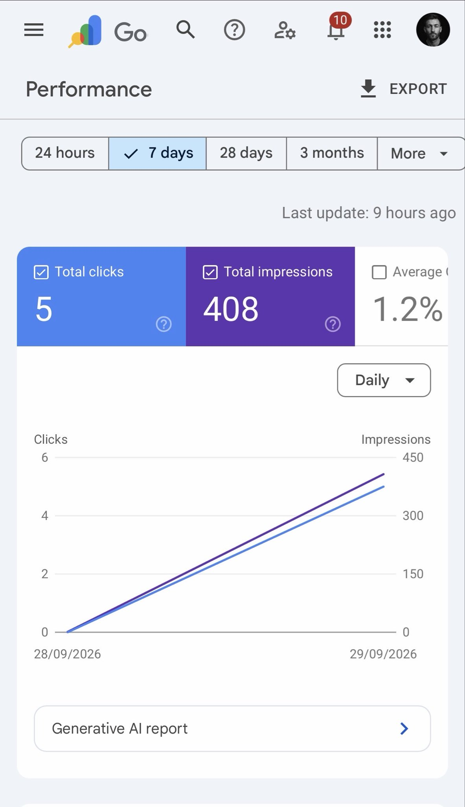
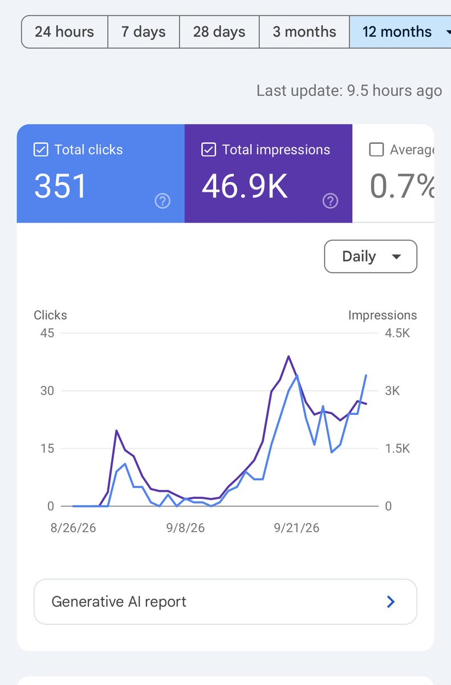
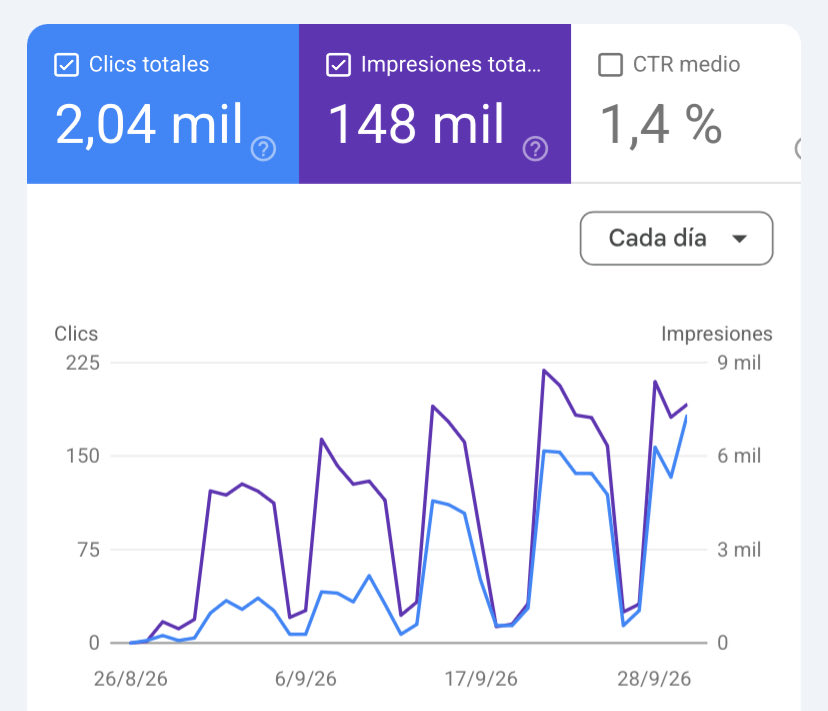
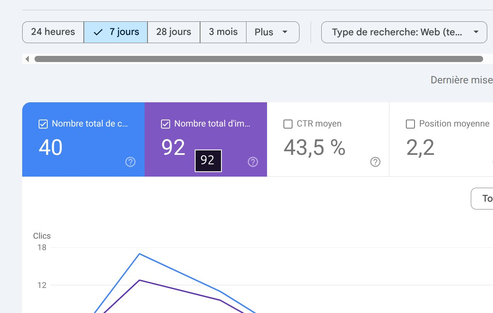
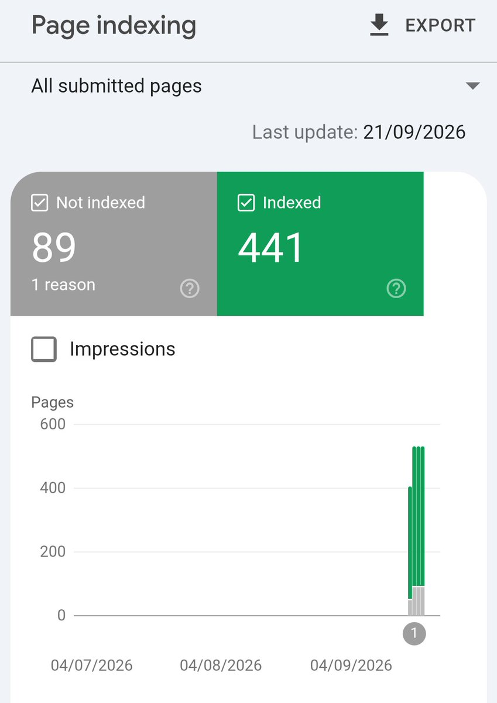
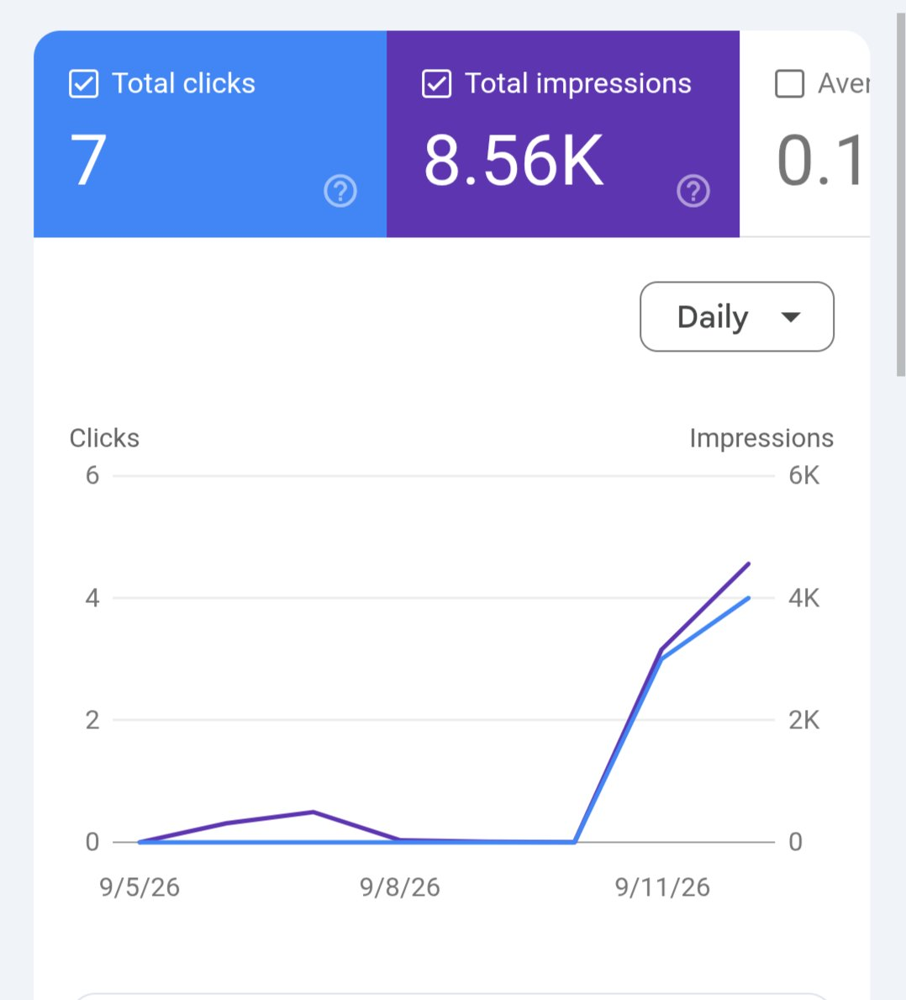
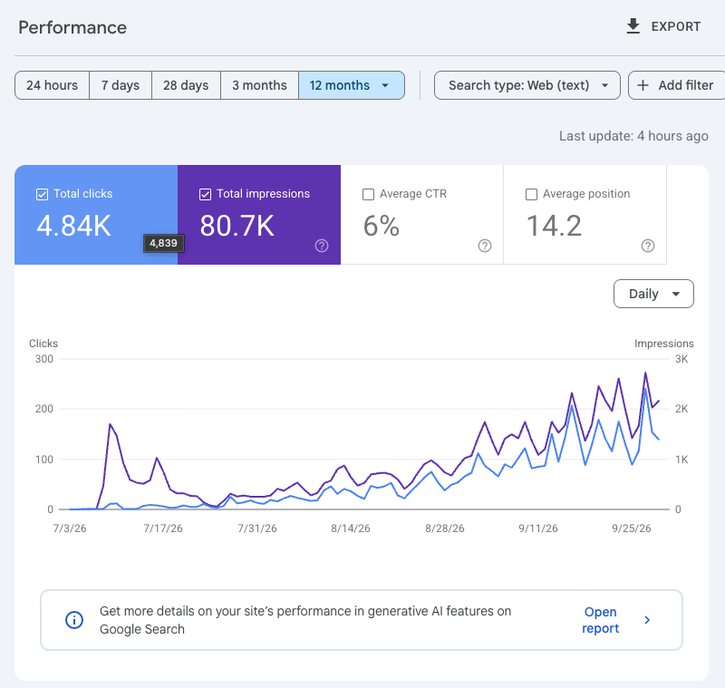

# The game with SEO is ‘how do I get my pages indexed’ with a new site.
> Source: https://x.com/SearchForRyan/status/2105951799995728084
> Author: Ryan Darani (@SearchForRyan)
> Posted: 2026-10-02T09:23:30+00:00
> Captured: 2026-10-15T09:02:28+00:00
> Stats at capture: 50,441 views · 271 likes · 43 replies · 18 reposts · 571 bookmarks · 11 quotes

## Post

The game with SEO is ‘how do I get my pages indexed’ with a new site. 

Especially when 99% of the content that hits the web is a big fat shit straight from an AI tool. 

This site is 48 hours old + 500 pages deep. 

Here’s how I got it to pop so quick: 

1. By far, your semantic structure matters more than anything else. How your headers connect, the logical flow of your content, the connection between pages… all of this is my top priority. 

2. Spend the time prepping your page briefs FIRST before you say ‘hey ChatGPT write me some garbage just like the other 4000 sites in my niche’. 

3. You will HAVE to force index it. I use indexmysite[dot]app to do this. It can take 24 hours to populate but I’d rather do that than wait 3-6 weeks to start receiving clicks. 

4. Make sure EVERY page has an end goal. A form fill, a lead magnet download, a quiz… something. 

5. You HAVE to attach an entity. This is my 5th site in a month to have popped and generate traffic so quickly and the person (completely fake person) is my entity. 

6. Run citations + social profiles to the domain within the first 2 weeks and force index the most powerful sites with indexmysite[dot]app. 

This will keep getting deeper + I’ll keep sending links and forcing any new pages in the index over time. 

Don’t just spam the web and hope your shit will stick. It won’t.

## Media

 — Post media 1. Source media: https://pbs.twimg.com/media/HTnX_9ZXwAAdWiq.jpg?name=orig
 — Reply 2105957599640183104 media 1. Source media: https://pbs.twimg.com/media/HTndRnsWsAAjC1F.jpg
 — Reply 2105985529900912751 media 1. Source media: https://pbs.twimg.com/media/HTn2rMFWgAAVEPz.jpg
 — Reply 2106312849593168052 media 1. Source media: https://pbs.twimg.com/media/HTsgBOMWgAAhkRF.jpg
 — Reply 2106194848130965626 media 1. Source media: https://pbs.twimg.com/media/HTq1DLhbIAATLCf.jpg
 — Reply 2106011356205813894 media 1. Source media: https://pbs.twimg.com/media/HToOKuJWkAAE2FH.jpg
 — Reply 2106317396739002740 media 1. Source media: https://pbs.twimg.com/media/HTskCM3XcAAytNJ.png

## Thread

### Ryan Darani ([@SearchForRyan](https://x.com/SearchForRyan/status/2105969787134255156)) — 2026-10-02T10:34:58+00:00

@s_matharu Hellll yeah
### Ryan Darani ([@SearchForRyan](https://x.com/SearchForRyan/status/2106015153888362565)) — 2026-10-02T13:35:15+00:00

@Curbsightio The indexing is the point. Not the clicks.
### Ryan Darani ([@SearchForRyan](https://x.com/SearchForRyan/status/2105988013520212406)) — 2026-10-02T11:47:24+00:00

@luisvegaseo Is mil = thousands?
### Ryan Darani ([@SearchForRyan](https://x.com/SearchForRyan/status/2105985042467930158)) — 2026-10-02T11:35:36+00:00

@eashish93 Send a screenshot for me?
### Ryan Darani ([@SearchForRyan](https://x.com/SearchForRyan/status/2106316370602541249)) — 2026-10-03T09:32:10+00:00

@Ahmedbenh1 This is just a custom code website using Vercel
### Ryan Darani ([@SearchForRyan](https://x.com/SearchForRyan/status/2106996303632937200)) — 2026-10-05T06:33:59+00:00

@samigrows Ya as I said

## Comments

### Sunny Matharu 💬 ([@s_matharu](https://x.com/s_matharu/status/2105957599640183104)) — 2026-10-02T09:46:33+00:00

@SearchForRyan Can relate 🙌🏽 Site launched to Google on August 26th https://t.co/WhKfTeJWDq
 — Source media: https://pbs.twimg.com/media/HTndRnsWsAAjC1F.jpg
### Sol Zendejas-Smith ([@Curbsightio](https://x.com/Curbsightio/status/2106006823308492969)) — 2026-10-02T13:02:09+00:00

@SearchForRyan If you have 500 pages and only 400 impressions you’re getting less than 1 impressions per page…

How is this considered a good result?
### Luis Vega | Consultor SEO ([@luisvegaseo](https://x.com/luisvegaseo/status/2105985529900912751)) — 2026-10-02T11:37:32+00:00

@SearchForRyan First month, what do you think? https://t.co/KWtBJzMwdI
 — Source media: https://pbs.twimg.com/media/HTn2rMFWgAAVEPz.jpg
### Ashish Rawat ([@eashish93](https://x.com/eashish93/status/2105979221113987554)) — 2026-10-02T11:12:28+00:00

@SearchForRyan This is very thin result and normal.  Even with just 2 pages you can get this kind of result
### Ahmed Benh ([@Ahmedbenh1](https://x.com/Ahmedbenh1/status/2106312849593168052)) — 2026-10-03T09:18:11+00:00

@SearchForRyan is it a cms based website? or a custom code website? 
i found it hard to rank custom code website. 
screenshot is a website that has 2 pages(lp + contact) not US based. new domain and still got indexed and already pulling some traffic https://t.co/2mqvMojTe1
 — Source media: https://pbs.twimg.com/media/HTsgBOMWgAAhkRF.jpg
### Sami | SEO AI ([@samigrows](https://x.com/samigrows/status/2106989814251974944)) — 2026-10-05T06:08:12+00:00

@SearchForRyan It's pretty easy to get your pages indexed lol
### David Choi ([@DavidChoiMusic](https://x.com/DavidChoiMusic/status/2106175049837469762)) — 2026-10-03T00:10:37+00:00

@SearchForRyan @grok is this relevant and useful info or is this person trying to sell a product? Can someone do this without the product he may be selling? If so, how?
### dFusion AI Protocol ([@dFusionAI](https://x.com/dFusionAI/status/2106030930125087015)) — 2026-10-02T14:37:56+00:00

@SearchForRyan Publishing more pages means nothing if Google can't understand how they connect!
### Tim ([@timmyships](https://x.com/timmyships/status/2106194848130965626)) — 2026-10-03T01:29:17+00:00

@SearchForRyan This graph doesn't really tell us anything about indexing though...? Show us the page indexing graph. Agree with most of what you said except the need to force index. Here's a similar site of mine, only submitted homepage and HTML sitemap for comparison. https://t.co/Vda35CfjQp
 — Source media: https://pbs.twimg.com/media/HTq1DLhbIAATLCf.jpg
### Luc ([@luc2web](https://x.com/luc2web/status/2106057523878863310)) — 2026-10-02T16:23:37+00:00

@SearchForRyan why use "indexmysite" vs just manual upload how do they do the force indexation?
### dkahhori ([@dkahhori](https://x.com/dkahhori/status/2106061550394228804)) — 2026-10-02T16:39:37+00:00

@SearchForRyan What’s indexmysite? Might sound dumb question, but I’m trying to rank my landing page for my app
### Tom Limb ([@thetomlimb](https://x.com/thetomlimb/status/2106171487862587881)) — 2026-10-02T23:56:28+00:00

@SearchForRyan This is not a very impressive impressions to clicks ratio
### AP Squared ([@APSquaredDev](https://x.com/APSquaredDev/status/2106217820530884794)) — 2026-10-03T03:00:34+00:00

@SearchForRyan Can you explain 5 and 6 more?
### Boon aka Hwee-Boon Yar ([@hboon](https://x.com/hboon/status/2106316578610708956)) — 2026-10-03T09:33:00+00:00

@SearchForRyan What did you use before indexmysite ? I have 2 Safari windows where I click through them using my daily GSC budget. It's so slow.
### Cody Schuldt ([@codylschuldt](https://x.com/codylschuldt/status/2106011356205813894)) — 2026-10-02T13:20:09+00:00

@SearchForRyan Yep, planning, entities and forced indexing work. I launched this one 3 weeks ago, you can see where it gets indexed after a couple of days and boom. https://t.co/qNqrITU3WK
 — Source media: https://pbs.twimg.com/media/HToOKuJWkAAE2FH.jpg
### Unstale ([@unstaleai](https://x.com/unstaleai/status/2106047022487027966)) — 2026-10-02T15:41:53+00:00

@SearchForRyan the page brief point is so underrated. i'd add internal links from day one tho, a 500 page site full of orphan pages just sits there no matter how hard you force index it. google still needs a path to crawl throgh
### Nick Launches ([@nicklaunches](https://x.com/nicklaunches/status/2105986841841402279)) — 2026-10-02T11:42:45+00:00

@SearchForRyan A few real backlinks usually get new pages indexed faster
### Bint E Jamil ( Technical SEO Specialist) ([@seo_bint_ejamil](https://x.com/seo_bint_ejamil/status/2106626515651936660)) — 2026-10-04T06:04:35+00:00

@SearchForRyan Indexing ≠ ranking.

You can force Google to crawl 500 pages. The real win is getting them indexed, retained, ranked, and converting.
### Alex ([@AlOnchain](https://x.com/AlOnchain/status/2106317396739002740)) — 2026-10-03T09:36:15+00:00

@SearchForRyan On my side, I have been testing different strategies in term of SEO/GEO in the last 12months. 

This one has just 3months (launched early July) and is starting to pick up and rank in google / llms. 

you need to understand the intent and frame it & source it to get those traffic! https://t.co/blP2NEd0RM
 — Source media: https://pbs.twimg.com/media/HTskCM3XcAAytNJ.png
### Ryan Doser ([@ryan_doser13](https://x.com/ryan_doser13/status/2106130560259436973)) — 2026-10-02T21:13:50+00:00

@SearchForRyan Yessir great perspective
### Jon Kraayenbrink ([@kraayenJon](https://x.com/kraayenJon/status/2106664604608712813)) — 2026-10-04T08:35:56+00:00

@SearchForRyan Timing also helps. My site basically the same day i published it started getting organic visitors.

I think what helped is to have my link in plenty of Socia posts that were trending

https://t.co/uAqBnOduNM
### Gene ([@genehttp](https://x.com/genehttp/status/2106097329862242327)) — 2026-10-02T19:01:47+00:00

@SearchForRyan Short correction: you do not need to use indexing Tools, submitting a sitemap is enough. My graph Looks the same and is also two days old.
### Immortal ([@Immortalai365](https://x.com/Immortalai365/status/2106248552943067310)) — 2026-10-03T05:02:41+00:00

@SearchForRyan Average 3 mins indexing of qualified links. No harm in giving this tool a try. $1 in free credits, and no card required. https://t.co/JdRl2orJ0w
### Brian Hadu ([@BrianHaDu](https://x.com/BrianHaDu/status/2106525483626295303)) — 2026-10-03T23:23:07+00:00

@SearchForRyan how did you ensure the semantic structure was optimized for indexing?
### AGTP ([@AGTPinsights](https://x.com/AGTPinsights/status/2105976134647316926)) — 2026-10-02T11:00:12+00:00

@SearchForRyan We actually went deeper on this here: https://t.co/X3rYtDRSGz
### Lauren Connally ([@ltconnally](https://x.com/ltconnally/status/2106439494031257931)) — 2026-10-03T17:41:25+00:00

@SearchForRyan A lot of it is just the index report not updating. I launched a new site (on a new domain) and got ranking/click data before indexing data. It was indexed within hours of publishing one article, and yet didn’t show up on the indexing report for almost a week.
### AIRobert ([@aiRobertDaily](https://x.com/aiRobertDaily/status/2105993258426077473)) — 2026-10-02T12:08:14+00:00

@SearchForRyan cool
### SEO Refresher ([@SEORefresher](https://x.com/SEORefresher/status/2105980197388648947)) — 2026-10-02T11:16:20+00:00

@SearchForRyan Great run down, easy to implement updates for people
### Abel Doma ([@DomaAbel](https://x.com/DomaAbel/status/2106141282301346036)) — 2026-10-02T21:56:26+00:00

@SearchForRyan Interesting experiment. Getting 500 pages discovered that quickly is one thing — I'd be even more interested in what happens over the next 60–90 days. Do the pages keep gaining impressions and rankings once Google has had more time to evaluate the site?
### Fahim Ansari ([@fahimansarihere](https://x.com/fahimansarihere/status/2106450512845660179)) — 2026-10-03T18:25:12+00:00

@SearchForRyan How does IndexMySite differ from submitting your site in Google Search Console?
### Sasha Voskolovych ([@Vosikkk](https://x.com/Vosikkk/status/2105965217159291159)) — 2026-10-02T10:16:49+00:00

@SearchForRyan Curious about #3. What does “force index” actually do differently from submitting a sitemap + requesting indexing in GSC?
### Jamie ([@jamiejreach](https://x.com/jamiejreach/status/2106307622219788716)) — 2026-10-03T08:57:25+00:00

@SearchForRyan Prepping briefs first is the right call, but a fake author entity is a trust risk, so attach a real person with a verifiable profile.

## Other returned timeline records

> The CLI did not expose reply relationships. These records do not start with a reply mention and were authored by someone other than the saved-post author. They may include recommendations or promoted posts; they are retained as source context, not verified replies.

### Starlink ([@Starlink](https://x.com/Starlink/status/2099964624632172986)) — 2026-09-15T20:52:36+00:00

Get fast, reliable home internet for seamless streaming, working from home, gaming, and more across multiple devices.

Order online in minutes.
### Starlink ([@Starlink](https://x.com/Starlink/status/2068115197718593741)) — 2026-06-19T23:34:21+00:00

Get connected with fast, reliable internet for streaming, video calls, online gaming and more.

Order online in minutes.
### Coherence ([@CoherenceBase](https://x.com/CoherenceBase/status/2110445970504974443)) — 2026-10-14T19:01:44+00:00

Your second brain is only as good as what you put in it.

Coherence captures while you read: highlight any page or PDF, add notes, save it with one click. Then search by meaning and ask your library anything, with answers that cite your sources.
### mrgadget ([@mrgadgetstudio](https://x.com/mrgadgetstudio/status/2105967333038604495)) — 2026-10-02T10:25:13+00:00

I agree with most of this from a technical SEO perspective, except the entity part.

You don’t need to attach an entity to every page, you can establish it once on the homepage or About page, then focus on building backlinks and external signals. Google can generally understand that the content across the site belongs to the same organizational entity.
