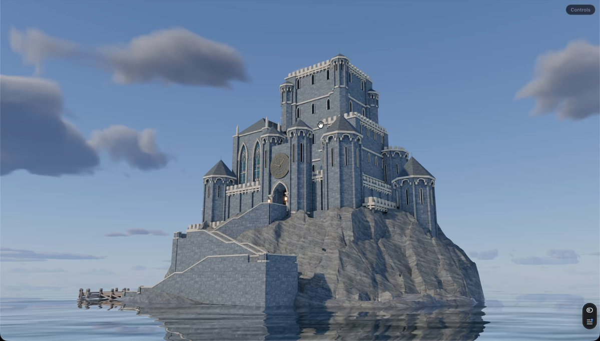
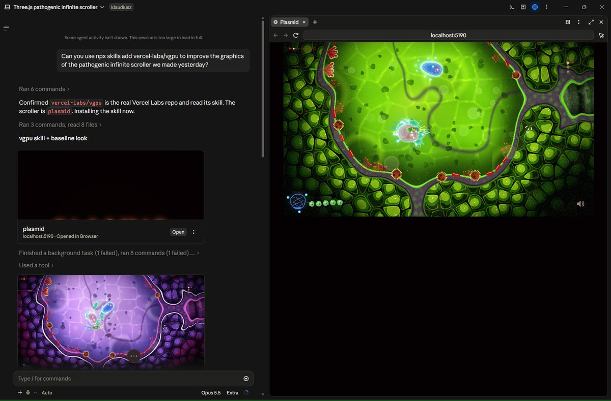

# The vgpu skill now helps your agent create better 3D models in Blender, optimized for web
> Source: https://x.com/matiNotFound/status/2106051894624047547
> Author: Matias 🧉 (@matiNotFound)
> Posted: 2026-10-02T16:01:14+00:00
> Captured: 2026-10-15T09:02:28+00:00
> Stats at capture: 28,921 views · 698 likes · 26 replies · 34 reposts · 807 bookmarks · 0 quotes

## Post

The vgpu skill now helps your agent create better 3D models in Blender, optimized for web

npx skills add vercel-labs/vgpu

## Media

[Post media 1](media/video-01.mp4) — Source media: https://video.twimg.com/amplify_video/2106050181330345984/vid/avc1/1264x720/xUZmD2gpZwNbFbfC.mp4?tag=29
 — Post media 1 thumbnail. Source media: https://pbs.twimg.com/amplify_video_thumb/2106050181330345984/img/PyZGqbV-HlKlKfzx.jpg
 — Reply 2106081128226447575 media 1. Source media: https://pbs.twimg.com/media/HTpNmwhX0AA1BYT.jpg
 — Reply 2106054324023419269 media 1. Source media: https://pbs.twimg.com/media/HTo1PX5WgAEWP9K.jpg
[Reply 2110375346046746649 media 1](media/video-02.mp4) — Source media: https://video.twimg.com/amplify_video/2110374180395098112/vid/avc1/576x1024/t-hXvst_5sBLVpTc.mp4?tag=29
[Reply 2110342352665473156 media 1](media/video-03.mp4) — Source media: https://video.twimg.com/amplify_video/2110341167745282048/vid/avc1/1920x1080/m0kAWre8eLhiSKiF.mp4?tag=29
[Reply 2110563791922770264 media 1](media/video-04.mp4) — Source media: https://video.twimg.com/amplify_video/2110478642488721409/vid/avc1/1438x1038/dB1MP0fH1Am8GDFv.mp4?tag=29
[Reply 2110342713228865764 media 1](media/video-05.mp4) — Source media: https://video.twimg.com/amplify_video/2110057828509470720/vid/avc1/1080x1080/I6F_bLTx6RiYciXQ.mp4?tag=29

## Thread

### Matias 🧉 ([@matiNotFound](https://x.com/matiNotFound/status/2106068969698533865)) — 2026-10-02T17:09:05+00:00

@agusegui Both!
### Matias 🧉 ([@matiNotFound](https://x.com/matiNotFound/status/2106053830148550702)) — 2026-10-02T16:08:56+00:00

@RaillyHugo 🫡
### Matias 🧉 ([@matiNotFound](https://x.com/matiNotFound/status/2106218321204965543)) — 2026-10-03T03:02:34+00:00

@michaeljelly The skill helps producing high poly models and then baking detail as AO and normal maps into low poly versions

Im actively using it to produce models for our web experiences
### Matias 🧉 ([@matiNotFound](https://x.com/matiNotFound/status/2106098749013696939)) — 2026-10-02T19:07:25+00:00

@JonDevX both!
### Matias 🧉 ([@matiNotFound](https://x.com/matiNotFound/status/2106098896753860991)) — 2026-10-02T19:08:01+00:00

@Sir_Romanus yes
### Matias 🧉 ([@matiNotFound](https://x.com/matiNotFound/status/2106066873909383187)) — 2026-10-02T17:00:46+00:00

@greenie_guy Baking

It doesn’t set a poly count since I think that can heavily depend on the thing you are trying to produce

Happy to iterate if you have feedback on it
### Matias 🧉 ([@matiNotFound](https://x.com/matiNotFound/status/2106400687634469013)) — 2026-10-03T15:07:13+00:00

@AndreusCafe Para cosas orgánicas no lo use mucho, tendría que probarlo pero no le tengo mucha fe
### Matias 🧉 ([@matiNotFound](https://x.com/matiNotFound/status/2106718124452003952)) — 2026-10-04T12:08:36+00:00

@gwammyy Definetly
### Matias 🧉 ([@matiNotFound](https://x.com/matiNotFound/status/2106445945042825436)) — 2026-10-03T18:07:03+00:00

@alnooraniii High poly / low poly
652.284 vertices / 283.592 vertices
19,56 MB / 8,76 MB
### Matias 🧉 ([@matiNotFound](https://x.com/matiNotFound/status/2106151228707156162)) — 2026-10-02T22:35:57+00:00

yes, search for visual references or ask astra to use image-gen to generate concepts.

for modeling I'd use astra, is the best one (in my experience)

then use the skill to start with a simple blocking and add detail as you confirm that you like the shots.

you'll need to ask your agent to render each part of the model and visually check
### Matias 🧉 ([@matiNotFound](https://x.com/matiNotFound/status/2106218495922901047)) — 2026-10-03T03:03:15+00:00

@RedCoatShiba I think it might help too, haven’t used Godot yet
### Matias 🧉 ([@matiNotFound](https://x.com/matiNotFound/status/2106098680306782524)) — 2026-10-02T19:07:09+00:00

@victor_vibing what do you mean?
### Matias 🧉 ([@matiNotFound](https://x.com/matiNotFound/status/2106098640880369972)) — 2026-10-02T19:07:00+00:00

@joebamsy2000 yes, but its free and you agent can just install it

## Comments

### Agu Seguí ([@agusegui](https://x.com/agusegui/status/2106067966358134827)) — 2026-10-02T17:05:06+00:00

@matiNotFound insane

it helps the agent to create a model or it just helps to optimize it?
### Hunter ♠️ ([@RaillyHugo](https://x.com/RaillyHugo/status/2106052907296604559)) — 2026-10-02T16:05:16+00:00

@matiNotFound You’re cooking hard bro
### Michael Jelly 🏴‍☠️ ([@michaeljelly](https://x.com/michaeljelly/status/2106156100429181187)) — 2026-10-02T22:55:19+00:00

@matiNotFound Better? Can you define that a bit more?
### Jonathan | Dev | WISHLIST Air Isles! ([@JonDevX](https://x.com/JonDevX/status/2106094465395933315)) — 2026-10-02T18:50:24+00:00

@matiNotFound Does it make better 3D or only optimization?

This castle looks incredible especially since it's on web.
### KR ([@Sir_Romanus](https://x.com/Sir_Romanus/status/2106098301066002812)) — 2026-10-02T19:05:39+00:00

@matiNotFound Can this work anywhere not just web
### greenguy ([@greenie_guy](https://x.com/greenie_guy/status/2106061629364273375)) — 2026-10-02T16:39:55+00:00

@matiNotFound what's the web optimization actually doing, decimation or baking? and is there a poly target it aims for
### Andreus ([@AndreusCafe](https://x.com/AndreusCafe/status/2106260973870829978)) — 2026-10-03T05:52:03+00:00

@matiNotFound Nice! Cómo va haciendo figuras organicas? Humanitos o animales. Todo lo que probé falló rotundamente salvo Meshy.
### gwam ([@gwammyy](https://x.com/gwammyy/status/2106149202506203412)) — 2026-10-02T22:27:54+00:00

@matiNotFound would this help with my godzilla game
### LA8 ([@alnooraniii](https://x.com/alnooraniii/status/2106124847441179077)) — 2026-10-02T20:51:08+00:00

@matiNotFound Can you put the download size and first-load time next to the castle demo? Same phone, same connection, before and after baking. That would make the web optimization much easier to judge.
### RitzDaCat ([@RitzDaCat](https://x.com/RitzDaCat/status/2106099425877836038)) — 2026-10-02T19:10:07+00:00

@matiNotFound Did you give it a initial starting reference or was this pure text to generation? Been struggling a bit with results having gaps in architecture.
### Dog of Wolf Street ([@RedCoatShiba](https://x.com/RedCoatShiba/status/2106135751222346174)) — 2026-10-02T21:34:27+00:00

@matiNotFound Looks cool - any equivalent with godot?
### Victor ([@victor_vibing](https://x.com/victor_vibing/status/2106074687885430975)) — 2026-10-02T17:31:49+00:00

@matiNotFound Starred, thanks. Can you try with 3D models too?
### J03✝️ ([@joebamsy2000](https://x.com/joebamsy2000/status/2106097184076619932)) — 2026-10-02T19:01:12+00:00

@matiNotFound Do I need to have blender?
### Artemi Vaarakallio ([@aaapinen](https://x.com/aaapinen/status/2106088656834355300)) — 2026-10-02T18:27:19+00:00

@matiNotFound i like this. earned the follow. the trophy is imaginary but very shiny
### Robert ([@robertjrooke](https://x.com/robertjrooke/status/2106105540774608957)) — 2026-10-02T19:34:25+00:00

@matiNotFound Man this is highly needed. Im going to look this up
### werqrwqer ([@rwsa23121](https://x.com/rwsa23121/status/2106130874458906964)) — 2026-10-02T21:15:05+00:00

@matiNotFound this supposed to be better 3d models?
### kaloszer ([@kaloszer](https://x.com/kaloszer/status/2106081128226447575)) — 2026-10-02T17:57:24+00:00

@matiNotFound hmmm https://t.co/EipFXMsNjL
 — Source media: https://pbs.twimg.com/media/HTpNmwhX0AA1BYT.jpg
### VoKUS ([@vokusz](https://x.com/vokusz/status/2106109154951864399)) — 2026-10-02T19:48:46+00:00

@matiNotFound Thanks Matias! Ofcourse this had to come from a (past) basementstudio employee :D
### Nahue Alberti ([@nays1_](https://x.com/nays1_/status/2106054324023419269)) — 2026-10-02T16:10:54+00:00

@matiNotFound https://t.co/SQmjezeF80
 — Source media: https://pbs.twimg.com/media/HTo1PX5WgAEWP9K.jpg
### Lady Zahra ([@ZeeJab](https://x.com/ZeeJab/status/2106125320994623537)) — 2026-10-02T20:53:01+00:00

@matiNotFound stfu!
### wonra ([@wonraai](https://x.com/wonraai/status/2108491011853095187)) — 2026-10-09T09:33:25+00:00

@matiNotFound Does it bake textures down for the web too, or only optimize the mesh?
### BULLA ([@zu53788](https://x.com/zu53788/status/2106428397786411254)) — 2026-10-03T16:57:20+00:00

@matiNotFound https://t.co/ihK6tDAaZE
### BULLA ([@zu53788](https://x.com/zu53788/status/2106428350038442238)) — 2026-10-03T16:57:08+00:00

@matiNotFound https://t.co/tmUFnU44E7
### Angry Socrates 🏛 ([@DefinitionsNew](https://x.com/DefinitionsNew/status/2106094025157804151)) — 2026-10-02T18:48:39+00:00

@matiNotFound Interior? My Worldheart project is doing exteriors and interiors now.

## Other returned timeline records

> The CLI did not expose reply relationships. These records do not start with a reply mention and were authored by someone other than the saved-post author. They may include recommendations or promoted posts; they are retained as source context, not verified replies.

### Starlink ([@Starlink](https://x.com/Starlink/status/2068115197718593741)) — 2026-06-19T23:34:21+00:00

Get connected with fast, reliable internet for streaming, video calls, online gaming and more.

Order online in minutes.
### Starlink ([@Starlink](https://x.com/Starlink/status/2092706810314858684)) — 2026-08-26T20:12:38+00:00

Starlink offers fast, reliable internet in the most rural and remote locations . Portable and easy to set up, Starlink Mini works wherever you are.

Order online in minutes.
### Starlink ([@Starlink](https://x.com/Starlink/status/2098108930048327740)) — 2026-09-10T17:58:44+00:00

Starlink offers fast, reliable internet in the most rural and remote locations. Portable and easy to set up, Starlink works wherever you are.

Order online in minutes.
### Steven Cheng ([@stevencheng](https://x.com/stevencheng/status/2110375346046746649)) — 2026-10-14T14:21:06+00:00

Behold, the ESP32 ball. https://t.co/yx3PvWK7jb
 — Source media: https://video.twimg.com/amplify_video/2110374180395098112/vid/avc1/576x1024/t-hXvst_5sBLVpTc.mp4?tag=29
### Emm | scenario.com ([@emmanuel_2m](https://x.com/emmanuel_2m/status/2110342352665473156)) — 2026-10-14T12:09:59+00:00

We just open-sourced an entire 3D team for Blender.

Introducing the Scenario plugin.

Use it inside Blender, or let Claude Code run it through MCP.

📁/scenario-plugin
┃
┣ 📁 Concept Artist
┃ ┣ 📁 Concept Art From a Prompt
┃ ┗ 📁 References From Your Viewport
┃
┣ 📁 3D Artist
┃ ┣ 📁 Meshes From Text or a Photo
┃ ┗ 📁 Retexture or Remesh the Selected Mesh
┃
┣ 📁 Animator
┃ ┣ 📁 Rig the Selected Character
┃ ┗ 📁 Motion From Text
┃
┣ 📁 Surfacing Artist
┃ ┣ 📁 PBR Materials Onto Any Slot
┃ ┗ 📁 Maps From a Photo
┃
┣ 📁 Layout Artist
┃ ┣ 📁 Greybox From a Description
┃ ┗ 📁 360 Worlds and Skies
┃
┣ 📁 Camera Operator
┃ ┣ 📁 Camera Path From a Sentence
┃ ┗ 📁 Orbits, Dollies, Cranes and Flyovers
┃
┣ 📁 Render Artist
┃ ┣ 📁 Viewport to Finished Still
┃ ┗ 📁 Playblast to Finished Shot
┃
┗ 📁 Sound Designer
┣ 📁 Music, Voice and SFX
┗ 📁 Dropped on Your Sequencer

Comment "BLENDER" and I'll send you the GitHub repo.
 — Source media: https://video.twimg.com/amplify_video/2110341167745282048/vid/avc1/1920x1080/m0kAWre8eLhiSKiF.mp4?tag=29
### Three.js ([@threejs](https://x.com/threejs/status/2110563791922770264)) — 2026-10-15T02:49:55+00:00

https://t.co/qGSBivDUdW
 — Source media: https://video.twimg.com/amplify_video/2110478642488721409/vid/avc1/1438x1038/dB1MP0fH1Am8GDFv.mp4?tag=29
### Brice ([@brice_deg](https://x.com/brice_deg/status/2110342713228865764)) — 2026-10-14T12:11:25+00:00

loving this technique: light baked in blender, reflections and light beams live in three.js

turned the bake off so you can see what it's actually doing. https://t.co/bRV300F97v
 — Source media: https://video.twimg.com/amplify_video/2110057828509470720/vid/avc1/1080x1080/I6F_bLTx6RiYciXQ.mp4?tag=29
