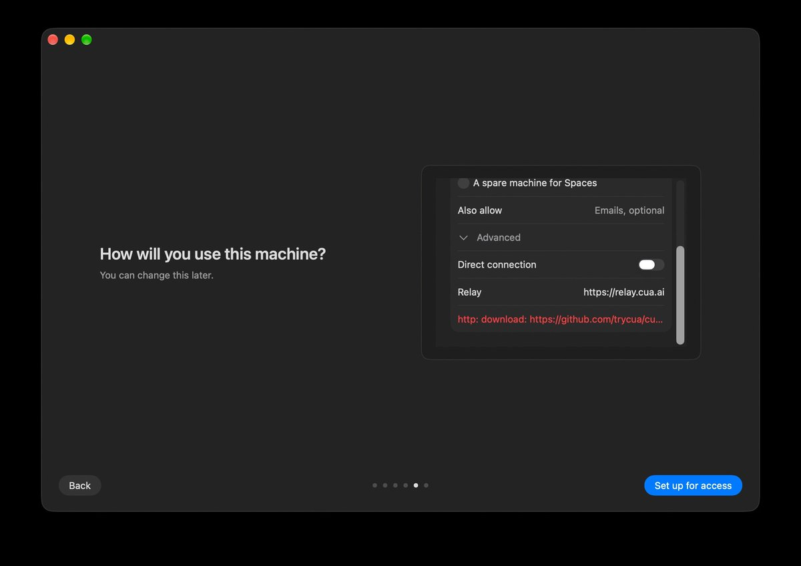

# 1/ We're reimagining what it means for your agents to work with all your computers.
> Source: https://x.com/trycua/status/2106057192285548763
> Author: Cua (@trycua)
> Posted: 2026-10-02T16:22:17+00:00
> Captured: 2026-10-15T09:02:28+00:00
> Stats at capture: 486,842 views · 2,531 likes · 126 replies · 180 reposts · 3,902 bookmarks · 85 quotes

## Post

1/ We're reimagining what it means for your agents to work with all your computers.

Today we're excited to share Cua Spaces, built on Cua Driver and our virtualization stack, rolling out on macOS today.

Download it now, it's free and source-available: https://spaces.cua.ai

## Media

[Post media 1](media/video-01.mp4) — Source media: https://video.twimg.com/amplify_video/2106055991124963328/vid/avc1/1280x720/5MKL09Wx1i6AJMc3.mp4?tag=29
 — Post media 1 thumbnail. Source media: https://pbs.twimg.com/amplify_video_thumb/2106055991124963328/img/G9tOs714LAdeUlo-.jpg
[Reply 2106057196450824708 media 1](media/video-02.mp4) — Source media: https://video.twimg.com/amplify_video/2106049028974575616/vid/avc1/1080x1350/zG4yw549dpFrZqcX.mp4?tag=29
[Reply 2106057199730479571 media 1](media/video-03.mp4) — Source media: https://video.twimg.com/amplify_video/2106049130199977984/vid/avc1/1080x1350/ZmXn9GelP92of7fv.mp4?tag=29
[Reply 2106057203543392632 media 1](media/video-04.mp4) — Source media: https://video.twimg.com/amplify_video/2106049239054753794/vid/avc1/1920x1080/AD4juLKJa-pHG6hJ.mp4?tag=29
[Reply 2106057206957298101 media 1](media/video-05.mp4) — Source media: https://video.twimg.com/amplify_video/2106049331119767552/vid/avc1/1920x1080/n_pxDz70ctX8huq9.mp4?tag=29
[Reply 2106057209859707193 media 1](media/video-06.mp4) — Source media: https://video.twimg.com/amplify_video/2106049415194595329/vid/avc1/720x900/1k9b7DHhnMccGDa8.mp4?tag=29
 — Reply 2106067579433517516 media 1. Source media: https://pbs.twimg.com/media/HTpBTIqXgAAhYdN.jpg
[Reply 2106104700781416457 media 1](media/animation-01.mp4) — Source media: https://video.twimg.com/tweet_video/HTpjD3NXwAA3NWk.mp4

## Thread

### Cua ([@trycua](https://x.com/trycua/status/2106057196450824708)) — 2026-10-02T16:22:18+00:00

2/ Teleport any app. Your agents keep going.

Teleport moves an app's session into a Space, so your agents skip the sign-in step. Nothing is read until you approve, and sensitive items need Touch ID. https://t.co/xGHZXt8heA
 — Source media: https://video.twimg.com/amplify_video/2106049028974575616/vid/avc1/1080x1350/zG4yw549dpFrZqcX.mp4?tag=29
### Cua ([@trycua](https://x.com/trycua/status/2106057199730479571)) — 2026-10-02T16:22:19+00:00

3/ What you teleport stays in the Keyvault on your Mac, locked by default.

Choose exactly which sites and files a Space gets, unlock only what an agent needs, and delete the rest. https://t.co/aag7bNRFcd
 — Source media: https://video.twimg.com/amplify_video/2106049130199977984/vid/avc1/1080x1350/ZmXn9GelP92of7fv.mp4?tag=29
### Cua ([@trycua](https://x.com/trycua/status/2106057203543392632)) — 2026-10-02T16:22:20+00:00

4/ You and your agents share the same desktop, each with your own cursor.

Watch the work as it happens, step in anytime, and hand it back when you're done. https://t.co/CowTeqxSGu
 — Source media: https://video.twimg.com/amplify_video/2106049239054753794/vid/avc1/1920x1080/AD4juLKJa-pHG6hJ.mp4?tag=29
### Cua ([@trycua](https://x.com/trycua/status/2106057206957298101)) — 2026-10-02T16:22:21+00:00

5/ Use all your computers.

Run Spaces on your Mac, on machines you own (a Mac mini or a Linux box), or in your own cloud.

Find them all in one list, each streaming to you as a live desktop. https://t.co/3qUK9w5hYx
 — Source media: https://video.twimg.com/amplify_video/2106049331119767552/vid/avc1/1920x1080/n_pxDz70ctX8huq9.mp4?tag=29
### Cua ([@trycua](https://x.com/trycua/status/2106057209859707193)) — 2026-10-02T16:22:22+00:00

6/ Every Space starts agent-ready. Permissions are pre-granted and tools are preinstalled, so agents don't stop at setup prompts.

macOS images are built locally on your Mac, and Linux images run too. https://t.co/GD8BEDgNyU
 — Source media: https://video.twimg.com/amplify_video/2106049415194595329/vid/avc1/720x900/1k9b7DHhnMccGDa8.mp4?tag=29
### Cua ([@trycua](https://x.com/trycua/status/2106057211902407103)) — 2026-10-02T16:22:22+00:00

7/ Spaces is built on Cua Driver, the layer that lets agents operate real desktop apps.

Cua Driver: https://t.co/hd400jqZLK
### Cua ([@trycua](https://x.com/trycua/status/2106057213735276689)) — 2026-10-02T16:22:23+00:00

8/ Cua Spaces is free for you and your agents. It's source-available under FSL-1.1-MIT, and Cua Driver stays MIT.

Pro and Teams are coming soon, with shared team machines, session handoff, keyvault sync and admin controls.

Source: https://t.co/NFKOEKuWME
### Cua ([@trycua](https://x.com/trycua/status/2106061408215462197)) — 2026-10-02T16:39:03+00:00

@aymanemsi ███████▒▒▒ 78%
### Cua ([@trycua](https://x.com/trycua/status/2106065417899028985)) — 2026-10-02T16:54:59+00:00

@Rimusz 🪩
### Cua ([@trycua](https://x.com/trycua/status/2106075523835404346)) — 2026-10-02T17:35:08+00:00

@Simonsebb 🫶

## Comments

### Aymane ([@aymanemsi](https://x.com/aymanemsi/status/2106058979679916130)) — 2026-10-02T16:29:24+00:00

@trycua WINDOWS WHENNNNN

I NEEEEDD THIIISSSS
### Rimas ([@Rimusz](https://x.com/Rimusz/status/2106065263867154603)) — 2026-10-02T16:54:22+00:00

@trycua This is freaking awesome.🤩
### Simon ([@Simonsebb](https://x.com/Simonsebb/status/2106074839023001763)) — 2026-10-02T17:32:25+00:00

@trycua Love the visual and design
### vogel ([@ryanvogel](https://x.com/ryanvogel/status/2106067579433517516)) — 2026-10-02T17:03:34+00:00

@trycua this is really cool but it wont work https://t.co/luaqe4iuWE
 — Source media: https://pbs.twimg.com/media/HTpBTIqXgAAhYdN.jpg
### kitze 🛠️ tinkerer.club ([@thekitze](https://x.com/thekitze/status/2106100453314588842)) — 2026-10-02T19:14:12+00:00

@trycua i was doing this with betterdisplay and virtual monitors haha, dope
### Farza 🇵🇰🇺🇸 ([@FarzaTV](https://x.com/FarzaTV/status/2106379407417864603)) — 2026-10-03T13:42:40+00:00

@trycua so sick, trying today
### 🥔🥔🥔 ([@argofowl](https://x.com/argofowl/status/2106068646011551826)) — 2026-10-02T17:07:48+00:00

@trycua fire
### Dev Patel ([@_devp](https://x.com/_devp/status/2106068421280485407)) — 2026-10-02T17:06:55+00:00

@trycua so cool, nice work @francedot !!
### Maddie D. Reese ([@maddiedreese](https://x.com/maddiedreese/status/2106079246607392806)) — 2026-10-02T17:49:56+00:00

@trycua Woah?! So excited to try this!!
### Morgan ([@morganlinton](https://x.com/morganlinton/status/2106069391930708221)) — 2026-10-02T17:10:46+00:00

@trycua Very cool, congrats!
### Michael Yagudaev 🧑🏻‍💻🇨🇦 ([@yagudaev](https://x.com/yagudaev/status/2106065776998600763)) — 2026-10-02T16:56:24+00:00

@trycua Epic we should try adding it to @AgentGrid_sh @0xpaperhead
### Michael Magán ([@mrmagan_](https://x.com/mrmagan_/status/2106075261708152999)) — 2026-10-02T17:34:06+00:00

@trycua Wow, this is actually cool.
### Tak 🦞 ([@cherry_mx_reds](https://x.com/cherry_mx_reds/status/2106493918539874555)) — 2026-10-03T21:17:41+00:00

@trycua this is super interesting
### Tony Simons ([@tonysimons](https://x.com/tonysimons/status/2106096169206055186)) — 2026-10-02T18:57:10+00:00

@trycua Maaaaan you guys have been cooking so hard lately! 🔥🔥
### PixelRainbow ([@PixelRainbowNFT](https://x.com/PixelRainbowNFT/status/2106361742066688322)) — 2026-10-03T12:32:28+00:00

@trycua So time to covert all my Mac's to omarchy and just run this on my main Mac?
### Felix Shpilman ([@nxrfelix](https://x.com/nxrfelix/status/2106334822838739430)) — 2026-10-03T10:45:30+00:00

@trycua Please buikd this windows. Pretty please.
### Aditya P. Advani ([@aditya_advani](https://x.com/aditya_advani/status/2106216074270433593)) — 2026-10-03T02:53:38+00:00

@trycua Kudos dude sweet bundle of features
### Anderson ([@ItsGoharr](https://x.com/ItsGoharr/status/2106072248033710351)) — 2026-10-02T17:22:07+00:00

@trycua Agents get their own computers while mine still forces an update mid-sentence
### Shupp ([@KimJungUzi](https://x.com/KimJungUzi/status/2106074326466437540)) — 2026-10-02T17:30:23+00:00

@trycua @grok how secure is this idea...
### Automate With David ([@AutomateDavid](https://x.com/AutomateDavid/status/2106104700781416457)) — 2026-10-02T19:31:04+00:00

@trycua Linux and Windows 11, please https://t.co/NCC0eDeBMx
 — Source media: https://video.twimg.com/tweet_video/HTpjD3NXwAA3NWk.mp4
### Jordy.app ([@Jordy_vD_](https://x.com/Jordy_vD_/status/2106073296047378767)) — 2026-10-02T17:26:17+00:00

@trycua @injaneity Interesting, should make verifying its own work without claiming focus much easier 

Is it possible for a space to use peripherals like my mic?
### Frederik Bruun ([@Bruunsen](https://x.com/Bruunsen/status/2106424306972406027)) — 2026-10-03T16:41:04+00:00

@trycua How is it free?🫪
### Eliel ([@elielAGI](https://x.com/elielAGI/status/2106273611124289962)) — 2026-10-03T06:42:16+00:00

@trycua this is what we've needed 👀
### Oli ([@_oliver_morley_](https://x.com/_oliver_morley_/status/2106066763393695805)) — 2026-10-02T17:00:19+00:00

@trycua Murdering the game
### Sas ([@sas_o07](https://x.com/sas_o07/status/2106072283781763449)) — 2026-10-02T17:22:16+00:00

@trycua Does this mean there will be more bots than humans on the internet than ever before?
### Ryan ([@hellorymi](https://x.com/hellorymi/status/2106082642764431709)) — 2026-10-02T18:03:25+00:00

@trycua I’ve been dying for essentially this. So cool
### Yitzy Mytelka ([@YitzyMytelka](https://x.com/YitzyMytelka/status/2106093652258795933)) — 2026-10-02T18:47:10+00:00

@trycua Are y'all building a windows version?
### Justin ([@JustinLKx](https://x.com/JustinLKx/status/2106127463332118777)) — 2026-10-02T21:01:31+00:00

@trycua Cua literally cooking every day
### Minseo Choi ([@cminseo0_0](https://x.com/cminseo0_0/status/2106166845329789228)) — 2026-10-02T23:38:01+00:00

@trycua Another leap forward with computer-use!
### J'son ([@JustaStonkGuy](https://x.com/JustaStonkGuy/status/2106365389643112594)) — 2026-10-03T12:46:57+00:00

@trycua @claude is this compatible with hermes?
### Clayton Liddell ([@ClayLiddell](https://x.com/ClayLiddell/status/2106149186898993313)) — 2026-10-02T22:27:51+00:00

@trycua ok this is really cool
### 🍯 Edgar ([@EdgarsHQ](https://x.com/EdgarsHQ/status/2106391755386200124)) — 2026-10-03T14:31:44+00:00

@trycua That’s so cool. Would like to try it. Interesting how well it plays with different agents and computer use. Hope evals prove as good as running on a single machine (or better)
### Praggy!👨🏻‍💻 ([@praggybuilds](https://x.com/praggybuilds/status/2106144092648567137)) — 2026-10-02T22:07:36+00:00

@trycua Holy Harry Potter!!!! You guys are wizards 🧙😍🔥
### Haseeb Mir ([@HaseebMir91](https://x.com/HaseebMir91/status/2106156956864139552)) — 2026-10-02T22:58:43+00:00

@trycua Why not available for windows?
### Muness Castle ([@muness](https://x.com/muness/status/2106082786226668017)) — 2026-10-02T18:04:00+00:00

@trycua 138 exposed MCP tools at over 100kb of context! 😿

## Other returned timeline records

> The CLI did not expose reply relationships. These records do not start with a reply mention and were authored by someone other than the saved-post author. They may include recommendations or promoted posts; they are retained as source context, not verified replies.

### Starlink ([@Starlink](https://x.com/Starlink/status/2068115197718593741)) — 2026-06-19T23:34:21+00:00

Get connected with fast, reliable internet for streaming, video calls, online gaming and more.

Order online in minutes.
### Coherence ([@CoherenceBase](https://x.com/CoherenceBase/status/2110445970504974443)) — 2026-10-14T19:01:44+00:00

Your second brain is only as good as what you put in it.

Coherence captures while you read: highlight any page or PDF, add notes, save it with one click. Then search by meaning and ask your library anything, with answers that cite your sources.
### Starlink ([@Starlink](https://x.com/Starlink/status/2098108930002133419)) — 2026-09-10T17:58:44+00:00

Starlink offers fast, reliable internet in the most rural and remote locations. Portable and easy to set up, Starlink works wherever you are.

Order online in minutes.
### Starlink ([@Starlink](https://x.com/Starlink/status/2092706810285490310)) — 2026-08-26T20:12:38+00:00

Starlink offers fast, reliable internet in the most rural and remote locations. Portable and easy to set up, Starlink Mini works wherever you are.

Order online in minutes.

## Links

- https://spaces.cua.ai
