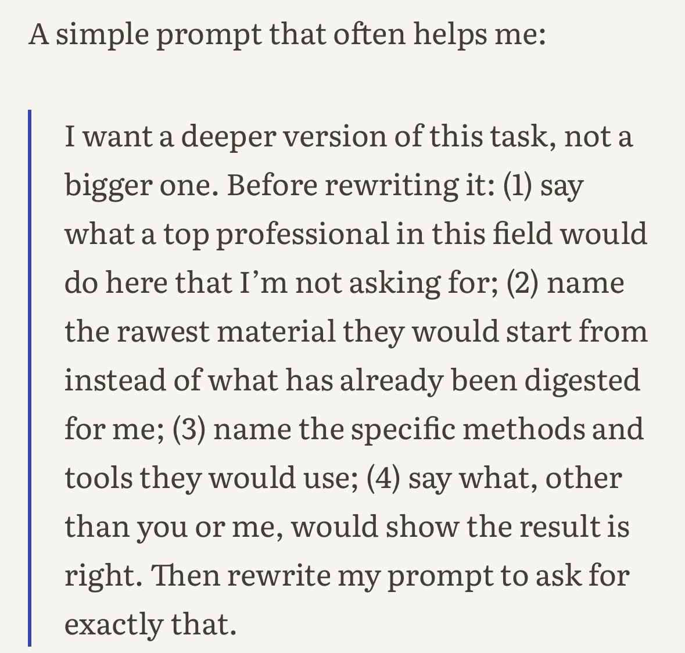
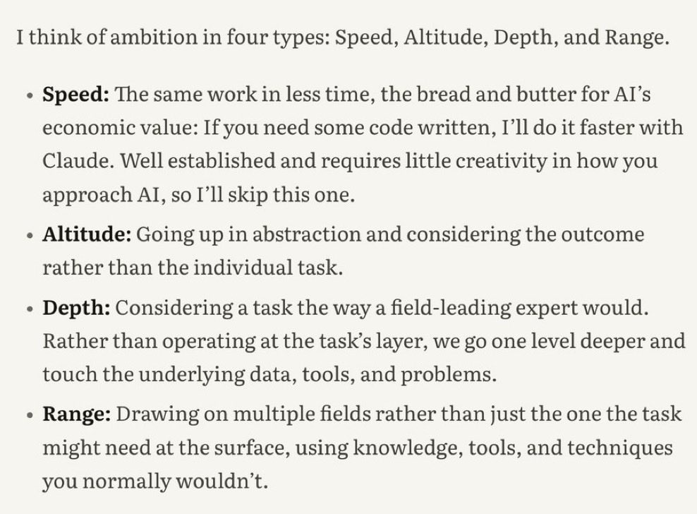

# A lot of folks have asked me: "why open source your core legal docs -isn't that your IP?" no. our exceptional lawyers are our IP. our massive deal flow is our IP. our precedent doc
> Source: https://x.com/jaypmo/status/2106080442004697367
> Author: JP Mohler (@jaypmo)
> Posted: 2026-10-02T17:54:41+00:00
> Captured: 2026-10-15T09:02:28+00:00
> Stats at capture: 88,210 views · 843 likes · 12 replies · 56 reposts · 1,618 bookmarks · 8 quotes

## Post

A lot of folks have asked me: "why open source your core legal docs -isn't that your IP?" no. our exceptional lawyers are our IP. our massive deal flow is our IP. our precedent docs r like a programming language: underlying scaffolding to enable the work.

https://github.com/General-Legal/legal-templates

## Media

 — Reply 2110571916973207906 media 1. Source media: https://pbs.twimg.com/media/HUpB-E-aoAAT9lr.jpg
 — Reply 2110571916973207906 media 2. Source media: https://pbs.twimg.com/media/HUpB-GXbsAED3TQ.jpg
 — Reply 2110414696037716372 media 1. Source media: https://pbs.twimg.com/media/HUmxH1EXsAAXxld.jpg
 — Reply 2110414696037716372 media 2. Source media: https://pbs.twimg.com/media/HUmxN20WgAAslAn.jpg
 — Reply 2110414696037716372 media 3. Source media: https://pbs.twimg.com/media/HUmxT7oXgAAM8_I.jpg

## Thread

### JP Mohler ([@jaypmo](https://x.com/jaypmo/status/2106262518511358088)) — 2026-10-03T05:58:11+00:00

@inner_concerns Soon

## Comments

### A Concerned Human ([@inner_concerns](https://x.com/inner_concerns/status/2106247208920285502)) — 2026-10-03T04:57:21+00:00

@jaypmo Got anything for intellectual property?
### ₮Ɽ₳Vł₴ ([@saastrash](https://x.com/saastrash/status/2106221914339373300)) — 2026-10-03T03:16:50+00:00

@jaypmo lolZ. legal docs are not IP in general.  “law” comes down to how the Judge interprets the Law
### Kevin Ellison ([@KevinAEllison](https://x.com/KevinAEllison/status/2106418867278905847)) — 2026-10-03T16:19:27+00:00

@jaypmo Thank you JP.
### Victor Bridges-Ruiz, Ph.D. ([@vbridgesruiz](https://x.com/vbridgesruiz/status/2106170658569019526)) — 2026-10-02T23:53:10+00:00

@jaypmo This is the way to go, I agree ⚡
### Keeran Jagadesan ([@KeeranJagadesan](https://x.com/KeeranJagadesan/status/2107050386792071196)) — 2026-10-05T10:08:53+00:00

@jaypmo Hey JP, I made a video on instagram about your repo and it’s getting some traction. Let’s jump on a call

https://t.co/8OgOsrB8PQ
### David Hampl ([@davhampl](https://x.com/davhampl/status/2106296653565358504)) — 2026-10-03T08:13:49+00:00

@jaypmo Same logic behind open sourcing my browser tool. Code is cheap, the team that built it isn't.

How do you handle version updates?
### Saint Zero Day is 🆗 ([@BayouChud](https://x.com/BayouChud/status/2106278735154458818)) — 2026-10-03T07:02:37+00:00

@jaypmo I'm what if I build something similar and just found out about you today
### Daniel ([@Daniel035535591](https://x.com/Daniel035535591/status/2106313991651991864)) — 2026-10-03T09:22:43+00:00

@jaypmo What's the ask aboutd You're looking for legal templates or something elsed.
### Marshall Moorman ([@MarshallMoorman](https://x.com/MarshallMoorman/status/2106385427426943339)) — 2026-10-03T14:06:35+00:00

@jaypmo Have you considered creating a @grok @bot with this knowledge?  I’ve created one for you if you want to use or share it.

https://t.co/KXJxVrQpdg
### signal_and_rage ([@signal_and_rage](https://x.com/signal_and_rage/status/2106366227375685984)) — 2026-10-03T12:50:17+00:00

@jaypmo @MikeOSSTeam

## Other returned timeline records

> The CLI did not expose reply relationships. These records do not start with a reply mention and were authored by someone other than the saved-post author. They may include recommendations or promoted posts; they are retained as source context, not verified replies.

### Starlink ([@Starlink](https://x.com/Starlink/status/2068115197718593741)) — 2026-06-19T23:34:21+00:00

Get connected with fast, reliable internet for streaming, video calls, online gaming and more.

Order online in minutes.
### bfrench ([@bfrench](https://x.com/bfrench/status/2106315033781420055)) — 2026-10-03T09:26:52+00:00

Indeed. Directionally, this is correct. The IP is not bound in the documents any more than the value of a popular SaaS app is bound by its easily replicated source code.

That IP is taste, judgement, fitness-of-purpose, and delivery. The advantages of this move far outweigh the market risks of service replication, with one possible exception — judgement as a service is emerging with an entirely new class of AI models.

It remains to be seen how decision models will impact the other components in the stack, but I have a hunch decisions-as-a-service combined with discrete ontologies will create opportunities to reshape the contours of the IP.
### Felix Rieseberg ([@felixrieseberg](https://x.com/felixrieseberg/status/2110023283169247623)) — 2026-10-13T15:02:07+00:00

Hi, I'm Felix. I'm an eng lead working on Claude. I love watching people take flight and do things they never thought possible.

We often describe that as "being more ambitious" when using AI, which is tricky advice to follow. I wrote a tutorial:

https://t.co/vNPPs5FWm8
### CG ([@cgtwts](https://x.com/cgtwts/status/2110571916973207906)) — 2026-10-15T03:22:12+00:00

anthropic’s lead engineer btw. https://t.co/pTlsbqDlXm
 — Source media: https://pbs.twimg.com/media/HUpB-E-aoAAT9lr.jpg
 — Source media: https://pbs.twimg.com/media/HUpB-GXbsAED3TQ.jpg
### GREG ISENBERG ([@gregisenberg](https://x.com/gregisenberg/status/2110414696037716372)) — 2026-10-14T16:57:27+00:00

I spent 48 hours in SF hanging out with billionaires, data labs and AI founders and execs running $1B to $100B companies.

My observations:

1. Sooo MANY stories of data brokers making like $2M a WEEK selling company data to labs. I can't tell if it's the beginning or a bubble, and I kept wondering which niches are left. Digging into it actively.

2. At dinner, someone asked the table, "If a new model drops next month, does your company get better or worse?" HALF the table went quiet! I think that's the best question to ask about any AI startup right now.

3. The bar people talk about now is hitting $1B in revenue in 12 months (I guess that's the new unicorn?). What I didn't hear much about is retention. AI revenue can come in fast and leave fast, and I think we're going to see a lot of stories of AI companies with huge revenue and terrible retention.

4. It's pretty clear we're living through the reinvention of the computer. The model is the CPU, the harness is the operating system, and skills and plugins are the apps. Thinking about it that way makes it easier to see where the whitespace is.

5. We're maybe 12 months from an agent that can watch you work for a week and then do your job without any instructions. The screen recording plus agent memory plus local model combination makes this possible right now.

6. Agent harnesses feel like the new GPT wrappers, in a good way, especially vertical ones. The best teams I talked to treat the model as swappable. One founder walked me through routing different models to different jobs: one for taste and visuals, a cheaper one for the everyday stuff, another for text. 

They use prompts they can move across models over fine-tuning, and A/B test the output on what users actually do with it: do they edit it, export it, share it? A vertical harness is basically four things: the connectors for that industry's data, evals written by people who know the work, rules for what the agent can and can't touch, and a clean screen for a human to review. The model is maybe 20% of it.

7. There's a lot of reverse engineering going on/cloning going on more than I've ever seen. People are decompiling software and rebuilding it with agents, and someone showed a suite of like 10 apps that are worth $5B+ each all that he cloned open source. Me and everyone are still thinking through what it means when software gets this easy to copy.

8. My guess is the value moves to data. If the software can be rebuilt quickly, what's worth paying for in a legacy SaaS company is the years of customer data and workflows inside it. Some SaaS companies are secretly data companies. 

Gets me thinking about how do you truly value data for this saas companies? Like if we were buying these dying saas companies at 2x ARR before (as example), maybe there is a better metric. Idk, just thinking out loud here.

9. It feels like a good chunk of legacy software won't make it to the agentic era, especially anything built around people clicking through a lot of screens.

10. Every company I talked to wants to pipe its internal data into one place and expose it to agents through MCP. Then they look at the data and realize it's a mess: five versions of the same customer, old Slack channels, PDFs nobody can search. Cleaning that up feels like a big consulting opportunity!

11. A lot of founders are building the basic building blocks for agents: APIs, data layers and tools. Some of the companies I saw barely have a UI because the main user is an agent. I really believe the startups that build primitives to this agentic era will do extremely well. Building blocks is the best way to think about it.

12. Labs can get plenty of training data, but it's harder to get real examples of agents failing inside companies. Whoever has those logs has something valuable.

13. Someone running a big consumer company told me the next fight is over memory. The model that remembers the most about you wins, and the smartest model matters less than people think.

14. Physical AI came up a lot. Astra I think was the first model that got people into AI can actually do CAD, and I think a lot of people are thinking what does vibe manufacturing really look like. The line I keep thinking about came from a robotics founder: the hardest problems in AI are deployment problems now, not research problems. Their robots work on their own, call a human when they get stuck, and every one of those calls becomes training data.

15. Cybersecurity companies are having a moment and are actually cool companies to build now, especially the ones that clean up after a breach. Every agent with access to your systems is a new door into your company, and a lot of those doors were left open. 

16. Some startups are worth more dead than alive now. A shutdown company with 5 years of Slack, email and code can get paid for licensing all of it. I wouldn't be surprised if founders start factoring that into when they shut down.

17. People are starting to talk about monetizing the agent web. It feels really early, but when the most popular user of the internet is an agent, what startups should you be building?

18. I think agent insurance is coming. Once an agent makes an expensive mistake, insurers will want audits before they cover anyone.

19. Several people said the hire they want most is someone with taste who can write evals. The models are getting good at generating ideas, so the hard part is judging which ones are good.

20. New trend I observed: startup raises VC, uses venture dollars to become a creator, startup fails, founder falls back on being a full-time creator and incubates other products bootstrapped.

21. Getting SIGNIFICANT distribution is HARD right now. Founders are sponsoring buses, buying billboards like crazy and throwing parties with famous DJs to get noticed. Kinda feels dotcom era in that sense. 

Attention is what's scarce! The growth guy going viral sharing his UGC strategy from Wispr Flow is a good example. It's the sauce everyone wants, and I truly believe there are probably only 50 people on the planet who know how to scale these types of businesses efficiently in this era.

Always good to get that dose of SF. I felt sooo lucky to have such an incredible trip during such an incredible time in building businesses. Surreal in so many ways. 

Happy to be home and locked in.

Until next time!
 — Source media: https://pbs.twimg.com/media/HUmxH1EXsAAXxld.jpg
 — Source media: https://pbs.twimg.com/media/HUmxN20WgAAslAn.jpg
 — Source media: https://pbs.twimg.com/media/HUmxT7oXgAAM8_I.jpg
### Ryan Doser ([@ryan_doser13](https://x.com/ryan_doser13/status/2110471378189312039)) — 2026-10-14T20:42:41+00:00

Lovable is a scam. 

So is Replit, Base44, Framer, and all AI website builders. 

These are for low IQ people who don’t know how to use AI and fall for SaaS marketing gimmicks. 

You are paying a premium for less usage, shittier models, shittier websites, and hand cuffing yourself to a SaaS ecosystem you don’t control. 

A $100/month Claude Max plan (or ChatGPT Pro) is a better solution BY FAR

## Links

- https://github.com/General-Legal/legal-templates
