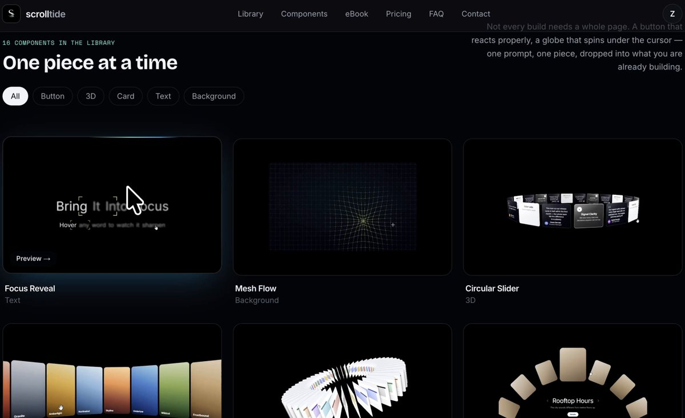

# Your AI isn't bad at design. It has just never seen good design.
> Source: https://x.com/himanshubuildss/status/2106411655055974640
> Author: Himanshu Hingorani (@himanshubuildss)
> Posted: 2026-10-03T15:50:48+00:00
> Captured: 2026-10-15T09:02:28+00:00
> Stats at capture: 361,150 views · 2,466 likes · 52 replies · 232 reposts · 7,910 bookmarks · 18 quotes

## Post

Your AI isn't bad at design. It has just never seen good design.

I've tested 100+ vibe coding resources this year. These are the 40 I actually kept, grouped by what you're stuck on.

Bookmark this 🔖

1. 👑 http://scrolltide.co 
Why it's different from everything below:
- Every one is a complete prompt, not a snippet you wire up yourself
- 3 steps: copy the prompt, paste it into your AI, launch it live
- 300+ award-winning prompts, all in one place
- Full source code to download and edit
- Works with Claude Code, Cursor or v0
Built for founders and freelancers who want award-level sites without a design team or a week of tweaking. If you only open one link in this post, make it this one.

2. http://designmd.ai - design systems as markdown your agent can read
3. http://vibeprompts.dev - ready-made prompts for dashboards and landing pages
4. http://minimal.gallery - curated high-end sites
5. http://kage.design - real UI inspiration mapped to prompts
6. http://styles.refero.design - 2,000+ real product styles with typography
7. http://component.gallery - 2,600+ examples of how top design systems solve the same element
8. http://godly.website - curated collection of beautiful websites
9. http://awwwards.com - the best of web design, recognized and ranked
10. http://landing.love - showcase of the best animation websites
11. http://land-book.com - curated landing pages
12. http://mobbin.com - mobile design patterns
13. http://hoverstat.es - experimental web design projects
14. http://navbar.gallery - navigation patterns
15. http://footer.design - footer layouts
16. http://cta.gallery - conversion-tested forms, popups and buttons
17. http://supahero.io - curated hero sections
18. http://pricingpages.design - the best pricing page examples
19. http://21st.dev - community component marketplace that plugs into agents via MCP
20. http://ui.shadcn.com - still the gold standard
21. http://ui.aceternity.com - 200+ animated React and Tailwind components
22. http://magicui.design - 150+ animated components and effects
23. http://motion-primitives.com - advanced interactions
24. http://uiverse.io - open-source UI elements
25. http://smoothui.dev - animated components built on Motion and GSAP
26. http://shadcnblocks.com - 2,000+ pre-built section blocks for shadcn/ui
27. http://kinetics.colorion.co - 150+ motion effects with React code and prompts
28. http://microkit.co - micro-interactions
29. http://glass.samasante.com - glass refraction components
30. http://animejs.com - lightweight animation engine
31. http://threejs.org - the most popular web 3D library
32. http://shadertoy.com - the standard online shader editor and community
33. http://thebookofshaders.com - free interactive intro to fragment shaders
34. http://threejs-journey.com - full Three.js course with shader chapters
35. http://kitbitz.art - 2,000+ hand-drawn illustrations
36. http://3dicons.co - 3D icons
37. http://claude.com/product/claude-code - command-line AI coding agent
38. http://cursor.com - AI-first code editor
39. http://v0.dev - Vercel's prompt-to-component tool
40. http://lovable.dev - AI app builder in the browser

Which one should I add next?

## Media

[Post media 1](media/video-01.mp4) — Source media: https://video.twimg.com/amplify_video/2106411389825024000/vid/avc1/1176x720/ClSLZN4tGWh7GkyM.mp4?tag=29
 — Post media 1 thumbnail. Source media: https://pbs.twimg.com/amplify_video_thumb/2106411389825024000/img/2IMcBbx5Z0qYjkbj.jpg
[Reply 2106644926221983824 media 1](media/animation-01.mp4) — Source media: https://video.twimg.com/tweet_video/HTxNxemWAAAMsU1.mp4

## Thread

### Himanshu Hingorani ([@himanshubuildss](https://x.com/himanshubuildss/status/2106411960384573735)) — 2026-10-03T15:52:01+00:00

If you only open one from the list, make it https://t.co/WvQ3Gln28e

It gives you more than 600+ award-winning prompts and full source code. Agencies charge thousands for UI like this.

## Comments

### Csaba Kissi ([@csaba_kissi](https://x.com/csaba_kissi/status/2106766870133317735)) — 2026-10-04T15:22:18+00:00

@himanshubuildss Thanks for adding my site, bro!
### Zachary Thompson ([@Spiritof76er](https://x.com/Spiritof76er/status/2106601317443764641)) — 2026-10-04T04:24:27+00:00

@himanshubuildss @Grok are these legit and not prompt injected?
### Jordan Lee ([@SP3NC3R5395](https://x.com/SP3NC3R5395/status/2106802861359415409)) — 2026-10-04T17:45:19+00:00

@himanshubuildss 40 resources?? yeah my bookmarks are cooked 😂
### Forha ([@Forhanvv](https://x.com/Forhanvv/status/2106776440205381859)) — 2026-10-04T16:00:20+00:00

@himanshubuildss i can attest to those vibes being a breath of fresh air in this scene
### Nawaz Alamgir ([@8T3_nawaz](https://x.com/8T3_nawaz/status/2106723183877599736)) — 2026-10-04T12:28:42+00:00

@himanshubuildss https://t.co/OHNbWtRcmQ is an example of trash. no real links to working sites, all video, just a scam
### Jatin.Design ([@jatinthakur009](https://x.com/jatinthakur009/status/2107395802457149487)) — 2026-10-06T09:01:27+00:00

@himanshubuildss Number of resources you have added is crazy.
### Coffee Cat ([@iLegend_AI](https://x.com/iLegend_AI/status/2106746946526601379)) — 2026-10-04T14:03:08+00:00

@himanshubuildss 40 个里我猜一半是提示词模板。真正拉开差距的不是资源数量，是卡住时知道去哪找。我自己只留了 5 个，用得最多的是截图转组件。
### AIガチ勢オジ｜40代×Claude Code ([@ai_gachi_oji](https://x.com/ai_gachi_oji/status/2106854239544963293)) — 2026-10-04T21:09:28+00:00

@himanshubuildss 100本以上を実際に試して40個に絞る検証量に脱帽です。「AIに足りないのは良いデザインの引き出し」という視点も学びになります。ありがとうございます。
### Guy Eats 🏴‍☠️ ([@Guyeats](https://x.com/Guyeats/status/2107357010568118325)) — 2026-10-06T06:27:18+00:00

@himanshubuildss Do you know of anyone who uses these and builds websites?
### mikkom ([@mikkom](https://x.com/mikkom/status/2106768385308578282)) — 2026-10-04T15:28:19+00:00

@himanshubuildss Not true. AI has seen ALL the designs
### Artist AnosCranel ([@ArtAnosCranel](https://x.com/ArtAnosCranel/status/2106663381348556961)) — 2026-10-04T08:31:04+00:00

@himanshubuildss Highly Appreciated Brother! ❤️
### REM ([@rapid_i_move](https://x.com/rapid_i_move/status/2107365927000096931)) — 2026-10-06T07:02:44+00:00

@himanshubuildss That’s not true at all. Your statement is false. AI has seen plenty of good design.
### Tuyussr ([@tuyussr](https://x.com/tuyussr/status/2106702963511001487)) — 2026-10-04T11:08:21+00:00

@himanshubuildss Open source?
### ladidai (@ladidaix) 💋 see linkinbyeo ([@ladidaix](https://x.com/ladidaix/status/2107244723467427908)) — 2026-10-05T23:01:07+00:00

@himanshubuildss You’re missing @Muse surprisingly which is the easiest agent to use and can do what a lot of these do on the pro level for free. Design is about taste more than anything and that should come from the user. 

Code if you wanna try: YZ3RD8

https://t.co/cgxsx4lzGG
### Jeremy Garcini ✧ Product Designer ([@jeremdesign](https://x.com/jeremdesign/status/2107438651110211875)) — 2026-10-06T11:51:43+00:00

@himanshubuildss My AI has seen plenty of good design by now and still insists every hero section needs a purple gradient. We're getting there. 😅
### Kshitij Koranne ([@kshitijkoranne](https://x.com/kshitijkoranne/status/2106670970668990735)) — 2026-10-04T09:01:14+00:00

@himanshubuildss True..!! AI copies what it sees. Give it 2-3 real reference screens and write down the spacing and fonts, output gets way better than just saying make it clean
### welhanDev ([@welhanDev](https://x.com/welhanDev/status/2106636112164962720)) — 2026-10-04T06:42:43+00:00

@himanshubuildss This is absolutely incredible! Thank you
### zoomi ([@zoomiRajpoot](https://x.com/zoomiRajpoot/status/2106670715261120719)) — 2026-10-04T09:00:13+00:00

@himanshubuildss Great design references can make a huge difference—definitely saving this one 🔖
### Testimony | UIUX Designer ([@uiuxbytestimony](https://x.com/uiuxbytestimony/status/2106703420862124356)) — 2026-10-04T11:10:10+00:00

@himanshubuildss This is a top resource!
### Maxim Bortnikov ([@maxim_bortnikov](https://x.com/maxim_bortnikov/status/2106644926221983824)) — 2026-10-04T07:17:44+00:00

@himanshubuildss Nice list! I'd also:
1) Decent slider with LTR and RTL support: https://t.co/c7V3GgKtdc (you can find the polished checkbox in that collection)
2) Animated icons: https://t.co/pPfVr1qMZU
3) Code that somehow significantly increases the UI quality: https://t.co/iTuDcpOggq https://t.co/2xM5tpCxOy
 — Source media: https://video.twimg.com/tweet_video/HTxNxemWAAAMsU1.mp4
### Artemi Vaarakallio ([@aaapinen](https://x.com/aaapinen/status/2106789888159047812)) — 2026-10-04T16:53:46+00:00

@himanshubuildss hello from the other side of the follow button
### Ash ([@Thewarlordai](https://x.com/Thewarlordai/status/2108518317401202758)) — 2026-10-09T11:21:55+00:00

@himanshubuildss Models copy the average of what they have seen. Three references you actually like beat any prompt tweak. Which one of the 40 changed your output the most?
### Kpop ([@XxCrystalxxo](https://x.com/XxCrystalxxo/status/2108350984376537154)) — 2026-10-09T00:17:00+00:00

@himanshubuildss Do not use claude
### Gil ([@GilFoss](https://x.com/GilFoss/status/2106673276596769181)) — 2026-10-04T09:10:23+00:00

@himanshubuildss Combine several of these when building, each excel in their own way. Great post, will try some of these
### jack ([@jakkuwang](https://x.com/jakkuwang/status/2107354419402510508)) — 2026-10-06T06:17:00+00:00

@himanshubuildss the number of resources is 🤯
### Philip’s Truth™ ([@PhilipsTruthTM](https://x.com/PhilipsTruthTM/status/2107218025653174587)) — 2026-10-05T21:15:02+00:00

@himanshubuildss Great list 👍
### Rafael Barros ([@Rafa_ewe](https://x.com/Rafa_ewe/status/2107193126607581584)) — 2026-10-05T19:36:05+00:00

@himanshubuildss Obrigado.
### teebostudio ([@THIBAUL76280609](https://x.com/THIBAUL76280609/status/2107536732870623396)) — 2026-10-06T18:21:27+00:00

@himanshubuildss https://t.co/8RTIQKdFUI
### AkinAyo | UI/UX Designer ([@akinayoUI](https://x.com/akinayoUI/status/2107240769161744838)) — 2026-10-05T22:45:24+00:00

@himanshubuildss Damn 
40 ??
### Tuyussr ([@tuyussr](https://x.com/tuyussr/status/2106703547421360453)) — 2026-10-04T11:10:41+00:00

@himanshubuildss Thank you
### tosin (design & ai) ([@14oluwatosin](https://x.com/14oluwatosin/status/2107875860158034158)) — 2026-10-07T16:49:02+00:00

@himanshubuildss @tylerrtosin
### zkkr ([@GitFlip](https://x.com/GitFlip/status/2107229269730726365)) — 2026-10-05T21:59:42+00:00

@himanshubuildss Interesting
### Designer ([@osehfavvy](https://x.com/osehfavvy/status/2107167763223478644)) — 2026-10-05T17:55:18+00:00

@himanshubuildss Thank u

## Other returned timeline records

> The CLI did not expose reply relationships. These records do not start with a reply mention and were authored by someone other than the saved-post author. They may include recommendations or promoted posts; they are retained as source context, not verified replies.

### Starlink ([@Starlink](https://x.com/Starlink/status/2092706810310619298)) — 2026-08-26T20:12:38+00:00

Starlink offers fast, reliable internet in the most rural and remote locations. Portable and easy to set up, Starlink Mini works wherever you are.

Order online in minutes.
### Starlink ([@Starlink](https://x.com/Starlink/status/2068115197718593741)) — 2026-06-19T23:34:21+00:00

Get connected with fast, reliable internet for streaming, video calls, online gaming and more.

Order online in minutes.

## Links

- https://scrolltide.co
- http://scrolltide.co
- http://designmd.ai
- http://vibeprompts.dev
- http://minimal.gallery
- http://kage.design
- http://styles.refero.design
- http://component.gallery
- http://godly.website
- http://awwwards.com
- http://landing.love
- http://land-book.com
- http://mobbin.com
- http://hoverstat.es
- http://navbar.gallery
- http://footer.design
- http://cta.gallery
- http://supahero.io
- http://pricingpages.design
- http://21st.dev
- http://ui.shadcn.com
- http://ui.aceternity.com
- http://magicui.design
- http://motion-primitives.com
- http://uiverse.io
- http://smoothui.dev
- http://shadcnblocks.com
- http://kinetics.colorion.co
- http://microkit.co
- http://glass.samasante.com
- http://animejs.com
- http://threejs.org
- http://shadertoy.com
- http://thebookofshaders.com
- http://threejs-journey.com
- http://kitbitz.art
- http://3dicons.co
- http://claude.com/product/claude-code
- http://cursor.com
- http://v0.dev
- http://lovable.dev
