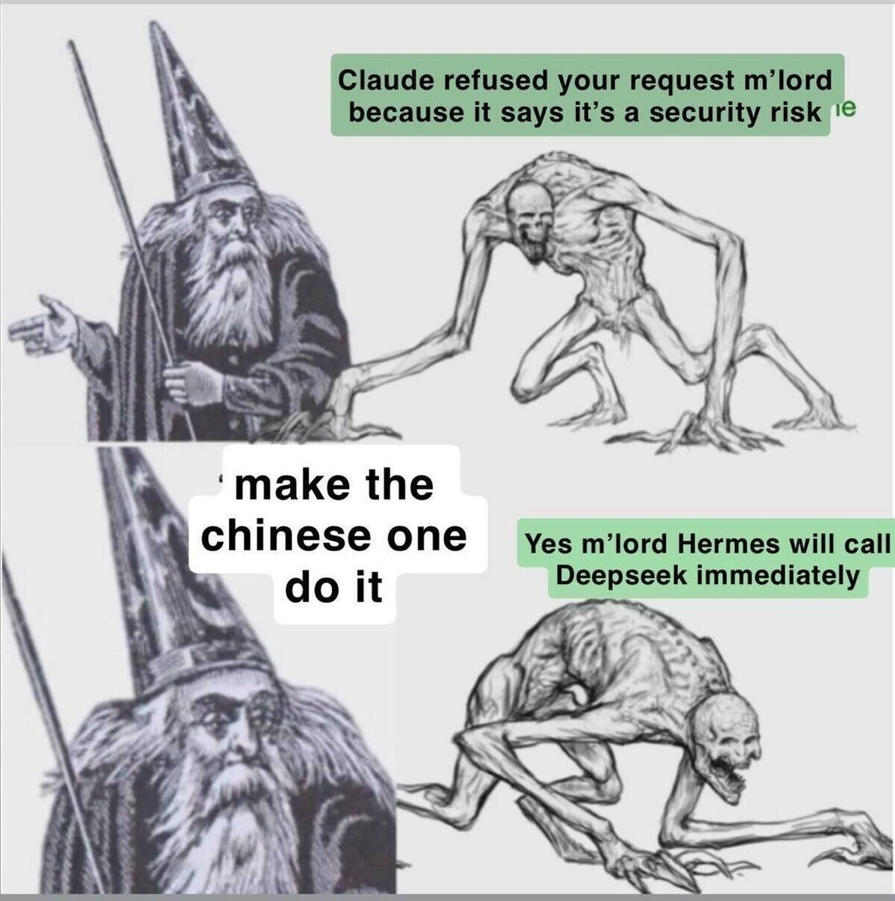
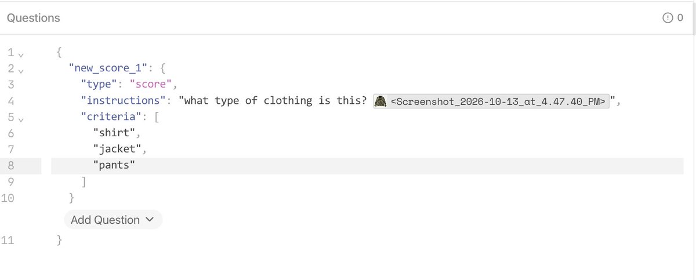
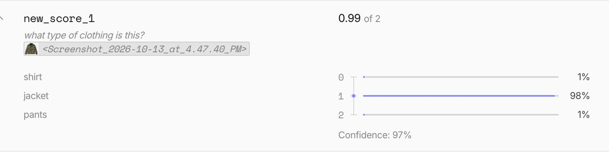
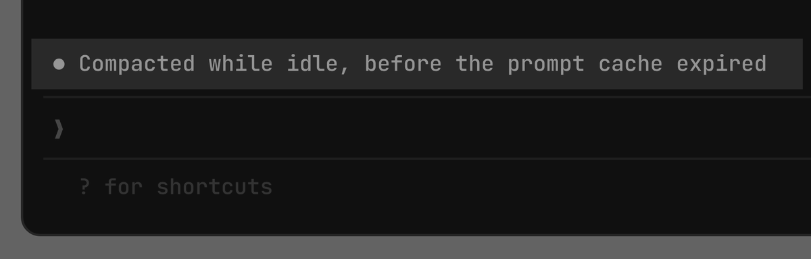

# if you want to unhandicap codex computer use (getting 1password to appear, having it not reprompt you for approval when you've already given it) here's a github gist to give to you
> Source: https://x.com/RhysSullivan/status/2106479630026973686
> Author: Rhys (@RhysSullivan)
> Posted: 2026-10-03T20:20:54+00:00
> Captured: 2026-10-15T09:02:28+00:00
> Stats at capture: 28,747 views · 319 likes · 20 replies · 6 reposts · 573 bookmarks · 3 quotes

## Post

if you want to unhandicap codex computer use (getting 1password to appear, having it not reprompt you for approval when you've already given it) here's a github gist to give to your agent

you should only do this if you know what you're doing https://gist.github.com/RhysSullivan/c3962da1768131a572791259d90da7de

## Media

 — Reply 2106483620777168952 media 1. Source media: https://pbs.twimg.com/media/HTu7sC4bcAA0OEY.jpg
 — Reply 2110509898958008515 media 1. Source media: https://pbs.twimg.com/media/HUoH2yoXoAARpmr.jpg
 — Reply 2110509898958008515 media 2. Source media: https://pbs.twimg.com/media/HUoJjt-WQAAaGw-.jpg
 — Reply 2110484840256819380 media 1. Source media: https://pbs.twimg.com/media/HUnthtMbMAAWITt.png
 — Reply 2110516297230336272 media 1. Source media: https://pbs.twimg.com/media/HUoPE0zWIAAc3aF.jpg

## Thread

### Rhys ([@RhysSullivan](https://x.com/RhysSullivan/status/2106494466391728253)) — 2026-10-03T21:19:52+00:00

@steipete ah i forgot to include that one, also a good one
### Rhys ([@RhysSullivan](https://x.com/RhysSullivan/status/2106537663352492219)) — 2026-10-04T00:11:31+00:00

@joshavant that's not gonna sign in to websites though but yeah good callout
### Rhys ([@RhysSullivan](https://x.com/RhysSullivan/status/2106480352097419674)) — 2026-10-03T20:23:47+00:00


### Rhys ([@RhysSullivan](https://x.com/RhysSullivan/status/2106483620777168952)) — 2026-10-03T20:36:46+00:00

@danieljvdm https://t.co/lKzDxm8R8y
 — Source media: https://pbs.twimg.com/media/HTu7sC4bcAA0OEY.jpg

## Comments

### Peter Steinberger 🦞 ([@steipete](https://x.com/steipete/status/2106494338989785137)) — 2026-10-03T21:19:21+00:00

@RhysSullivan defaults write -g ComputerUseAllowForbiddenTargets -bool YES
### josh avant ([@joshavant](https://x.com/joshavant/status/2106535298352238672)) — 2026-10-04T00:02:07+00:00

@RhysSullivan For 1password, it's far faster and more robust to create skill that uses `op` directly with a service token and doesn't rely on the UI. Pair it with a dedicated 'Agent Secrets' vault that is the only thing it has access to, if you'd like.
### Logan ([@notloganhogg](https://x.com/notloganhogg/status/2106480056428052922)) — 2026-10-03T20:22:36+00:00

@RhysSullivan auth prompts are the unglamorous part that decides whether computer use is actually usable. if it keeps stopping to ask, you end up watching it anyway
### Dan van der Merwe ([@danieljvdm](https://x.com/danieljvdm/status/2106481942598422680)) — 2026-10-03T20:30:06+00:00

@RhysSullivan "I can’t apply patches that bypass those safeguards."

I guess you just can't use codex to do it...
### Dara A. ([@daradoescode](https://x.com/daradoescode/status/2106479936311853210)) — 2026-10-03T20:22:07+00:00

@RhysSullivan OMG I LOVE YOU
### mike ([@mikepunzano](https://x.com/mikepunzano/status/2106507343353745541)) — 2026-10-03T22:11:02+00:00

@RhysSullivan 1password? the cool kids use 2password https://t.co/cyUY4w99JZ
### JFMN ([@jayfmn_](https://x.com/jayfmn_/status/2106572154074480767)) — 2026-10-04T02:28:34+00:00

@RhysSullivan Needed this.
### Vito Botta ([@vitobotta](https://x.com/vitobotta/status/2106779913206554912)) — 2026-10-04T16:14:08+00:00

@RhysSullivan Nice, though a 1Password surface showing up in an agent's screen context is its own can of worms.
### An$h ([@eth_ansh](https://x.com/eth_ansh/status/2106715852120940851)) — 2026-10-04T11:59:34+00:00

@RhysSullivan unshackling the agent, bold strategy
### Anderson ([@ItsGoharr](https://x.com/ItsGoharr/status/2106537031178629424)) — 2026-10-04T00:09:00+00:00

@RhysSullivan Remove the guardrails and call it unhandicapped
### Shubh Chaudhary ([@killer__z3](https://x.com/killer__z3/status/2107007303555919984)) — 2026-10-05T07:17:42+00:00

@RhysSullivan that 1password reprompt pain mostly goes away if the agent's browser is just your real logged in chrome instead of a fresh sandboxed one every run. that's the whole point of ridealong, one shared chrome so cookies/2fa survive across sessions. https://t.co/Yv1rZ1ipS6
### ADL ([@ADLXBT](https://x.com/ADLXBT/status/2106488480721522826)) — 2026-10-03T20:56:05+00:00

@RhysSullivan codex uses a sandbox that checks for a secret key in the env, if missing it triggers a prompt, the gist injects the key into the agent’s runtime so the check passes and the prompt is bypassed, this shim is loaded before the original library
### Dusan Odalovic ([@dusangran](https://x.com/dusangran/status/2106495043028537804)) — 2026-10-03T21:22:09+00:00

@RhysSullivan i think for the 1password part `op run` with an env file might be a calmer way, the agent gets the secrets as env vars and never touches the vault ui. full computer use still makes me a bit nervous...
### Mykyta Pavlenko ([@mktpavlenko](https://x.com/mktpavlenko/status/2106495005783376278)) — 2026-10-03T21:22:00+00:00

@RhysSullivan The weird part comes on the next unrelated Codex task. 1Password is visible now, but the missing approval prompt won't announce that this gist is still in effect.
### king kusaila 👑 ([@kusailatalit](https://x.com/kusailatalit/status/2106494367150084593)) — 2026-10-03T21:19:28+00:00

@RhysSullivan the reprompt after you already approved is what kills computer use for me, good that someone wrote it down
### catman ([@catmanyau](https://x.com/catmanyau/status/2106517414544392342)) — 2026-10-03T22:51:03+00:00

@RhysSullivan The gist specifically aims to stop 1Password from re-prompting after approval. Since that changes an auth boundary, I’d inspect exactly what permissions it grants before letting an agent apply it.
### 小森 ([@oxniubi](https://x.com/oxniubi/status/2106551593718206599)) — 2026-10-04T01:06:52+00:00

@RhysSullivan Sticky approval beats re-prompt every click.
Do you grant once per app, or force a fresh yes every time 1Password pops up?
### Tanish ([@taniiishh](https://x.com/taniiishh/status/2106503662436835366)) — 2026-10-03T21:56:24+00:00

@RhysSullivan interesting. i've been running into that error a bunch of times on muse, will try doing something similar

## Other returned timeline records

> The CLI did not expose reply relationships. These records do not start with a reply mention and were authored by someone other than the saved-post author. They may include recommendations or promoted posts; they are retained as source context, not verified replies.

### Starlink ([@Starlink](https://x.com/Starlink/status/2099964624640598175)) — 2026-09-15T20:52:36+00:00

Get fast, reliable home internet for seamless streaming, working from home, gaming, and more across multiple devices.

Order online in minutes.
### lauren ([@poteto](https://x.com/poteto/status/2110496830429839869)) — 2026-10-14T22:23:50+00:00

perhaps one of the most durable parts of pstack are its engineering principles: very concise skills (~10-20 loc) that distill down good practices into its core. 

as models get smarter, i expect most of pstack skills to compress into short principles or workflows (a generic list of steps) and that i will be able to delete a few of them. 

how it works is that /poteto-mode contains a short index of available principles and tells agents "In your reply, name each principle that shaped a decision and the specific choice it changed." this is why you'll often see a Principles Named or Used section at the end of the agent's response

many of these principles were extracted from my sessions correcting agents since the start of this year. some are inspired by problems i see people talk about, like Attack the Premise, inspired by @VictorTaelin's post https://t.co/qTGVfoKSyD

you can also use the principles as skills if you want greater control, by invoking /principle-<name> 

https://t.co/wuTWsflVN3
### Wes Bos ([@wesbos](https://x.com/wesbos/status/2110509898958008515)) — 2026-10-14T23:15:45+00:00

Jev images is here

One question about an image that is 850x850 cost one hundredth of a cent -  $0.000096936

about 10,000 images for a dollar. 

referencing the image more than once duplicates the token usage    - so asking two questions in a single request is equivalent to uploading two images
 — Source media: https://pbs.twimg.com/media/HUoH2yoXoAARpmr.jpg
 — Source media: https://pbs.twimg.com/media/HUoJjt-WQAAaGw-.jpg
### Lydia Hallie ✨ ([@lydiahallie](https://x.com/lydiahallie/status/2110484840256819380)) — 2026-10-14T21:36:11+00:00

We recently added idle compaction to Claude Code! 

It now compacts long idle sessions right before the prompt cache expires (~1h). If you come back to it later, it only has to reprocess the summary instead of the entire conversation, which saves you some usage. https://t.co/SG3QyTNFwr
 — Source media: https://pbs.twimg.com/media/HUnthtMbMAAWITt.png
### Zed ([@zeddotdev](https://x.com/zeddotdev/status/2110516297230336272)) — 2026-10-14T23:41:11+00:00

Congrats @typesafeai https://t.co/Z9WU9pAPDj
 — Source media: https://pbs.twimg.com/media/HUoPE0zWIAAc3aF.jpg

## Links

- https://gist.github.com/RhysSullivan/c3962da1768131a572791259d90da7de
