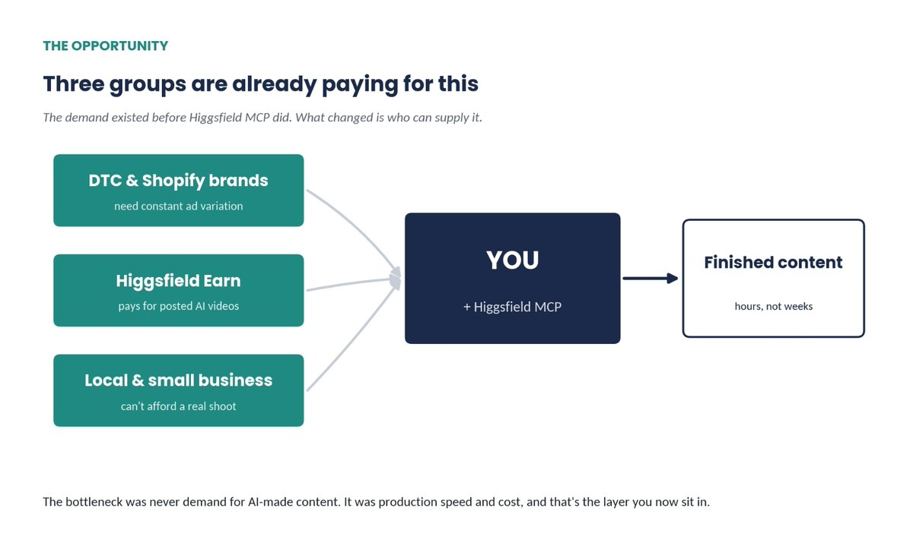
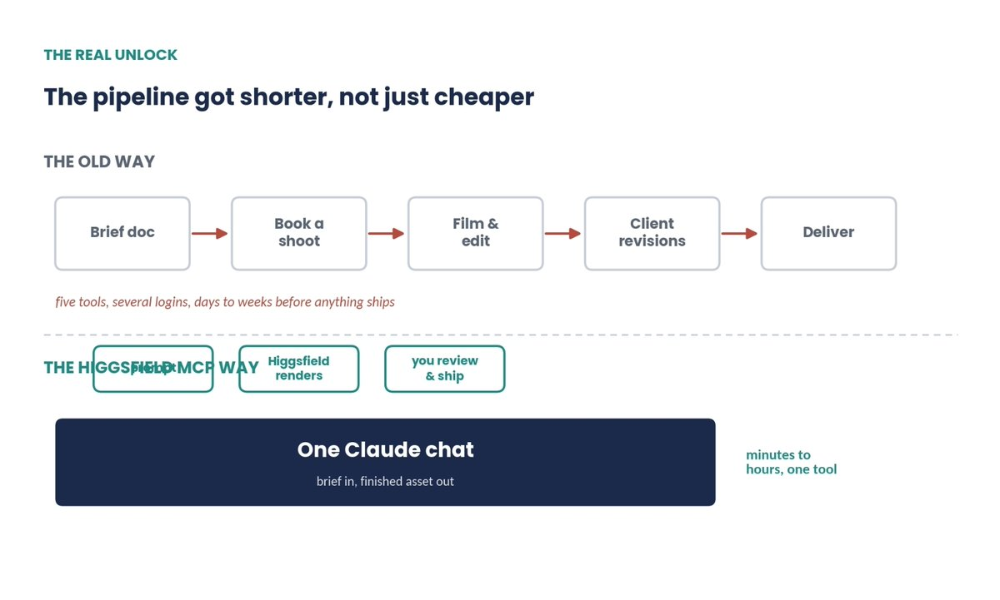
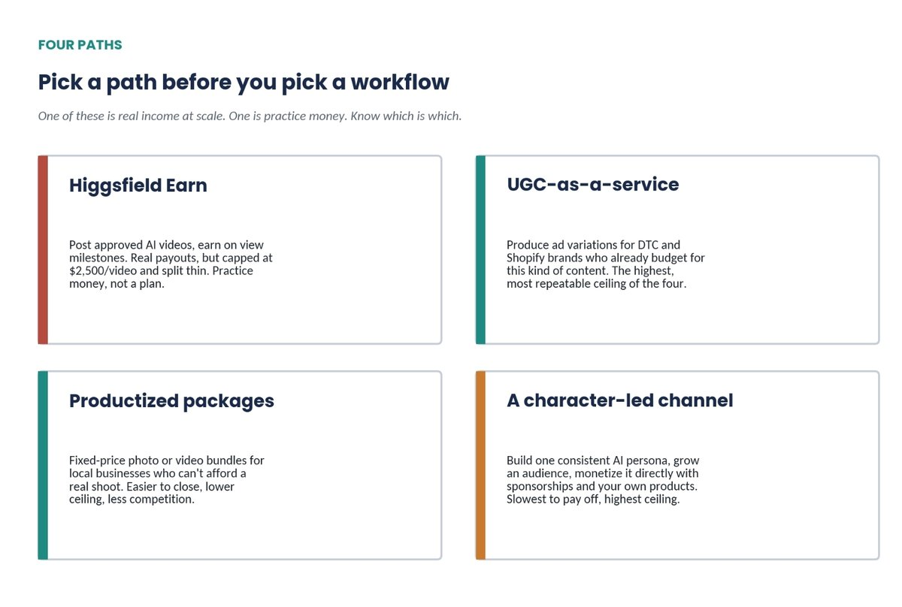
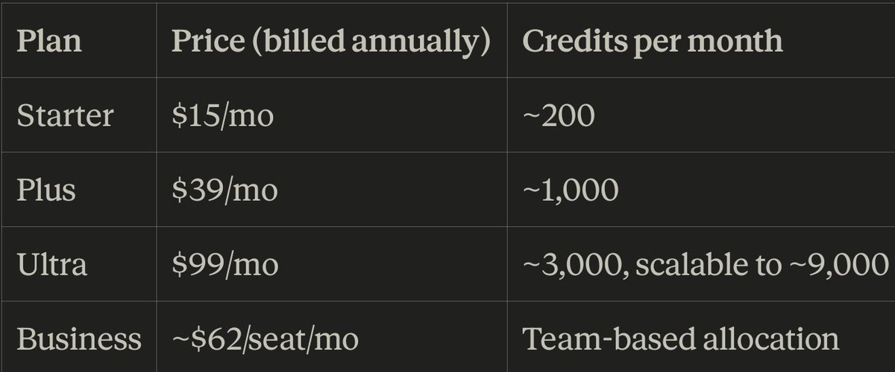
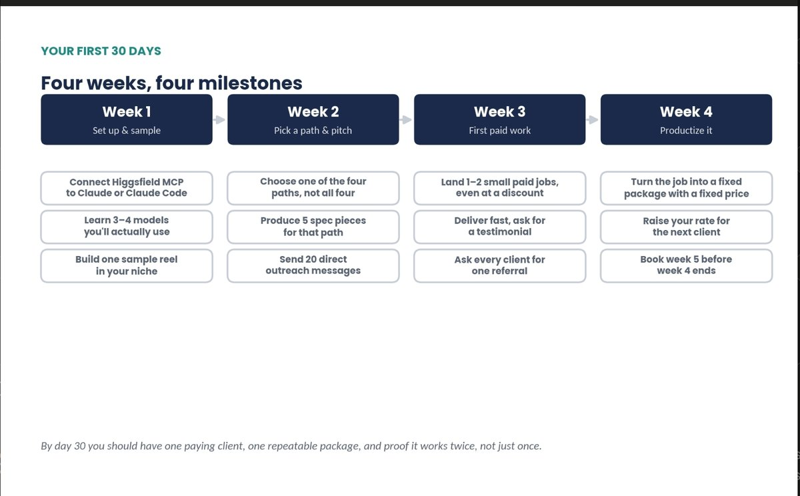
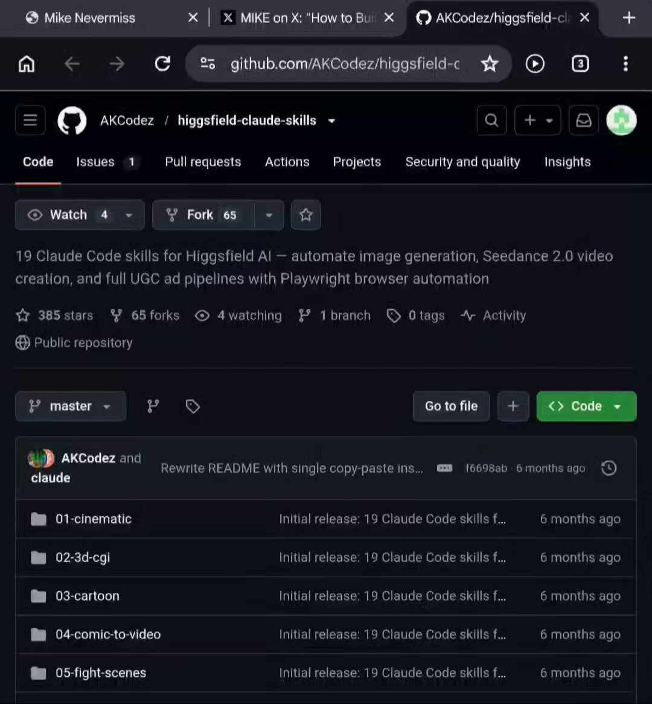
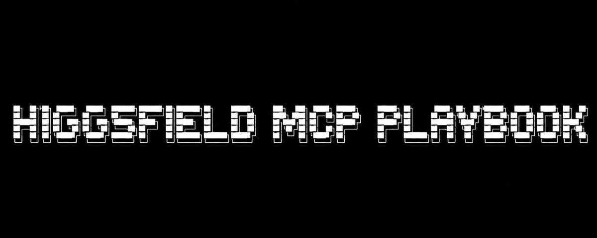

# CLAUDE CODE CAN NOW TURN HIGGSFIELD INTO A ONE-PERSON AI VIDEO STUDIO.
> Source: https://x.com/mikenevermiss/status/2106636580735619118
> Author: MIKE (@mikenevermiss)
> Posted: 2026-10-04T06:44:34+00:00
> Captured: 2026-10-15T09:02:28+00:00
> Stats at capture: 30,667 views · 458 likes · 24 replies · 60 reposts · 677 bookmarks · 4 quotes

## Post

CLAUDE CODE CAN NOW TURN HIGGSFIELD INTO A ONE-PERSON AI VIDEO STUDIO.

install this 19 skills, connect Claude Code to Higgsfield, then tell Claude what you want to create.

run /ugc-hot-girl and let it create the character, generate the visuals, and produce the Seedance video for you.

Claude controls Higgsfield through Playwright. you just review the output and make changes when needed.

this is useful if you want to make UGC ads for brands without spending hours doing everything manually.

you could even turn the workflow into a service and sell the finished content.

if you’re building toward the solo creator income path, save this.

repo below 👇

> Quoted post by MIKE ([@mikenevermiss](https://x.com/mikenevermiss/status/2106619616092905789)):
>
> https://x.com/i/article/2081846430604668928

## Quoted article: How I would use Higgsfield MCP to make money as a "solo creator”

Four real income paths, five workflows, and a 30 days plan to test them

---

Thesis: Higgsfield MCP does not create new demand for AI-made content. That demand already exists, and it is large. What Higgsfield MCP changes is who can supply it, by collapsing a production pipeline that used to require a crew, a shoot day, and a week of back and forth into one Claude conversation. The opportunity for a solo creator is not "make cool AI videos." It is becoming the fast, reliable production layer for buyers who are already paying for this content.

---

### 1. The Opportunity: Why This Pays Right Now

Higgsfield is not a hobbyist app. Independent research firm Sacra estimated Higgsfield's annualized revenue at roughly $500 million in June 2026, up from about $200 million at the end of 2025, with the company reportedly targeting $1 billion in annual run rate by year's end. That revenue comes mostly from creators and businesses buying credits, not from advertising, and a portion of it already flows to enterprise and agency customers, some spending $200,000 or more a year on marketing automation built on top of the platform.

None of that money was waiting for Higgsfield MCP to exist. Brands have paid for UGC-style ads, product photos, and short-form video for years. What kept most solo creators out of that market was production. A single round of UGC ad variations used to mean booking a creator, a shoot day, a round of edits, and days of back and forth before a brand ever saw a finished clip.

Higgsfield MCP collapses that pipeline into one conversation. Connect it to Claude or Claude Code, and a brief that used to take a week to execute can produce a finished, platform-native video in the same chat where you wrote the brief. That is the actual unlock. Not a new market. A new production speed inside an existing one.



Three groups already pay for this kind of content. The only thing that changed is who can supply it fast enough.

---

### 2. What Higgsfield MCP Actually Is

MCP stands for Model Context Protocol. It is an open standard, originally built by Anthropic, that lets an AI chat connect directly to an outside tool instead of you copying and pasting between browser tabs. Once a tool is connected through MCP, you ask for something inside your normal conversation, the tool does the work in the background, and the result lands back in the same chat.

Higgsfield runs a hosted MCP server that any MCP-compatible client can connect to, including Claude on web, desktop, mobile, and Claude Code. There is no API key to manage. You connect your Higgsfield account once, and every generation draws on the same credit balance you would use on the Higgsfield website.

The practical capabilities are broad once connected. You can generate images and video from text, from a reference image, or from existing footage, across 30-plus models. You can train a consistent character with Higgsfield's Soul model and reuse that same face across future clips. You can hand it a product URL and get a finished, platform-native ad back, with camera work, pacing, and captions built in. You can pull up your own generation history inside the chat and use an old clip as the starting point for a new one, which matters once you are juggling more than one project.

The output is designed to look native to social platforms, not like a polished corporate video. That distinction is the whole reason this is a monetizable skill rather than a novelty. A brand does not want a video that looks like an ad. It wants one that looks like a creator made it.



Same output, five fewer tools and logins, and days of turnaround compressed into one sitting.

---

### 3. Four Ways to Actually Get Paid

Not all four of these pay the same way or on the same timeline. Pick one to start. Do not try to run all four in month one.



One of these four is real income at scale. One is practice money. The rest sit in between.

Higgsfield Earn: real, but treat it as practice money. Higgsfield runs its own creator payment program. You generate videos with Higgsfield's tools, post them to your own Instagram or YouTube account, and submit them against an active campaign brief.

Approved submissions earn through a three-part structure: a base payment, a bonus if the video holds up after 24 hours, and a milestone bonus at day seven. Payouts are capped at $1,000 on the first day and $2,500 over a video's lifetime, processed through a KYC-verified payment partner.

Higgsfield has published that the program has paid out more than $1 million to over 10,000 verified creators, at a 90 percent approval rate. Do the division and that works out to under $100 per creator across the program's entire lifetime, not per month. One independent analysis of the program's public numbers estimated the weekly payout pool at roughly $100,000, split across everyone who submits that week and weighted by performance. A small number of consistent, high-performing creators clear real money from it. Most people land much closer to the average. A big total tells you the program is real. It does not tell you what you, specifically, will earn.

The program's own guidance is worth taking seriously regardless: it rewards consistency and technical repeatability over one viral swing. Use Higgsfield Earn to learn the tools, build a portfolio of finished clips, and offset your subscription cost. Do not build your monthly budget around it.

UGC-as-a-service: the highest ceiling of the four. This is the path Higgsfield's own product line is built around. Its Marketing Studio and ad generator turn a product URL into a finished ad across formats including face-to-camera reviews, unboxings, demos, and cinematic spots. That is the exact deliverable small and mid-sized DTC brands already pay freelancers and agencies for.

Your pitch to a brand is simple: a finished ad, in a specific format, in a day, at a fraction of the cost of a shoot. DTC brands running paid social already budget for constant creative refresh, since a hook that performs this week is often dead in two. That is a recurring need, which is what makes this the path with room to grow into a retainer instead of a one-off sale. Look for these brands where they already show their hand: Shopify's app review sections for popular product niches, TikTok Shop sellers whose ads have gone stale, and small marketing agencies who need overflow capacity but do not want to hire.

Productized packages for small business. Not every client is a venture-backed DTC brand. A local business or a small Shopify seller still needs product photos and short video for their site and social, but cannot afford a photographer or videographer for a day. They can afford a fixed-price package: ten product photos and three fifteen-second vertical videos for a flat fee, turned around in 48 hours, for example. The ceiling per client is lower than brand UGC work, but the sale is easier to close. You are competing with a phone photo taken in bad lighting, not an existing agency relationship. Your best leads are the businesses you can already see doing this badly: a local restaurant using blurry phone photos on its delivery app listing, a boutique with a Shopify page and no lifestyle shots, a gym with no video at all on its Instagram.

A character-led channel. The slowest path to pay off, and the highest ceiling if it works. Use Higgsfield's Soul model to build one consistent AI persona, post under that identity on a real schedule, and grow an actual audience. Once the audience exists, monetize it the way any creator does: sponsorships, affiliate links, and eventually a product of your own. Higgsfield's own materials point to creators who used platform-made work to land contracts with larger agencies and brands. Treat those as proof the ceiling exists, not as a typical outcome for a new account.

---

### 4. Five Workflows Worth Building

1. The hook batch. A single ad rarely survives contact with a real ad account. Brands test five to ten hooks before one earns its budget. Ask for the batch in one request instead of generating clips one at a time:

```
Here is our product page: [URL]. Generate a 20-second launch
teaser video for this product, cinematic style, with a clear
call to action at the end. Deliver in both 9:16 and 1:1.
```

4. The small-business starter kit. Package photos and video together as one deliverable instead of selling them separately. Ten product photos and three short vertical clips generated in a single session is a complete, sellable package, not five small jobs.

5. The side-by-side comparison. Before you commit a client's brief to one model, generate the same short clip across two or three models and compare them. This costs a small number of credits and saves you from discovering a model's limitations only after promising a client a specific look.

### 5. How to Position and Price Yourself

---

Do not position yourself as someone who makes AI videos. Position yourself as someone who solves the problem a client already has: they need content on a schedule and cannot afford the traditional way of making it. The AI is how you deliver, not what you are selling.

A useful frame when pricing your own services: a professional product photoshoot commonly runs several hundred to a few thousand dollars once a photographer, styling, and a location are included. A single UGC video ad from a freelancer or small agency commonly runs from around one hundred to several hundred dollars per finished clip, more with usage rights or paid whitelisting attached. You do not need to match those numbers to be profitable. You need to beat them on speed while still charging enough to make the work worth your time, which for most people starting out means pricing meaningfully below agency rates and well above your own credit cost per generation.

> Price the outcome, not the render.

Which Higgsfield plan you need depends on your output volume, not which features you want, since Plus and above unlock the full model roster:



One source we checked listed Higgsfield's entry price as low as $5 a month, but three independent sources agree on $15 a month as the lowest paid tier, so treat that lower figure with caution. Higgsfield has changed its plan structure more than once through 2026, so confirm current pricing directly before building a client quote around it.

Price your own packages as fixed amounts, not hourly rates. A client buying "a UGC ad" wants to know the total before they commit, not to negotiate an hourly number with you.

---

### 6. Your First 30 Days

Week one is setup. Connect Higgsfield MCP to Claude or Claude Code, spend a few hours learning the three or four models you will actually use for your niche, and build one sample reel good enough to send to a stranger.

Week two is choosing and pitching. Pick one of the four paths above. Do not split your attention across all four in month one. Produce five spec pieces in that path's format and send twenty direct outreach messages, whether that means applying to Higgsfield Earn campaigns, messaging small businesses in your area, or pitching a DTC brand you already use.

Week three is about landing the first paying job, even at a discount. Speed matters more than margin right now. Deliver faster than the client expects, then ask for two things: a short testimonial and one referral.

Week four is productizing what worked. Turn the job you just completed into a named package with a fixed price. Raise your rate slightly for the next client, since your first price was a discovery price, not your real one. Before the month ends, book at least one piece of work for week five, so month two starts with revenue already moving instead of from zero.

Four weeks, four milestones. By day 30 you need proof it works twice, not just once.

---

### 7. What to Watch Out For

Disclose AI-generated content where it matters. Ad platforms and regulators increasingly expect clear disclosure when content is AI-generated or a synthetic endorsement, especially in paid campaigns. Build this into your contracts and captions instead of treating it as optional.

Watch likeness and rights carefully. If a character you build resembles a real person, or you are using someone else's face or voice, get explicit written consent. Higgsfield has invested in a similarity-detection feature specifically to flag content that resembles known people, characters, or brand logos before it ships, which is a signal that the company itself treats this as a real risk.
Pricing will move under you. Higgsfield has changed its plan structure more than once through 2026. Do not build a long client contract around today's credit costs without a buffer.

Read the platform's rules, not just Higgsfield's. Instagram, YouTube, and individual ad platforms each have their own policies on AI-generated content and undisclosed AI personas. Higgsfield permitting something does not mean every platform does.
Do not plan your month around Earn payouts. Treat it as a portfolio-building and practice tool, and price your actual income around client work.

Access to the tool is not your differentiation. Every other solo creator reading a guide like this one has access to the same models you do. What separates the ones who get repeat clients is turnaround speed, taste in what to generate, and a narrow, well-chosen niche. Everyone has the same tool. Nobody has the same client list.



---

### Resources & Further Reading

- [Higgsfield MCP](https://higgsfield.ai/mcp): the official connector page, setup steps, and example prompts

- [Higgsfield CLI](https://higgsfield.a/cli): for running Higgsfield from Claude Code or any MCP-compatible terminal agent

- MindStudio, [How to Use Higgsfield MCP with Claude to Build a Creative Marketing Agency](https://www.mindstudio.ai/blog/higgsfield-mcp-claude-creative-marketing-agency): a hands-on setup and workflow walkthrough

- Higgsfield's own pricing page at higgsfield.ai/pricing, checked directly, since third-party trackers can lag a fast-changing plan structure

---

If you’re a solo creator, save this and try some of these workflows yourself.

Follow @mikenevermiss for more AI tools, workflows, and practical ways to make money with them.

Disclosure: This is not a paid partnership or sponsored post. I’m sharing Higgsfield MCP because I find it useful and wanted to show how I’d use it as a solo creator.

## Media

[Post media 1](media/video-01.mp4) — Source media: https://video.twimg.com/amplify_video/2106636334748037120/vid/avc1/720x776/EnafGHJm9-G6FQ7N.mp4?tag=29
 — Post media 1 thumbnail. Source media: https://pbs.twimg.com/amplify_video_thumb/2106636334748037120/img/4uMvvjd66UnxoJ8T.jpg
 — Quoted article media. Source media: https://pbs.twimg.com/media/HOQ7C0EWkAAlCJ7.jpg
 — Quoted article media. Source media: https://pbs.twimg.com/media/HOQ8TJeWgAAluD-.jpg
 — Quoted article media. Source media: https://pbs.twimg.com/media/HOQ3awqWIAApdtV.jpg
 — Quoted article media. Source media: https://pbs.twimg.com/media/HOQ2dITW0AA9Z5k.jpg
 — Quoted article media. Source media: https://pbs.twimg.com/media/HOQ9a4EXYAAoDmR.jpg
 — Quoted article media. Source media: https://pbs.twimg.com/media/HOQ3-GmWoAAJTaI.jpg

## Thread

### MIKE ([@mikenevermiss](https://x.com/mikenevermiss/status/2106636666588868686)) — 2026-10-04T06:44:55+00:00

repo : https://t.co/4DITS7b4as
### MIKE ([@mikenevermiss](https://x.com/mikenevermiss/status/2106855352180650178)) — 2026-10-04T21:13:54+00:00

@ZoneA0official then simply do whichever works for you
### MIKE ([@mikenevermiss](https://x.com/mikenevermiss/status/2106855461936837109)) — 2026-10-04T21:14:20+00:00

@amazing_marshal yess 💯

## Comments

### ZONE A0 ([@ZoneA0official](https://x.com/ZoneA0official/status/2106848206986649772)) — 2026-10-04T20:45:30+00:00

@mikenevermiss Why would I run higgsfield thru playwright when I could just use the MCP?
### marshal ([@amazing_marshal](https://x.com/amazing_marshal/status/2106830334536941881)) — 2026-10-04T19:34:29+00:00

@mikenevermiss You don't really need all this u just need to have a gpt account and higgsfield

Easy
### Hamza Khalid ([@humzaakhalid](https://x.com/humzaakhalid/status/2106637871935545385)) — 2026-10-04T06:49:42+00:00

@mikenevermiss powerfull~ higgsfield has an official mcp now, no playwright needed
### Max Bevza ([@max_bevza](https://x.com/max_bevza/status/2106837131180278150)) — 2026-10-04T20:01:29+00:00

@mikenevermiss agentic workflows are getting wild this cycle
### Vipul Kumar Kewat ([@VipulKewatTech](https://x.com/VipulKewatTech/status/2106664812285763709)) — 2026-10-04T08:36:45+00:00

@mikenevermiss This is a powerful workflow for solo creators.
### Nimi ([@nimi_101](https://x.com/nimi_101/status/2106647580868567384)) — 2026-10-04T07:28:17+00:00

@mikenevermiss nice this will be very useful 

but would’ve loved it if worked for goggleflow too
### Lingjie Weng ([@Everlynww](https://x.com/Everlynww/status/2107967407713292305)) — 2026-10-07T22:52:48+00:00

@mikenevermiss Chaining agents to generate avatars and scenes is where ad production is heading, especially for testing hooks without manual editing. I'm building AdAnt to automate that entire research and video ad creation pipeline in one place
### catman ([@catmanyau](https://x.com/catmanyau/status/2106650248613437593)) — 2026-10-04T07:38:53+00:00

@mikenevermiss Think of the agent as a production assistant, not an art director: it can handle repeatable setup and rendering, while a human still needs to review brand fit, rights, and the final cut.
### Kagi ([@Kaggii_](https://x.com/Kaggii_/status/2106655667654201772)) — 2026-10-04T08:00:25+00:00

@mikenevermiss before you sell this to brands: if the AI girl says "i use this every day", that's a fake testimonial. the FTC's 2024 rule names AI-generated ones directly
### Qwizer ([@Qwizerto](https://x.com/Qwizerto/status/2106690722338590876)) — 2026-10-04T10:19:43+00:00

@mikenevermiss hw can w apply ths in ur own context?i think that can be really useful
### Chen ([@chenzhangreal](https://x.com/chenzhangreal/status/2106669279785673068)) — 2026-10-04T08:54:30+00:00

@mikenevermiss the /ugc-hot-girl command name is so on the nose it's almost funny. 19 skills for a one-person studio feels wild.
### Yohaku ([@yohakujpn](https://x.com/yohakujpn/status/2106775790696419770)) — 2026-10-04T15:57:45+00:00

@mikenevermiss my friend Mike is here with another alpha
### Veyra | AI & Tech ([@VeyraWithAI](https://x.com/VeyraWithAI/status/2106780898335301929)) — 2026-10-04T16:18:02+00:00

@mikenevermiss One person AI video studio through Claude Code is wild
### mike ([@madetisforthat](https://x.com/madetisforthat/status/2106637030734155809)) — 2026-10-04T06:46:22+00:00

@mikenevermiss looks goated bro
### ceek ([@ceekszn](https://x.com/ceekszn/status/2106636887280521446)) — 2026-10-04T06:45:48+00:00

@mikenevermiss thanks for sharing fam
### Rasel Hossen ([@Tech_AI_Rasel](https://x.com/Tech_AI_Rasel/status/2106753403225612552)) — 2026-10-04T14:28:47+00:00

@mikenevermiss Great share
### DAVE ([@Daveexbt](https://x.com/Daveexbt/status/2106642410788851787)) — 2026-10-04T07:07:44+00:00

@mikenevermiss Thanks for this bro


## Other returned timeline records

> The CLI did not expose reply relationships. These records do not start with a reply mention and were authored by someone other than the saved-post author. They may include recommendations or promoted posts; they are retained as source context, not verified replies.

### Starlink ([@Starlink](https://x.com/Starlink/status/2068115197718593741)) — 2026-06-19T23:34:21+00:00

Get connected with fast, reliable internet for streaming, video calls, online gaming and more.

Order online in minutes.
### beɪst ˈnɔːr.mi ([@beistnormie](https://x.com/beistnormie/status/2106776581146661112)) — 2026-10-04T16:00:53+00:00

Why would you use Higgsfield that charges 3x more vs just going direct to APIs? lmfao. Do people know that Higgsfield is just an api aggregator? You can build the entire Higgsfield app and UI in like an hour with either Astra or Opus. Then just go to api clients and get a token. It’s so easy. Higgsfield has ZERO moat. And the only things people are using on Higgsfield are OpenAI gpt-image-2.5, Google nano banana 2, and Seedance 2.5. Takes you 10 minutes to get your own api token and save bank.  Ffs 🤦‍♀️ how can people be this dumb.

## Links

- https://x.com/i/article/2081846430604668928
- https://higgsfield.ai/mcp
- https://higgsfield.a/cli
- https://www.mindstudio.ai/blog/higgsfield-mcp-claude-creative-marketing-agency
