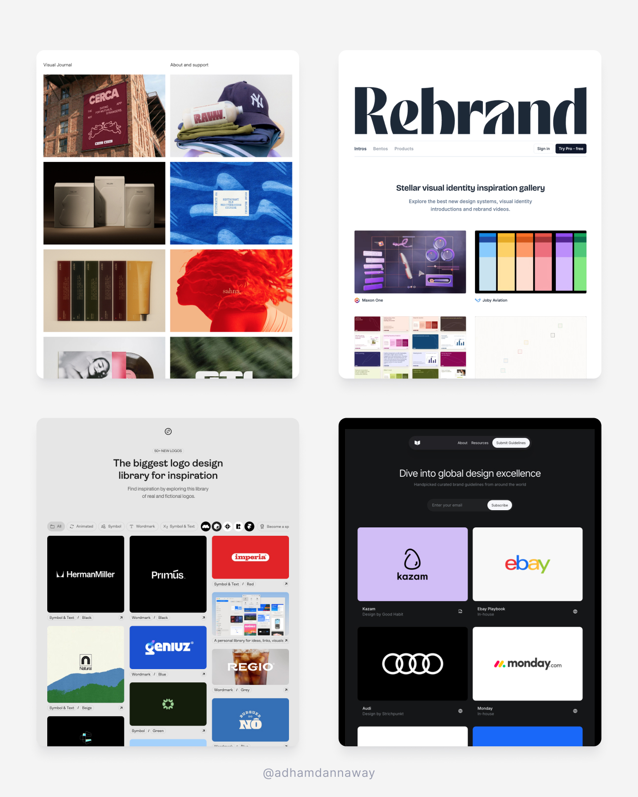
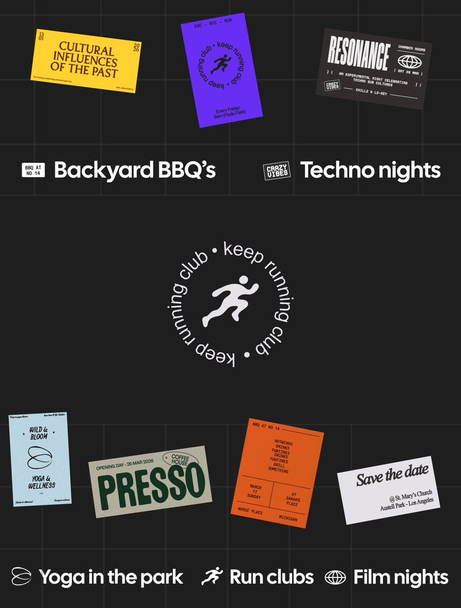
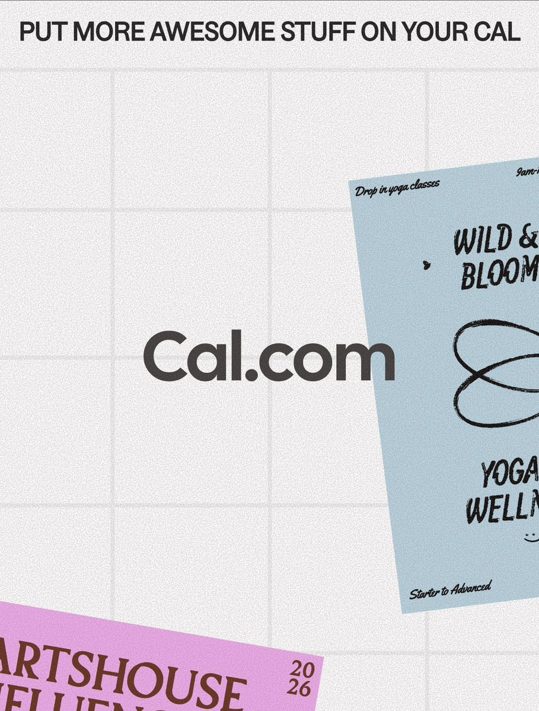
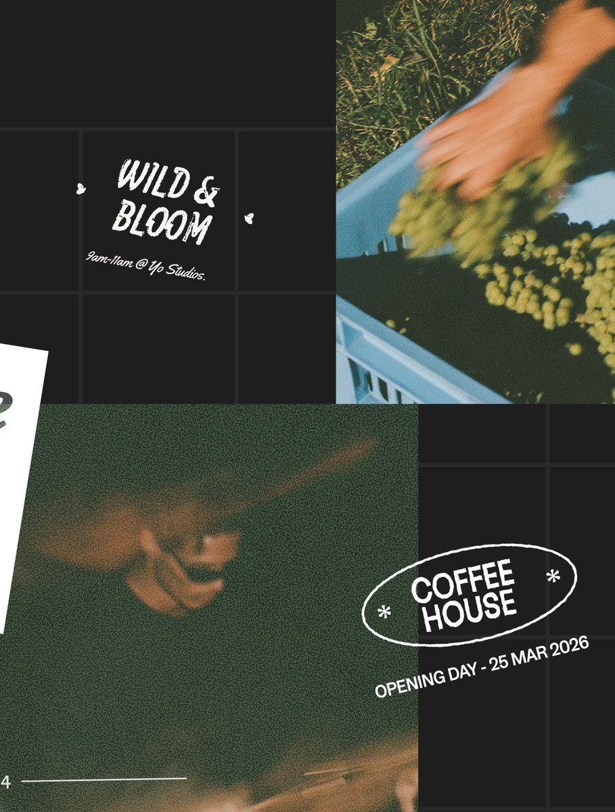
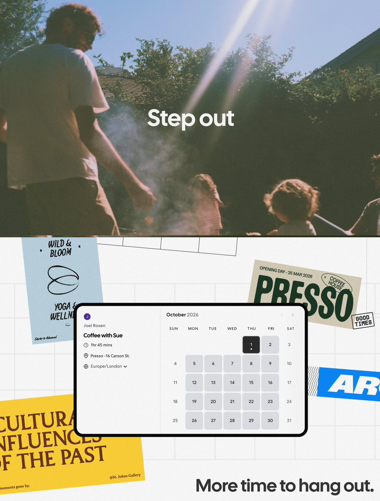

# ✨ Go-to brand design resources 👇
> Source: https://x.com/AdhamDannaway/status/2106740370415473027
> Author: Adham Dannaway (@AdhamDannaway)
> Posted: 2026-10-04T13:37:00+00:00
> Captured: 2026-10-15T09:02:28+00:00
> Stats at capture: 13,425 views · 278 likes · 5 replies · 44 reposts · 407 bookmarks · 0 quotes

## Post

✨ Go-to brand design resources 👇

Decks → https://deck.gallery
Logos → https://logosystem.co
Inspiration → https://visualjournal.it
Brand videos → https://rebrand.gallery
Brand guidelines → https://brandguidelines.net

Any others?

## Media

 — Post media 1. Source media: https://pbs.twimg.com/media/HS0aXu9bwAAf58J.jpg?name=orig
[Reply 2110371484044783722 media 1](media/animation-01.mp4) — Source media: https://video.twimg.com/tweet_video/HUmK7Eva0AAXxYU.mp4
[Reply 2110258739085509062 media 1](media/video-01.mp4) — Source media: https://video.twimg.com/amplify_video/2110258631216365568/vid/avc1/1920x1080/boomEXUSQYjQb8FK.mp4?tag=29
 — Reply 2110511473080606756 media 1. Source media: https://pbs.twimg.com/media/HUoK2tJbAAEVRZC.jpg
 — Reply 2110511473080606756 media 2. Source media: https://pbs.twimg.com/media/HUoK3i0a0AAUT3a.jpg
 — Reply 2110511473080606756 media 3. Source media: https://pbs.twimg.com/media/HUoK-VzaYAAMFyt.jpg
 — Reply 2110511473080606756 media 4. Source media: https://pbs.twimg.com/media/HUoK_MsawAAU3d2.jpg
[Reply 2110267783661625714 media 1](media/video-02.mp4) — Source media: https://video.twimg.com/amplify_video/2110267487019515904/vid/avc1/2522x1732/23jo29Zz5ky88y9r.mp4?tag=29

## Thread

### Adham Dannaway ([@AdhamDannaway](https://x.com/AdhamDannaway/status/2106851303725080622)) — 2026-10-04T20:57:48+00:00

@Mike_Andreuzza Nice, thanks for sharing
### Adham Dannaway ([@AdhamDannaway](https://x.com/AdhamDannaway/status/2106851221936185420)) — 2026-10-04T20:57:29+00:00

@cabralorenzo Cool, thanks for sharing 👍
### Adham Dannaway ([@AdhamDannaway](https://x.com/AdhamDannaway/status/2107046080311603329)) — 2026-10-05T09:51:47+00:00

@uiuxbytestimony hope the links help 👍

## Comments

### Michael Andreuzza ([@Mike_Andreuzza](https://x.com/Mike_Andreuzza/status/2106756627265167701)) — 2026-10-04T14:41:36+00:00

@AdhamDannaway https://t.co/O1rxXSh3Vk

This one
### Lorenzo Cabra ([@cabralorenzo](https://x.com/cabralorenzo/status/2106795820976849020)) — 2026-10-04T17:17:20+00:00

@AdhamDannaway Interactions -> https://t.co/csJz2YLBAa
### Testimony | UIUX Designer ([@uiuxbytestimony](https://x.com/uiuxbytestimony/status/2106897990304624927)) — 2026-10-05T00:03:19+00:00

@AdhamDannaway Definitely taking this;!!!!!
### Design Compass ([@dsgn_cmpss](https://x.com/dsgn_cmpss/status/2106875558038807020)) — 2026-10-04T22:34:11+00:00

@AdhamDannaway https://t.co/nUc1qxpR0i

Creative & Productive designs!
### Nova Start ([@NovastartOS](https://x.com/NovastartOS/status/2107315761773785208)) — 2026-10-06T03:43:24+00:00

@AdhamDannaway Rebrand gallery for brand videos is a good one. Seeing how a mark moves tells you more than any static guideline page.

## Other returned timeline records

> The CLI did not expose reply relationships. These records do not start with a reply mention and were authored by someone other than the saved-post author. They may include recommendations or promoted posts; they are retained as source context, not verified replies.

### Ahmed ([@Ahmedcreatives](https://x.com/Ahmedcreatives/status/2110371484044783722)) — 2026-10-14T14:05:45+00:00

animated this brand intro in minutes using claude 🤯 https://t.co/XLhZRgoytd
 — Source media: https://video.twimg.com/tweet_video/HUmK7Eva0AAXxYU.mp4
### Nick ([@nickbakeddesign](https://x.com/nickbakeddesign/status/2110258739085509062)) — 2026-10-14T06:37:44+00:00

brand explorations # 2 for opentag YC S26 https://t.co/urfE6xt8xQ
 — Source media: https://video.twimg.com/amplify_video/2110258631216365568/vid/avc1/1920x1080/boomEXUSQYjQb8FK.mp4?tag=29
### Ayush Soni ([@ayushsoni_io](https://x.com/ayushsoni_io/status/2110511473080606756)) — 2026-10-14T23:22:01+00:00

coming soon https://t.co/C611cnCia5
 — Source media: https://pbs.twimg.com/media/HUoK2tJbAAEVRZC.jpg
 — Source media: https://pbs.twimg.com/media/HUoK3i0a0AAUT3a.jpg
 — Source media: https://pbs.twimg.com/media/HUoK-VzaYAAMFyt.jpg
 — Source media: https://pbs.twimg.com/media/HUoK_MsawAAU3d2.jpg
### Simoom ([@simoomdesign](https://x.com/simoomdesign/status/2110267783661625714)) — 2026-10-14T07:13:41+00:00

Bookmark these motion design tools before your next project. 🎬

https://t.co/3K3IV5ClAP - AI motion design with the prompts and skills

https://t.co/ZXlBnr5h1R - Motion templates, animated device mockups, stock library in one place.

https://t.co/oHaCOdwMY7 - AI motion designer for stunning animations and typefaces

https://t.co/ne0kN6zmR4 - Build motion
videos in minutes

https://t.co/0uXt3njMFL - Showcase your designs in motion.
 — Source media: https://video.twimg.com/amplify_video/2110267487019515904/vid/avc1/2522x1732/23jo29Zz5ky88y9r.mp4?tag=29

## Links

- https://deck.gallery
- https://logosystem.co
- https://visualjournal.it
- https://rebrand.gallery
- https://brandguidelines.net
