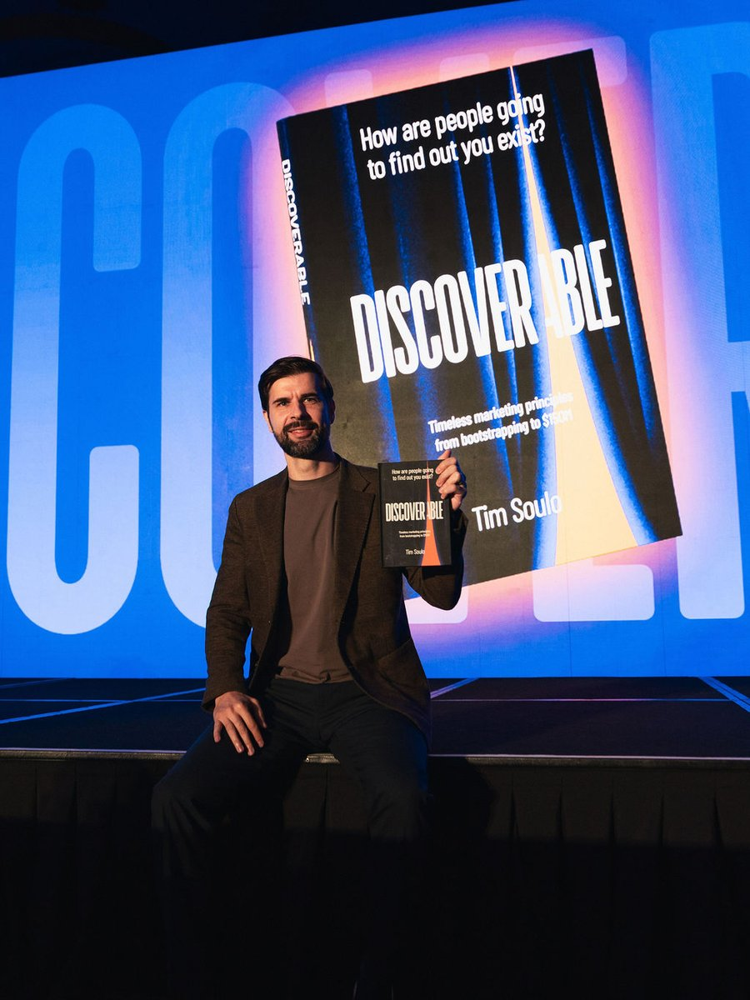
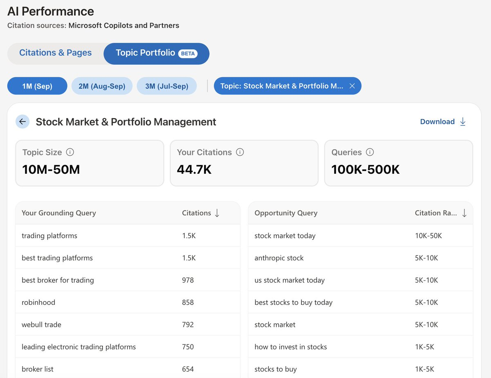
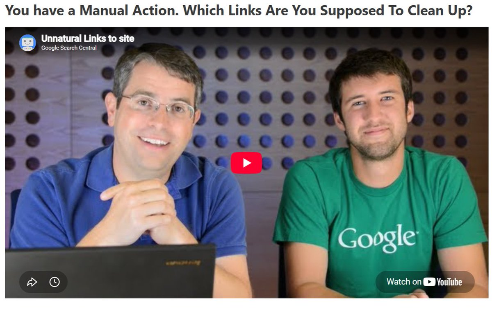

# Stop using AI for one-off SEO tasks. Build an AI agent that can handle keyword research, competitor analysis, and link building outreach for you.
> Source: https://x.com/semrush/status/2107038587866804617
> Author: Semrush (@semrush)
> Posted: 2026-10-05T09:22:00+00:00
> Captured: 2026-10-15T09:02:28+00:00
> Stats at capture: 9,106 views · 79 likes · 15 replies · 13 reposts · 90 bookmarks · 1 quotes

## Post

Stop using AI for one-off SEO tasks. Build an AI agent that can handle keyword research, competitor analysis, and link building outreach for you.

Here’s a 9-step process to get there:
1. Choose one clearly defined SEO workflow
2. Document the existing human process
3. Choose your inputs and outputs
4. Connect verified data sources
5. Turn your human process document into agent instructions
6. Add your skill to the AI platform
7. Add relevant files to the skill
8. Test and tweak your agentic workflow
9. Deploy, monitor, and improve

The real opportunity is turning a proven SEO process into a repeatable system that scales without removing human judgment. Start with one workflow, ground the agent in reliable data, and keep strategic decisions with your team.

Full walk-through: https://social.semrush.com/4dobYiB.

## Media

[Reply 2107094632341651895 media 1](media/video-01.mp4) — Source media: https://video.twimg.com/amplify_video/2107094552733458432/vid/avc1/1280x720/AgIEcH6-XySgTljJ.mp4?tag=29
 — Reply 2110390699913044093 media 1. Source media: https://pbs.twimg.com/media/HUmdI4dakAAfXYB.jpg
 — Reply 2110257382303650241 media 1. Source media: https://pbs.twimg.com/media/HUkjMtwXkAAmu80.jpg
 — Reply 2110538353372172394 media 1. Source media: https://pbs.twimg.com/media/HUojaAQXIAAvh_c.jpg

## Thread

### Semrush ([@semrush](https://x.com/semrush/status/2108638843423305886)) — 2026-10-09T19:20:51+00:00

@NamujogoB63828 logging outcomes is especially useful because it shows whether the workflow is actually improving, not just running faster

## Comments

### Namujogo Brenda ([@NamujogoB63828](https://x.com/NamujogoB63828/status/2108630356983205924)) — 2026-10-09T18:47:08+00:00

@semrush Browser agents are only as good as the guardrails. Start with low-risk workflows (data pull, form drafts), add one-click “review before submit,” validate fields, and keep a simple log of actions + outcomes to benchmark time saved vs. errors.
### Harley Lewis Foote ([@harleyfoote_](https://x.com/harleyfoote_/status/2107094632341651895)) — 2026-10-05T13:04:42+00:00

@semrush Nine steps to build something that still can't act. Agents need the loop, not a longer todo list. https://t.co/D0un6up0io
 — Source media: https://video.twimg.com/amplify_video/2107094552733458432/vid/avc1/1280x720/AgIEcH6-XySgTljJ.mp4?tag=29
### Tony G. | The GEO Guy ([@Sourcelift](https://x.com/Sourcelift/status/2107060532406542492)) — 2026-10-05T10:49:12+00:00

@semrush This is a good use case of AI applied to SEO. However, since the recent Google update, we need to reinforce the human input & review part.
### Brian Hadu ([@BrianHaDu](https://x.com/BrianHaDu/status/2107270524477026685)) — 2026-10-06T00:43:38+00:00

@semrush that 9-step process could save hours on repetitive tasks every month
### Anakimota ([@anakimota](https://x.com/anakimota/status/2107157992537829770)) — 2026-10-05T17:16:29+00:00

@semrush Since Google lost 70% of all traffic, how does SEMrush still generate sales?

## Other returned timeline records

> The CLI did not expose reply relationships. These records do not start with a reply mention and were authored by someone other than the saved-post author. They may include recommendations or promoted posts; they are retained as source context, not verified replies.

### Cattis Friberg ([@home_work_biz](https://x.com/home_work_biz/status/2107064806465286152)) — 2026-10-05T11:06:11+00:00

I'd pick to put my time into Step 2. Writing out the human process can help you see the decisions you’ve been making without thinking about them, especially what makes a keyword worth targeting for your business. Those choices are worth considering before an agent begins to repeat them in large numbers.
### Tim Soulo 🇺🇦 ([@timsoulo](https://x.com/timsoulo/status/2110390699913044093)) — 2026-10-14T15:22:06+00:00

Big announcement! I wrote a BOOK!!!

It's called DISCOVERABLE, and it's 223 pages of my best thinking about marketing.

It is:

- 60% first principles of marketing that I've developed over 15 years of doing it.
- 20% stories of how I helped grow @Ahrefs from under $8M to over $150M in ARR.
- 20% stories of other companies and brands that inspired me.

The underlying narrative is simple.

There are only three ways how people discover products and businesses:

1. They search. On Google, ChatGPT, TikTok, Amazon, etc.
2. They notice. Advertising, or content that gets organic traction.
3. They talk. People recommending you to their friends and peers.

In my book, I'm explaining the fundamental forces behind making each of these three pillars work for your business.

The book is not technical at all. No graphs. No diagrams. No dashboards. It doesn't teach you how to use marketing tools or how to succeed on specific platforms.

I wanted to make sure that the ideas from this book would be relevant for years to come, no matter what changes our industry will face going forward.

Without a doubt, this is the best piece of writing/thinking about marketing that I've ever produced.

And it would mean the WORLD to me if you'd grab a copy and give it a read. 🙏

Already available for pre-order on Amazon (dot com).

Release date: November 24, 2026.

P.S.
I was telling everyone it took me 2 years to write this book. Then I opened the revision history of the "master" Google Doc, and it was 4 years old.
 — Source media: https://pbs.twimg.com/media/HUmdI4dakAAfXYB.jpg
### Kevin_Indig ([@Kevin_Indig](https://x.com/Kevin_Indig/status/2110257382303650241)) — 2026-10-14T06:32:21+00:00

INTERESTING!

Bing Webmaster Tools is once again leading the charge: you can now see topics you're being cited for, how often they're cited and related grounding queries.

This is the closest we have to classic search data.

Your turn, Google! https://t.co/JKEA8P0mhY
 — Source media: https://pbs.twimg.com/media/HUkjMtwXkAAmu80.jpg
### Lily Ray 😏 ([@lilyraynyc](https://x.com/lilyraynyc/status/2110451723630252410)) — 2026-10-14T19:24:35+00:00

SEOs ❤️ Bing
### Shaun Anderson ([@Hobo_Web](https://x.com/Hobo_Web/status/2110538353372172394)) — 2026-10-15T01:08:50+00:00

https://t.co/ViQkzwbkfq
 — Source media: https://pbs.twimg.com/media/HUojaAQXIAAvh_c.jpg

## Links

- https://social.semrush.com/4dobYiB
