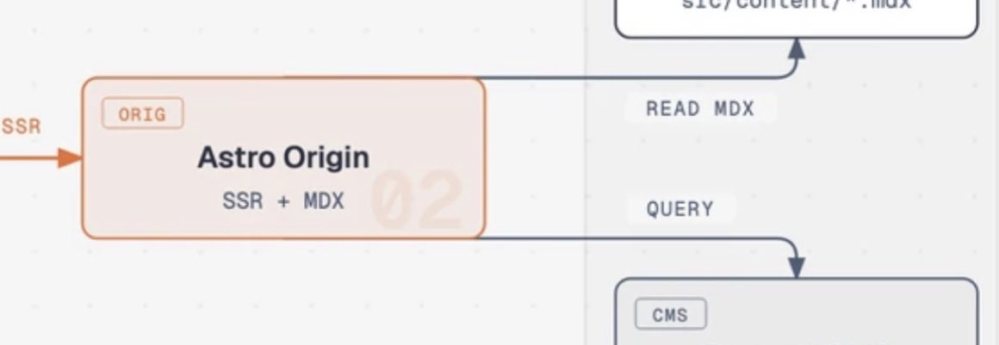

# Diagram Design skill now in 3D.
> Source: https://x.com/cathrynlavery/status/2107222360155701709
> Author: Cathryn (@cathrynlavery)
> Posted: 2026-10-05T21:32:15+00:00
> Captured: 2026-10-15T09:02:28+00:00
> Stats at capture: 35,420 views · 851 likes · 20 replies · 62 reposts · 1,347 bookmarks · 2 quotes

## Post

Diagram Design skill now in 3D.

exploded views, floor plans and site plans. 

→ up to 44 diagram types and it's open-source 😘

## Media

[Post media 1](media/video-01.mp4) — Source media: https://video.twimg.com/amplify_video/2107221866263752704/vid/avc1/1280x720/1wwH5-729d6h5cej.mp4?tag=29
 — Post media 1 thumbnail. Source media: https://pbs.twimg.com/amplify_video_thumb/2107221866263752704/img/GVQIEDu56Ku7YL0W.jpg
[Reply 2107278265731645462 media 1](media/animation-01.mp4) — Source media: https://video.twimg.com/tweet_video/HT6OaUQWUAAS9FZ.mp4
 — Reply 2107446788693299704 media 1. Source media: https://pbs.twimg.com/media/HT8nriibAAAa7M9.jpg
[Reply 2107366272073957545 media 1](media/video-02.mp4) — Source media: https://video.twimg.com/amplify_video/2107365948806373376/vid/avc1/2670x1612/Rr6qrIwFa21SEvPl.mp4?tag=29
[Reply 2110375346046746649 media 1](media/video-03.mp4) — Source media: https://video.twimg.com/amplify_video/2110374180395098112/vid/avc1/576x1024/t-hXvst_5sBLVpTc.mp4?tag=29
[Reply 2110385721391366263 media 1](media/video-04.mp4) — Source media: https://video.twimg.com/amplify_video/2110385606014480384/vid/avc1/1920x1080/eKSiyJZ5o7itVk74.mp4?tag=29
[Reply 2110564814531797386 media 1](media/video-05.mp4) — Source media: https://video.twimg.com/amplify_video/2110564564559364096/vid/avc1/1920x1080/0IEKKVE3Qqpc4sEI.mp4?tag=29

## Thread

### Cathryn ([@cathrynlavery](https://x.com/cathrynlavery/status/2107223051892908071)) — 2026-10-05T21:35:00+00:00

https://t.co/IKe4TxFYwq
### Cathryn ([@cathrynlavery](https://x.com/cathrynlavery/status/2107278460326728165)) — 2026-10-06T01:15:10+00:00

@davidfano @fedenegro share what you make!
### Cathryn ([@cathrynlavery](https://x.com/cathrynlavery/status/2107278265731645462)) — 2026-10-06T01:14:24+00:00

@sflorimm https://t.co/1m4vVWIGCo
 — Source media: https://video.twimg.com/tweet_video/HT6OaUQWUAAS9FZ.mp4
### Cathryn ([@cathrynlavery](https://x.com/cathrynlavery/status/2107461075377512679)) — 2026-10-06T13:20:49+00:00

@_cmd8 Why?

(Also I think this was a v1 diagram tbh)
### Cathryn ([@cathrynlavery](https://x.com/cathrynlavery/status/2107278374997557426)) — 2026-10-06T01:14:50+00:00

@gaurabhmathure 🥰🥰🥰

## Comments

### Dave Fano ([@davidfano](https://x.com/davidfano/status/2107225302531260563)) — 2026-10-05T21:43:57+00:00

@cathrynlavery 🤯🤯🤯🤯 
Can't wait to try this!!

FYI @fedenegro
### Floro S. ([@sflorimm](https://x.com/sflorimm/status/2107251281522020824)) — 2026-10-05T23:27:11+00:00

@cathrynlavery superb

star added
### Eugene Oldman ([@_cmd8](https://x.com/_cmd8/status/2107446788693299704)) — 2026-10-06T12:24:03+00:00

@cathrynlavery idk, this what I see at the top of the repo and it makes me immediately not want to use it https://t.co/1390ABoaJU
 — Source media: https://pbs.twimg.com/media/HT8nriibAAAa7M9.jpg
### Gaurabh ([@gaurabhmathure](https://x.com/gaurabhmathure/status/2107236802348122593)) — 2026-10-05T22:29:38+00:00

@cathrynlavery You are awesome 😎
### Jomar ([@J0_mart](https://x.com/J0_mart/status/2107377750264742193)) — 2026-10-06T07:49:43+00:00

@cathrynlavery Thanks, that will be useful !
### OySana ([@oysanastudio](https://x.com/oysanastudio/status/2107328763273097637)) — 2026-10-06T04:35:04+00:00

@cathrynlavery Can it create it own diagrams?
### anirudh ([@anirudhux](https://x.com/anirudhux/status/2107285221540548701)) — 2026-10-06T01:42:02+00:00

@cathrynlavery I’ve needed this at so many situations! Thank you. Can’t wait to try this out.
### Agon Aliu ([@agonaliu_](https://x.com/agonaliu_/status/2107555664335634470)) — 2026-10-06T19:36:41+00:00

@cathrynlavery So many layers of satisfaction in one vid
### Aryan Utkarsh ([@aryanandutkarsh](https://x.com/aryanandutkarsh/status/2107366272073957545)) — 2026-10-06T07:04:06+00:00

@cathrynlavery Been using this skill for quite some time...this makes my docs stand out so much 
I built this skill on top of yours, which even animates all the diagrams and adds details to each node, along with support for converting other diagrams as well. 
https://t.co/x4lZEwRPBK https://t.co/Q2Nxzj3dcE
 — Source media: https://video.twimg.com/amplify_video/2107365948806373376/vid/avc1/2670x1612/Rr6qrIwFa21SEvPl.mp4?tag=29
### AI Operator Lab ([@Attollo_Labs_AI](https://x.com/Attollo_Labs_AI/status/2107274973916385539)) — 2026-10-06T01:01:19+00:00

@cathrynlavery Yes, and — the floor plans are the sleeper feature. Every contractor still pays someone to redraw redlines before a permit. Turning a rough sketch into a clean floor plan in minutes kills a week of back-and-forth.
### dust ([@dustADD](https://x.com/dustADD/status/2109845187702989040)) — 2026-10-13T03:14:26+00:00

@cathrynlavery A single projection function gives agents a useful constraint here. The declared part boxes can be checked against the rendered SVG, so review can catch geometry drift without relying only on whether the picture looks convincing.
### Alek ([@AlekVectis](https://x.com/AlekVectis/status/2107233110765051941)) — 2026-10-05T22:14:58+00:00

@cathrynlavery exploded views are where this earns its keep. that's the diagram type that used to need a CAD person and half a day, and it's exactly what makes a hardware pitch deck or assembly doc click for someone non-technical
### kt ([@kanavtaneja29](https://x.com/kanavtaneja29/status/2109914010112111029)) — 2026-10-13T07:47:54+00:00

@cathrynlavery diagram design is on the innernet community now, credited to you: https://t.co/q8T1MmHOYA
45 diagram types from one link, and every update you ship reaches whoever's using it.
if you'd rather it wasn't listed, reply and it's gone same day.
### Robbie Heane ([@HeaneRobbie](https://x.com/HeaneRobbie/status/2107366409554804972)) — 2026-10-06T07:04:39+00:00

@cathrynlavery You're a ripper Cath! I've been enjoying building nice diagrams with your skill: https://t.co/CzxgAnmIeS
### Brian Hadu ([@BrianHaDu](https://x.com/BrianHaDu/status/2107458270806041062)) — 2026-10-06T13:09:41+00:00

@cathrynlavery with 44 types, it sounds like this can really boost collaboration efforts
### Vera Ai | Tools & Updates ([@VeraAiUpdates](https://x.com/VeraAiUpdates/status/2107401744787640332)) — 2026-10-06T09:25:04+00:00

@cathrynlavery Open-source diagramming getting 3D support is a seriously useful upgrade
### Brjan | AI Builder ([@MrBrjan](https://x.com/MrBrjan/status/2107250713156026854)) — 2026-10-05T23:24:55+00:00

@cathrynlavery having 44 diagram types opens up so many possibilities for complex projects
### Kevin Dunbar ([@Kevin_S_Dunbar](https://x.com/Kevin_S_Dunbar/status/2107377534585168364)) — 2026-10-06T07:48:52+00:00

@cathrynlavery That is fantastic
### Ahmed Muhi ([@ahmedmuhi01](https://x.com/ahmedmuhi01/status/2107328914557395210)) — 2026-10-06T04:35:40+00:00

@cathrynlavery I looove this skill, I use it to create Azure architecture diagrams, it is magic, thank you 😊🙌

## Other returned timeline records

> The CLI did not expose reply relationships. These records do not start with a reply mention and were authored by someone other than the saved-post author. They may include recommendations or promoted posts; they are retained as source context, not verified replies.

### Starlink ([@Starlink](https://x.com/Starlink/status/2092706810310643936)) — 2026-08-26T20:12:38+00:00

Starlink offers fast, reliable internet in the most rural and remote locations. Portable and easy to set up, Starlink Mini works wherever you are.

Order online in minutes.
### Starlink ([@Starlink](https://x.com/Starlink/status/2068115197718593741)) — 2026-06-19T23:34:21+00:00

Get connected with fast, reliable internet for streaming, video calls, online gaming and more.

Order online in minutes.
### Steven Cheng ([@stevencheng](https://x.com/stevencheng/status/2110375346046746649)) — 2026-10-14T14:21:06+00:00

Behold, the ESP32 ball. https://t.co/yx3PvWK7jb
 — Source media: https://video.twimg.com/amplify_video/2110374180395098112/vid/avc1/576x1024/t-hXvst_5sBLVpTc.mp4?tag=29
### Hassan ([@nutlope](https://x.com/nutlope/status/2110385721391366263)) — 2026-10-14T15:02:19+00:00

Introducing Gloss!

A beautiful new way to save, read, and interact with articles.

→ Save articles, PDFs, and X bookmarks
→ Highlight and get instant answers with AI
→ Build a personal library you'll actually use

Free and open source! https://t.co/Uc5nU5nLym
 — Source media: https://video.twimg.com/amplify_video/2110385606014480384/vid/avc1/1920x1080/eKSiyJZ5o7itVk74.mp4?tag=29
### Luneri ([@itsluneri](https://x.com/itsluneri/status/2110564814531797386)) — 2026-10-15T02:53:58+00:00

Opus 5.5 with and without TasteSkill v2, same prompt on both.

Details, and my opinion about TasteSkill below! :) https://t.co/vq9mZnWLvl
 — Source media: https://video.twimg.com/amplify_video/2110564564559364096/vid/avc1/1920x1080/0IEKKVE3Qqpc4sEI.mp4?tag=29
### Felix Rieseberg ([@felixrieseberg](https://x.com/felixrieseberg/status/2110023283169247623)) — 2026-10-13T15:02:07+00:00

Hi, I'm Felix. I'm an eng lead working on Claude. I love watching people take flight and do things they never thought possible.

We often describe that as "being more ambitious" when using AI, which is tricky advice to follow. I wrote a tutorial:

https://t.co/vNPPs5FWm8
