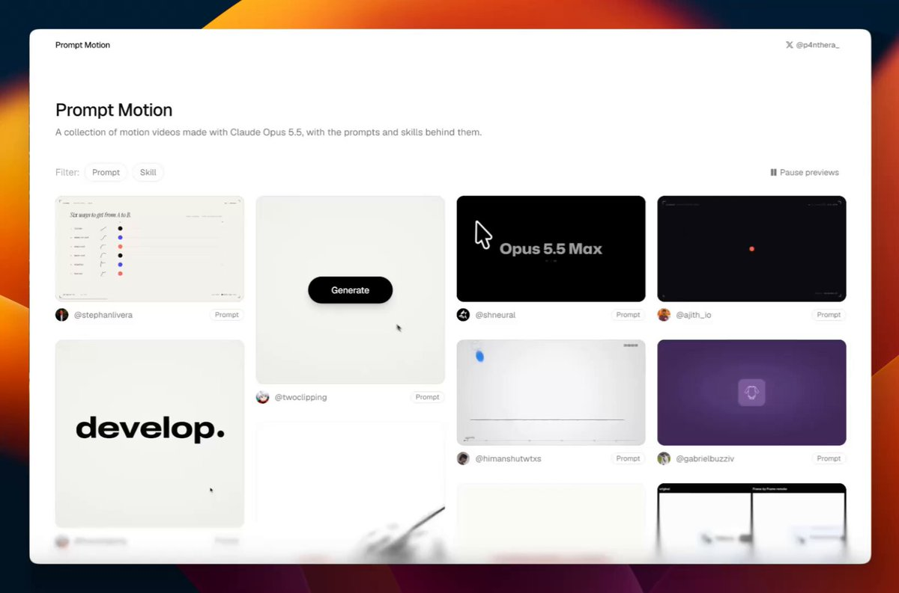
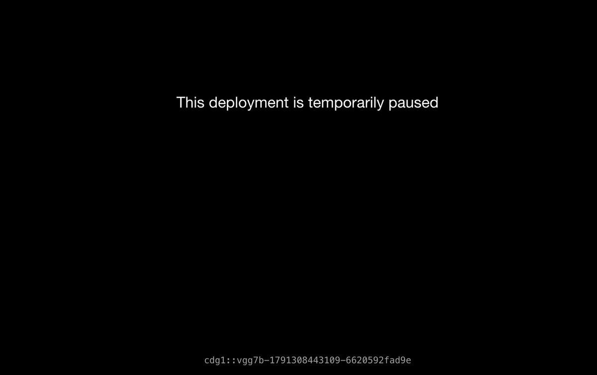
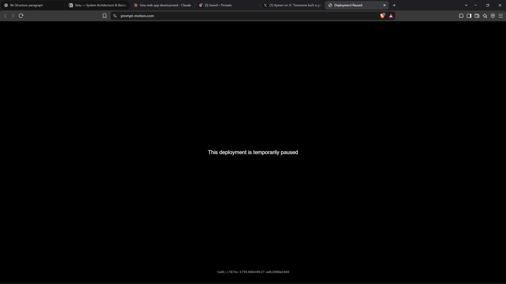
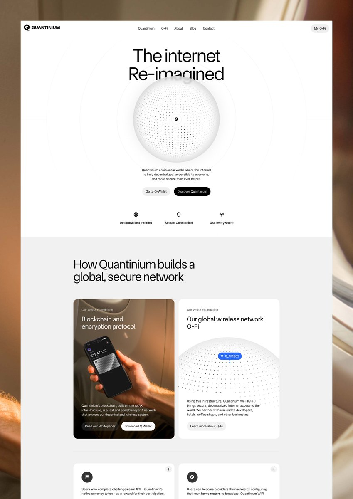
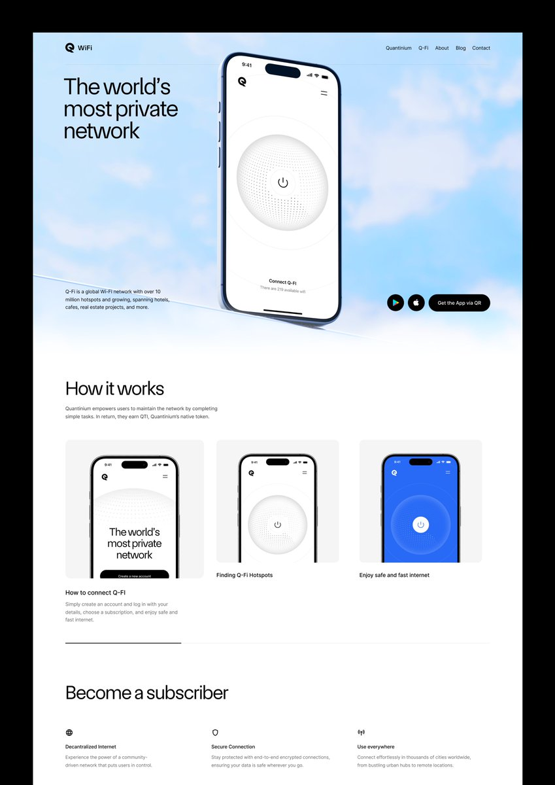
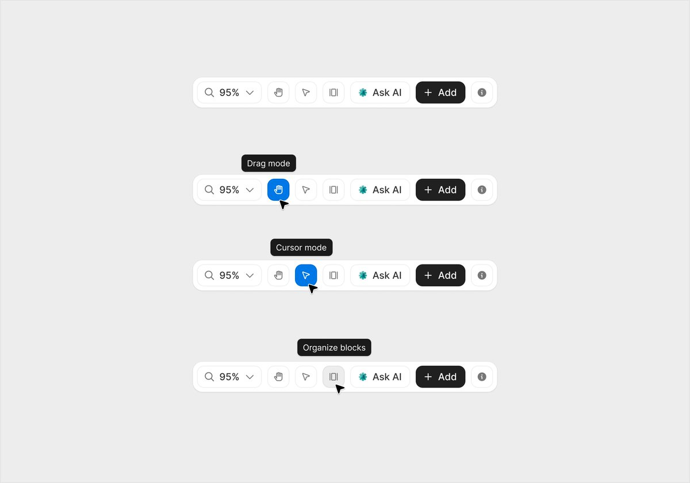
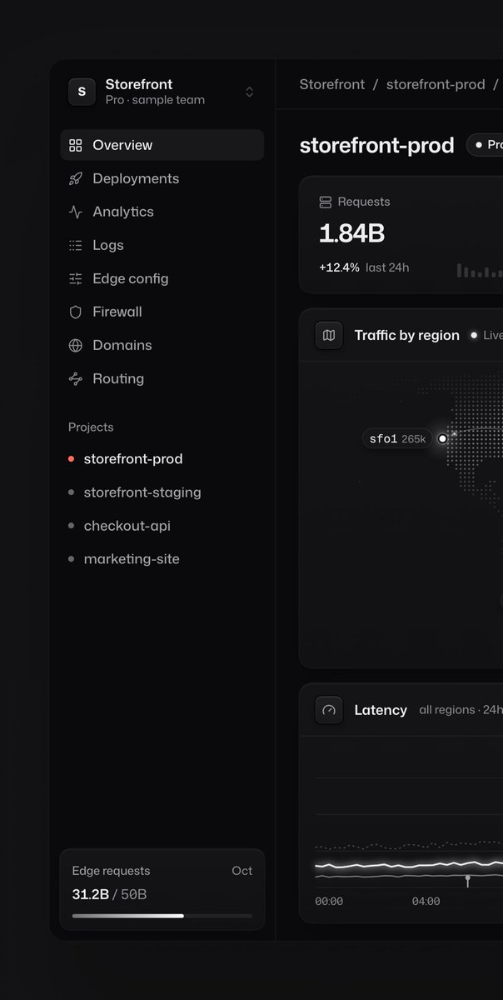
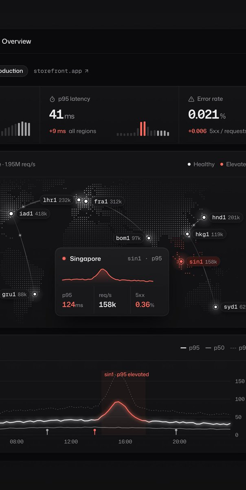
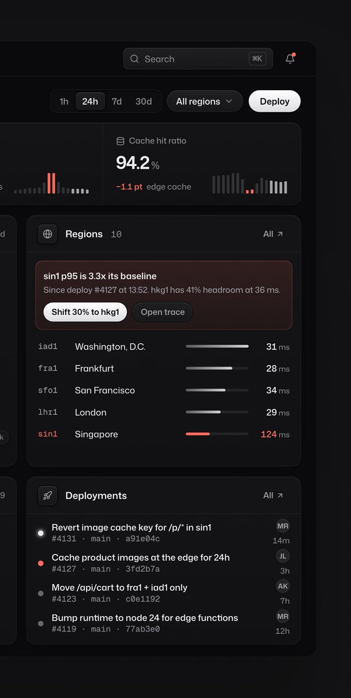

# Someone built a growing gallery of motion graphics made with Claude Opus 5.5, each shown alongside the prompt or skill that created it.
> Source: https://x.com/aymenpursue/status/2107321323911549277
> Author: Aymen (@aymenpursue)
> Posted: Tue Oct 06 04:05:30 +0000 2026
> Captured: 2026-10-15T09:02:28+00:00
> Stats at capture: 29,281 views · 356 likes · 12 replies · 29 reposts · 553 bookmarks · 1 quotes

## Post

Someone built a growing gallery of motion graphics made with Claude Opus 5.5, each shown alongside the prompt or skill that created it.

226 examples + the prompts behind them 👀

https://prompt-motion.com

## Media

[Post media 1](media/video-01.mp4) — Source media: https://video.twimg.com/amplify_video/2107320831101554688/vid/avc1/1088x720/WU5tQ0NjKD1dHAmp.mp4?tag=29
 — Post media 1 thumbnail. Source media: https://pbs.twimg.com/amplify_video_thumb/2107320831101554688/img/qR9y_AT5NVKMjK9L.jpg
[Reply 2107668199085142203 media 1](media/video-02.mp4) — Source media: https://video.twimg.com/amplify_video/2107668080260423680/vid/avc1/1080x1350/8HcfTYbQy2XE_Hcd.mp4?tag=29
 — Reply 2107526833168326659 media 1. Source media: https://pbs.twimg.com/media/HT9wd97WYAAG4hE.jpg
 — Reply 2107526606189433307 media 1. Source media: https://pbs.twimg.com/media/HT9wQsfbIAAjzle.jpg
 — Reply 2110311051657187825 media 1. Source media: https://pbs.twimg.com/media/HUlUtL6XMAE4B3r.jpg
 — Reply 2110311051657187825 media 2. Source media: https://pbs.twimg.com/media/HUlUtLoWsAAz5xN.jpg
 — Reply 2110311051657187825 media 3. Source media: https://pbs.twimg.com/media/HUlUtLrXYAAblHc.jpg
 — Reply 2110311051657187825 media 4. Source media: https://pbs.twimg.com/media/HUlUtLyXIAA1Gxc.jpg
[Reply 2110479557937840344 media 1](media/video-03.mp4) — Source media: https://video.twimg.com/amplify_video/2110479510605115392/vid/avc1/1678x1080/XBTkkLNIcBcLdzjC.mp4?tag=16
 — Reply 2110408550845702320 media 1. Source media: https://pbs.twimg.com/media/HUmtY8BbkAAFNoZ.jpg
 — Reply 2110393766754341153 media 1. Source media: https://pbs.twimg.com/media/HUmf8VJWYAARPlE.jpg
 — Reply 2110393766754341153 media 2. Source media: https://pbs.twimg.com/media/HUmf8VCW4AAKWt8.jpg
 — Reply 2110393766754341153 media 3. Source media: https://pbs.twimg.com/media/HUmf8VXW4AEBFNb.jpg

## Thread

### Aymen ([@aymenpursue](https://x.com/aymenpursue/status/2107483728796655641)) — 2026-10-06T14:50:50+00:00

@BDoma Yes

## Comments

### COURT ([@BDoma](https://x.com/BDoma/status/2107480893803884740)) — 2026-10-06T14:39:34+00:00

@aymenpursue And the best part is they are completely free.
### Simar Kohli ([@SimarKohli_](https://x.com/SimarKohli_/status/2107668199085142203)) — 2026-10-07T03:03:51+00:00

@aymenpursue How about making a library of perfectly replicated videos from Apple, Meta, Google, Anthropic? 

This was replicated by our algo (with one single codex call) https://t.co/4ZhU0X6Qmh
 — Source media: https://video.twimg.com/amplify_video/2107668080260423680/vid/avc1/1080x1350/8HcfTYbQy2XE_Hcd.mp4?tag=29
### BreezeOg ([@BreezeOg1](https://x.com/BreezeOg1/status/2107462264101945793)) — 2026-10-06T13:25:33+00:00

@aymenpursue 226 with the prompts?

saved
### Taoufik Zaria ([@TaoufikZr](https://x.com/TaoufikZr/status/2107526833168326659)) — 2026-10-06T17:42:07+00:00

@aymenpursue somethong wrong https://t.co/Dr7ZkFBlC2
 — Source media: https://pbs.twimg.com/media/HT9wd97WYAAG4hE.jpg
### Ikram Sakib ([@ikramhsakib](https://x.com/ikramhsakib/status/2107475689553469449)) — 2026-10-06T14:18:54+00:00

@aymenpursue Creative one.
### hvqo ([@buildinghugo](https://x.com/buildinghugo/status/2107445850943168892)) — 2026-10-06T12:20:19+00:00

@aymenpursue I love it!
### Karan ([@karaninreal](https://x.com/karaninreal/status/2109627507259707510)) — 2026-10-12T12:49:27+00:00

@aymenpursue https://t.co/9Uz7ZHPl2Y
### Shishu Kumar Guin ([@ShishuGuin](https://x.com/ShishuGuin/status/2107526606189433307)) — 2026-10-06T17:41:13+00:00

@aymenpursue It says https://t.co/GD8MSac9yR
 — Source media: https://pbs.twimg.com/media/HT9wQsfbIAAjzle.jpg
### Hridya ([@AgrawalHridaya](https://x.com/AgrawalHridaya/status/2107564278668468576)) — 2026-10-06T20:10:55+00:00

@aymenpursue nice resource, thanks for sharing

## Other returned timeline records

> The CLI did not expose reply relationships. These records do not start with a reply mention and were authored by someone other than the saved-post author. They may include recommendations or promoted posts; they are retained as source context, not verified replies.

### Starlink ([@Starlink](https://x.com/Starlink/status/2068115197718593741)) — 2026-06-19T23:34:21+00:00

Get connected with fast, reliable internet for streaming, video calls, online gaming and more.

Order online in minutes.
### Bakers Studio ([@studiobakers](https://x.com/studiobakers/status/2110311051657187825)) — 2026-10-14T10:05:37+00:00

landing for quantinium https://t.co/M0Jrs4HkJa
 — Source media: https://pbs.twimg.com/media/HUlUtL6XMAE4B3r.jpg
 — Source media: https://pbs.twimg.com/media/HUlUtLoWsAAz5xN.jpg
 — Source media: https://pbs.twimg.com/media/HUlUtLrXYAAblHc.jpg
 — Source media: https://pbs.twimg.com/media/HUlUtLyXIAA1Gxc.jpg
### Adrian ([@adriankuleszo](https://x.com/adriankuleszo/status/2110479557937840344)) — 2026-10-14T21:15:12+00:00

New testimonial cards design on @designme

Simple default state, shader matches the brand's accent color, hover state reveals more info to reduce cognitive load. https://t.co/mS7fnLpgEK
 — Source media: https://video.twimg.com/amplify_video/2110479510605115392/vid/avc1/1678x1080/XBTkkLNIcBcLdzjC.mp4?tag=16
### rico ([@_heyrico](https://x.com/_heyrico/status/2110408550845702320)) — 2026-10-14T16:33:02+00:00

navigation 🦙 https://t.co/JrkWM8ReaH
 — Source media: https://pbs.twimg.com/media/HUmtY8BbkAAFNoZ.jpg
### Augustas ([@augustasdesign](https://x.com/augustasdesign/status/2110393766754341153)) — 2026-10-14T15:34:17+00:00

the most detailed dashboard I’ve ever built 👀 https://t.co/Wss1Ru8Olg
 — Source media: https://pbs.twimg.com/media/HUmf8VJWYAARPlE.jpg
 — Source media: https://pbs.twimg.com/media/HUmf8VCW4AAKWt8.jpg
 — Source media: https://pbs.twimg.com/media/HUmf8VXW4AEBFNb.jpg

## Links

- https://prompt-motion.com
