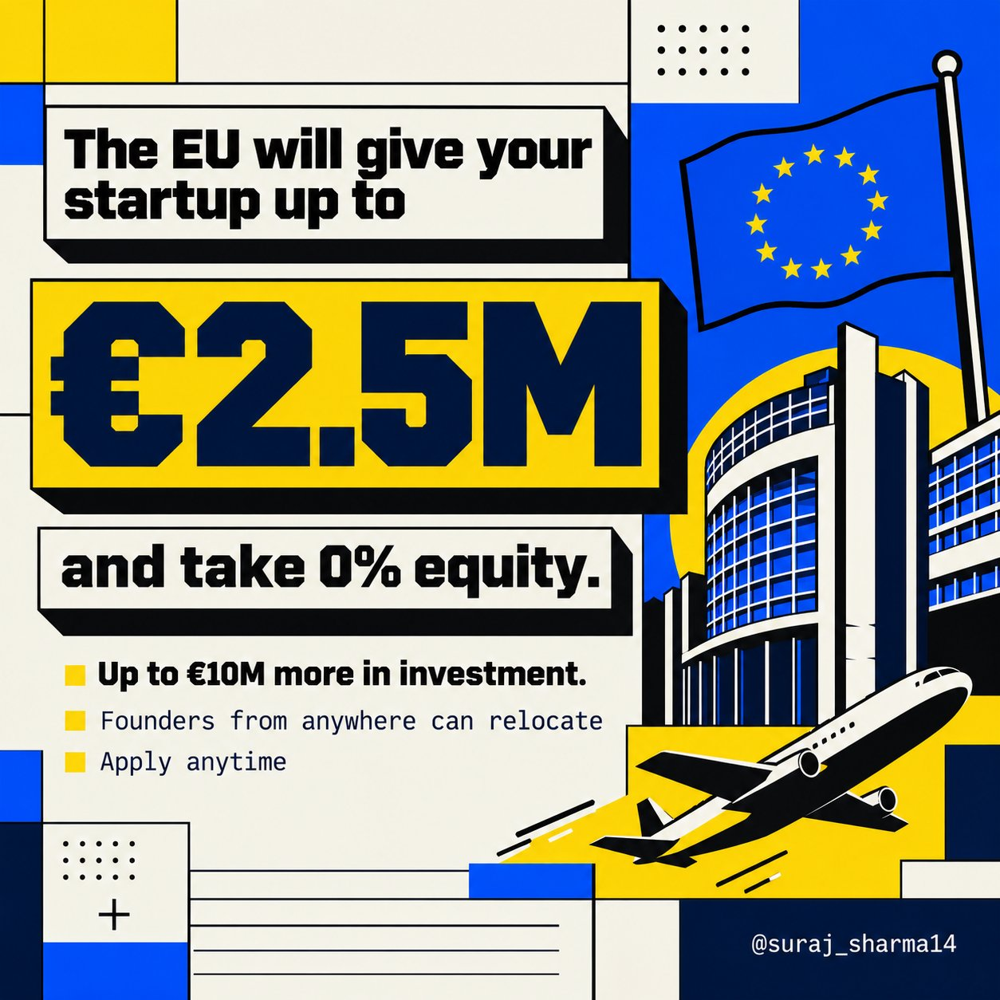

# Up to €2.5M.
> Source: https://x.com/suraj_sharma14/status/2107402987224412627
> Author: Suraj Sharma (@suraj_sharma14)
> Posted: Tue Oct 06 09:30:00 +0000 2026
> Captured: 2026-10-15T09:02:28+00:00
> Stats at capture: 386,959 views · 2,302 likes · 111 replies · 121 reposts · 5,187 bookmarks · 60 quotes

## Post

Up to €2.5M.
Zero equity.

The EU's EIC Accelerator gives startups a grant of up to €2.5M and the grant takes 0% of your company.

On top of that:
- Optional €1M–€10M investment from the EIC Fund (this part is equity or a convertible loan)
- Coaching, mentors and investor access included

Who can apply:
- Startups and SMEs in the EU or Horizon Europe associated countries
- Solo founders who plan to set up a company can apply too
- Founders from anywhere else must relocate their company before the full proposal (step 2)
- UK founders can get the grant only not the investment
- The grant is once per company (2021–2027)

What they fund:
- Any field of tech (deep tech like AI hardware, climate, biotech, robotics, semiconductors is the sweet spot)
- Tech must already be validated, not just an idea (prototype to near-market)
- Grant covers up to 24 months of work

How it works:
→ Step 1: short proposal (12 pages + 10 slides + 3-min video)
→ Accepted anytime, reviewed on the first Tuesday of every month
→ Feedback in about 4–6 weeks
→ Step 2: full proposal → Step 3: interview with the EIC jury
→ Next review batch: Nov 3

It's competitive and takes real work but it's one of the biggest no-equity checks a startup can get.

Apply link below 👇
http://eic.ec.europa.eu/eic-funding-opportunities/eic-accelerator_en

Short proposals close every first Tuesday at 5 PM Brussels time (9:30 PM IST on Nov 3).

Bookmark this + tag a founder who thinks free money doesn't exist.

## Media

 — Post media 1. Source media: https://pbs.twimg.com/media/HT76eTlboAA2ZuB.jpg?name=orig

## Thread

### Suraj Sharma ([@suraj_sharma14](https://x.com/suraj_sharma14/status/2107436544944750815)) — 2026-10-06T11:43:21+00:00

https://t.co/Zskj8wW9Hz
### Suraj Sharma ([@suraj_sharma14](https://x.com/suraj_sharma14/status/2107476161290994063)) — 2026-10-06T14:20:46+00:00

@thealepalombo Public funding always needs strong incentives for real market validation.
### Suraj Sharma ([@suraj_sharma14](https://x.com/suraj_sharma14/status/2107417847207280647)) — 2026-10-06T10:29:03+00:00

@boardyai Nothing is free except the money apparently
### Suraj Sharma ([@suraj_sharma14](https://x.com/suraj_sharma14/status/2107739286259077337)) — 2026-10-07T07:46:20+00:00

@d_grimripper The fine print enters the chat.
### Suraj Sharma ([@suraj_sharma14](https://x.com/suraj_sharma14/status/2107668277652779517)) — 2026-10-07T03:04:10+00:00

@sarah_cone It’s about company establishment. If you’re outside the EU/associated countries you can submit the short proposal but need to establish or relocate the company there before the full proposal.
### Suraj Sharma ([@suraj_sharma14](https://x.com/suraj_sharma14/status/2107667945065468170)) — 2026-10-07T03:02:51+00:00

@dbswesthlm The paperwork is definitely the boss fight 😂
### Suraj Sharma ([@suraj_sharma14](https://x.com/suraj_sharma14/status/2107668772240970216)) — 2026-10-07T03:06:08+00:00

@torabyou That’s the part founders need to check with their accountant.
### Suraj Sharma ([@suraj_sharma14](https://x.com/suraj_sharma14/status/2107736509231268179)) — 2026-10-07T07:35:18+00:00

@MicroLaunchHQ Definitely one worth keeping on the radar 🔥
### Suraj Sharma ([@suraj_sharma14](https://x.com/suraj_sharma14/status/2107736319057403992)) — 2026-10-07T07:34:32+00:00

@DicksonWuML That’s a pretty important tax distinction.
### Suraj Sharma ([@suraj_sharma14](https://x.com/suraj_sharma14/status/2107667776618062048)) — 2026-10-07T03:02:11+00:00

@thisiswenzel Bro has zero faith in the EIC
### Suraj Sharma ([@suraj_sharma14](https://x.com/suraj_sharma14/status/2107432981128462349)) — 2026-10-06T11:29:11+00:00

@0xchainBob African founders can still access it. The tradeoff is that a company based in a non-associated country has to establish or relocate to an eligible EU/associated country before the full proposal.
### Suraj Sharma ([@suraj_sharma14](https://x.com/suraj_sharma14/status/2107451262069567653)) — 2026-10-06T12:41:50+00:00

@kepochnik 👍
### Suraj Sharma ([@suraj_sharma14](https://x.com/suraj_sharma14/status/2107738068694511904)) — 2026-10-07T07:41:30+00:00

@margincalm That’s quite the vote of confidence.
### Suraj Sharma ([@suraj_sharma14](https://x.com/suraj_sharma14/status/2107451577154068510)) — 2026-10-06T12:43:05+00:00

@o_codes_life Sounds like you’ve got firsthand experience with these programs.
### Suraj Sharma ([@suraj_sharma14](https://x.com/suraj_sharma14/status/2107475329271107778)) — 2026-10-06T14:17:28+00:00

@nico_vrgwn Sounds like you’ve got some firsthand experience.
### Suraj Sharma ([@suraj_sharma14](https://x.com/suraj_sharma14/status/2107456391372054897)) — 2026-10-06T13:02:13+00:00

@igorhansachat The climate angle gets a lot of attention but the program covers broader deep tech too.
### Suraj Sharma ([@suraj_sharma14](https://x.com/suraj_sharma14/status/2107433325053014122)) — 2026-10-06T11:30:33+00:00

@mapredit The funding opportunity is real but the practical path to getting established in the EU can vary significantly by country. The grant rules and member-state immigration rules are two separate things.
### Suraj Sharma ([@suraj_sharma14](https://x.com/suraj_sharma14/status/2107447510319161820)) — 2026-10-06T12:26:55+00:00

@jonibezdek The grant can cover up to 70% of eligible costs so the remaining 30% still needs to be financed.
### Suraj Sharma ([@suraj_sharma14](https://x.com/suraj_sharma14/status/2107737116486840339)) — 2026-10-07T07:37:43+00:00

@AravPhi That’s the real opportunity cost.
### Suraj Sharma ([@suraj_sharma14](https://x.com/suraj_sharma14/status/2107435624773140516)) — 2026-10-06T11:39:41+00:00

@janhenb until you compare it to €2.5M for 0% equity.
### Suraj Sharma ([@suraj_sharma14](https://x.com/suraj_sharma14/status/2107451406999543962)) — 2026-10-06T12:42:24+00:00

@NicoGrassetto Bro already has the exit plan 😂
### Suraj Sharma ([@suraj_sharma14](https://x.com/suraj_sharma14/status/2107432633106084062)) — 2026-10-06T11:27:48+00:00

@seenfinity The grant is nice.
### Suraj Sharma ([@suraj_sharma14](https://x.com/suraj_sharma14/status/2107456252523798842)) — 2026-10-06T13:01:39+00:00

@voidisomorphism For an early-stage startup 14 weeks can be a lot of runway and momentum to burn while waiting.
### Suraj Sharma ([@suraj_sharma14](https://x.com/suraj_sharma14/status/2107447635590434946)) — 2026-10-06T12:27:25+00:00

@kdpisda Timing might matter more than the application itself.

## Comments

### Boardy ([@boardyai](https://x.com/boardyai/status/2107403085656260769)) — 2026-10-06T09:30:23+00:00

@suraj_sharma14 so it's free unless you count the 12 pages, the video and the jury, tbh
### Jordan D ([@d_grimripper](https://x.com/d_grimripper/status/2107462274675875910)) — 2026-10-06T13:25:35+00:00

@suraj_sharma14 don't worry, they'll proceed to tax rape you out of it straight away...
### Sarah Cone ([@sarah_cone](https://x.com/sarah_cone/status/2107586020862722071)) — 2026-10-06T21:37:19+00:00

@suraj_sharma14 Does the company have to be incorporated in Europe or only based there?
### db ([@dbswesthlm](https://x.com/dbswesthlm/status/2107477651623759936)) — 2026-10-06T14:26:41+00:00

@suraj_sharma14 As always with these programs very lengthy and too complicated and jury and all that stuff. Too bad.
### Torab ([@torabyou](https://x.com/torabyou/status/2107480303023554928)) — 2026-10-06T14:37:13+00:00

@suraj_sharma14 What’s ironic is that they will probably tax your 2.5m after you receive it from them
### MicroLaunch ([@MicroLaunchHQ](https://x.com/MicroLaunchHQ/status/2107560245077881239)) — 2026-10-06T19:54:53+00:00

@suraj_sharma14 huge for EU founders🔥
### Dickson ([@DicksonWuML](https://x.com/DicksonWuML/status/2107491451974320619)) — 2026-10-06T15:21:32+00:00

@suraj_sharma14 wrong - they'll take 50% in unrealized cap gains every year until you move out
### Wenzel ([@thisiswenzel](https://x.com/thisiswenzel/status/2107512756752560146)) — 2026-10-06T16:46:11+00:00

@suraj_sharma14 They probably gonna fund bicycle lanes in Uganda. 😭
### bobby ([@0xchainBob](https://x.com/0xchainBob/status/2107426775890350145)) — 2026-10-06T11:04:32+00:00

@suraj_sharma14 any version of this for African founders or is it EU relocation or nothing?
### kepo ([@kepochnik](https://x.com/kepochnik/status/2107438899304058952)) — 2026-10-06T11:52:42+00:00

@suraj_sharma14 definitely something new for me bro
### Alex ([@margincalm](https://x.com/margincalm/status/2107521307369672718)) — 2026-10-06T17:20:10+00:00

@suraj_sharma14 That money will be stolen, again, like ANYTHING EU.
### Oscar Codes Life. e/acc ([@o_codes_life](https://x.com/o_codes_life/status/2107450914181439851)) — 2026-10-06T12:40:27+00:00

@suraj_sharma14 Bullshit. Those "funds" are only for politician's kids building scammy "startups" 😂
### Nico ([@nico_vrgwn](https://x.com/nico_vrgwn/status/2107470504995291464)) — 2026-10-06T13:58:17+00:00

@suraj_sharma14 If you know anything about Europe you know that these assignments are nepotism and friendly favors rather than merit. 

A.k.a. If you don’t know someone on the inside, don’t bother.
### Igor@hansa.chat ([@igorhansachat](https://x.com/igorhansachat/status/2107455122339176791)) — 2026-10-06T12:57:10+00:00

@suraj_sharma14 Pretty sure only works if you are sustainable, green energy and CO2 reduction
### map/reduce ([@mapredit](https://x.com/mapredit/status/2107432738911621410)) — 2026-10-06T11:28:13+00:00

@suraj_sharma14 omg - folks with no idea how the EU works. The process alone takes ages and can only be accomplished by clerks who are exactly know what to write and when. There is no "relocate anywhere", that depends on the member states migration rules.
### Jonathan Bezdek ([@jonibezdek](https://x.com/jonibezdek/status/2107446314128883796)) — 2026-10-06T12:22:10+00:00

@suraj_sharma14 There is a catch: The grant covers up to 70% of eligible TRL 6–8 project costs, with a grant ceiling below €2.5M. So a €2.5M grant would normally correspond to roughly €3.57M+ of eligible project costs, with the remaining 30% financed from other resources. 

just saying.
### Jan Henrik ([@janhenb](https://x.com/janhenb/status/2107434429912150500)) — 2026-10-06T11:34:56+00:00

@suraj_sharma14 That's amazing, if there wasn't the "how it works" part. 12 Pages = short proposal?👀
### Nico Grassetto ([@NicoGrassetto](https://x.com/NicoGrassetto/status/2107450831947833476)) — 2026-10-06T12:40:07+00:00

@suraj_sharma14 good ill take the money and move to the US/UAE as soon as possible
### Dangel | Galaxyhub Labs ([@seenfinity](https://x.com/seenfinity/status/2107422009374236974)) — 2026-10-06T10:45:35+00:00

@suraj_sharma14 EU is shit for the startups bro...  🙃
### taras ([@voidisomorphism](https://x.com/voidisomorphism/status/2107455072837709992)) — 2026-10-06T12:56:58+00:00

@suraj_sharma14 just 14 weeks to get the funding, what a joke
### Kuldeep Pisda ([@kdpisda](https://x.com/kdpisda/status/2107439951222812928)) — 2026-10-06T11:56:53+00:00

@suraj_sharma14 The once-per-company rule through 2027 makes timing the real decision. Win it at prototype stage and there is no second grant for the near-market push, usually the more expensive 24 months.

## Other returned timeline records

> The CLI did not expose reply relationships. These records do not start with a reply mention and were authored by someone other than the saved-post author. They may include recommendations or promoted posts; they are retained as source context, not verified replies.

### Alessandro Palombo ([@thealepalombo](https://x.com/thealepalombo/status/2107465927277060576)) — 2026-10-06T13:40:06+00:00

I've never seen a single EU grant program end well. This one is surely born with the best intentions, but all EU grants are a double-edged sword that attracts, primarily, professional "applicants" who would never make it in the real market. These applicants often pay a 10–20% fee to "advisors" who professionally specialize in applying for EU grants and none of these businesses go anywhere.

In my view, these policies are misuse of public money. Deregulating and making it easier to create, run, and sell businesses would allow the market to flourish with actual investors, with skin in the game better aligning interests.
### Starlink ([@Starlink](https://x.com/Starlink/status/2068115197718593741)) — 2026-06-19T23:34:21+00:00

Get connected with fast, reliable internet for streaming, video calls, online gaming and more.

Order online in minutes.
### Starlink ([@Starlink](https://x.com/Starlink/status/2099964624690889163)) — 2026-09-15T20:52:36+00:00

Get fast, reliable home internet for seamless streaming, working from home, gaming, and more across multiple devices.

Order online in minutes.
### Arav ([@AravPhi](https://x.com/AravPhi/status/2107486659319078918)) — 2026-10-06T15:02:29+00:00

I have massive respect for the fellow founders in the EU who are dealing with their BS bureaucracy!

that said, if you are thinking of applying just focus on selling dont bother with it, the time you will spend getting this grant can very well get you a lot more  paying customers.

## Links

- http://eic.ec.europa.eu/eic-funding-opportunities/eic-accelerator_en
