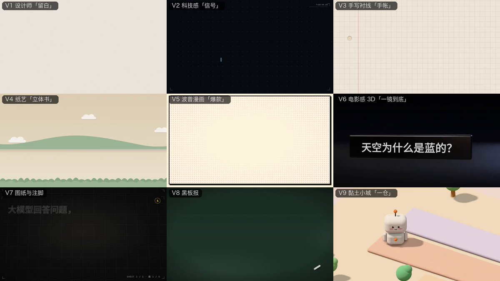

# 🚨重磅：我们2000+ Star的开源项目迎来了重大更新：经过多轮迭代，我们用Opus 5.5 新增了9种讲解视频风格，不求多，只求做到极致，经过多次迭代后，今天开源分享给大家，效果可以见视频，感觉任何一周都可以拿去起号了
> Source: https://x.com/LufzzLiz/status/2107408409859359211
> Author: 岚叔 (@LufzzLiz)
> Posted: Tue Oct 06 09:51:33 +0000 2026
> Captured: 2026-10-15T09:02:28+00:00
> Stats at capture: 69,791 views · 984 likes · 47 replies · 164 reposts · 1,487 bookmarks · 16 quotes

## Post

🚨重磅：我们2000+ Star的开源项目迎来了重大更新：经过多轮迭代，我们用Opus 5.5 新增了9种讲解视频风格，不求多，只求做到极致，经过多次迭代后，今天开源分享给大家，效果可以见视频，感觉任何一周都可以拿去起号了
看看大家更喜欢哪一种，或者有推荐的风格也可以发给我

测试发现用我们的skill模版，即使是用codex也开始可以产出类似的效果

使用流程也很简单：
1️⃣ 拉取最新的代码
2️⃣ 在 harness （claude 的模型最佳）使用该skill 完成关于【任意主题】的动画讲解，风格使用【v1 设计师】风格
3️⃣ 配音（可选），使用相关TTS模型完成配音
4️⃣ 生成数字人口播视频（可选），如果想加数字人，就用我们上面的配音驱动+ 你的数字人图片 生成最终视频。然后让claude 完美融合视频即可

开源地址见评论👇

## Media

[Post media 1](media/video-01.mp4) — Source media: https://video.twimg.com/amplify_video/2107404354714222592/vid/avc1/1280x720/pgjcVf5IaKjmo5KN.mp4?tag=29
 — Post media 1 thumbnail. Source media: https://pbs.twimg.com/amplify_video_thumb/2107404354714222592/img/iR2GjC2WeIoHZS2L.jpg

## Thread

### 岚叔 ([@LufzzLiz](https://x.com/LufzzLiz/status/2107408413458309193)) — 2026-10-06T09:51:34+00:00

https://t.co/HWxsdCJn8Z
### 岚叔 ([@LufzzLiz](https://x.com/LufzzLiz/status/2107483098560745965)) — 2026-10-06T14:48:20+00:00

@li9292 哈哈😄
### 岚叔 ([@LufzzLiz](https://x.com/LufzzLiz/status/2107475074781753827)) — 2026-10-06T14:16:27+00:00

@RealYDT 哈哈😄
### 岚叔 ([@LufzzLiz](https://x.com/LufzzLiz/status/2107675572562489649)) — 2026-10-07T03:33:09+00:00

@chenchaoge1900 厉害👍🏻
### 岚叔 ([@LufzzLiz](https://x.com/LufzzLiz/status/2107442316982247880)) — 2026-10-06T12:06:17+00:00

@iBigQiang 可以的，欢迎反馈~
### 岚叔 ([@LufzzLiz](https://x.com/LufzzLiz/status/2107692594646089853)) — 2026-10-07T04:40:48+00:00

@dandan8900882 感谢推荐，我去试试
### 岚叔 ([@LufzzLiz](https://x.com/LufzzLiz/status/2108318721509105799)) — 2026-10-08T22:08:48+00:00

@coder_left 感谢支持
### 岚叔 ([@LufzzLiz](https://x.com/LufzzLiz/status/2107411794000282003)) — 2026-10-06T10:05:00+00:00

@ai_edisonZ 这个项目原生就是做数字人口播的。
这些风格都可以作为口播的画面，口播人物视频可以按照文稿来生成，再嵌入到这些画面里即可

## Comments

### 李韭二 ([@li9292](https://x.com/li9292/status/2107468753625899349)) — 2026-10-06T13:51:20+00:00

@LufzzLiz 岚叔我偶像
### 阿良｜AI 工作流 ([@RealYDT](https://x.com/RealYDT/status/2107469066135056596)) — 2026-10-06T13:52:34+00:00

@LufzzLiz 我操，牛逼啊！我要请你去做特色服务。
### 陈朝歌chen ([@chenchaoge1900](https://x.com/chenchaoge1900/status/2107660508413522134)) — 2026-10-07T02:33:18+00:00

@LufzzLiz 现在opus5.5做视频确实香，我做了一9分钟长视频都有20万播放，ai动效用在口播类、教程科普类视频上非常契合
### 强子手记 ([@iBigQiang](https://x.com/iBigQiang/status/2107442224665706754)) — 2026-10-06T12:05:55+00:00

@LufzzLiz 抽空试试，看纯跑 codex 能达到上面效果的几成
### JK｜人间借口簿 ([@JKJiekou](https://x.com/JKJiekou/status/2107691971338973656)) — 2026-10-07T04:38:19+00:00

@LufzzLiz 想推荐“生活场景小剧场”这种讲解风格：角色先遇到一个误区，再通过账单、队列或实物对照找到原因，最后用一句话收束。适合把抽象术语讲给新人。尤其想看：同一个难题，用不同叙事方式会怎样讲。
### 程序员Left ([@coder_left](https://x.com/coder_left/status/2108223845991919646)) — 2026-10-08T15:51:48+00:00

@LufzzLiz 收藏了，AI 做 mg 动画真有一手
### edisonZ ([@ai_edisonZ](https://x.com/ai_edisonZ/status/2107410422676795671)) — 2026-10-06T09:59:33+00:00

@LufzzLiz 有口播风格的吗
### Howard ([@Howard_Pengg](https://x.com/Howard_Pengg/status/2107524258801025471)) — 2026-10-06T17:31:53+00:00

@LufzzLiz wait, 這都你們原創的嗎?
### fowardforever ([@foreverfoward07](https://x.com/foreverfoward07/status/2107499321029702131)) — 2026-10-06T15:52:48+00:00

@LufzzLiz astra试过了，效果挺一般的，我直接让astra改成分页HTML直接用来做演示文件了，思路打开，动画很赞
### 沉默王二 ([@itwanger](https://x.com/itwanger/status/2107706582079504838)) — 2026-10-07T05:36:23+00:00

@LufzzLiz 已经star了，看起来真的很不错，学习一波了。
### 拜 Byi ([@baibyebaibai](https://x.com/baibyebaibai/status/2107613310187442266)) — 2026-10-06T23:25:45+00:00

@LufzzLiz 牛哇，这就去试试！
### WenWen ([@WenBuilds](https://x.com/WenBuilds/status/2107409337413239281)) — 2026-10-06T09:55:14+00:00

@LufzzLiz 能直接套模板出动画讲解，配音和画面对齐省事不少。
### AIRobert ([@aiRobertDaily](https://x.com/aiRobertDaily/status/2107450972079555036)) — 2026-10-06T12:40:40+00:00

@LufzzLiz 叔叔太牛了
### godsonde ([@godsonde](https://x.com/godsonde/status/2107482265601339879)) — 2026-10-06T14:45:01+00:00

@LufzzLiz v1设计师风格最稳，已准备拉代码起号！
### 杯中风暴 ([@kun70706](https://x.com/kun70706/status/2107706586307367197)) — 2026-10-07T05:36:24+00:00

@LufzzLiz 哇，2000+ Star的项目更新也太香了吧！9种风格听着就很诱人，我私心最期待那个“v1 设计师”风格，感觉审美在线。流程看着也不复杂，这就去拉代码试试，坐等看到效果！
### sunshineLx ([@ios_1261142602](https://x.com/ios_1261142602/status/2107682567822672351)) — 2026-10-07T04:00:57+00:00

@LufzzLiz 牛啊 。现在越来越多 opus5.5 的案例了
### CloudHeaven ([@CloudBoySpace](https://x.com/CloudBoySpace/status/2108120841103778003)) — 2026-10-08T09:02:30+00:00

@LufzzLiz 配音和数字人能按需加，做个简单教程就轻便多了
### cylive ([@cyliveyou](https://x.com/cyliveyou/status/2108023552532471932)) — 2026-10-08T02:35:54+00:00

@LufzzLiz 长视频中间站怎么连接起来的
### tootooc ([@tootoocvc](https://x.com/tootoocvc/status/2107638829792280991)) — 2026-10-07T01:07:09+00:00

@LufzzLiz 用 skill 模板把风格固定下来，连 Codex 也能出差不多的效果，这点挺说明问题：讲解视频的质量很大一部分在模板，不全在模型。我比较好奇加了 TTS 和数字人以后，口播和画面节奏是怎么对齐的，这一步往往最费时间。
### 景哥｜AI落地与智能体实践 ([@whb0821](https://x.com/whb0821/status/2107454104788410388)) — 2026-10-06T12:53:07+00:00

@LufzzLiz 模型会越来越强，但能沉淀的不是某次 Prompt，而是 Skill、流程和验证体系。把能力变成工作流，才是 Agent 的价值。
### black ([@overestal](https://x.com/overestal/status/2107517074360938776)) — 2026-10-06T17:03:20+00:00

@LufzzLiz 我偏沉稳讲解那种，听起来不容易吵。一条视频大概要花多少 token？渲染是本地还是云端方案？
### cc chris ([@ifbulls2017](https://x.com/ifbulls2017/status/2107668798954414262)) — 2026-10-07T03:06:14+00:00

@LufzzLiz token 消耗如何
### ReignSwords ([@ReignSwords](https://x.com/ReignSwords/status/2107627269262913947)) — 2026-10-07T00:21:13+00:00

@LufzzLiz 看到这类工具第一反应：以后做口播讲解号，连剪辑师都不用请了。好奇问下，TTS 配音和画面节奏是自动对齐的吗？讲解类视频音画一旦错位，观感直接崩一半。
### 听｜月入万刀版 ([@ting_267](https://x.com/ting_267/status/2107474106933543373)) — 2026-10-06T14:12:36+00:00

@LufzzLiz 9 种风格做成 Skill 模板挺方便的。想问下 TTS 和画面对齐这一步，现在是按字幕时间轴切，还是让 Claude 调整镜头长度？
### 山中狐 ([@foxbuilds_ai](https://x.com/foxbuilds_ai/status/2107671087987458441)) — 2026-10-07T03:15:20+00:00

@LufzzLiz 9 种风格，够我纠结一周了。v1 设计师先收藏，起号有效果回来交作业。
### Jhon Dennis ([@JhonDennisxiud](https://x.com/JhonDennisxiud/status/2107646720775774446)) — 2026-10-07T01:38:31+00:00

@LufzzLiz 九种风格都挺好看 做课件能省不少事
### Jackie Zhong ([@hqzhon](https://x.com/hqzhon/status/2107490231863910517)) — 2026-10-06T15:16:41+00:00

@LufzzLiz 优秀，改天用codex试试，看看能整出什么花样来😀
### 飞云 ([@feiyun_AI](https://x.com/feiyun_AI/status/2107530013725892820)) — 2026-10-06T17:54:45+00:00

@LufzzLiz 感谢大佬开源，这就去试试！
### yuqing--雨晴 ([@yuqingjz](https://x.com/yuqingjz/status/2107438058652266833)) — 2026-10-06T11:49:22+00:00

@LufzzLiz 9种风格还说不求多，这口气有点凡尔赛了
### Flynn ([@fly3nn](https://x.com/fly3nn/status/2107615897506742376)) — 2026-10-06T23:36:02+00:00

@LufzzLiz @dotey 这得玩玩了
### narin ruin ([@narinnovo](https://x.com/narinnovo/status/2107674209996755215)) — 2026-10-07T03:27:45+00:00

@LufzzLiz 9种风格里那个手绘的挺对味，先跑起来再说 (￣▽￣)
### LIght JUNction ([@LIghtJUNction_x](https://x.com/LIghtJUNction_x/status/2107801241992806466)) — 2026-10-07T11:52:31+00:00

@LufzzLiz 把同一个 KV cache 主题放进九种风格里，选起来就很直观了。黑板适合跟着推一遍，动画适合画出缓存怎样复用，选风格其实也在选“希望观众怎么理解这件事”。
### 张群AI ([@robinzh12821176](https://x.com/robinzh12821176/status/2109509755001848111)) — 2026-10-12T05:01:33+00:00

@LufzzLiz codex上能用吗
### EsenLau ([@miststockholder](https://x.com/miststockholder/status/2107487993170899340)) — 2026-10-06T15:07:47+00:00

@LufzzLiz star 给了，支持一下
### AIsnote ([@aisnote](https://x.com/aisnote/status/2107713768620978428)) — 2026-10-07T06:04:56+00:00

@LufzzLiz 欢迎订阅 https://t.co/8jaOAXptBl
### 🍍菠萝吹雪🍍 ([@Gus_Pineapple](https://x.com/Gus_Pineapple/status/2108100829635051919)) — 2026-10-08T07:42:59+00:00

@LufzzLiz 先插个眼，去试试Codex拿到成品来反馈
### Agenti ([@Missingno_x](https://x.com/Missingno_x/status/2107680637000040460)) — 2026-10-07T03:53:17+00:00

@LufzzLiz Wow
### Rliey ([@leyi166](https://x.com/leyi166/status/2107643384211087742)) — 2026-10-07T01:25:15+00:00

@LufzzLiz @dotey 厉害

## Other returned timeline records

> The CLI did not expose reply relationships. These records do not start with a reply mention and were authored by someone other than the saved-post author. They may include recommendations or promoted posts; they are retained as source context, not verified replies.

### Starlink ([@Starlink](https://x.com/Starlink/status/2068115197718593741)) — 2026-06-19T23:34:21+00:00

Get connected with fast, reliable internet for streaming, video calls, online gaming and more.

Order online in minutes.
### Starlink ([@Starlink](https://x.com/Starlink/status/2098108930002211077)) — 2026-09-10T17:58:44+00:00

Starlink offers fast, reliable internet in the most rural and remote locations. Portable and easy to set up, Starlink works wherever you are.

Order online in minutes.
### Starlink ([@Starlink](https://x.com/Starlink/status/2092706810314858684)) — 2026-08-26T20:12:38+00:00

Starlink offers fast, reliable internet in the most rural and remote locations . Portable and easy to set up, Starlink Mini works wherever you are.

Order online in minutes.
