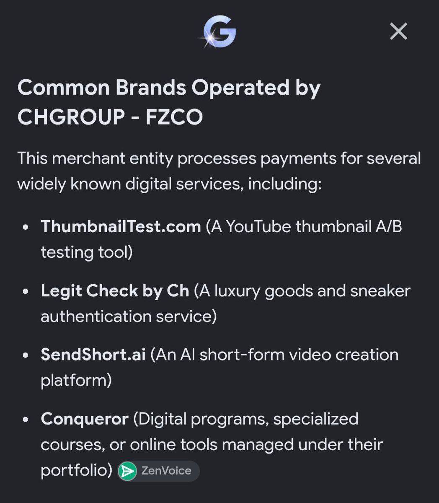

# Semrush charges $139.95/month.
> Source: https://x.com/chddaniel/status/2107414044772880783
> Author: Daniel Ch (@chddaniel)
> Posted: Tue Oct 06 10:13:56 +0000 2026
> Captured: 2026-10-15T09:02:28+00:00
> Stats at capture: 66,531 views · 772 likes · 37 replies · 52 reposts · 1,695 bookmarks · 2 quotes

## Post

Semrush charges $139.95/month.
Ahrefs charges $129/month.

A guy named David built the self-running alternative that agents can run on autopilot for you.

It is called Conqueror.

Enter a competitor's website and it reveals the keywords bringing them traffic, the pages winning those searches, and the backlinks helping them rank.

Connect your own website and it tracks rankings, crawls technical problems, finds pages losing traffic, and shows whether ChatGPT or Google AI Overviews mention your brand.

Then connect Claude, ChatGPT, Codex, Cursor, OpenClaw, or your own agent.

Your agent can pull the real numbers, compare opportunities, cluster keywords, write or refresh content, and publish the changes back to your website instead of guessing from a prompt.

It can research keywords, study the live SERP, find content gaps, rewrite titles and metadata, fix existing pages, publish new ones, and keep refreshing them as rankings change.

No, it does not magically reproduce every database and advanced feature Ahrefs or Semrush built over a decade.

But it breaks the most important rule of the old SEO market:

You no longer need to sit inside their dashboard and do the work yourself.

## Media

[Post media 1](media/video-01.mp4) — Source media: https://video.twimg.com/amplify_video/2107413975537438720/vid/avc1/1280x720/rA6ADaVyZCV47y1j.mp4?tag=16
 — Post media 1 thumbnail. Source media: https://pbs.twimg.com/amplify_video_thumb/2107413975537438720/img/ZDFz8KX225i5NUBK.jpg
 — Reply 2107652611654512875 media 1. Source media: https://pbs.twimg.com/media/HT_i4WUWAAAxxSm.jpg

## Thread

### Daniel Ch ([@chddaniel](https://x.com/chddaniel/status/2107414056680521974)) — 2026-10-06T10:13:59+00:00

Try it here: https://t.co/csCblyqNtN
### Daniel Ch ([@chddaniel](https://x.com/chddaniel/status/2107849715169554939)) — 2026-10-07T15:05:08+00:00

@yesith_thomas Works for WordPress/Shopify/Github-based websites

Can build more integrations

People should just share what they want!
### Daniel Ch ([@chddaniel](https://x.com/chddaniel/status/2107692149018185768)) — 2026-10-07T04:39:02+00:00

@codylschuldt Saudi Arabia gave me another 100k to reply to your tweet

And to say it’s all good (but a bit hot)

Ty Cody for the new car
### Daniel Ch ([@chddaniel](https://x.com/chddaniel/status/2107691948505215157)) — 2026-10-07T04:38:14+00:00

@ImranovAydin Ok keep paying 10x for Semrush then! 

For about the same keyword research data/etc
### Daniel Ch ([@chddaniel](https://x.com/chddaniel/status/2107912623849447737)) — 2026-10-07T19:15:07+00:00

@cameddy100 Sorry too much demand... back up now!

## Comments

### Yesith Thomas ([@yesith_thomas](https://x.com/yesith_thomas/status/2107822082331472179)) — 2026-10-07T13:15:20+00:00

@chddaniel For wordpress? Can this run locally and open?
### Cody Schuldt ([@codylschuldt](https://x.com/codylschuldt/status/2107652611654512875)) — 2026-10-07T02:01:55+00:00

@chddaniel "David" is a Saudi Arabia backed private equity group (CHGROUP – FZCO)....doesn't mean it's not a good tool, but let's not be fooled by the fake backstory https://t.co/eFWQYVtfnx
 — Source media: https://pbs.twimg.com/media/HT_i4WUWAAAxxSm.jpg
### Aydin ([@ImranovAydin](https://x.com/ImranovAydin/status/2107415614574993544)) — 2026-10-06T10:20:11+00:00

@chddaniel Pretty sure the moat of Semrush and others is the data they have collected over the years. You can't just "clone" that.
### Cam Eddy 🧠💰 ([@cameddy100](https://x.com/cameddy100/status/2107860885452755244)) — 2026-10-07T15:49:31+00:00

@chddaniel @chddaniel  your website is down
### Amelia | AI & Tech ([@AmeliaonAI](https://x.com/AmeliaonAI/status/2107776686963962001)) — 2026-10-07T10:14:57+00:00

@chddaniel Agent-run SEO finally breaks dashboard slavery
### Cody Schuldt ([@codylschuldt](https://x.com/codylschuldt/status/2107650639710888289)) — 2026-10-07T01:54:05+00:00

@chddaniel Are you David 🧐😂
### heath ([@HeathGerrald](https://x.com/HeathGerrald/status/2107624485675528470)) — 2026-10-07T00:10:09+00:00

@chddaniel The agent going from competitor research all the way to publishing is the interesting bit. How are you handling approvals before it touches production?
### Roberto Ramírez ([@robramz_ai](https://x.com/robramz_ai/status/2107707417702391827)) — 2026-10-07T05:39:42+00:00

@chddaniel Stop it bro, your time must focus on Encharge, that platform seems abandoned at this point.
### Kc ([@KSimilien](https://x.com/KSimilien/status/2108054118929691121)) — 2026-10-08T04:37:22+00:00

@chddaniel I'm confused, are you working for them?
### Rikin with Popform ([@rikin311](https://x.com/rikin311/status/2107856439721041966)) — 2026-10-07T15:31:51+00:00

@chddaniel David is your brother?
### Veyra | AI & Tech ([@VeyraWithAI](https://x.com/VeyraWithAI/status/2107783591338057758)) — 2026-10-07T10:42:23+00:00

@chddaniel Agents finally run SEO instead of you
### Oscar Ortega ([@OscarOrtega75](https://x.com/OscarOrtega75/status/2107597245918965974)) — 2026-10-06T22:21:55+00:00

@chddaniel Nice! Giving it a shot this week. Congrats, Daniel
### Alex Ai | Tools & Updates ([@AlexWithAi_](https://x.com/AlexWithAi_/status/2107760490050969890)) — 2026-10-07T09:10:35+00:00

@chddaniel Self-running SEO alternative agents autopilot Conqueror competitor analysis magic
### Ted | unfair.so ([@notmiramurati](https://x.com/notmiramurati/status/2107914433670647825)) — 2026-10-07T19:22:18+00:00

@chddaniel the dashboard was the bottleneck. agents doing the work is the actual disruption.

https://t.co/Qyg1q5wBta
### Abhishek Iyer ([@distantgradient](https://x.com/distantgradient/status/2107710623274688681)) — 2026-10-07T05:52:26+00:00

@chddaniel nice original ad copy... lol

https://t.co/kIVhTgi5C3
### Gravity ([@gravityfast_](https://x.com/gravityfast_/status/2107840916291829785)) — 2026-10-07T14:30:10+00:00

@chddaniel the launch video goes hard ngl. gotta try how good the product is
### Sashanka ([@ISashankaSekhar](https://x.com/ISashankaSekhar/status/2107708338347835783)) — 2026-10-07T05:43:21+00:00

@chddaniel Nice product 
Curious to know where you build this animated demo video
### JeffButcher ([@JeffButcher](https://x.com/JeffButcher/status/2107644954340209011)) — 2026-10-07T01:31:29+00:00

@chddaniel @bot let’s see how you can use this in our usual tasks for forge.
### Brian Hadu ([@BrianHaDu](https://x.com/BrianHaDu/status/2107813686291419478)) — 2026-10-07T12:41:58+00:00

@chddaniel self-running tools like Conqueror could really shake up the SEO game
### Kimi Nguyen ([@kimindiehacker](https://x.com/kimindiehacker/status/2107778632815100312)) — 2026-10-07T10:22:41+00:00

@chddaniel automating competitive analysis could save a lot of time
### Brjan | AI Builder ([@MrBrjan](https://x.com/MrBrjan/status/2107644434271920624)) — 2026-10-07T01:29:25+00:00

@chddaniel self-running tools like Conqueror could really change the game for SEO
### Ikram Sakib ([@ikramhsakib](https://x.com/ikramhsakib/status/2107785136796525038)) — 2026-10-07T10:48:32+00:00

@chddaniel Good work
### xfasup ([@xfasup9xj2](https://x.com/xfasup9xj2/status/2107897940727718351)) — 2026-10-07T18:16:46+00:00

@chddaniel I feel like promo videos these days just assume everyone has ADHD.
### Petra ([@synthshareai](https://x.com/synthshareai/status/2107422177666445687)) — 2026-10-06T10:46:15+00:00

@chddaniel David vibe-coded this?  Holy shit ! take my money. Now.
### Sani Ai Tech ([@SaniAiTech](https://x.com/SaniAiTech/status/2107713762350575623)) — 2026-10-07T06:04:55+00:00

@chddaniel Agent-native SEO could completely change how teams execute organic growth
### #AK2=KarriemKhan=#AK2Pak of XTribe SA=Real Wakanda ([@AK2Pac](https://x.com/AK2Pac/status/2107722234395599020)) — 2026-10-07T06:38:34+00:00

@chddaniel @threadreaderApp unroll
### sachin poswal ([@sachin_poswall](https://x.com/sachin_poswall/status/2107769852899295397)) — 2026-10-07T09:47:48+00:00

@chddaniel ❤️‍🔥

## Other returned timeline records

> The CLI did not expose reply relationships. These records do not start with a reply mention and were authored by someone other than the saved-post author. They may include recommendations or promoted posts; they are retained as source context, not verified replies.

### Starlink ([@Starlink](https://x.com/Starlink/status/2068115197718593741)) — 2026-06-19T23:34:21+00:00

Get connected with fast, reliable internet for streaming, video calls, online gaming and more.

Order online in minutes.
### Starlink ([@Starlink](https://x.com/Starlink/status/2098108930073465308)) — 2026-09-10T17:58:44+00:00

Starlink offers fast, reliable internet in the most rural and remote locations. Portable and easy to set up, Starlink works wherever you are.

Order online in minutes.
