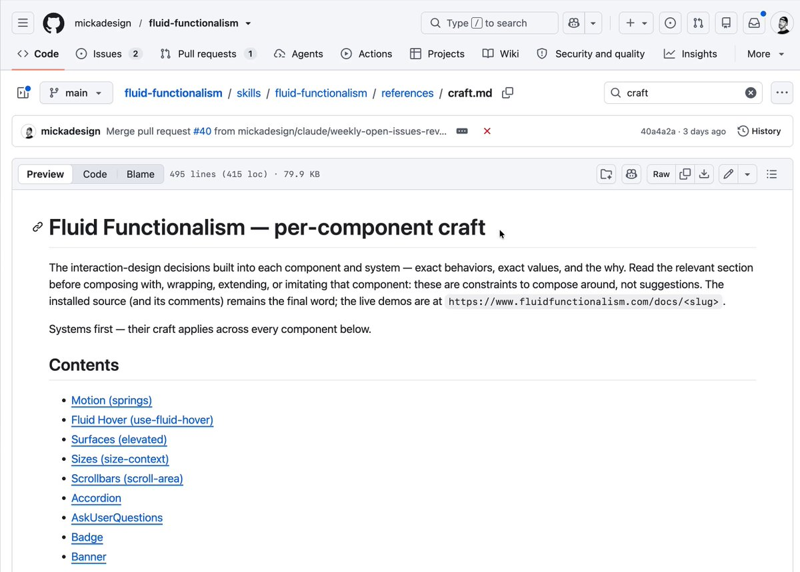
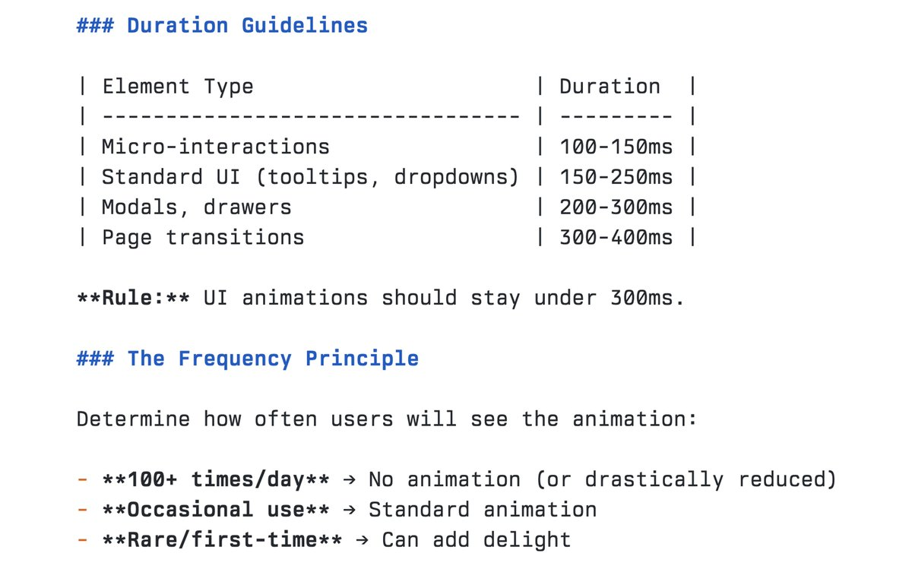

# New skill unlocked: /fluid-functionalism
> Source: https://x.com/micka_design/status/2107456589951361083
> Author: Micka (@micka_design)
> Posted: Tue Oct 06 13:03:00 +0000 2026
> Captured: 2026-10-15T09:02:28+00:00
> Stats at capture: 7,419 views · 186 likes · 5 replies · 3 reposts · 242 bookmarks · 0 quotes

## Post

New skill unlocked: /fluid-functionalism

Behind every components there's hundreds of craft decisions. I've extracted them from my code comments and package them into a skill. 
Now available one prompt away to audit your project and receive the most impactful recommendations.

http://fluidfunctionalism.com/docs/skill

## Media

[Post media 1](media/video-01.mp4) — Source media: https://video.twimg.com/amplify_video/2107124178231160832/vid/avc1/1006x720/NrUJ72a9e4mGR96E.mp4?tag=29
 — Post media 1 thumbnail. Source media: https://pbs.twimg.com/amplify_video_thumb/2107124178231160832/img/QpCLvzSTyGNLTTFJ.jpg
[Reply 2110456607297749099 media 1](media/video-02.mp4) — Source media: https://video.twimg.com/amplify_video/2110455645933568002/vid/avc1/3840x2160/qTEk0TowO2B33sPs.mp4?tag=29
 — Reply 2110429909160264027 media 1. Source media: https://pbs.twimg.com/media/HUnAx4rWwAE7vNg.jpg
[Reply 2110403186574180555 media 1](media/video-03.mp4) — Source media: https://video.twimg.com/amplify_video/2110402864296177666/vid/avc1/1920x1080/IkQ4E-x2PhLQlXos.mp4?tag=29
[Reply 2110425467996209244 media 1](media/video-04.mp4) — Source media: https://video.twimg.com/amplify_video/2110425227935318016/vid/avc1/1920x1080/GX048H4Ly1_HE_Kb.mp4?tag=29

## Thread

### Micka ([@micka_design](https://x.com/micka_design/status/2107527251323760974)) — 2026-10-06T17:43:47+00:00

@_jshmllr That works! I also try to convert most of my unambiguous guidelines into CI lint rules as well.

## Comments

### Josh ([@_jshmllr](https://x.com/_jshmllr/status/2107515980448669961)) — 2026-10-06T16:59:00+00:00

@micka_design This is really thorough. 👏 Going to implement something similar as an enforcement layer whenever a PR gets filed and Copilot does the auto-review in GH. Trying to maintain a high bar of craft at speed and scale for this DS.
### ✳︎ huge ([@hugofromonline](https://x.com/hugofromonline/status/2107576972280844674)) — 2026-10-06T21:01:21+00:00

@micka_design nice - gonna give it a try
### Hridya ([@AgrawalHridaya](https://x.com/AgrawalHridaya/status/2107552205792248215)) — 2026-10-06T19:22:56+00:00

@micka_design pretty nice skill! will merge into my setup
### Amitka ([@Amitka111](https://x.com/Amitka111/status/2107714296184791148)) — 2026-10-07T06:07:02+00:00

@micka_design really really beautiful work! thx for sharing with us!
### Bryan Lee ([@junmobius](https://x.com/junmobius/status/2107549908387430548)) — 2026-10-06T19:13:49+00:00

@micka_design fluid-functionalism → PromptScript: PromptScript does not support global skill installation doing global install!

## Other returned timeline records

> The CLI did not expose reply relationships. These records do not start with a reply mention and were authored by someone other than the saved-post author. They may include recommendations or promoted posts; they are retained as source context, not verified replies.

### Lucas ([@lucasmarkes__](https://x.com/lucasmarkes__/status/2110456607297749099)) — 2026-10-14T19:44:00+00:00

/hairline-adopt is out now!

bring the svg you already have, it comes back as a figure.
 — Source media: https://video.twimg.com/amplify_video/2110455645933568002/vid/avc1/3840x2160/qTEk0TowO2B33sPs.mp4?tag=29
### Emil Kowalski ([@emilkowalski](https://x.com/emilkowalski/status/2110429909160264027)) — 2026-10-14T17:57:54+00:00

Duration guidelines for your interactions and animations.

Share them with your agents and tell them I said hi. https://t.co/UH1k3IW3Pj
 — Source media: https://pbs.twimg.com/media/HUnAx4rWwAE7vNg.jpg
### Joel Califa ([@notdetails](https://x.com/notdetails/status/2110403186574180555)) — 2026-10-14T16:11:43+00:00

what if your website built itself https://t.co/LLdrfRZHsw
 — Source media: https://video.twimg.com/amplify_video/2110402864296177666/vid/avc1/1920x1080/IkQ4E-x2PhLQlXos.mp4?tag=29
### Arlan Marat ([@arlanoska](https://x.com/arlanoska/status/2110425467996209244)) — 2026-10-14T17:40:16+00:00

new design system for AI apps and developer tools!

copy code here:
https://t.co/0TUsuvGXzl https://t.co/zj0MmPZOMp
 — Source media: https://video.twimg.com/amplify_video/2110425227935318016/vid/avc1/1920x1080/GX048H4Ly1_HE_Kb.mp4?tag=29

## Links

- http://fluidfunctionalism.com/docs/skill
