# The Claude Startups program is expanding to more founders.
> Source: https://x.com/claudeai/status/2107513494493179954
> Author: Claude (@claudeai)
> Posted: Tue Oct 06 16:49:07 +0000 2026
> Captured: 2026-10-15T09:02:28+00:00
> Stats at capture: 5,771,506 views · 18,793 likes · 740 replies · 1,236 reposts · 19,434 bookmarks · 915 quotes

## Post

The Claude Startups program is expanding to more founders.

Members can get a year of Claude Team, API credits, special offers on the tools a startup runs on, and office hours with Anthropic’s Applied AI team.

## Media

[Post media 1](media/video-01.mp4) — Source media: https://video.twimg.com/amplify_video/2107499963898867712/vid/avc1/1280x720/I4DvERYLHy92C2nC.mp4?tag=29
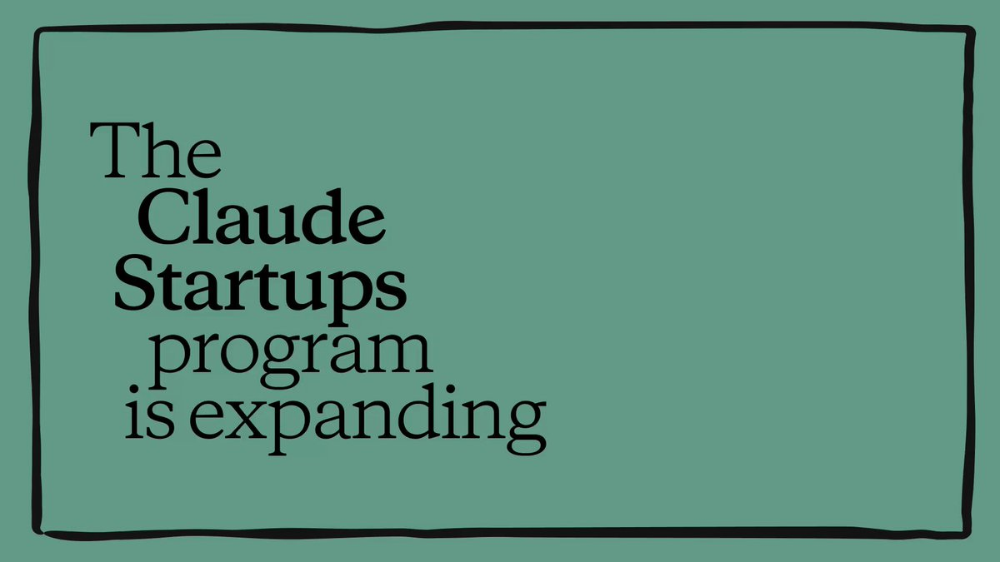 — Post media 1 thumbnail. Source media: https://pbs.twimg.com/amplify_video_thumb/2107499963898867712/img/u16lNYeiZ6H1vJx2.jpg
[Reply 2107513497420710203 media 1](media/video-02.mp4) — Source media: https://video.twimg.com/amplify_video/2107500131113136128/vid/avc1/1920x1080/Xrskg4v3T8rNOTql.mp4?tag=29
[Reply 2107657831633588634 media 1](media/video-03.mp4) — Source media: https://video.twimg.com/amplify_video/2107657821009403904/vid/avc1/720x720/EEiqCQWvx8cz0bcO.mp4?tag=29
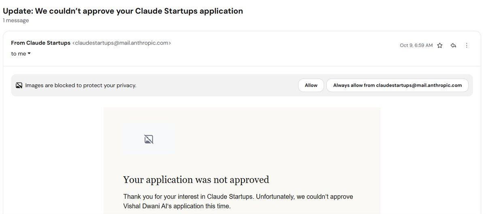 — Reply 2108537065625583988 media 1. Source media: https://pbs.twimg.com/media/HUMHOhdbcAAnA33.jpg
[Reply 2107513658532069392 media 1](media/animation-01.mp4) — Source media: https://video.twimg.com/tweet_video/HT9kgK-XQAAlxtu.mp4
[Reply 2107519181675528289 media 1](media/video-04.mp4) — Source media: https://video.twimg.com/amplify_video/2107518723766497280/vid/avc1/720x1280/CGdunBzNFZraq98a.mp4?tag=29
 — Reply 2107515909539815641 media 1. Source media: https://pbs.twimg.com/media/HT9mi65b0AABfd-.jpg
 — Reply 2107544643617292386 media 1. Source media: https://pbs.twimg.com/media/HT-ArlvWAAAWvxQ.jpg
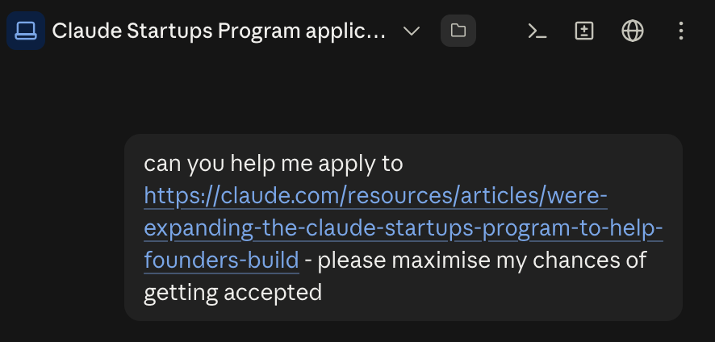 — Reply 2107740989758865720 media 1. Source media: https://pbs.twimg.com/media/HUAuODAX0AA8_Wt.png
 — Reply 2107740989758865720 media 2. Source media: https://pbs.twimg.com/media/HUAzNNsXUAAYrlv.png
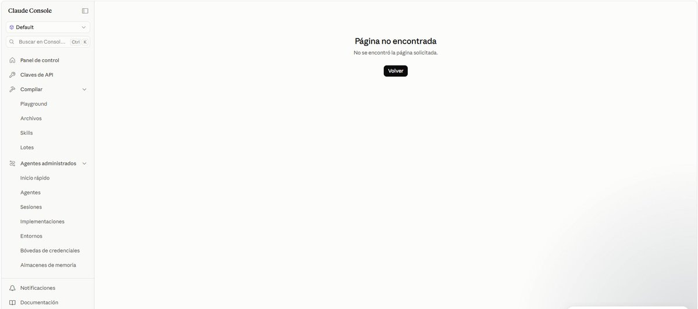 — Reply 2107522587010228612 media 1. Source media: https://pbs.twimg.com/media/HT9sg6TXwAAvXDO.jpg
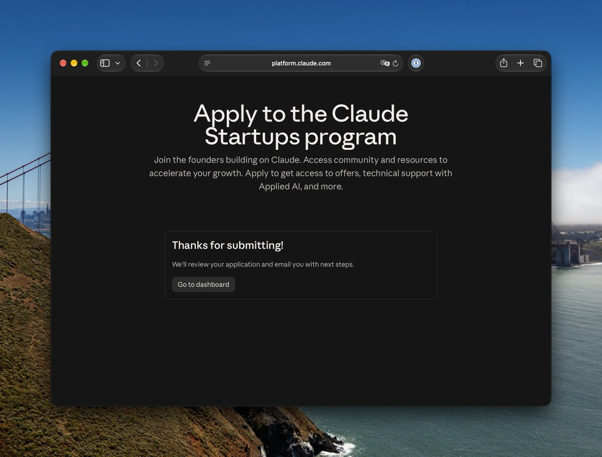 — Reply 2107519099748364447 media 1. Source media: https://pbs.twimg.com/media/HT9pD4YaEAAZJA1.jpg
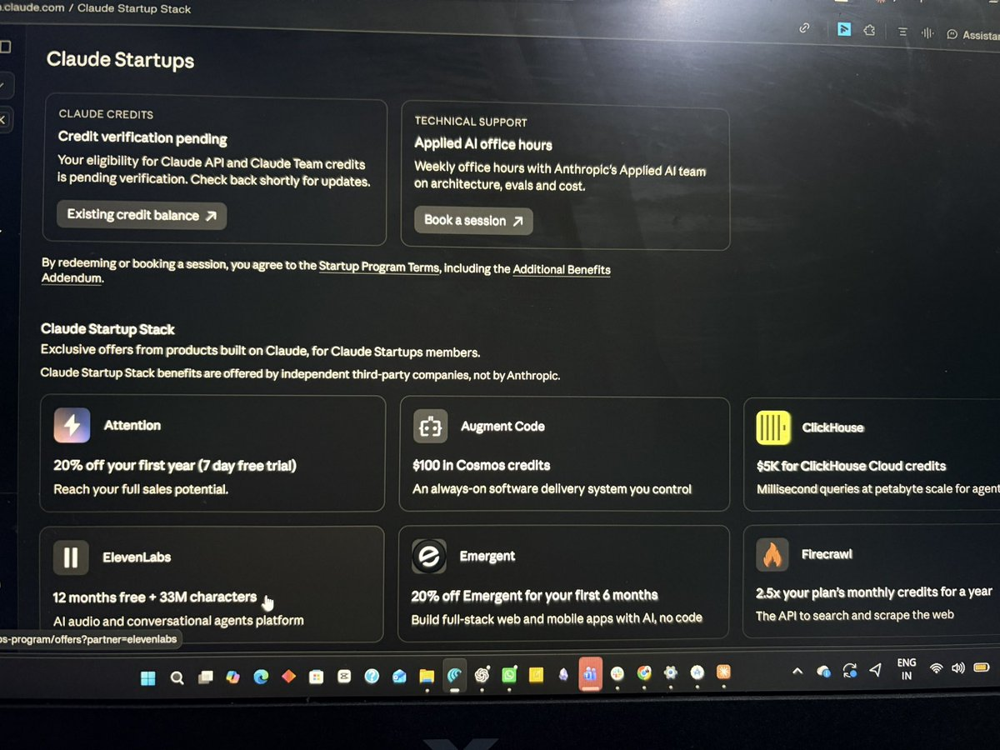 — Reply 2107555358168506575 media 1. Source media: https://pbs.twimg.com/media/HT-KbPRa4AAUzyD.jpg
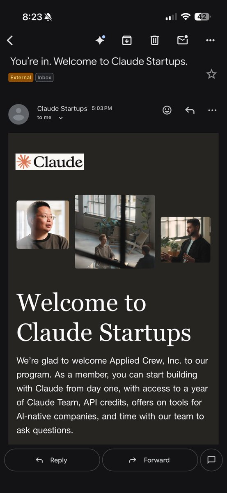 — Reply 2107673529399566461 media 1. Source media: https://pbs.twimg.com/media/HT_159NbIAAmKVd.jpg
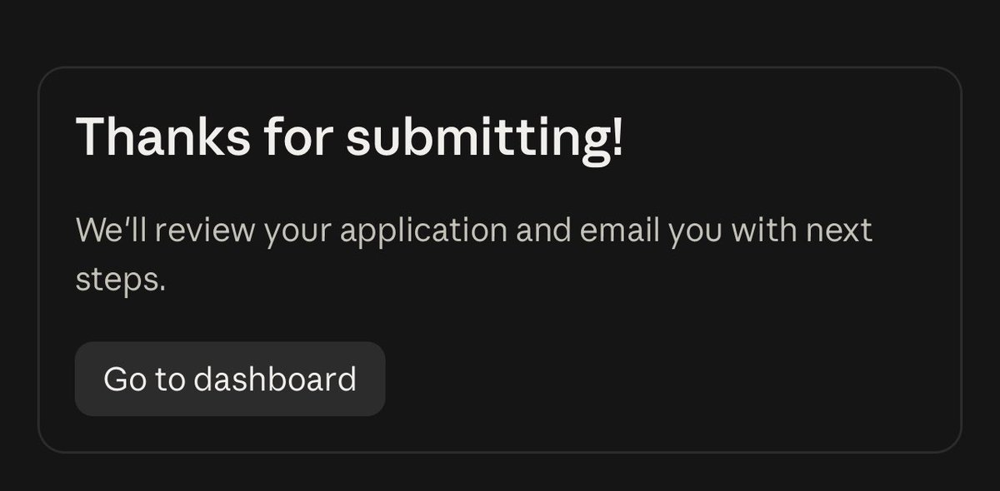 — Reply 2107543328048955619 media 1. Source media: https://pbs.twimg.com/media/HT9_e_pbgAAzaA2.jpg
 — Reply 2107559406317515000 media 1. Source media: https://pbs.twimg.com/media/HT-Nv0qWQAAe6tE.jpg
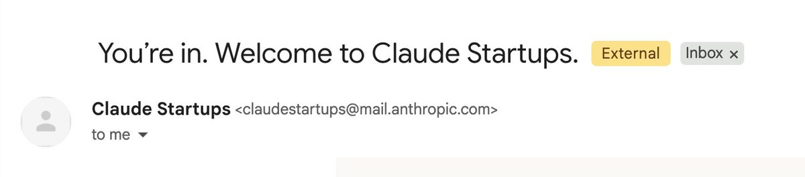 — Reply 2107747284444389786 media 1. Source media: https://pbs.twimg.com/media/HUA4-adWIAAwBmR.jpg
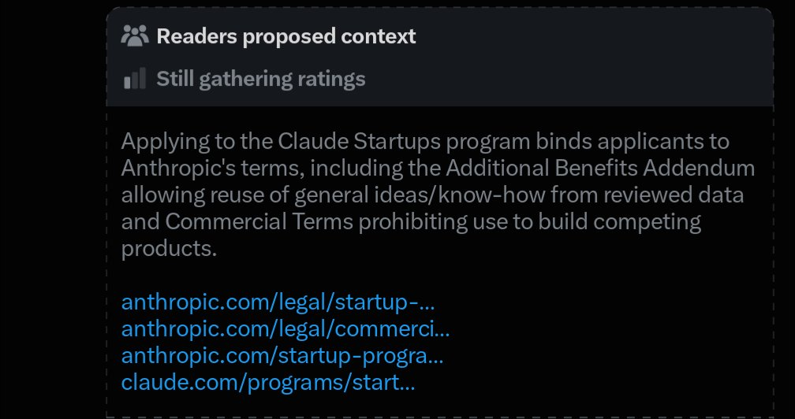 — Reply 2107675263102554359 media 1. Source media: https://pbs.twimg.com/media/HT_3ethbcAA9JBz.jpg
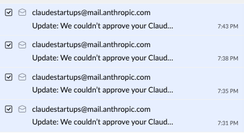 — Reply 2107663701285474531 media 1. Source media: https://pbs.twimg.com/media/HT_sxmJbAAAaVaV.png
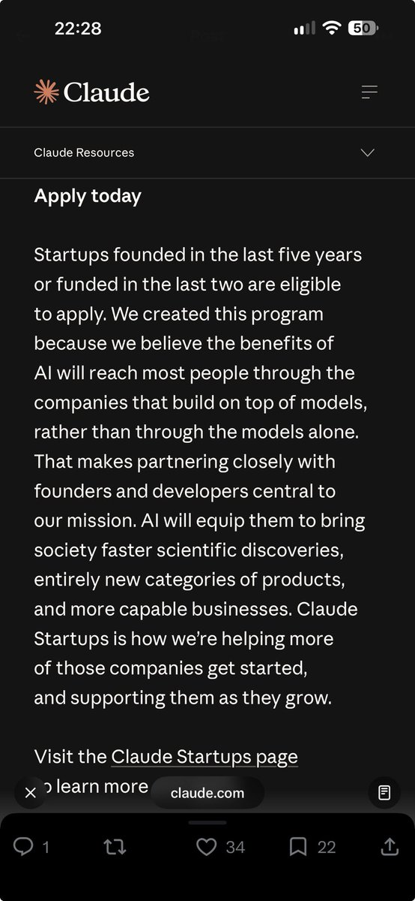 — Reply 2107515949532467217 media 1. Source media: https://pbs.twimg.com/media/HT9mlP1b0AESMRr.jpg
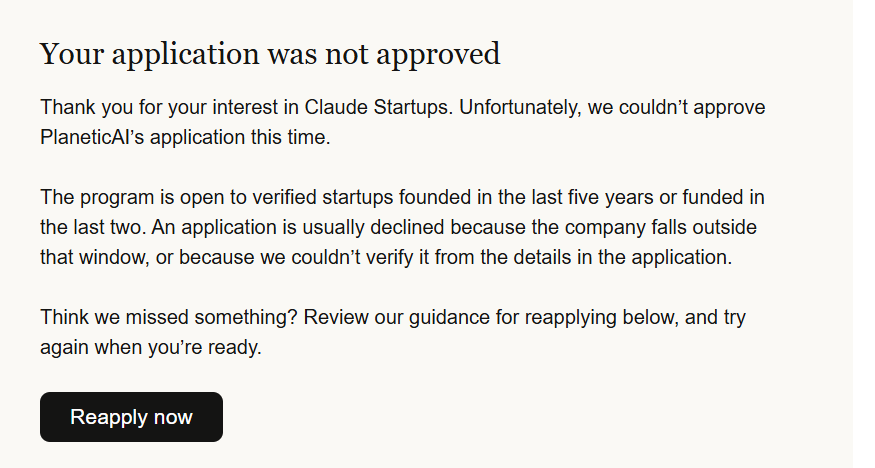 — Reply 2107554594180206676 media 1. Source media: https://pbs.twimg.com/media/HT-JaQvbcAAvmqc.png
 — Reply 2108243748207616258 media 1. Source media: https://pbs.twimg.com/media/HUH8gJvXYAAO3d_.jpg
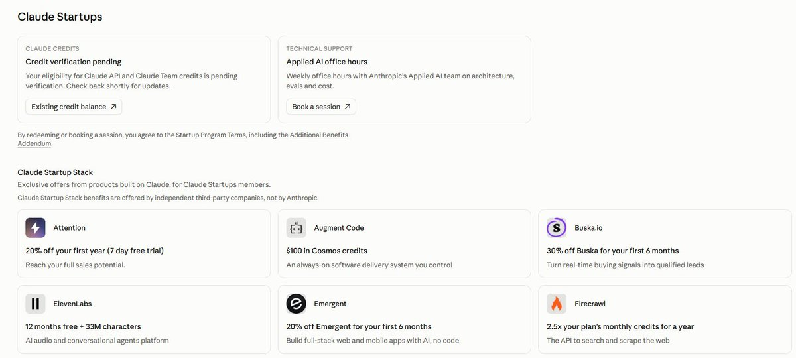 — Reply 2107552513247309836 media 1. Source media: https://pbs.twimg.com/media/HT-H0eKWwAAAESS.jpg
 — Reply 2107515941642977731 media 1. Source media: https://pbs.twimg.com/media/HT9mhqZaMAAwVud.png
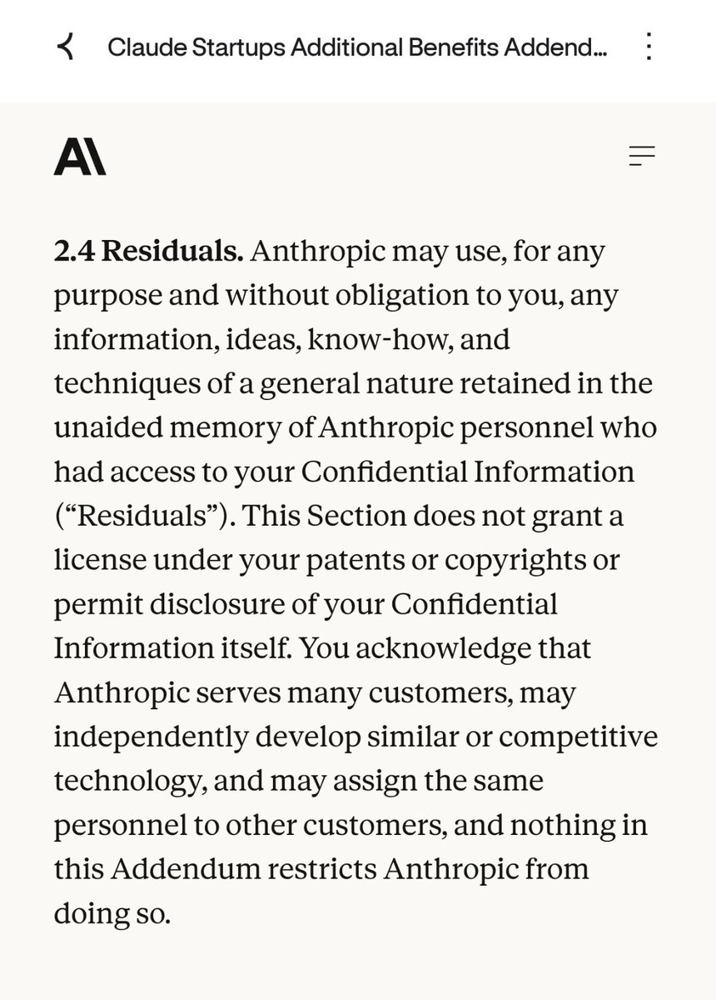 — Reply 2107795051535597888 media 1. Source media: https://pbs.twimg.com/media/HUBkZeSbAAEgM2H.jpg
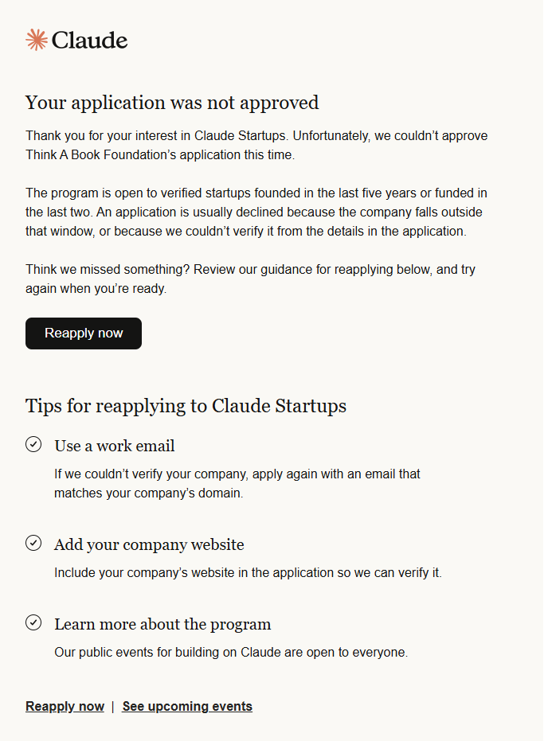 — Reply 2107851330828349479 media 1. Source media: https://pbs.twimg.com/media/HUCXb-wakAA8gZ7.png
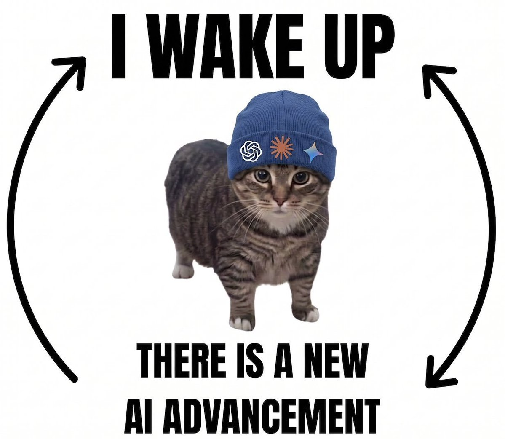 — Reply 2107646231120073027 media 1. Source media: https://pbs.twimg.com/media/HT_dEyTasAAajKN.jpg

## Thread

### Claude ([@claudeai](https://x.com/claudeai/status/2107513497420710203)) — 2026-10-06T16:49:08+00:00

The new Claude Startup Stack brings together offers from companies building with Claude, including Linear, Lovable, ElevenLabs, Granola, and Hex.

You’ll get discounts and credits worth up to $45,000 on tools for sales, design, data engineering, and more. https://t.co/yZBotW454D
 — Source media: https://video.twimg.com/amplify_video/2107500131113136128/vid/avc1/1920x1080/Xrskg4v3T8rNOTql.mp4?tag=29
### Claude ([@claudeai](https://x.com/claudeai/status/2107513501576999318)) — 2026-10-06T16:49:09+00:00

You can also book virtual office hours with Anthropic’s Applied AI team, and join Claude Startups events like Founder House, hackathons, and meetups as space allows.

Startups founded in the last five years or funded in the last two are eligible to apply: https://t.co/niD82RXHTN
### Claude ([@claudeai](https://x.com/claudeai/status/2107521446570303997)) — 2026-10-06T17:20:43+00:00

You'll also receive up to $7,000 in Claude products and credits to build with.  

That includes a free year of Claude Team for companies new to Team, plus $1,000 in API credits as soon as you’re approved.
### Claude ([@claudeai](https://x.com/claudeai/status/2108404561413349695)) — 2026-10-09T03:49:54+00:00

We’ve loved seeing so many founders join the Claude Startups program. Unfortunately, we underestimated demand for the program, and we need to pause the Claude Team and $1,000 API credit offers.

With hundreds of thousands of applicants, we're re-reviewing applications so the program can serve as many startups as possible.

If you’ve already claimed the Claude offers, they’ll still remain in your account.

If you applied or were approved and haven’t claimed the offer, we're re-reviewing your application. Unfortunately, this means that some accounts who had already been approved will not get access to the offer. We know this is disappointing and we’re very sorry.

All accepted program members still have access to the Startup Stack and Applied AI office hours. If you're on a Claude Max or Team plan, your monthly API credits are available in Console as usual.

We appreciate your patience, and we're working to get you building as quickly as we can.
https://t.co/cq6ce8VKlE

## Comments

### Evan Kirstel #B2B #TechFluencer ([@EvanKirstel](https://x.com/EvanKirstel/status/2107657831633588634)) — 2026-10-07T02:22:40+00:00

@claudeai https://t.co/CPYGO9Gym8
 — Source media: https://video.twimg.com/amplify_video/2107657821009403904/vid/avc1/720x720/EEiqCQWvx8cz0bcO.mp4?tag=29
### Amy · fireply.ai ([@amybuildsAI](https://x.com/amybuildsAI/status/2107514185072443833)) — 2026-10-06T16:51:52+00:00

@claudeai solo founders qualify or is it team only
### Teneo Protocol ([@teneo_protocol](https://x.com/teneo_protocol/status/2107528131221545298)) — 2026-10-06T17:47:17+00:00

@claudeai Lowering the cost of experimentation could mean smaller teams building much bigger companies.
### Emanuele Di Pietro ([@emanueledpt](https://x.com/emanueledpt/status/2107834527779377431)) — 2026-10-07T14:04:47+00:00

@claudeai bro i applied 6h ago and everybody got in, what's the hold up
### Vishal Singh ([@vishalsingh2972](https://x.com/vishalsingh2972/status/2108537065625583988)) — 2026-10-09T12:36:25+00:00

@claudeai Finally got rejected

Thanks Claude 🥳 https://t.co/ElrILQmPSw
 — Source media: https://pbs.twimg.com/media/HUMHOhdbcAAnA33.jpg
### metashill ([@metashill_web3](https://x.com/metashill_web3/status/2107536671806034148)) — 2026-10-06T18:21:13+00:00

@claudeai Free API credits and team seats are great but unlimited compute doesn't build distribution

Startups with frontier models still bleed out if nobody knows their product exists🫢
### Stephanie ([@stephdreals](https://x.com/stephdreals/status/2107513658532069392)) — 2026-10-06T16:49:46+00:00

@claudeai Good news 🗞️ https://t.co/VbhT6Tc8IF
 — Source media: https://video.twimg.com/tweet_video/HT9kgK-XQAAlxtu.mp4
### dFusion AI Protocol ([@dFusionAI](https://x.com/dFusionAI/status/2107609437502570780)) — 2026-10-06T23:10:22+00:00

@claudeai free compute and API credits when you’re building is hard to say no to
### Heart ([@iheartjpgs](https://x.com/iheartjpgs/status/2107514098636509511)) — 2026-10-06T16:51:31+00:00

@claudeai My submission is being submitted asap
### Suede AI ([@AISUEDE](https://x.com/AISUEDE/status/2108041952700600672)) — 2026-10-08T03:49:01+00:00

@claudeai Let’s go!!
### Tenzin Dhonyoe ([@_tenZdhon_](https://x.com/_tenZdhon_/status/2107534475987235284)) — 2026-10-06T18:12:29+00:00

@claudeai https://t.co/yGH6dl16qg
### ashen ([@ashen_one](https://x.com/ashen_one/status/2107882861621559760)) — 2026-10-07T17:16:51+00:00

@claudeai hell yea
### kage ([@0XKageX0](https://x.com/0XKageX0/status/2107519181675528289)) — 2026-10-06T17:11:43+00:00

@claudeai how Claude walking by you with generosity that you wouldn't get: https://t.co/qJBUkgzQvD
 — Source media: https://video.twimg.com/amplify_video/2107518723766497280/vid/avc1/720x1280/CGdunBzNFZraq98a.mp4?tag=29
### Sujan 🌏 ([@devil9614_](https://x.com/devil9614_/status/2107517533767217159)) — 2026-10-06T17:05:10+00:00

@claudeai do solo devs with no funding round qualify or is it vc backed only?
### Yashas ([@YashasGunderia](https://x.com/YashasGunderia/status/2107515909539815641)) — 2026-10-06T16:58:43+00:00

@claudeai hey, I'm unable to redeem my offers https://t.co/1R5H7qb5TH
 — Source media: https://pbs.twimg.com/media/HT9mi65b0AABfd-.jpg
### slopbrains ([@slopbrains](https://x.com/slopbrains/status/2107543256536129816)) — 2026-10-06T18:47:23+00:00

@claudeai its a scam guys, they need only with investors, not some random dudes trying to build without investors, so be dont have hopes and apply
### AirCunha ([@AirCunhaXtra](https://x.com/AirCunhaXtra/status/2107544643617292386)) — 2026-10-06T18:52:53+00:00

@claudeai https://t.co/M3kk0Mx9Pq
 — Source media: https://pbs.twimg.com/media/HT-ArlvWAAAWvxQ.jpg
### Ethan (inner work for daily life) ([@ethan_tan](https://x.com/ethan_tan/status/2107740989758865720)) — 2026-10-07T07:53:06+00:00

@claudeai my inside man got me in in 2 mins 😉 https://t.co/20alE5rEJA
 — Source media: https://pbs.twimg.com/media/HUAuODAX0AA8_Wt.png
 — Source media: https://pbs.twimg.com/media/HUAzNNsXUAAYrlv.png
### Juan Carlos Gamboa Buendía ([@sevengbperu](https://x.com/sevengbperu/status/2107522587010228612)) — 2026-10-06T17:25:15+00:00

@claudeai I'm unable to redeem my offers @claudeai https://t.co/U6tuHXwf6k
 — Source media: https://pbs.twimg.com/media/HT9sg6TXwAAvXDO.jpg
### Süleyman_ ([@suleyman_mh](https://x.com/suleyman_mh/status/2107568029789725114)) — 2026-10-06T20:25:49+00:00

@claudeai @grok what is the link for application
### Lauren ([@parcse_](https://x.com/parcse_/status/2107519099748364447)) — 2026-10-06T17:11:23+00:00

@claudeai Thank you! https://t.co/m1BOLdJZ7b
 — Source media: https://pbs.twimg.com/media/HT9pD4YaEAAZJA1.jpg
### Udit Akhouri ([@AkhouriUdit](https://x.com/AkhouriUdit/status/2107555358168506575)) — 2026-10-06T19:35:28+00:00

@claudeai Thanks @claudeai for a $50k credit grant ❣️ https://t.co/KRrVUQvcHZ
 — Source media: https://pbs.twimg.com/media/HT-KbPRa4AAUzyD.jpg
### Sai Veda ([@Saiveda](https://x.com/Saiveda/status/2107673529399566461)) — 2026-10-07T03:25:02+00:00

@claudeai Sweet, thank you https://t.co/fBE2TjbmSH
 — Source media: https://pbs.twimg.com/media/HT_159NbIAAmKVd.jpg
### Cat 🐯 ([@vh1ne](https://x.com/vh1ne/status/2107543328048955619)) — 2026-10-06T18:47:40+00:00

@claudeai 🤞🏼🤞🏼🤞🏼 https://t.co/KWceGiuT14
 — Source media: https://pbs.twimg.com/media/HT9_e_pbgAAzaA2.jpg
### Leonel Boa ([@josemboa](https://x.com/josemboa/status/2107559406317515000)) — 2026-10-06T19:51:33+00:00

@claudeai Gives an error while I'm trying to claim. Can you please help? https://t.co/oRN1Fq2pSL
 — Source media: https://pbs.twimg.com/media/HT-Nv0qWQAAe6tE.jpg
### Yashasvi ([@yashasvigirdhar](https://x.com/yashasvigirdhar/status/2107747284444389786)) — 2026-10-07T08:18:07+00:00

@claudeai Sweet! https://t.co/kWhkSIOhKD
 — Source media: https://pbs.twimg.com/media/HUA4-adWIAAwBmR.jpg
### Tom ([@yo_tom_o](https://x.com/yo_tom_o/status/2107675263102554359)) — 2026-10-07T03:31:56+00:00

@claudeai ... https://t.co/ofRCm4D0Hk
 — Source media: https://pbs.twimg.com/media/HT_3ethbcAA9JBz.jpg
### Alek Carnell ([@AlekCarnell](https://x.com/AlekCarnell/status/2107514260821573932)) — 2026-10-06T16:52:10+00:00

@claudeai What counts as a "company" or "startup"? Any minimum requirements?
### Kevin ([@Kevinxsun](https://x.com/Kevinxsun/status/2107663701285474531)) — 2026-10-07T02:45:59+00:00

@claudeai You instantly rejected all the applications we submitted, like in 30 second, this must be a joke! https://t.co/Qn9Kmsj0cn
 — Source media: https://pbs.twimg.com/media/HT_sxmJbAAAaVaV.png
### Soura Vamseekar ([@SVamseekar](https://x.com/SVamseekar/status/2107515949532467217)) — 2026-10-06T16:58:52+00:00

@claudeai https://t.co/2FdxHe6RWU
 — Source media: https://pbs.twimg.com/media/HT9mlP1b0AESMRr.jpg
### Sk Samim ([@thisisaxon](https://x.com/thisisaxon/status/2107554594180206676)) — 2026-10-06T19:32:26+00:00

@claudeai just say it out that you don't take bootstrap pre-seed startup, I already used company email and provided my company info and still get rejected.... https://t.co/N5h0IuCE02
 — Source media: https://pbs.twimg.com/media/HT-JaQvbcAAvmqc.png
### Fabricio ➔ gitquest.dev ([@o_fabriciosouza](https://x.com/o_fabriciosouza/status/2108243748207616258)) — 2026-10-08T17:10:53+00:00

@claudeai it's impossible to redeem the credits now, did you guys remove from the program? https://t.co/akVoaIdJXr
 — Source media: https://pbs.twimg.com/media/HUH8gJvXYAAO3d_.jpg
### X ([@xPapiMat](https://x.com/xPapiMat/status/2107529947397116166)) — 2026-10-06T17:54:30+00:00

@claudeai auto-rejected despite meeting all criteria and submitting correct information.
### Tristan Berguer ([@TBerguer](https://x.com/TBerguer/status/2107552513247309836)) — 2026-10-06T19:24:10+00:00

@claudeai Thanks 🙏🚀 https://t.co/tJZYzChm8L
 — Source media: https://pbs.twimg.com/media/HT-H0eKWwAAAESS.jpg
### Thuy ([@tranngocthuycom](https://x.com/tranngocthuycom/status/2107785680546124166)) — 2026-10-07T10:50:41+00:00

@claudeai How long does the review usually take, and when will I receive a confirmation email? My friends told me it’s automatic, but I haven’t received any response email yet.
### Bowie ([@bowie_hw](https://x.com/bowie_hw/status/2107515941642977731)) — 2026-10-06T16:58:50+00:00

@claudeai uhm guys, the 'redeem your offer' button in the marketing email doesn't work.. https://t.co/JVOHxTOV5R
 — Source media: https://pbs.twimg.com/media/HT9mhqZaMAAwVud.png
### Kushal Magar ([@Kushal_70](https://x.com/Kushal_70/status/2107690283744022540)) — 2026-10-07T04:31:37+00:00

@claudeai That’s some shady way to reduce competition.
### Adarsh Kant ([@adarshknt1](https://x.com/adarshknt1/status/2107752021889896556)) — 2026-10-07T08:36:56+00:00

@claudeai I got into the program but not able to redeem Claude Team plan, it  shows something went wrong
### Saadi ([@codersaadi](https://x.com/codersaadi/status/2107795051535597888)) — 2026-10-07T11:27:55+00:00

@claudeai catch is that they may train independently and may steal ideas https://t.co/oOH6Fmlt8T
 — Source media: https://pbs.twimg.com/media/HUBkZeSbAAEgM2H.jpg
### Think A Book ([@ThinkABook](https://x.com/ThinkABook/status/2107851330828349479)) — 2026-10-07T15:11:33+00:00

@claudeai Thanks, will always remember this. https://t.co/GgvrIXA1ZX
 — Source media: https://pbs.twimg.com/media/HUCXb-wakAA8gZ7.png
### RodBuildsAI ([@rodkendrick](https://x.com/rodkendrick/status/2107539663795958184)) — 2026-10-06T18:33:06+00:00

@claudeai Thank You Anthropic! I've been trying to use Opus 5.5 and Sonnet 5.5 through my AWS account. No success, these would be awesome for us.
### ShadowAguy ([@shadowaguy](https://x.com/shadowaguy/status/2107560626503770156)) — 2026-10-06T19:56:24+00:00

@claudeai a year of team plus credits is how they get you hooked before the overage bills start
### Shubham Sharma | Video Editor ([@editxshub](https://x.com/editxshub/status/2107646231120073027)) — 2026-10-07T01:36:34+00:00

@claudeai https://t.co/fBNMQLpMpK
 — Source media: https://pbs.twimg.com/media/HT_dEyTasAAajKN.jpg
### Turk ([@turkonthelurk](https://x.com/turkonthelurk/status/2107820505864806732)) — 2026-10-07T13:09:04+00:00

@claudeai Office hrs w/ applied SI is the new YC interview

## Other returned timeline records

> The CLI did not expose reply relationships. These records do not start with a reply mention and were authored by someone other than the saved-post author. They may include recommendations or promoted posts; they are retained as source context, not verified replies.

### Rich Stureborg ([@rstureborg](https://x.com/rstureborg/status/2107554861558411428)) — 2026-10-06T19:33:30+00:00

The terms for this sucks, and you agree to them by just applying.

- §2.4 Anthropic "may develop similar or competitive  technology"
- §2.4 permits reuse, for any purpose, of general ideas, know-how and techniques remembered by personnel looking at your data
- §D.4 prohibits accessing their services to build competing products or services
- §F.1 allows them to retain and perform safety reviews, superseding ZDR (whats the point of ZDR then?)

and it could get worse later!
- §6 permits changes to the addendum at any time without notice or liability

@jason you advising your start ups to apply for this?

[1] https://t.co/IFeoVixOsb
[2] https://t.co/PKJFl6UBlr
