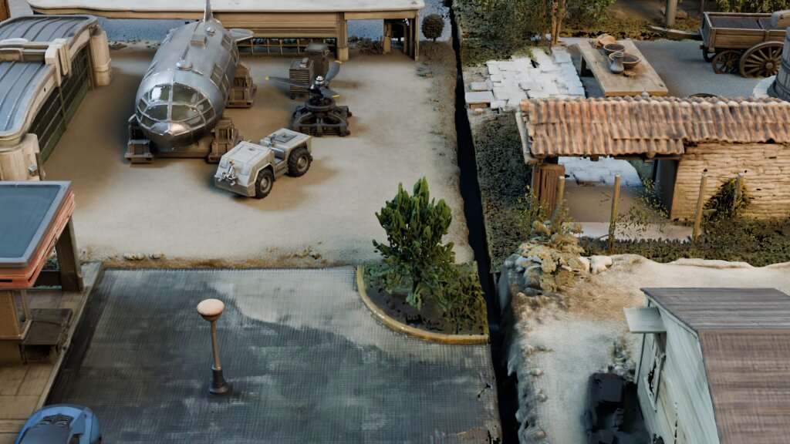

# DistScene- turns a single image into an editable 3D scene.
> Source: https://x.com/wildmindai/status/2107761959009718673
> Author: Wildminder (@wildmindai)
> Posted: 2026-10-07T09:16:26+00:00
> Captured: 2026-10-15T09:02:28+00:00
> Stats at capture: 47,546 views · 1,122 likes · 13 replies · 125 reposts · 1,337 bookmarks · 4 quotes

## Post

DistScene-  turns a single image into an editable 3D scene.

Uses sparse voxels, sparse DiT flow-matching models + LoRA. Based on TRELLIS.2
object-centric refinement restores details

https://coolbeam.github.io/DistScene/

## Media

[Post media 1](media/video-01.mp4) — Source media: https://video.twimg.com/amplify_video/2107761523728814080/vid/avc1/1024x576/DH4EUyE2BF15mHyr.mp4?tag=29
 — Post media 1 thumbnail. Source media: https://pbs.twimg.com/amplify_video_thumb/2107761523728814080/img/HxRgv-Bvp8FTS2CD.jpg
[Reply 2110342352665473156 media 1](media/video-02.mp4) — Source media: https://video.twimg.com/amplify_video/2110341167745282048/vid/avc1/1920x1080/m0kAWre8eLhiSKiF.mp4?tag=29
[Reply 2110343012421181485 media 1](media/video-03.mp4) — Source media: https://video.twimg.com/amplify_video/2110341696881840128/vid/avc1/1200x760/XMO3ArIm1bTXD73I.mp4?tag=29
[Reply 2110423274413056230 media 1](media/video-04.mp4) — Source media: https://video.twimg.com/amplify_video/2110423186038992896/vid/avc1/1920x1080/VnC5Vj_T41mcV-J4.mp4?tag=29
[Reply 2110335677032432086 media 1](media/video-05.mp4) — Source media: https://video.twimg.com/amplify_video/2110335544299536384/vid/avc1/2160x2612/Vr77m6EYhaRkcjX3.mp4?tag=29

## Comments

### AmirMušić ([@AmirMushich](https://x.com/AmirMushich/status/2108139384986017912)) — 2026-10-08T10:16:11+00:00

@wildmindai Ok, this has to be saved
### Thusatharan ([@Thusatharan](https://x.com/Thusatharan/status/2107803112585281552)) — 2026-10-07T11:59:57+00:00

@wildmindai if the objects come out as separate meshes, blender kitbashing gets way faster
### Andrii Zadaianchuk 🇺🇦 ([@ZadaianchukML](https://x.com/ZadaianchukML/status/2107894878663307272)) — 2026-10-07T18:04:36+00:00

@wildmindai Nice paper! 

Is it possible to expend for robotics, when more inputs about the scene are available like depth or multi-view? 
In RecGen we showed that it leads to much more accurate object placements in the scene, needed for real-to-sim

https://t.co/UAIbiCCS31
### Fedsurrection ([@fedsurrection](https://x.com/fedsurrection/status/2107949862885187935)) — 2026-10-07T21:43:05+00:00

@wildmindai Nice. 

Potential use case?

A photo of a person holding a tennis racquet gets transformed into a (vector?) 3D object which can then be printed into a bobblehead of that person holding the tennis racquet.

Is this possible with DistScene?

Is there a more elegant way to do this?
### 燎原 ([@e_page](https://x.com/e_page/status/2107877098702700615)) — 2026-10-07T16:53:57+00:00

@wildmindai 超级棒，我想他小到不需要独立显卡
### The Qubits Guy ([@Toy_Maestro](https://x.com/Toy_Maestro/status/2108367909714108473)) — 2026-10-09T01:24:15+00:00

@wildmindai That’s a bunch of cool stuff.
### Matthew Man e/acc ⏩ ([@vamatt](https://x.com/vamatt/status/2108261628927947021)) — 2026-10-08T18:21:56+00:00

@wildmindai We’re living in the future.
### Zhang Cheng ([@zhanggcheng](https://x.com/zhanggcheng/status/2108062151537791308)) — 2026-10-08T05:09:17+00:00

@wildmindai @bot  remind me later at 1.11 pm to try this
### Soroosh ([@Soroosh_Tajdar](https://x.com/Soroosh_Tajdar/status/2107816610967027865)) — 2026-10-07T12:53:36+00:00

@wildmindai does it hold up on messy real photos or only clean ones? that's where these fall apart for me
### The real Burgstall ([@TheBurgstall](https://x.com/TheBurgstall/status/2108294734628196477)) — 2026-10-08T20:33:29+00:00

@wildmindai No weights, no code...
### Kinder • Grinder ([@kinder_grinder](https://x.com/kinder_grinder/status/2108124588718608513)) — 2026-10-08T09:17:23+00:00

@wildmindai Waiting for code
###  007 ([@007_eth_](https://x.com/007_eth_/status/2108070634349858887)) — 2026-10-08T05:42:59+00:00

@wildmindai cool
### tvitzer tvitzerovich ([@tvitzer](https://x.com/tvitzer/status/2107777835611947455)) — 2026-10-07T10:19:31+00:00

@wildmindai coming soon

## Other returned timeline records

> The CLI did not expose reply relationships. These records do not start with a reply mention and were authored by someone other than the saved-post author. They may include recommendations or promoted posts; they are retained as source context, not verified replies.

### Starlink ([@Starlink](https://x.com/Starlink/status/2068115197718593741)) — 2026-06-19T23:34:21+00:00

Get connected with fast, reliable internet for streaming, video calls, online gaming and more.

Order online in minutes.
### Starlink ([@Starlink](https://x.com/Starlink/status/2092706810285490310)) — 2026-08-26T20:12:38+00:00

Starlink offers fast, reliable internet in the most rural and remote locations. Portable and easy to set up, Starlink Mini works wherever you are.

Order online in minutes.
### Emm | scenario.com ([@emmanuel_2m](https://x.com/emmanuel_2m/status/2110342352665473156)) — 2026-10-14T12:09:59+00:00

We just open-sourced an entire 3D team for Blender.

Introducing the Scenario plugin.

Use it inside Blender, or let Claude Code run it through MCP.

📁/scenario-plugin
┃
┣ 📁 Concept Artist
┃ ┣ 📁 Concept Art From a Prompt
┃ ┗ 📁 References From Your Viewport
┃
┣ 📁 3D Artist
┃ ┣ 📁 Meshes From Text or a Photo
┃ ┗ 📁 Retexture or Remesh the Selected Mesh
┃
┣ 📁 Animator
┃ ┣ 📁 Rig the Selected Character
┃ ┗ 📁 Motion From Text
┃
┣ 📁 Surfacing Artist
┃ ┣ 📁 PBR Materials Onto Any Slot
┃ ┗ 📁 Maps From a Photo
┃
┣ 📁 Layout Artist
┃ ┣ 📁 Greybox From a Description
┃ ┗ 📁 360 Worlds and Skies
┃
┣ 📁 Camera Operator
┃ ┣ 📁 Camera Path From a Sentence
┃ ┗ 📁 Orbits, Dollies, Cranes and Flyovers
┃
┣ 📁 Render Artist
┃ ┣ 📁 Viewport to Finished Still
┃ ┗ 📁 Playblast to Finished Shot
┃
┗ 📁 Sound Designer
┣ 📁 Music, Voice and SFX
┗ 📁 Dropped on Your Sequencer

Comment "BLENDER" and I'll send you the GitHub repo.
 — Source media: https://video.twimg.com/amplify_video/2110341167745282048/vid/avc1/1920x1080/m0kAWre8eLhiSKiF.mp4?tag=29
### fofr ([@fofrAI](https://x.com/fofrAI/status/2110343012421181485)) — 2026-10-14T12:12:37+00:00

I found Argon could sketch pretty quickly when using a custom dsl tool it had built for the job.

So I asked it to try animating a scene by sketching the next few frames from scratch each time, rocking the motion back and forth a bit, and iterating to make a short clip.

Then I asked it to add cel shading and transparency and to put it all together onto a background.
 — Source media: https://video.twimg.com/amplify_video/2110341696881840128/vid/avc1/1200x760/XMO3ArIm1bTXD73I.mp4?tag=29
### AK ([@_akhaliq](https://x.com/_akhaliq/status/2110423274413056230)) — 2026-10-14T17:31:33+00:00

VideoJev

System One Model for Video Understanding and Interaction

paper: https://t.co/JtkDu1fSJb https://t.co/FJguUPKuwB
 — Source media: https://video.twimg.com/amplify_video/2110423186038992896/vid/avc1/1920x1080/VnC5Vj_T41mcV-J4.mp4?tag=29
### Simplifying AI ([@simplifyinAI](https://x.com/simplifyinAI/status/2110335677032432086)) — 2026-10-14T11:43:28+00:00

Woow Nvidia has a 2.6B open-source world model 🔥

Turn an image, a text prompt, and a camera trajectory into a controllable world.

All on a single GPU.

- Code available on GitHub
- Paper on arXiv
- Useful for embodied AI, robotics research, and simulations

Runs on GPUs like an RTX 5090 or H100, making world-model experiments possible without a multi-GPU setup.
 — Source media: https://video.twimg.com/amplify_video/2110335544299536384/vid/avc1/2160x2612/Vr77m6EYhaRkcjX3.mp4?tag=29

## Links

- https://coolbeam.github.io/DistScene/
