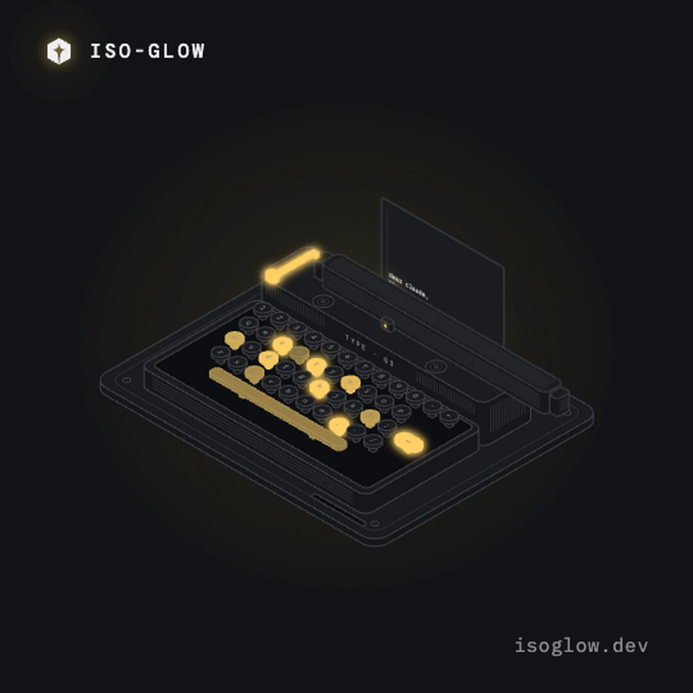
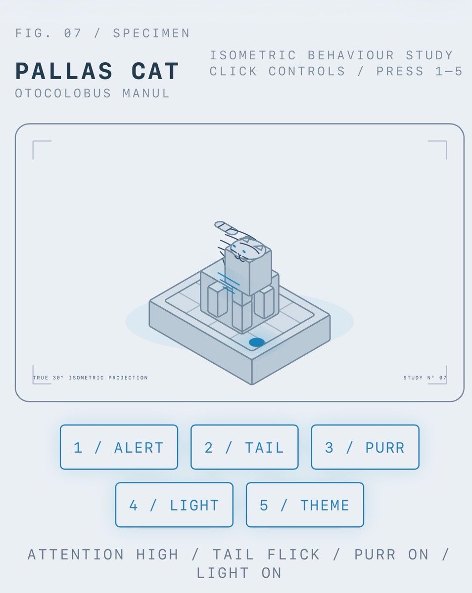

# A few people asked how I made the isometric objects and cities, so I packaged it into a Claude skill.
> Source: https://x.com/Aprilzz423/status/2107794465457139988
> Author: April (@Aprilzz423)
> Posted: 2026-10-07T11:25:36+00:00
> Captured: 2026-10-15T09:02:28+00:00
> Stats at capture: 78,671 views · 1,688 likes · 40 replies · 117 reposts · 2,420 bookmarks · 11 quotes

## Post

A few people asked how I made the isometric objects and cities, so I packaged it into a Claude skill.

Describe an object, device or building, and ISO-GLOW creates a single interactive HTML file.

Try it out yourself!
https://isoglow.dev

## Media

[Post media 1](media/video-01.mp4) — Source media: https://video.twimg.com/amplify_video/2107794380442804224/vid/avc1/720x720/RGV6cBzbb3Qbs8Ct.mp4?tag=29
 — Post media 1 thumbnail. Source media: https://pbs.twimg.com/amplify_video_thumb/2107794380442804224/img/6Ci7noHqs58qYMQe.jpg
 — Reply 2109156911233073514 media 1. Source media: https://pbs.twimg.com/media/HUU7B3GbYAANdL1.jpg
[Reply 2107852774981648742 media 1](media/animation-01.mp4) — Source media: https://video.twimg.com/tweet_video/HUCY7KCXwAAEPHQ.mp4

## Thread

### April ([@Aprilzz423](https://x.com/Aprilzz423/status/2107795321875222987)) — 2026-10-07T11:29:00+00:00

ISO-GLOW is built on Tolga Cohce’s open-source iso-figure skill, extended with lighting, palettes, galleries and a simpler installation flow.

Full credits:
https://t.co/TLpx1GEEXM
### April ([@Aprilzz423](https://x.com/Aprilzz423/status/2109197107211219075)) — 2026-10-11T08:19:12+00:00

@crypto_linn hey is that modern art

## Comments

### 🉐 Crypto Linn ([@crypto_linn](https://x.com/crypto_linn/status/2109156911233073514)) — 2026-10-11T05:39:28+00:00

@Aprilzz423 look what I made https://t.co/w6Y4UoEIFP
 — Source media: https://pbs.twimg.com/media/HUU7B3GbYAANdL1.jpg
### Amelia | AI & Tech ([@AmeliaonAI](https://x.com/AmeliaonAI/status/2108182806497272033)) — 2026-10-08T13:08:43+00:00

@Aprilzz423 Isometric generator as Claude skill is clever
### Mark Praschan ([@MarkPraschan](https://x.com/MarkPraschan/status/2107852774981648742)) — 2026-10-07T15:17:18+00:00

@Aprilzz423 I have no idea what I'm going to use this for... yet https://t.co/hwEiKTnzN3
 — Source media: https://video.twimg.com/tweet_video/HUCY7KCXwAAEPHQ.mp4
### Jay Derinbogaz ([@CDerinbogaz](https://x.com/CDerinbogaz/status/2108172316156858530)) — 2026-10-08T12:27:02+00:00

@Aprilzz423 I love it, thanks for sharing! I will definitely use it for the v2 of the on-prem calculator!
https://t.co/4pwH5UPzuE
### Konan ([@Neural333](https://x.com/Neural333/status/2107802705309704233)) — 2026-10-07T11:58:20+00:00

@Aprilzz423 Just tried the night diner. Switching the neon off changes the whole little scene. Love that you packaged these so others can make their own
### Misael Silva ([@misabjj](https://x.com/misabjj/status/2107851542271610947)) — 2026-10-07T15:12:24+00:00

@Aprilzz423 Just tried and it works very well! Thanks!
### Atharv Remeshan ([@atharv_rem](https://x.com/atharv_rem/status/2107814836663103610)) — 2026-10-07T12:46:33+00:00

@Aprilzz423 Thank youu so much
### dev9nine ([@dev9nine](https://x.com/dev9nine/status/2107871860297961862)) — 2026-10-07T16:33:08+00:00

@Aprilzz423 thanks! it looks amazing
### WAKUWAKU 🫧 ([@Wakuwaku](https://x.com/Wakuwaku/status/2107883052231758016)) — 2026-10-07T17:17:36+00:00

@Aprilzz423 Yeah this is so much fun, and looks great! Thanks for sharing
### awal ([@xinfeu](https://x.com/xinfeu/status/2107799096438440404)) — 2026-10-07T11:44:00+00:00

@Aprilzz423 trying it! appreciate it for sharing
### Harold Finch ([@Maverick_Quant](https://x.com/Maverick_Quant/status/2108179261605699979)) — 2026-10-08T12:54:38+00:00

@Aprilzz423 This is beautiful, thank you for sharing
### BreezeOg ([@BreezeOg1](https://x.com/BreezeOg1/status/2107935094765949221)) — 2026-10-07T20:44:24+00:00

@Aprilzz423 these look so good

the glow on them is everything
### Zara Tech & Tools ([@AskZaratech](https://x.com/AskZaratech/status/2108136728590794995)) — 2026-10-08T10:05:38+00:00

@Aprilzz423 Clean execution on isometric generation
### Yornaath ([@yornaath](https://x.com/yornaath/status/2109591460433818028)) — 2026-10-12T10:26:13+00:00

@Aprilzz423 Amazing work. I might use this
### Mintu Gogoi ([@Min2_gg](https://x.com/Min2_gg/status/2107898867882844180)) — 2026-10-07T18:20:27+00:00

@Aprilzz423 maybe just try https://t.co/hqo7g4Il7Z
### Actian for Developers ([@actiandev](https://x.com/actiandev/status/2107933092900200818)) — 2026-10-07T20:36:27+00:00

@Aprilzz423 this looks incredible! how did you come up with the idea? :D
### Zuhayr Khan ([@zuhayr_dev](https://x.com/zuhayr_dev/status/2107902199867027834)) — 2026-10-07T18:33:42+00:00

@Aprilzz423 Love the little city, especially the lit-up windows.
### Ilia Reingold ([@IliaReingold](https://x.com/IliaReingold/status/2107827391796240760)) — 2026-10-07T13:36:26+00:00

@Aprilzz423 This is gorgeous! Really well done. I'll give it a shot.
### Brjan | AI Builder ([@MrBrjan](https://x.com/MrBrjan/status/2107864708942577869)) — 2026-10-07T16:04:43+00:00

@Aprilzz423 packaging it into a Claude skill is a smart way to share your process
### Maxim Kich ([@maximkich](https://x.com/maximkich/status/2107904819264729592)) — 2026-10-07T18:44:06+00:00

@Aprilzz423 cool! thank u
### Asmir ([@asmirkn](https://x.com/asmirkn/status/2107847180744552531)) — 2026-10-07T14:55:04+00:00

@Aprilzz423 the single html file is the smart part, nothing to host or install, you can just send it to someone and it opens
### Kysignal ([@thorsgardian_](https://x.com/thorsgardian_/status/2107805105907183879)) — 2026-10-07T12:07:53+00:00

@Aprilzz423 nice....trying right away
### enny ([@ennyonx](https://x.com/ennyonx/status/2108141045016068321)) — 2026-10-08T10:22:47+00:00

@Aprilzz423 very cool!
### luke sine ([@Lukegsine](https://x.com/Lukegsine/status/2108072334070559164)) — 2026-10-08T05:49:45+00:00

@Aprilzz423 Love it
### Loris ([@epicLoris9](https://x.com/epicLoris9/status/2107913943016505703)) — 2026-10-07T19:20:21+00:00

@Aprilzz423 Nice 👍
### Миша хз ([@bushidops](https://x.com/bushidops/status/2108058360520011802)) — 2026-10-08T04:54:13+00:00

@Aprilzz423 Noice
### Rohit Purkait ([@codeswithroh](https://x.com/codeswithroh/status/2107907067877224505)) — 2026-10-07T18:53:02+00:00

@Aprilzz423 Woah amazing
### Yash Desale ([@Yash_Desale_007](https://x.com/Yash_Desale_007/status/2107856379436568758)) — 2026-10-07T15:31:37+00:00

@Aprilzz423 Crazzzy ✨✌️
### Akash Parmar ([@AkashDev001](https://x.com/AkashDev001/status/2108184173743911197)) — 2026-10-08T13:14:09+00:00

@Aprilzz423 Hey April, this project is just mind bobling, 
Like so smooth and precision is top notch.

Would Definitely love to connect
### Chole Syntax Expert AI ([@CholeSyntax](https://x.com/CholeSyntax/status/2108115137781485770)) — 2026-10-08T08:39:50+00:00

@Aprilzz423 ISO GLOW looks incredible love how clean those isometric builds are
### Shivani Das ([@Shivanidas0910](https://x.com/Shivanidas0910/status/2108071682019938444)) — 2026-10-08T05:47:09+00:00

@Aprilzz423 This looks cool! And it’s lightweight on the browser. SVGs can be powerful if given enough thought. Will definitely try it.
### Ping ([@chadami223](https://x.com/chadami223/status/2108066802773442703)) — 2026-10-08T05:27:46+00:00

@Aprilzz423 太牛逼了
### Basit ([@aderemi_oluokun](https://x.com/aderemi_oluokun/status/2109409643063849396)) — 2026-10-11T22:23:44+00:00

@Aprilzz423 This will really be a game changer for Video editor and motion designers.
### Geoff ([@Counihan_g](https://x.com/Counihan_g/status/2108006016436900247)) — 2026-10-08T01:26:13+00:00

@Aprilzz423 Super cool

## Other returned timeline records

> The CLI did not expose reply relationships. These records do not start with a reply mention and were authored by someone other than the saved-post author. They may include recommendations or promoted posts; they are retained as source context, not verified replies.

### Starlink ([@Starlink](https://x.com/Starlink/status/2068115197718593741)) — 2026-06-19T23:34:21+00:00

Get connected with fast, reliable internet for streaming, video calls, online gaming and more.

Order online in minutes.
### Starlink ([@Starlink](https://x.com/Starlink/status/2092706810285490310)) — 2026-08-26T20:12:38+00:00

Starlink offers fast, reliable internet in the most rural and remote locations. Portable and easy to set up, Starlink Mini works wherever you are.

Order online in minutes.

## Links

- https://isoglow.dev
