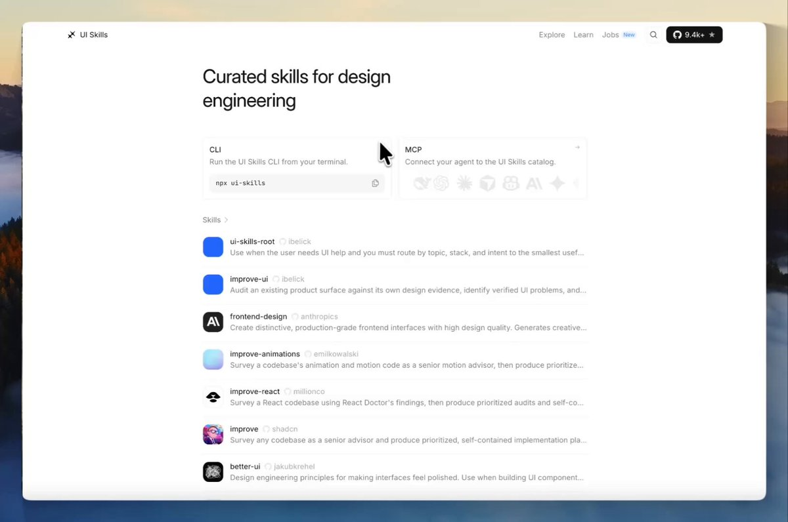
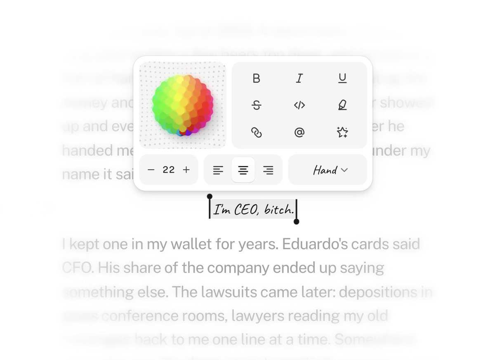

# 7 UI skills every design engineer should know when building with AI agents:
> Source: https://x.com/aymenpursue/status/2107835276810739945
> Author: Aymen (@aymenpursue)
> Posted: 2026-10-07T14:07:46+00:00
> Captured: 2026-10-15T09:02:28+00:00
> Stats at capture: 15,689 views · 312 likes · 2 replies · 28 reposts · 530 bookmarks · 1 quotes

## Post

7 UI skills every design engineer should know when building with AI agents:

1-emil-design-eng
https://www.ui-skills.com/skills/emilkowalski/emil-design-eng
2-make-interfaces-feel-better
https://www.ui-skills.com/skills/jakubkrehel/make-interfaces-feel-better
3-playwright-cli
https://www.ui-skills.com/skills/microsoft/playwright-cli
4-react-doctor
https://www.ui-skills.com/skills/millionco/react-doctor
5-fixing-accessibility
https://www.ui-skills.com/skills/ibelick/fixing-accessibility
6-12-principles-of-animation
https://www.ui-skills.com/skills/raphaelsalaja/12-principles-of-animation
7-shadcn
https://www.ui-skills.com/skills/shadcn-ui/shadcn

## Media

[Post media 1](media/video-01.mp4) — Source media: https://video.twimg.com/amplify_video/2107834538755756032/vid/avc1/1084x720/ecC1bdDqOSBk3bsh.mp4?tag=29
 — Post media 1 thumbnail. Source media: https://pbs.twimg.com/amplify_video_thumb/2107834538755756032/img/fhO5X9OFbVrmsEOZ.jpg
[Reply 2110456607297749099 media 1](media/video-02.mp4) — Source media: https://video.twimg.com/amplify_video/2110455645933568002/vid/avc1/3840x2160/qTEk0TowO2B33sPs.mp4?tag=29
 — Reply 2110512054851526682 media 1. Source media: https://pbs.twimg.com/media/HUoK4fLboAAo1fo.jpg
[Reply 2110425467996209244 media 1](media/video-03.mp4) — Source media: https://video.twimg.com/amplify_video/2110425227935318016/vid/avc1/1920x1080/GX048H4Ly1_HE_Kb.mp4?tag=29
[Reply 2110359771094368574 media 1](media/video-04.mp4) — Source media: https://video.twimg.com/amplify_video/2110359338833580032/vid/avc1/1796x1772/ww4pNM86sMs6wHgw.mp4?tag=29

## Comments

### Andrii Boichuk ([@andriy_uiux](https://x.com/andriy_uiux/status/2108170353906507801)) — 2026-10-08T12:19:14+00:00

@aymenpursue Saving this list

## Other returned timeline records

> The CLI did not expose reply relationships. These records do not start with a reply mention and were authored by someone other than the saved-post author. They may include recommendations or promoted posts; they are retained as source context, not verified replies.

### Lucas ([@lucasmarkes__](https://x.com/lucasmarkes__/status/2110456607297749099)) — 2026-10-14T19:44:00+00:00

/hairline-adopt is out now!

bring the svg you already have, it comes back as a figure.
 — Source media: https://video.twimg.com/amplify_video/2110455645933568002/vid/avc1/3840x2160/qTEk0TowO2B33sPs.mp4?tag=29
### shawn. ([@zzzzshawn](https://x.com/zzzzshawn/status/2110512054851526682)) — 2026-10-14T23:24:19+00:00

text toolbar concept https://t.co/2vVtwUVfHv
 — Source media: https://pbs.twimg.com/media/HUoK4fLboAAo1fo.jpg
### Arlan Marat ([@arlanoska](https://x.com/arlanoska/status/2110425467996209244)) — 2026-10-14T17:40:16+00:00

new design system for AI apps and developer tools!

copy code here:
https://t.co/0TUsuvGXzl https://t.co/zj0MmPZOMp
 — Source media: https://video.twimg.com/amplify_video/2110425227935318016/vid/avc1/1920x1080/GX048H4Ly1_HE_Kb.mp4?tag=29
### Alvish 🧙‍♂️ ([@alvish](https://x.com/alvish/status/2110359771094368574)) — 2026-10-14T13:19:12+00:00

🔌 Empty states deserve some love too https://t.co/8hD95eOVxM
 — Source media: https://video.twimg.com/amplify_video/2110359338833580032/vid/avc1/1796x1772/ww4pNM86sMs6wHgw.mp4?tag=29

## Links

- https://www.ui-skills.com/skills/emilkowalski/emil-design-eng
- https://www.ui-skills.com/skills/jakubkrehel/make-interfaces-feel-better
- https://www.ui-skills.com/skills/microsoft/playwright-cli
- https://www.ui-skills.com/skills/millionco/react-doctor
- https://www.ui-skills.com/skills/ibelick/fixing-accessibility
- https://www.ui-skills.com/skills/raphaelsalaja/12-principles-of-animation
- https://www.ui-skills.com/skills/shadcn-ui/shadcn
