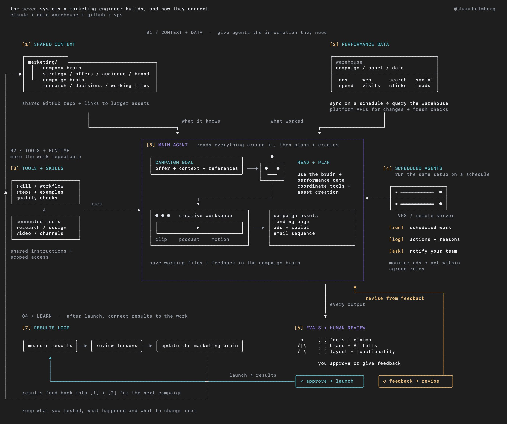

# one role that every company needs right now is a marketing engineer
> Source: https://x.com/shannholmberg/status/2108112682922705181
> Author: Shann³ (@shannholmberg)
> Posted: Thu Oct 08 08:30:05 +0000 2026
> Captured: 2026-10-15T09:02:28+00:00
> Stats at capture: 19,363 views · 335 likes · 41 replies · 21 reposts · 579 bookmarks · 3 quotes

## Post

one role that every company needs right now is a marketing engineer

your goal is to use agents to generate more revenue and lower costs

and you only need: claude + a data warehouse + github + a vps

here are 7 things to build, plus 3 bonus workflows you can start with:

1. shared context for your team and agents

build a marketing brain with your company strategy, offers, target customers, brand guidelines and previous campaign lessons

keep research, decisions and working files for each campaign in a campaign brain

you can keep the knowledge files in a GitHub repo your team can access, with links to designs and larger assets

when someone starts a task, their agent can find the relevant context and use what your team already knows

2. performance data agents can use

bring ad spend, website analytics, search data and social performance into a data warehouse

sync it on a schedule so agents can read historical performance without repeatedly requesting it from rate-limited platform APIs

use the platform APIs to create and change campaigns, with direct checks when you need fresh information

your agents can compare previous campaigns, find patterns and use those findings to make better decisions

3. tools and skills your team can share

keep a shared list of tools, what each tool does and how agents can access it

document the permissions, required inputs and expected outputs so your team’s agents know how to use each tool

create reusable skills that combine those tools into workflows, with examples and quality checks for the finished work

4. agents that work on a schedule

a vps is a remote server that can run your agents when your laptop is closed

a paid ads workflow can check campaign performance on a schedule and act within rules you’ve agreed on

it could pause an ad that meets your stop criteria or notify you when it recommends changing the creative or budget

keep a record of what it changed and why

5. creative production from idea to finished assets

build workflows that use your campaign goal, research and brand guidelines to produce finished creative work

that could mean producing clips from livestreams, editing podcasts or creating motion design for your social channels

give agents your references, source files and feedback so they can follow your design and editing standards

6. evaluations and reviews before work goes live

build a review system that catches weak work before your team has to review it

evaluations are checks against defined criteria, such as factual accuracy, brand consistency, AI writing patterns and broken layouts

give agents approved examples and rejected examples with your notes, then have them revise work that fails the checks

keep human review for taste, judgment and decisions the checks cannot reliably make

7. learning from the results

connect campaign results to the assets and decisions behind them

record what you tested, what happened and what you would change next time

review those lessons before adding them to the marketing brain for future campaigns

3 bonus workflows you can build right away:

> paid ads workflow: agents research campaign angles, generate ad variations and create campaigns ready for approval. once launched, they monitor warehouse data, pause underperforming ads within agreed rules and produce new variations from the results

> campaign launch workflow: build on existing frameworks like Matt’s skills or Claude Superpowers. give your main agent a goal, offer and campaign brain, then have it plan and coordinate the landing page, promo video, social posts and email sequence through checks and approval

> webinar-to-content workflow: agents turn a recording into edited clips, captions, social posts, an article and a follow-up email. they prepare approved content for distribution across your channels and track which assets bring visitors and leads

## Media

 — Post media 1. Source media: https://pbs.twimg.com/media/HUGFT88aoAA_OTW.jpg?name=orig

## Thread

### Shann³ ([@shannholmberg](https://x.com/shannholmberg/status/2108448077254463919)) — 2026-10-09T06:42:49+00:00

@SaidAitmbarek the only way
### Shann³ ([@shannholmberg](https://x.com/shannholmberg/status/2108447839869415667)) — 2026-10-09T06:41:52+00:00

@NielsPosts_ Thanks! How come you want infra now instead of doing the action with whats out there already? I find it better to focus on distribtuion than trying to build infra right now as its so easy to whip something up with opus, the hard part is getting it seen rn
### Shann³ ([@shannholmberg](https://x.com/shannholmberg/status/2108448046912582008)) — 2026-10-09T06:42:42+00:00

@oleh_bernatskyi I wouldn´t say so, you´d keep logs for traceability, but otherwise not so much log reading
### Shann³ ([@shannholmberg](https://x.com/shannholmberg/status/2108448118811631685)) — 2026-10-09T06:42:59+00:00

@MauroJPelle thanks, appreciate it!

## Comments

### Saïd Aitmbarek ([@SaidAitmbarek](https://x.com/SaidAitmbarek/status/2108219091010093406)) — 2026-10-08T15:32:54+00:00

@shannholmberg deep into gtm/distribution these days
### Niels Post ([@NielsPosts_](https://x.com/NielsPosts_/status/2108347435852738818)) — 2026-10-09T00:02:54+00:00

@shannholmberg agree man, and nice visual. i'm switching at least 50% of my focus now on building ai agent infra, instead of 'using' AI to perform certain tasks

it's quite hard tbh to switch mentally but definitely see the value on the long term

working on > in the business
### Oleg Bernatskyi ([@oleh_bernatskyi](https://x.com/oleh_bernatskyi/status/2108298492766814531)) — 2026-10-08T20:48:25+00:00

@shannholmberg a marketing engineer is just a marketer who reads the logs. long overdue
### Mauro ([@MauroJPelle](https://x.com/MauroJPelle/status/2108158984960041330)) — 2026-10-08T11:34:04+00:00

@shannholmberg Clean diagram and true
### Leo ([@hung030299](https://x.com/hung030299/status/2108120939271745807)) — 2026-10-08T09:02:53+00:00

@shannholmberg github for marketing brains is next level
### Lou ([@0xLouz](https://x.com/0xLouz/status/2108119080821723148)) — 2026-10-08T08:55:30+00:00

@shannholmberg vps part is the real unlock here for scaling
### Lina 🦅 ([@XNXX_EN](https://x.com/XNXX_EN/status/2108113208972325155)) — 2026-10-08T08:32:10+00:00

@shannholmberg that vps part is really smart
### furan ([@furan86999](https://x.com/furan86999/status/2108128916997276115)) — 2026-10-08T09:34:35+00:00

@shannholmberg 营销工程师这个角色真的每个团队都该有 用Claude加数据仓库直接起飞
### chrisreedbates ([@chrisreedbates](https://x.com/chrisreedbates/status/2108436857860321559)) — 2026-10-09T05:58:14+00:00

@shannholmberg I think you've discovered what happens to all the software engineers.
### Ethan Caldwell ([@ethannnrvnu](https://x.com/ethannnrvnu/status/2108186215635644644)) — 2026-10-08T13:22:16+00:00

@shannholmberg marketing engineer sounds like a fun rabbit hole to fall into
### Thomas Heimann ([@thomasheimann](https://x.com/thomasheimann/status/2108722018002600207)) — 2026-10-10T00:51:21+00:00

@shannholmberg Excellent blueprint - thanks for sharing!
### Wallchain Community Hub ([@quack_research](https://x.com/quack_research/status/2108124937110327448)) — 2026-10-08T09:18:46+00:00

@shannholmberg this setup changes the whole thing for real
### Evening Trader Group ([@Eveningtraders](https://x.com/Eveningtraders/status/2108114079005261873)) — 2026-10-08T08:35:37+00:00

@shannholmberg Marketing engineer: the ultimate growth hack
### mrpicule.eth ([@MrPicule](https://x.com/MrPicule/status/2108113098666021015)) — 2026-10-08T08:31:44+00:00

@shannholmberg autonomy is the ultimate alpha fren
### Alek ([@AlekVectis](https://x.com/AlekVectis/status/2108121073325834630)) — 2026-10-08T09:03:25+00:00

@shannholmberg for the webinar workflow, i'd link each clip and email claim to a transcript timestamp. if the speaker says 'we're testing this', the promo shouldn't turn it into 'available now'. editing that source line should flag every draft that uses it.
### Eggb4by ([@eggbaby](https://x.com/eggbaby/status/2108144721008931017)) — 2026-10-08T10:37:23+00:00

@shannholmberg The campaign history is the bit I'd bet on. As ad variants get easier to generate, knowing which offers your audience has already ignored becomes a pretty valuable asset.
### Sanwerrs | AI for e-com ([@Sanwerrs_AI](https://x.com/Sanwerrs_AI/status/2108181867187048783)) — 2026-10-08T13:04:59+00:00

@shannholmberg solo store version of #1 is one google doc with your offer and the real complaints from your reviews. paste it in first and claude stops writing generic copy
### Nick ([@0xnick__](https://x.com/0xnick__/status/2108446342033084628)) — 2026-10-09T06:35:55+00:00

@shannholmberg I think it's good when the product already has a PMF and you aren't in 0 to 1 phase. Otherwise not sure how it helps to manually cold reach people 1 by 1
### Ruuj ([@RuujSs](https://x.com/RuujSs/status/2108262232979366183)) — 2026-10-08T18:24:20+00:00

@shannholmberg Seen couple of startup’s working on this space even for improving client outreach. Requirement is real And it’s growing pretty fast
### Arthur ([@Crackx17_](https://x.com/Crackx17_/status/2108482930284896718)) — 2026-10-09T09:01:18+00:00

@shannholmberg Many companies, even large-scale startups, still believe they need a 20-person team to handle all of this
### BeeReach ([@BeeReach_io](https://x.com/BeeReach_io/status/2108294280838328785)) — 2026-10-08T20:31:41+00:00

@shannholmberg nice blueprint, the vps schedule keeps the brain running when i’m offline
### Greg Glazewski ([@Greg_GL_87](https://x.com/Greg_GL_87/status/2108237678986871127)) — 2026-10-08T16:46:46+00:00

@shannholmberg Who writes the stop rules for the ad-pausing agent, you or the agent?
### BitAres ([@bitares](https://x.com/bitares/status/2108446844456198279)) — 2026-10-09T06:37:55+00:00

@shannholmberg Keep the creative ID in the campaign report too, so the lesson points back to an actual asset.
### SVO ([@Soloveryown](https://x.com/Soloveryown/status/2108115442158260593)) — 2026-10-08T08:41:02+00:00

@shannholmberg marketing engineers? who would have thought?
