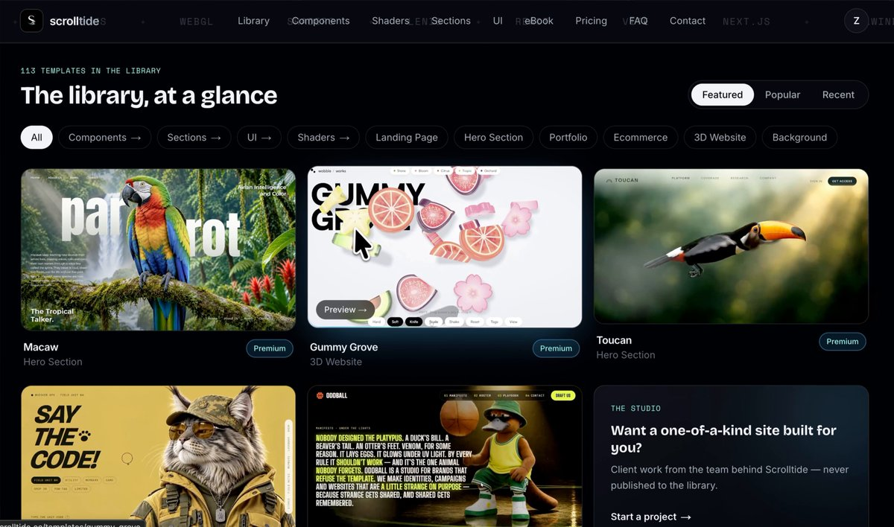

# 🍟 Still using Pinterest for design inspo in 2026? These will replace it in 2027. 👇
> Source: https://x.com/himanshubuildss/status/2108181934669238593
> Author: Himanshu Hingorani (@himanshubuildss)
> Posted: Thu Oct 08 13:05:16 +0000 2026
> Captured: 2026-10-15T09:02:28+00:00
> Stats at capture: 11,791 views · 213 likes · 5 replies · 28 reposts · 317 bookmarks · 0 quotes

## Post

🍟 Still using Pinterest for design inspo in 2026? These will replace it in 2027. 👇

1. 👑 http://scrolltide.co - 600+ award-winning prompts for 3D and scroll-driven sites.
→ 100+ 3D scenes, 200+ interactive gradients, 200+ UI components
→ Components, shaders, sections and full landing pages, all in one library
→ Every one is a complete prompt, not a snippet you wire up yourself
→ Copy it, paste it into your AI, launch it live
→ Full source code to download and edit
→ Works with Claude Code, Cursor or v0
Built for founders, freelancers and designers who want award-level sites without a design team or a week of tweaking. If you only open one link in this post, make it this one.

2. http://supahero.io → a full library of website hero sections to swipe from.
3. http://cta.gallery → call-to-actions that actually get clicked.
4. http://loadmo.re → a gallery of bold, loud mobile websites.
5. http://60fps.design → the tiny motion & interaction details that read as expensive.
6. http://recent.design → the best of what shipped today, refreshed daily.
7. http://posts.design → the sharpest social post design in one place.
8. http://navbar.gallery → every navbar pattern worth copying.

Bookmark this before 2027 🧷

## Media

[Post media 1](media/video-01.mp4) — Source media: https://video.twimg.com/amplify_video/2108181699226128385/vid/avc1/1220x720/V83k_QgN60_y0nbf.mp4?tag=29
 — Post media 1 thumbnail. Source media: https://pbs.twimg.com/amplify_video_thumb/2108181699226128385/img/Qxy6zR6834FjMSs3.jpg
[Reply 2110375346046746649 media 1](media/video-02.mp4) — Source media: https://video.twimg.com/amplify_video/2110374180395098112/vid/avc1/576x1024/t-hXvst_5sBLVpTc.mp4?tag=29
[Reply 2110342352665473156 media 1](media/video-03.mp4) — Source media: https://video.twimg.com/amplify_video/2110341167745282048/vid/avc1/1920x1080/m0kAWre8eLhiSKiF.mp4?tag=29
[Reply 2110322552841056689 media 1](media/video-04.mp4) — Source media: https://video.twimg.com/amplify_video/2110322008420503552/vid/avc1/2880x2160/R8FENHHsAEIE_JWh.mp4?tag=29
[Reply 2110349874608931157 media 1](media/video-05.mp4) — Source media: https://video.twimg.com/amplify_video/2108072332229050368/vid/avc1/1320x2868/RcIXDtHdvk7JkwDI.mp4?tag=29
[Reply 2110349874608931157 media 2](media/video-06.mp4) — Source media: https://video.twimg.com/amplify_video/2108072332233170944/vid/avc1/1320x2868/rwkdDKO-C_Fku2is.mp4?tag=29

## Thread

### Himanshu Hingorani ([@himanshubuildss](https://x.com/himanshubuildss/status/2108182308419473549)) — 2026-10-08T13:06:45+00:00

If you only open one from the list, make it https://t.co/WvQ3Gln28e

- 600+ award-winning prompts and full source code. 100+ 3D scenes. 200+ interactive gradients. 200+ UI components. 
Copy. Paste. Launch live.

## Comments

### catman ([@catmanyau](https://x.com/catmanyau/status/2108202518299713718)) — 2026-10-08T14:27:03+00:00

@himanshubuildss A good design library is like a stocked workshop: ready-made parts speed up the build, but taste still decides what belongs together.
### Yao's Studio ([@Mumubuddyhibi1](https://x.com/Mumubuddyhibi1/status/2108399612289843675)) — 2026-10-09T03:30:14+00:00

@himanshubuildss Cool
### J Mac ([@JuanMiguelCQ](https://x.com/JuanMiguelCQ/status/2108403102898434445)) — 2026-10-09T03:44:06+00:00

@himanshubuildss @threadreaderapp unroll

## Other returned timeline records

> The CLI did not expose reply relationships. These records do not start with a reply mention and were authored by someone other than the saved-post author. They may include recommendations or promoted posts; they are retained as source context, not verified replies.

### Steven Cheng ([@stevencheng](https://x.com/stevencheng/status/2110375346046746649)) — 2026-10-14T14:21:06+00:00

Behold, the ESP32 ball. https://t.co/yx3PvWK7jb
 — Source media: https://video.twimg.com/amplify_video/2110374180395098112/vid/avc1/576x1024/t-hXvst_5sBLVpTc.mp4?tag=29
### Emm | scenario.com ([@emmanuel_2m](https://x.com/emmanuel_2m/status/2110342352665473156)) — 2026-10-14T12:09:59+00:00

We just open-sourced an entire 3D team for Blender.

Introducing the Scenario plugin.

Use it inside Blender, or let Claude Code run it through MCP.

📁/scenario-plugin
┃
┣ 📁 Concept Artist
┃ ┣ 📁 Concept Art From a Prompt
┃ ┗ 📁 References From Your Viewport
┃
┣ 📁 3D Artist
┃ ┣ 📁 Meshes From Text or a Photo
┃ ┗ 📁 Retexture or Remesh the Selected Mesh
┃
┣ 📁 Animator
┃ ┣ 📁 Rig the Selected Character
┃ ┗ 📁 Motion From Text
┃
┣ 📁 Surfacing Artist
┃ ┣ 📁 PBR Materials Onto Any Slot
┃ ┗ 📁 Maps From a Photo
┃
┣ 📁 Layout Artist
┃ ┣ 📁 Greybox From a Description
┃ ┗ 📁 360 Worlds and Skies
┃
┣ 📁 Camera Operator
┃ ┣ 📁 Camera Path From a Sentence
┃ ┗ 📁 Orbits, Dollies, Cranes and Flyovers
┃
┣ 📁 Render Artist
┃ ┣ 📁 Viewport to Finished Still
┃ ┗ 📁 Playblast to Finished Shot
┃
┗ 📁 Sound Designer
┣ 📁 Music, Voice and SFX
┗ 📁 Dropped on Your Sequencer

Comment "BLENDER" and I'll send you the GitHub repo.
 — Source media: https://video.twimg.com/amplify_video/2110341167745282048/vid/avc1/1920x1080/m0kAWre8eLhiSKiF.mp4?tag=29
### Zsolt Kacso ([@kaolti](https://x.com/kaolti/status/2110322552841056689)) — 2026-10-14T10:51:19+00:00

Playing with some elemental cards. https://t.co/dchKiKCMzM
 — Source media: https://video.twimg.com/amplify_video/2110322008420503552/vid/avc1/2880x2160/R8FENHHsAEIE_JWh.mp4?tag=29
### Albia ([@AlbiaHossain](https://x.com/AlbiaHossain/status/2110349874608931157)) — 2026-10-14T12:39:53+00:00

Omg this is soo cool!?🤌🏻 https://t.co/e4AopNcXz7
 — Source media: https://video.twimg.com/amplify_video/2108072332229050368/vid/avc1/1320x2868/RcIXDtHdvk7JkwDI.mp4?tag=29
 — Source media: https://video.twimg.com/amplify_video/2108072332233170944/vid/avc1/1320x2868/rwkdDKO-C_Fku2is.mp4?tag=29

## Links

- https://scrolltide.co
- http://scrolltide.co
- http://supahero.io
- http://cta.gallery
- http://loadmo.re
- http://60fps.design
- http://recent.design
- http://posts.design
- http://navbar.gallery
