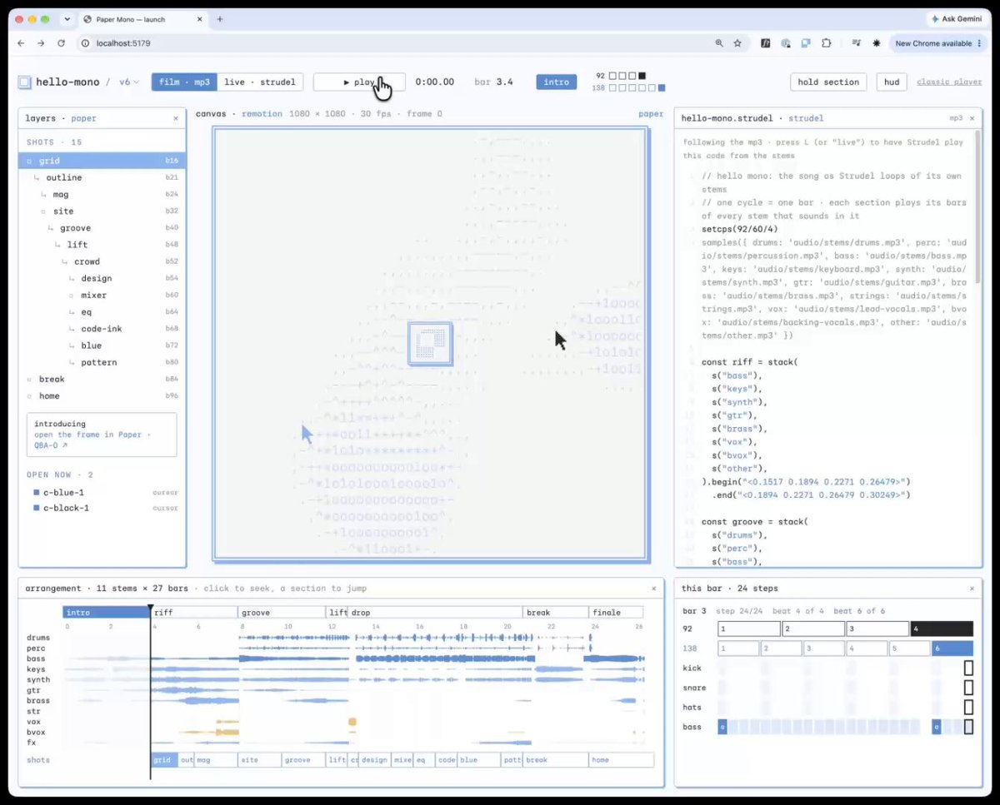
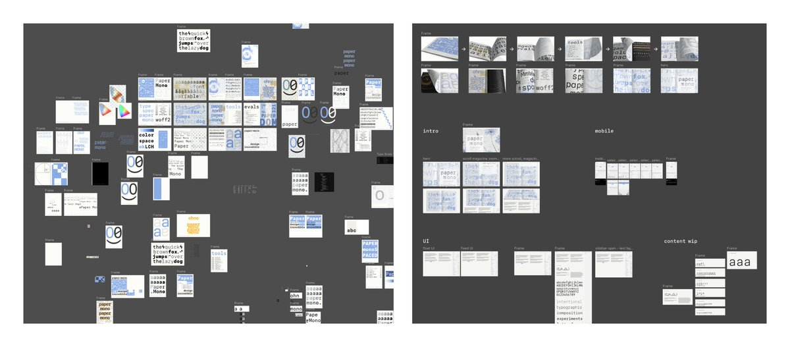
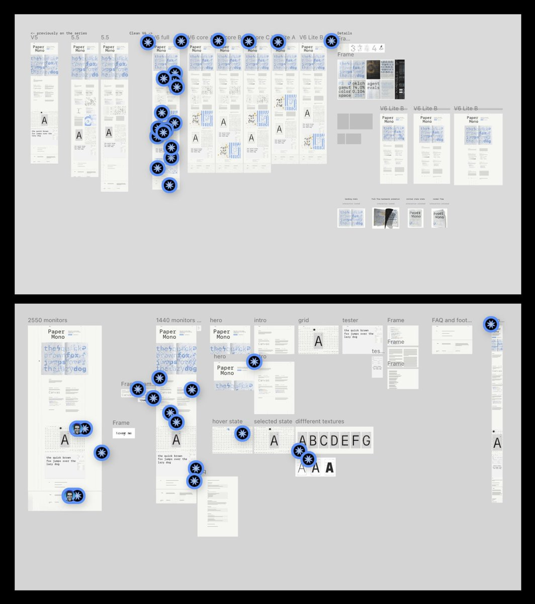
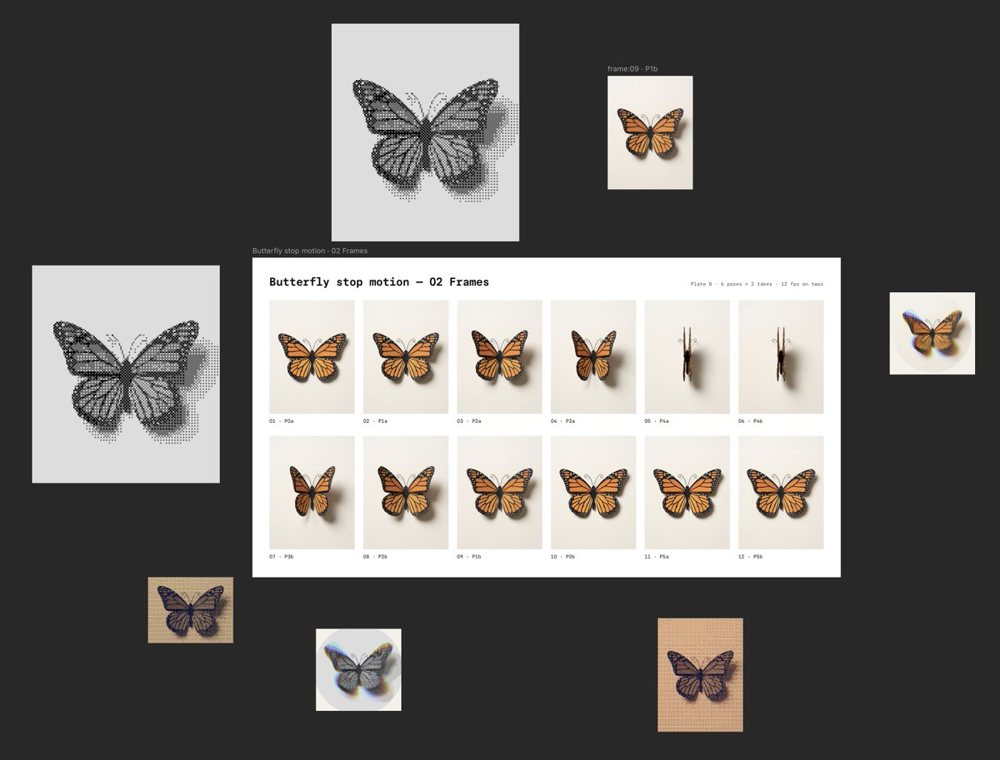
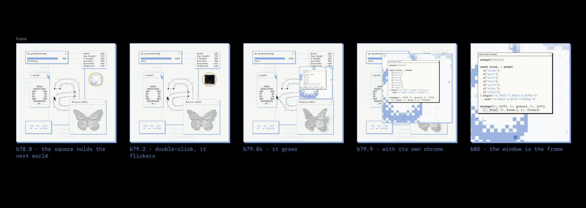
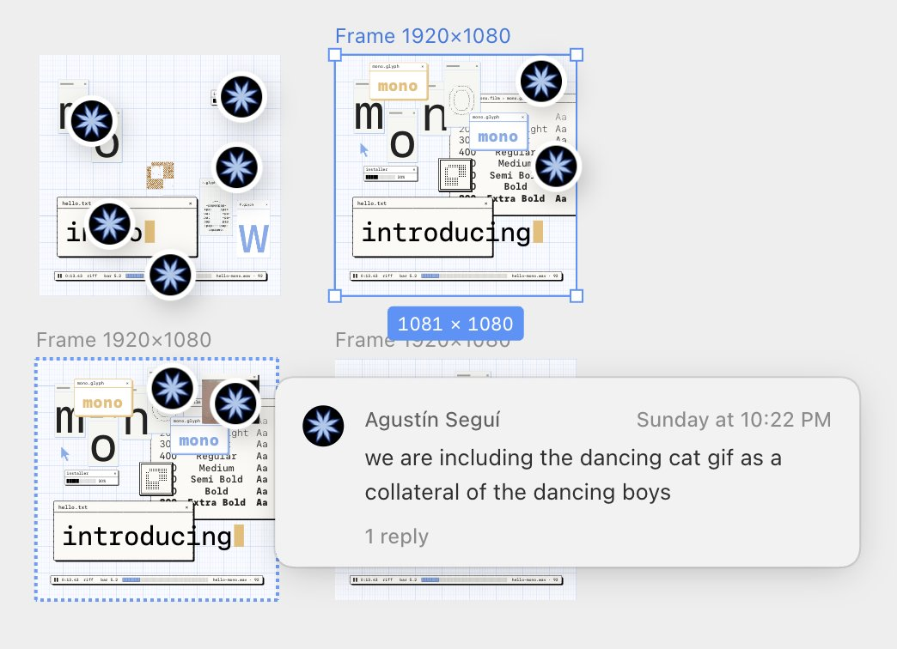
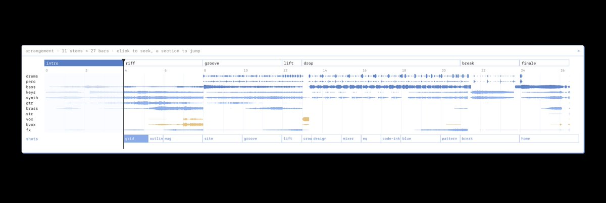
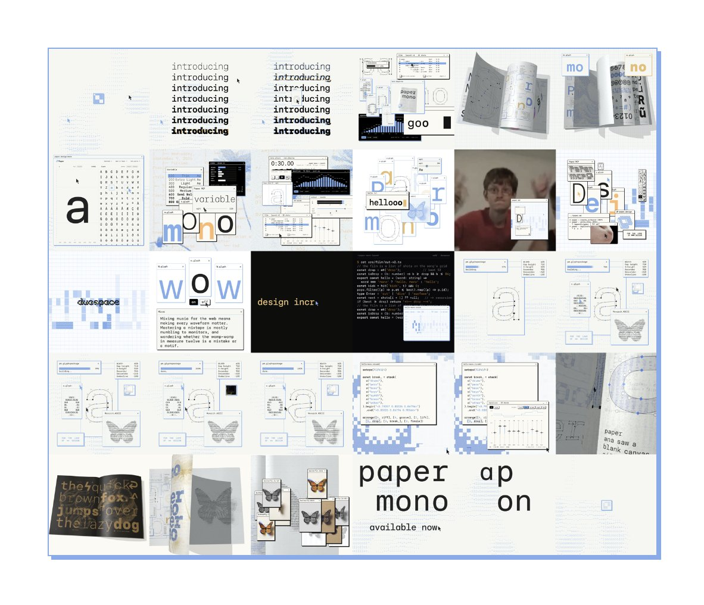

# want to see how the whole Paper Mono launch video was made?
> Source: https://x.com/agusegui/status/2108251509830140401
> Author: Agu Seguí (@agusegui)
> Posted: Thu Oct 08 17:41:44 +0000 2026
> Captured: 2026-10-15T09:02:28+00:00
> Stats at capture: 215,786 views · 2,740 likes · 126 replies · 191 reposts · 3,056 bookmarks · 125 quotes

## Post

want to see how the whole Paper Mono launch video was made?

everything is code but I didn't touch any of it 

here we go 🔥

## Media

[Post media 1](media/video-01.mp4) — Source media: https://video.twimg.com/amplify_video/2108229775743471616/vid/avc1/892x720/ZrVQHfdRuIHqDDqC.mp4?tag=29
 — Post media 1 thumbnail. Source media: https://pbs.twimg.com/amplify_video_thumb/2108229775743471616/img/2qKpd7QN2JLKamog.jpg
 — Reply 2108251516742070463 media 1. Source media: https://pbs.twimg.com/media/HUHylniXAAALlP0.jpg
 — Reply 2108251521636761792 media 1. Source media: https://pbs.twimg.com/media/HUHzV0DW4AAs1dX.jpg
 — Reply 2108251525927534897 media 1. Source media: https://pbs.twimg.com/media/HUH6cigWYAAWjBF.jpg
[Reply 2108251530990104735 media 1](media/video-02.mp4) — Source media: https://video.twimg.com/amplify_video/2108234243486715904/vid/avc1/1740x1080/iePkn8T9uqm4dhti.mp4?tag=29
[Reply 2108251534542672227 media 1](media/video-03.mp4) — Source media: https://video.twimg.com/amplify_video/2108248239669387264/vid/avc1/2570x2160/Y8pcfvTz-cyssVIm.mp4?tag=29
 — Reply 2108251541576831095 media 1. Source media: https://pbs.twimg.com/media/HUH06QkXwAA_cqM.jpg
 — Reply 2108251546723004631 media 1. Source media: https://pbs.twimg.com/media/HUH1fhiWYAAE9Oy.jpg
 — Reply 2108251551202447789 media 1. Source media: https://pbs.twimg.com/media/HUH1ySWXMAAEU71.jpg
 — Reply 2108251555128352916 media 1. Source media: https://pbs.twimg.com/media/HUIBJNoWcAA6EVJ.jpg
[Reply 2108251562111828229 media 1](media/video-04.mp4) — Source media: https://video.twimg.com/amplify_video/2108239485733416960/vid/avc1/2632x1924/EMLSuuHADpiXEV8j.mp4?tag=29
[Reply 2108252991413268955 media 1](media/animation-01.mp4) — Source media: https://video.twimg.com/tweet_video/HUIE665WEAAdzk3.mp4
[Reply 2108277323032395865 media 1](media/animation-02.mp4) — Source media: https://video.twimg.com/tweet_video/HUIbDAYW8AAVZcC.mp4
[Reply 2108259919682253160 media 1](media/animation-03.mp4) — Source media: https://video.twimg.com/tweet_video/HUILOPKXcAASxI4.mp4
[Reply 2108255653156274617 media 1](media/animation-04.mp4) — Source media: https://video.twimg.com/tweet_video/HUIHVpeXQAAIj7h.mp4
[Reply 2108267152444661874 media 1](media/animation-05.mp4) — Source media: https://video.twimg.com/tweet_video/HUIRzQvWEAAW-G0.mp4
[Reply 2108258697403347041 media 1](media/animation-06.mp4) — Source media: https://video.twimg.com/tweet_video/HUIKHE8XkAEquuK.mp4
[Reply 2108582316859674861 media 1](media/animation-07.mp4) — Source media: https://video.twimg.com/tweet_video/HUMwcGwWoAAJa9S.mp4
[Reply 2108651325919572379 media 1](media/animation-08.mp4) — Source media: https://video.twimg.com/tweet_video/HUNvMxPWoAAetyv.mp4
[Reply 2108256288689852902 media 1](media/animation-09.mp4) — Source media: https://video.twimg.com/tweet_video/HUIH6puW8AAJF62.mp4
[Reply 2108252719412596974 media 1](media/animation-10.mp4) — Source media: https://video.twimg.com/tweet_video/HUIEq2QX0AI1QlB.mp4
[Reply 2108254076471558613 media 1](media/animation-11.mp4) — Source media: https://video.twimg.com/tweet_video/HUIF5zHXQAAqmPK.mp4

## Thread

### Agu Seguí ([@agusegui](https://x.com/agusegui/status/2108251512652640750)) — 2026-10-08T17:41:44+00:00

the stack? just the web!

· motion is not AE, it's react with @Remotion in localhost
· the magazine is not Blender, it's @threejs by @uuuuuulala 
· the music? not a song, it's my draft on Strudel CC processed with @suno 
· the cool UI? no rectangles, it's Paper Mono box-drawing characters
· the workflow? a total mess, thankfully orchestrated with @paper 
· the assistant? @claudeai my boi

here's the story:
### Agu Seguí ([@agusegui](https://x.com/agusegui/status/2108251516742070463)) — 2026-10-08T17:41:45+00:00

my work for Paper Mono brand started on @paper months ago, so I didn't want to step away from the canvas where my whole visual world lives

I didn't want to export the hell out of this into raster stuff, nor reinvent the wheel in another tool

we are in the golden age of software malleability, so I thought: we're launching a monospace font that speaks "software" at its core

what if the launch film is just... software?
 — Source media: https://pbs.twimg.com/media/HUHylniXAAALlP0.jpg
### Agu Seguí ([@agusegui](https://x.com/agusegui/status/2108251521636761792)) — 2026-10-08T17:41:46+00:00

Paper was my fundamental design station: 
concepts, ideas, questions, prints, web design, and all kind of intents, was all delivered from here as it evolved day by day 

when it was time to take care of the launch video, the whole work was just waiting on the canvas for me to compile

and the seamless channel to translate everything was basically code
 — Source media: https://pbs.twimg.com/media/HUHzV0DW4AAs1dX.jpg
### Agu Seguí ([@agusegui](https://x.com/agusegui/status/2108251525927534897)) — 2026-10-08T17:41:47+00:00

even the stop-motion work was workshopped in Paper, using MCP image gen 🦋

thanks @douges for shipping this boi https://t.co/IPfWILU6s4
 — Source media: https://pbs.twimg.com/media/HUH6cigWYAAWjBF.jpg
### Agu Seguí ([@agusegui](https://x.com/agusegui/status/2108251530990104735)) — 2026-10-08T17:41:49+00:00

on soundtrack, my favorite part ❤️

the song is not a song, it's a mix of motifs inspired by the words "hello" or "mono", processed in code with Strudel cc, remixed through Suno and then brought back into stems into a Strudel compilation of loops 

(thanks to @eschadiol and DJ_Dave for being such a big inspiration for doing this)

I thought this would help sync the music and React components to one structure and BPM, so I could speak natural language and just say things like "get my 2 dudes dancing GIF in sync with the drop" and it did the damn job 😍

so what if each letter represented some notes in some key? the final result is far from the original drafts and melodies, but I find it poetic that the whole thing is a software collage inspired by a typeface

I also couldn't resist testing Paper Mono in Strudel, there was no better, more fun specimen for me
 — Source media: https://video.twimg.com/amplify_video/2108234243486715904/vid/avc1/1740x1080/iePkn8T9uqm4dhti.mp4?tag=29
### Agu Seguí ([@agusegui](https://x.com/agusegui/status/2108251534542672227)) — 2026-10-08T17:41:49+00:00

about the aesthetics

the last frontier to explore on this typeface was the addition of box-drawing characters by @guidoferreyra, a completely uncertain world for me as a designer

with monospaced fonts like Paper Mono you can create tables, boxes, buttons, bars and so many other artifacts that just inherit the nature and rhythm of the typesetting
 — Source media: https://video.twimg.com/amplify_video/2108248239669387264/vid/avc1/2570x2160/Y8pcfvTz-cyssVIm.mp4?tag=29
### Agu Seguí ([@agusegui](https://x.com/agusegui/status/2108251537080221879)) — 2026-10-08T17:41:50+00:00

it actually clicked for me when @robynxpark asked us if we were down to just create a fun menu for a founders' dinner with @designerfund - the outcome was great, everyone loved it and I thought, okay, I'm onto something...  

so this is another key aspect of this whole project: no matter how many agents I spawned for some processes, every feedback loop with humans and their raw emotions was the fundamental driver for me to keep it up and make decisions

https://t.co/wlJeb6BT2f
### Agu Seguí ([@agusegui](https://x.com/agusegui/status/2108251541576831095)) — 2026-10-08T17:41:51+00:00

back to the launch video

the thing is that I used Paper to organize intent, and for example, one of the key concepts was explaining to Claude how recursion would work visually

so nothing cuts in the video,  every world lives in a window of the world before it, and the storyboard to make sense of it lives in @paper
 — Source media: https://pbs.twimg.com/media/HUH06QkXwAA_cqM.jpg
### Agu Seguí ([@agusegui](https://x.com/agusegui/status/2108251546723004631)) — 2026-10-08T17:41:52+00:00

and every scene starts as design work in @paper 

the agent reads it through Paper's MCP and ports the exact values, scaled to the film's 1080 px - no screenshots

reviews are comments pinned on Paper frames; the agent lists the threads, reads where each one is pinned, makes the change and answers with a render

pretty neat
 — Source media: https://pbs.twimg.com/media/HUH1fhiWYAAE9Oy.jpg
### Agu Seguí ([@agusegui](https://x.com/agusegui/status/2108251551202447789)) — 2026-10-08T17:41:53+00:00

and everything is wired up man 🤩

each section owns its beats so five agents can rebuild five sections at once, handing off by id https://t.co/K0oqcZQybd
 — Source media: https://pbs.twimg.com/media/HUH1ySWXMAAEU71.jpg
### Agu Seguí ([@agusegui](https://x.com/agusegui/status/2108251555128352916)) — 2026-10-08T17:41:54+00:00

I can also ask for changes at a specific beat or section, or I can lay out the current frames in Paper and zoom out to think about it again

versions are forks, and every change is checked - old cuts are never edited and Claude looks at its own frames before I do https://t.co/zN1OnIOEsP
 — Source media: https://pbs.twimg.com/media/HUIBJNoWcAA6EVJ.jpg
### Agu Seguí ([@agusegui](https://x.com/agusegui/status/2108251558051770652)) — 2026-10-08T17:41:55+00:00

so, this is such a beautiful phenomenon of intent orchestrated with agents

the film became a meta conversation, a love letter to software, written in a monospaced rhythm

so glad you liked it ❤️
https://t.co/RTsgRIfh3r
### Agu Seguí ([@agusegui](https://x.com/agusegui/status/2108251562111828229)) — 2026-10-08T17:41:56+00:00

btw, huge props to @uuuuuulala, who brought my forever graphic design dream into a 3D world, along with a bunch of neat creative code artifacts that we used not just for the web but also brought back into the visual design of the type specimen

plus, Ksenia's shaders played a huge part in this project, since I used them heavily as image filters and post-processors, and they became a heavy influence on my design practice
 — Source media: https://video.twimg.com/amplify_video/2108239485733416960/vid/avc1/2632x1924/EMLSuuHADpiXEV8j.mp4?tag=29
### Agu Seguí ([@agusegui](https://x.com/agusegui/status/2108251564729085997)) — 2026-10-08T17:41:57+00:00

I'm also pumped and happy to have had the opportunity to work alongside @alex_krasikau to put the cherry on top of all the code artifacts needed to make the website real, and the code performant enough for me to even bring it into the launch film

this story ended up bringing him to the @paper team, so this is just getting started guys

https://t.co/bIPAWAuAE9
### Agu Seguí ([@agusegui](https://x.com/agusegui/status/2108251567744790976)) — 2026-10-08T17:41:57+00:00

finally, thanks to @vladmoroz, @stephenhaney, and the whole Paper team for trusting me with their heart and soul, for letting me lead this across the finish line, for supporting me through the difficult times, and for always pushing harder and harder to make this experience feel on the verge of being incredible 🔥 

so who wants the full song? 
should we release Paper Records?

always for the love of design - go visit https://t.co/UW33ONyPqJ
### Agu Seguí ([@agusegui](https://x.com/agusegui/status/2108252991413268955)) — 2026-10-08T17:47:37+00:00

@hugosaintemarie https://t.co/0motfxfpnd
 — Source media: https://video.twimg.com/tweet_video/HUIE665WEAAdzk3.mp4
### Agu Seguí ([@agusegui](https://x.com/agusegui/status/2108365750679347707)) — 2026-10-09T01:15:41+00:00

@jackbutcher oh man oh man, do you know how crazy it is to get support from you? you don’t even know how influential you were to my career, love and respect, my man, thank you
### Agu Seguí ([@agusegui](https://x.com/agusegui/status/2108277323032395865)) — 2026-10-08T19:24:18+00:00

@stephenhaney https://t.co/naZCwEV72B
 — Source media: https://video.twimg.com/tweet_video/HUIbDAYW8AAVZcC.mp4
### Agu Seguí ([@agusegui](https://x.com/agusegui/status/2108259919682253160)) — 2026-10-08T18:15:09+00:00

@mds @hugosaintemarie https://t.co/9YLP1aVICA
 — Source media: https://video.twimg.com/tweet_video/HUILOPKXcAASxI4.mp4
### Agu Seguí ([@agusegui](https://x.com/agusegui/status/2108255653156274617)) — 2026-10-08T17:58:11+00:00

@ggsimm me and my agentic stack shipping cool shit https://t.co/RRCqFyQVbz
 — Source media: https://video.twimg.com/tweet_video/HUIHVpeXQAAIj7h.mp4
### Agu Seguí ([@agusegui](https://x.com/agusegui/status/2108267152444661874)) — 2026-10-08T18:43:53+00:00

@evilrabbit_ https://t.co/fLsiZ70e42
 — Source media: https://video.twimg.com/tweet_video/HUIRzQvWEAAW-G0.mp4
### Agu Seguí ([@agusegui](https://x.com/agusegui/status/2108258697403347041)) — 2026-10-08T18:10:17+00:00

@ragojose https://t.co/1OV7SmsO6P
 — Source media: https://video.twimg.com/tweet_video/HUIKHE8XkAEquuK.mp4
### Agu Seguí ([@agusegui](https://x.com/agusegui/status/2108300458515374135)) — 2026-10-08T20:56:14+00:00

@victormustar i know right??
### Agu Seguí ([@agusegui](https://x.com/agusegui/status/2108370282595377182)) — 2026-10-09T01:33:41+00:00

@Riyvir riiight? wild times man
### Agu Seguí ([@agusegui](https://x.com/agusegui/status/2108651325919572379)) — 2026-10-09T20:10:27+00:00

@jnrkay_x https://t.co/qAEy1Kf20H
 — Source media: https://video.twimg.com/tweet_video/HUNvMxPWoAAetyv.mp4
### Agu Seguí ([@agusegui](https://x.com/agusegui/status/2108256288689852902)) — 2026-10-08T18:00:43+00:00

@arthurhilhorst @hugosaintemarie https://t.co/CEmUMzetO8
 — Source media: https://video.twimg.com/tweet_video/HUIH6puW8AAJF62.mp4
### Agu Seguí ([@agusegui](https://x.com/agusegui/status/2108252719412596974)) — 2026-10-08T17:46:32+00:00

@marchantweb https://t.co/6SsGhUgm7z
 — Source media: https://video.twimg.com/tweet_video/HUIEq2QX0AI1QlB.mp4
### Agu Seguí ([@agusegui](https://x.com/agusegui/status/2108650966233104607)) — 2026-10-09T20:09:01+00:00

@cpenned Thank you Chris ❤️❤️❤️
### Agu Seguí ([@agusegui](https://x.com/agusegui/status/2108254076471558613)) — 2026-10-08T17:51:55+00:00

@oliverhamrin and a live perf on the Paper conf hell yeah!! https://t.co/SpuNlBH7O4
 — Source media: https://video.twimg.com/tweet_video/HUIF5zHXQAAqmPK.mp4
### Agu Seguí ([@agusegui](https://x.com/agusegui/status/2108651050508964298)) — 2026-10-09T20:09:21+00:00

@robynxpark 🫶✨🦋
### Agu Seguí ([@agusegui](https://x.com/agusegui/status/2108371310795501756)) — 2026-10-09T01:37:46+00:00

heya! thank you

I don't do motion too often tbh, I got some skills in AE but not crazy, but then did lot of video prod on Davinci and been using Jitter for quick things. Want to try @KMkota0 's tool too asap, and I'd love to get better ay Rive - but there's something about owning the workflow and code artifacts.. I didn't hear about HyperFrames, I'd be down to try if it's the same idea as Remotion

## Comments

### Hugo ([@hugosaintemarie](https://x.com/hugosaintemarie/status/2108252406199050384)) — 2026-10-08T17:45:17+00:00

@agusegui imagine seeing this like 2 years ago
### @jackbutcher ([@jackbutcher](https://x.com/jackbutcher/status/2108363648586400162)) — 2026-10-09T01:07:19+00:00

@agusegui absurdly good
### Stephen Haney ([@stephenhaney](https://x.com/stephenhaney/status/2108260775806877928)) — 2026-10-08T18:18:33+00:00

@agusegui Absolutely next level Agu! You are showing us all the way
### MDS ([@mds](https://x.com/mds/status/2108255948527530493)) — 2026-10-08T17:59:22+00:00

@agusegui @hugosaintemarie 🤯
### gsimone ([@ggsimm](https://x.com/ggsimm/status/2108255040884404696)) — 2026-10-08T17:55:45+00:00

@agusegui I'm gonna cry, this is so good ffs
### Evil Rabbit ([@evilrabbit_](https://x.com/evilrabbit_/status/2108265635864355167)) — 2026-10-08T18:37:51+00:00

@agusegui so good Agu
### Jose ([@ragojose](https://x.com/ragojose/status/2108257564614152211)) — 2026-10-08T18:05:47+00:00

@agusegui amazing work brother!
### Victor M ([@victormustar](https://x.com/victormustar/status/2108295750366957829)) — 2026-10-08T20:37:31+00:00

@agusegui the music goes haaard
### River Marchand ([@Riyvir](https://x.com/Riyvir/status/2108347964217495760)) — 2026-10-09T00:05:00+00:00

@agusegui Amazing work! Isn't is so fun building systems like this?!
### turdemoji.lol ([@jnrkay_x](https://x.com/jnrkay_x/status/2108582316859674861)) — 2026-10-09T15:36:14+00:00

@agusegui https://t.co/mvaWUaCeLl
 — Source media: https://video.twimg.com/tweet_video/HUMwcGwWoAAJa9S.mp4
### Arthur Hilhorst ([@arthurhilhorst](https://x.com/arthurhilhorst/status/2108256016605630884)) — 2026-10-08T17:59:38+00:00

@agusegui @hugosaintemarie Masterclass 😮‍💨
### Simon Le Marchant ([@marchantweb](https://x.com/marchantweb/status/2108252172387537047)) — 2026-10-08T17:44:21+00:00

@agusegui The video itself was impressive. The behind the scenes goes WAY beyond that 🔥
### Chris Pennington ([@cpenned](https://x.com/cpenned/status/2108415616944374194)) — 2026-10-09T04:33:50+00:00

@agusegui Wow. Incredible work. 

We’re in a tool building revolution.
### Oliver ([@oliverhamrin](https://x.com/oliverhamrin/status/2108253315079524846)) — 2026-10-08T17:48:54+00:00

@agusegui Crazy. I need this song on Spotify!
### robyn park ([@robynxpark](https://x.com/robynxpark/status/2108279582080295302)) — 2026-10-08T19:33:16+00:00

@agusegui your mind agu!!!
### Kevin ⨀ ([@kvncnls](https://x.com/kvncnls/status/2108290058885398852)) — 2026-10-08T20:14:54+00:00

@agusegui This is awesome! Curious what other motion tools you’ve tried versus Remotion. Have you tried out HyperFrames by any chance?

## Other returned timeline records

> The CLI did not expose reply relationships. These records do not start with a reply mention and were authored by someone other than the saved-post author. They may include recommendations or promoted posts; they are retained as source context, not verified replies.

### Starlink ([@Starlink](https://x.com/Starlink/status/2068115197718593741)) — 2026-06-19T23:34:21+00:00

Get connected with fast, reliable internet for streaming, video calls, online gaming and more.

Order online in minutes.
### Starlink ([@Starlink](https://x.com/Starlink/status/2092706810285490310)) — 2026-08-26T20:12:38+00:00

Starlink offers fast, reliable internet in the most rural and remote locations. Portable and easy to set up, Starlink Mini works wherever you are.

Order online in minutes.
