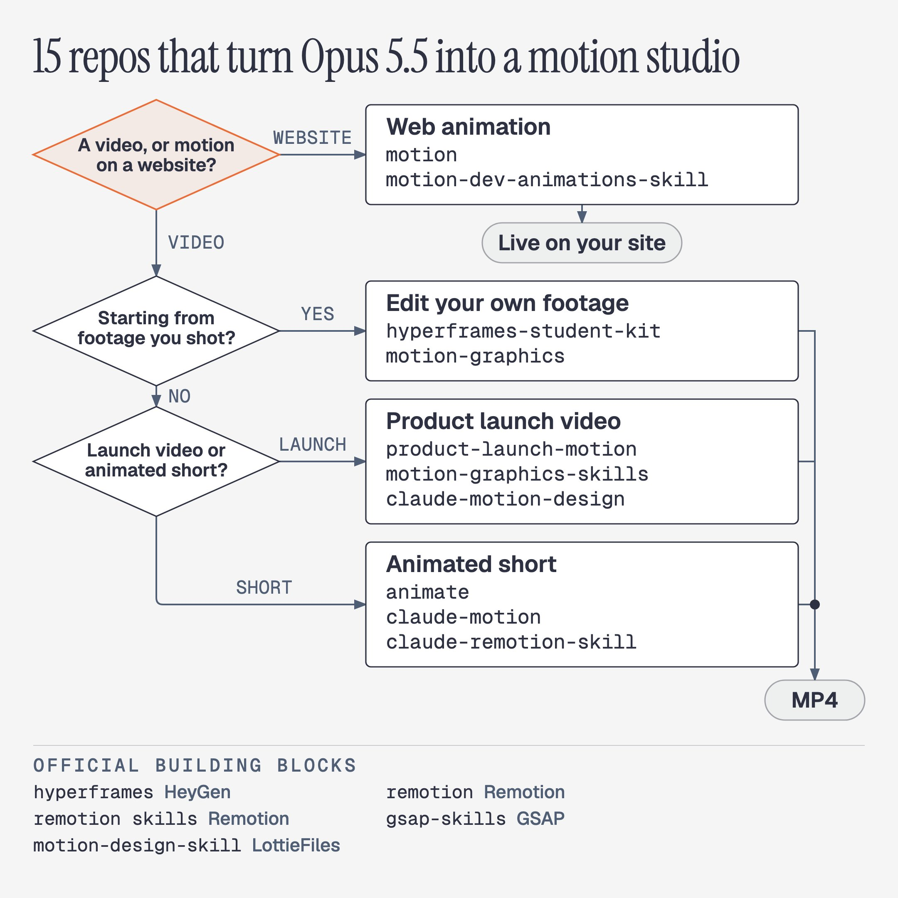

# These 15 GitHub repos turn your Opus 5.5 into 𝗮𝗻 𝗲𝗻𝘁𝗶𝗿𝗲 𝗺𝗼𝘁𝗶𝗼𝗻 𝘀𝘁𝘂𝗱𝗶𝗼.
> Source: https://x.com/Voxyz_ai/status/2108905392776360333
> Author: Vox (@Voxyz_ai)
> Posted: 2026-10-10T13:00:01+00:00
> Captured: 2026-10-15T09:02:28+00:00
> Stats at capture: 123,986 views · 488 likes · 18 replies · 43 reposts · 1,368 bookmarks · 9 quotes

## Post

These 15 GitHub repos turn your Opus 5.5 into 𝗮𝗻 𝗲𝗻𝘁𝗶𝗿𝗲 𝗺𝗼𝘁𝗶𝗼𝗻 𝘀𝘁𝘂𝗱𝗶𝗼.

Even the teams behind HeyGen, Remotion, GSAP and LottieFiles have stepped in to 𝘁𝗲𝗮𝗰𝗵 𝗔𝗜 𝗺𝗼𝘁𝗶𝗼𝗻 𝗱𝗲𝘀𝗶𝗴𝗻 𝘁𝗵𝗲𝗺𝘀𝗲𝗹𝘃𝗲𝘀.

I picked them from official and community repos and sorted them by use. Install them and you can make launch videos, edit your own footage and create animated shorts:

Product launch videos
→ product-launch-motion: hand it your product and it writes the script, adds a voice-over, moves the camera and grades the color, all the way to a finished launch video
http://github.com/AbubakrChan/product-launch-motion
→ motion-graphics-skills: 13 skills for launch videos, animated charts and short videos. The author suggests switching to Opus 5.5 first
http://github.com/charlie947/motion-graphics-skills
→ claude-motion-design: picture and sound land on the beat of the music. The author made their own launch video with it on Opus 5.5 in 5 rounds
http://github.com/howseen-ai/claude-motion-design

Edit your own footage
→ hyperframes-student-kit: hand it your footage and it cuts the pauses and flubs, tightens the story, then adds motion graphics
http://github.com/nateherkai/hyperframes-student-kit
→ motion-graphics: wherever you're talking, it drops in an animation right there. It can also cut a person out of the background
http://github.com/Barty-Bart/motion-graphics

Animated shorts
→ animate: short explainers in 7 styles, like cut paper, riso print and pixel art, and it shows you the storyboard before it starts
http://github.com/cth9191/animate
→ claude-motion: teaches AI taste, has it look back over its own frames to catch problems, and lets it make its own sound effects
http://github.com/whaleyxbt/claude-motion
→ claude-remotion-skill: AI-made videos tend to move stiffly. This one fixes that
http://github.com/haidrrrry/claude-remotion-skill

Web animation
→ motion: makes the buttons, cards and page transitions on your site move
http://github.com/motiondivision/motion
→ motion-dev-animations-skill: one sentence and Claude Code adds animation to your site
http://github.com/199-biotechnologies/motion-dev-animations-skill

Official
→ hyperframes: open-sourced by HeyGen and built for AI. AI writes a web page, and it turns the page into a video
http://github.com/heygen-com/hyperframes
→ remotion: Remotion itself, now built around letting your AI turn an idea straight into a video
http://github.com/remotion-dev/remotion
→ remotion skills: Remotion's official manual for AI
http://github.com/remotion-dev/skills
→ gsap-skills: the official skill for GSAP, the long-running animation library the launch-video and editing kits above both rely on
http://github.com/greensock/gsap-skills
→ motion-design-skill: LottieFiles adapted Disney's animation principles for AI: how fast things move and what moves first. It works with any tool
http://github.com/LottieFiles/motion-design-skill

Save this and come back when you need to make a video.

## Media

 — Post media 1. Source media: https://pbs.twimg.com/media/HUNFp4ObgAAUR7k.jpg?name=orig

## Thread

### Vox ([@Voxyz_ai](https://x.com/Voxyz_ai/status/2108913108987367641)) — 2026-10-10T13:30:41+00:00

@kepochnik ❤️

## Comments

### kepo ([@kepochnik](https://x.com/kepochnik/status/2108907532614050093)) — 2026-10-10T13:08:32+00:00

@Voxyz_ai these repos should be useful for me Vox

thanks for the sharing brother
### theoracles.studio ([@oracles_studio](https://x.com/oracles_studio/status/2110038026554589377)) — 2026-10-13T16:00:42+00:00

@Voxyz_ai So I basically just asked Claude to review all the repos, campare it to my existing skill, and add in what I wanted or it thought was an improvement. This feels very simple, am I missing something? Now my skill has integrated what I wanted from these repos.
### Jimmy Collins ([@Jimmycollins101](https://x.com/Jimmycollins101/status/2109039943788179909)) — 2026-10-10T21:54:41+00:00

@Voxyz_ai Do you need access to motion first?  I do not have it yet.
### Sabba Keynejad ([@sab8a](https://x.com/sab8a/status/2109228303307751609)) — 2026-10-11T10:23:09+00:00

@Voxyz_ai You missed open edit.
### thomas_R ([@thomas_rehmer](https://x.com/thomas_rehmer/status/2109245310190887216)) — 2026-10-11T11:30:44+00:00

@Voxyz_ai My motion method is derived from claude-motion-design, and its critic prompts and Gauntlet loop come from echris6/motion-video-kit.
### Harry Tandy ([@HarryTandy](https://x.com/HarryTandy/status/2109219609085616242)) — 2026-10-11T09:48:36+00:00

@Voxyz_ai motion design is becoming accessible to people without animation skills
### BreezeOg ([@BreezeOg1](https://x.com/BreezeOg1/status/2108964592584126907)) — 2026-10-10T16:55:16+00:00

@Voxyz_ai saving this, the launch video ones look so useful
### Wallchain Community Hub ([@quack_research](https://x.com/quack_research/status/2109195215340736570)) — 2026-10-11T08:11:40+00:00

@Voxyz_ai Consistently making it look intentional rather than AI-generated is the harder problem
### lostinazeroy ([@lostinazeroy](https://x.com/lostinazeroy/status/2108931920608248140)) — 2026-10-10T14:45:26+00:00

@Voxyz_ai the trick with ai motion is letting the model write the timeline, not the pixels. render it frame by frame and it stays deterministic
### Wayne L. ([@wayne_liang_](https://x.com/wayne_liang_/status/2108957927264370880)) — 2026-10-10T16:28:47+00:00

@Voxyz_ai which of these actually survives past the first demo clip? heygen being in the teaching set is the part that stuck
### Jorge Suarez Basañez ([@jorgefsb](https://x.com/jorgefsb/status/2109176611069387257)) — 2026-10-11T06:57:45+00:00

@Voxyz_ai @bot esto funciona para nuestro content engine o content factory no? dentro de papacito os a quien mas le serviria algo asi?
### Mirza ([@b1rkh0ff](https://x.com/b1rkh0ff/status/2109264603548962948)) — 2026-10-11T12:47:24+00:00

@Voxyz_ai Nice list, bookmark for later 👍
### Jwu.eth Ø ([@Ycjustinwu](https://x.com/Ycjustinwu/status/2108916480926793750)) — 2026-10-10T13:44:05+00:00

@Voxyz_ai @bot read through all of it and Give suggestions to motion html bot
### Osc🔺r ([@OscarLai](https://x.com/OscarLai/status/2109478598294049065)) — 2026-10-12T02:57:44+00:00

@Voxyz_ai thanks for sharing
### Fayez Khan ([@FayezKh70409159](https://x.com/FayezKh70409159/status/2109951566690365942)) — 2026-10-13T10:17:09+00:00

@Voxyz_ai 🆒

## Other returned timeline records

> The CLI did not expose reply relationships. These records do not start with a reply mention and were authored by someone other than the saved-post author. They may include recommendations or promoted posts; they are retained as source context, not verified replies.

### Starlink ([@Starlink](https://x.com/Starlink/status/2098108930002211077)) — 2026-09-10T17:58:44+00:00

Starlink offers fast, reliable internet in the most rural and remote locations. Portable and easy to set up, Starlink works wherever you are.

Order online in minutes.
### Starlink ([@Starlink](https://x.com/Starlink/status/2068115197718593741)) — 2026-06-19T23:34:21+00:00

Get connected with fast, reliable internet for streaming, video calls, online gaming and more.

Order online in minutes.

## Links

- http://github.com/AbubakrChan/product-launch-motion
- http://github.com/charlie947/motion-graphics-skills
- http://github.com/howseen-ai/claude-motion-design
- http://github.com/nateherkai/hyperframes-student-kit
- http://github.com/Barty-Bart/motion-graphics
- http://github.com/cth9191/animate
- http://github.com/whaleyxbt/claude-motion
- http://github.com/haidrrrry/claude-remotion-skill
- http://github.com/motiondivision/motion
- http://github.com/199-biotechnologies/motion-dev-animations-skill
- http://github.com/heygen-com/hyperframes
- http://github.com/remotion-dev/remotion
- http://github.com/remotion-dev/skills
- http://github.com/greensock/gsap-skills
- http://github.com/LottieFiles/motion-design-skill
