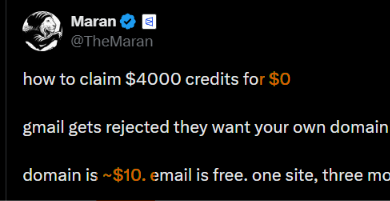

# how to claim $4000 credits for $0
> Source: https://x.com/TheMaran/status/2108926274916012057
> Author: Maran (@TheMaran)
> Posted: 2026-10-10T14:23:00+00:00
> Captured: 2026-10-15T09:02:28+00:00
> Stats at capture: 127,316 views · 1,529 likes · 47 replies · 132 reposts · 4,010 bookmarks · 4 quotes

## Post

how to claim $4000 credits for $0

gmail gets rejected they want your own domain and matching work email

domain is ~$10. email is free. one site, three more applications

> buy the domain + get the email

- grab a .com on cloudflare domains (~$10)
- turn on whois privacy
- set up free email (zoho free works)
- add mx/spf/dkim
- create you@yourdomain.com
- make a simple 1 page site that loads and explains what you actually build

> google cloud start tier = $2,000

> go to: https://cloud.google.com/startup/pre-funded

- founded in last 24 months
- working mvp + clear business model
- planning to seek vc
- website domain, email domain, and billing account email must all match
- have your 18 character billing account id ready
- 12 months. a few business days (longer if manual)

> aws activate founders = $1,000 (select up to $5k)

> go to: https://aws.amazon.com/startups/credits

- self funded, pre series b, founded last 10 years
- make a builder id with your professional email
- link an aws account on the paid plan (free tier doesn’t qualify)
- they ask about product, funding stage, company profile
- 5 - 10 business days

> deepgram = $1,000 starter (up to $100k possible)

> go to: https://deepgram.com/startup-program

- live or launching within 6 months
- make a deepgram account first
- keep your project id handy
- ~1 week review, then 24 - 48 hrs to land
- 12 months

> extra ones worth stacking

- azure self serve: $1k now + $4k after business verification (new azure account)
- cloudflare for startups: bootstrapped tier still exists (~$5–10k range)
- oracle for startups: $500 + 70% off for 2 years
- claude for startups: open to bootstrapped, but the free team + $1k credits are currently over capacity

> things you need to know

- 2k + 1k + 1k = $4k base. azure can push it higher
- google is discretionary. no agencies, consultancies, personal blogs, crypto mining, or token projects against local rules
- aws: count on the $1k. the extra up to $5k is select only
- credits expire. google + deepgram are 12 months. aws dates show in billing

> what not to do

- don’t apply from gmail or free email
- don’t fake a company or park a domain with no site
- don’t apply as an agency, dev shop, or consultancy
- apply != approved. these are for real products, build real products

one domain. matching work email. working site. stack the rest

bookmark this. terms change often. read each page before you apply. good luck.

## Media

 — Reply 2109013685360525588 media 1. Source media: https://pbs.twimg.com/media/HUS4xLCaYAAxQYR.jpg
 — Reply 2109008301086408859 media 1. Source media: https://pbs.twimg.com/media/HUSz3LmXgAAUl5x.png

## Thread

### Maran ([@TheMaran](https://x.com/TheMaran/status/2109013685360525588)) — 2026-10-10T20:10:20+00:00

I was not intended to post for $0

the first line was something like this

how to get $4k worth credits with a $10 domain https://t.co/BMUAhDdl1N
 — Source media: https://pbs.twimg.com/media/HUS4xLCaYAAxQYR.jpg
### Maran ([@TheMaran](https://x.com/TheMaran/status/2108949582004826393)) — 2026-10-10T15:55:37+00:00

@Nouhouddeen my pleasure sir

## Comments

### The Romantic💐| Web3 Nigeria 💰🇳🇬 ([@Nouhouddeen](https://x.com/Nouhouddeen/status/2108927222094479542)) — 2026-10-10T14:26:46+00:00

@TheMaran Thank you for sharing this with us
### Haki ([@hakiiizimana](https://x.com/hakiiizimana/status/2108951440479953052)) — 2026-10-10T16:03:00+00:00

@TheMaran kinda outdated @DeepgramAI paused for a while now !
### Meenu ([@I_M33NU](https://x.com/I_M33NU/status/2108985506516369797)) — 2026-10-10T18:18:22+00:00

@TheMaran .com domain is just 3$
### Cobi Marcheline ([@hosicix](https://x.com/hosicix/status/2109035733436731661)) — 2026-10-10T21:37:57+00:00

@TheMaran Google are a huge pain in the ass with money, just for an example, there free cloud tier is 23 dollars.
### Satya ([@satya5614](https://x.com/satya5614/status/2109523105093984627)) — 2026-10-12T05:54:35+00:00

@TheMaran @TheMaran why is it important to turn on whois privacy in this process?
### Gravity ([@gravityfast_](https://x.com/gravityfast_/status/2108954501239750856)) — 2026-10-10T16:15:10+00:00

@TheMaran another post promoting spammy applications
### De Luca ([@delucakeeper](https://x.com/delucakeeper/status/2109141063034449930)) — 2026-10-11T04:36:30+00:00

@TheMaran cloudflare domains at $10 vs namecheap at $8.88, either works but CF has better email routing built in
### Juancho ([@juanchosaravia](https://x.com/juanchosaravia/status/2109010282928394608)) — 2026-10-10T19:56:49+00:00

@TheMaran You can get more on AWS if you apply with a bank. With Mercury you get 5K instead of 1K
### Shawn Hyde ([@ShawnHyde](https://x.com/ShawnHyde/status/2109104732878807119)) — 2026-10-11T02:12:08+00:00

@TheMaran Everything google has been trash since the pandemic. Would let my business touch them with a 10ft pole.
### lume.hl ([@LumeBTC](https://x.com/LumeBTC/status/2108955046105039292)) — 2026-10-10T16:17:20+00:00

@TheMaran Clean blueprint for stacking early infra credits
### Max Kupriianov ([@its_xlab](https://x.com/its_xlab/status/2109250113864601941)) — 2026-10-11T11:49:49+00:00

@TheMaran Good advice but Azure not worth it, they have extremely limited goods available for that "free credit". Last time I got it for fun and I was struggling to do anything rather than order a tiny box for couple of months.

That tiny box cost x20 than normal VPS
### Nickolai ([@NicholasXVIX](https://x.com/NicholasXVIX/status/2109037974658723870)) — 2026-10-10T21:46:51+00:00

@TheMaran This sucks. Don’t do this, this is some low trust society shit. There’s no need to exploit every system you can.
Leave the nice shit where it is so that people who need it can build nice things and move society forward.
### Aanya Bose ([@AanyaBose_](https://x.com/AanyaBose_/status/2108996325274775963)) — 2026-10-10T19:01:21+00:00

@TheMaran Which ones works as of now ??
### Hivex · domains for AI ([@hivexsi](https://x.com/hivexsi/status/2109066515551223895)) — 2026-10-10T23:40:16+00:00

@TheMaran Heads-up for anyone doing this: Verisign raises the .com registry fee from $10.26 to $10.97 on Nov 1. Cloudflare sells at cost, so the ~$10 becomes ~$11 next month, and every renewal after that too.
### Lucyy Sky🐣 ([@luucyveilx](https://x.com/luucyveilx/status/2109164237482582356)) — 2026-10-11T06:08:35+00:00

@TheMaran the way everyone in the comments is arguing about spammy applications but the real scam is paying $10 for a domain and still getting rejected because your "mvp" is a landing page with a stock photo
### GetAskAI - Free Ask AI ([@getaskaicom](https://x.com/getaskaicom/status/2109014298349699496)) — 2026-10-10T20:12:46+00:00

@TheMaran ovhcloud has a startup program too if you want one more for the stack. signup didnt ask for a card but next day they emailed saying add a payment method and set the account to company type to improve your chances. decision within 7 days
### Prakash dole ([@doleprakash0](https://x.com/doleprakash0/status/2109111438690447664)) — 2026-10-11T02:38:47+00:00

@TheMaran You piece of shit, don't do this. These are the credits for the people who are actually doing something unlike you who just want to exploit everything which you find for free
### Fizz ([@FizzHasif](https://x.com/FizzHasif/status/2109118181608767959)) — 2026-10-11T03:05:34+00:00

@TheMaran Azure offer has changed. You need VC backed partner code to even get to 5k.
### Lunar ([@0xlunarhash](https://x.com/0xlunarhash/status/2109212657903677628)) — 2026-10-11T09:20:59+00:00

@TheMaran Small questions are this credits limited by time like sign up bonus on cloud 300$ for 1 month ?
### Rachel ([@raiychuu](https://x.com/raiychuu/status/2108968177057083480)) — 2026-10-10T17:09:30+00:00

@TheMaran @Grok which of these actually work
### doanbactam ([@m0nle0z](https://x.com/m0nle0z/status/2108966819591782678)) — 2026-10-10T17:04:07+00:00

@TheMaran https://t.co/4uc4QNGzKx yeah
### Brjan | AI Builder ([@MrBrjan](https://x.com/MrBrjan/status/2109135687085899845)) — 2026-10-11T04:15:08+00:00

@TheMaran what's the best email provider for setting up that matching work email?
### WAGMİ 100x💎 ([@gemsnper](https://x.com/gemsnper/status/2109031130221395978)) — 2026-10-10T21:19:40+00:00

@TheMaran cloudflare email routing is free — forward that custom domain straight to gmail and you skip workspace fees entirely

stack the same domain across aws/azure/gcp startup programs and you're looking at closer to $10k+ in credits, not $4k.
### Chia ([@tchchia](https://x.com/tchchia/status/2109012806527778882)) — 2026-10-10T20:06:51+00:00

@TheMaran @bot pls Analyse this one
### kshabana ([@realkshabana](https://x.com/realkshabana/status/2109011115183387116)) — 2026-10-10T20:00:08+00:00

@TheMaran @grok how can i do that
### HADDAD Michel ([@HADDADMichel3](https://x.com/HADDADMichel3/status/2109232869302481208)) — 2026-10-11T10:41:18+00:00

@TheMaran the $10 gateway to $4000 in credits is genuinely wild arbitrage
### Mohammad ([@1Tawallbeh](https://x.com/1Tawallbeh/status/2109075835965853930)) — 2026-10-11T00:17:18+00:00

@TheMaran thx maran
### Sholaeko.base.eth ([@sholaekodgt_](https://x.com/sholaekodgt_/status/2108950281593495927)) — 2026-10-10T15:58:24+00:00

@TheMaran you called this $0? lol.
### Leon Lin ([@LexnLin](https://x.com/LexnLin/status/2109008301086408859)) — 2026-10-10T19:48:57+00:00

@TheMaran pretty funny lmao https://t.co/lWDWU5W97W
 — Source media: https://pbs.twimg.com/media/HUSz3LmXgAAUl5x.png
### Jack ([@JacksAISites](https://x.com/JacksAISites/status/2109165453096476843)) — 2026-10-11T06:13:25+00:00

@TheMaran 自家域名过得飞快吧
### TheLazyIndianTechie 🕹️ ([@LzyIndTky](https://x.com/LzyIndTky/status/2109185691293000047)) — 2026-10-11T07:33:50+00:00

@TheMaran Just need Cloudflare worker email for incoming routing to your gmail. Don't even need Zoho.
### Ed Zuleger ([@EdZuleger](https://x.com/EdZuleger/status/2109005446178857023)) — 2026-10-10T19:37:36+00:00

@TheMaran @bot
### Kunda Anoma Gnoma ([@Kunda634724](https://x.com/Kunda634724/status/2109079870752133570)) — 2026-10-11T00:33:20+00:00

@TheMaran @grok can I withdraw this 4k$
### MEHN 🤖🪐🐂🀄️ ([@cryptomehn1](https://x.com/cryptomehn1/status/2109017265484042491)) — 2026-10-10T20:24:34+00:00

@TheMaran Thanks 🙏
### olajide paris ([@OlajideParis](https://x.com/OlajideParis/status/2108964033072386121)) — 2026-10-10T16:53:02+00:00

@TheMaran @grok what?

## Other returned timeline records

> The CLI did not expose reply relationships. These records do not start with a reply mention and were authored by someone other than the saved-post author. They may include recommendations or promoted posts; they are retained as source context, not verified replies.

### Starlink ([@Starlink](https://x.com/Starlink/status/2099964624644776310)) — 2026-09-15T20:52:36+00:00

Get fast, reliable home internet for seamless streaming, working from home, gaming, and more across multiple devices.

Order online in minutes.
### Starlink ([@Starlink](https://x.com/Starlink/status/2068115197718593741)) — 2026-06-19T23:34:21+00:00

Get connected with fast, reliable internet for streaming, video calls, online gaming and more.

Order online in minutes.

## Links

- https://cloud.google.com/startup/pre-funded
- https://aws.amazon.com/startups/credits
- https://deepgram.com/startup-program
