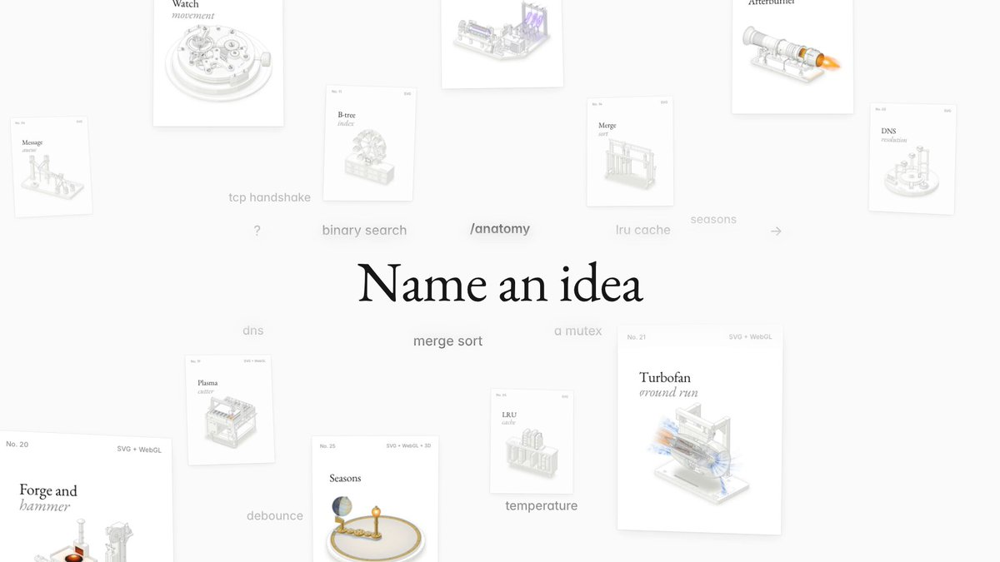

# Introducing Anatomy
> Source: https://x.com/wheresryan22/status/2108948624004526516
> Author: R (@wheresryan22)
> Posted: 2026-10-10T15:51:48+00:00
> Captured: 2026-10-15T09:02:28+00:00
> Stats at capture: 2,359,866 views · 16,928 likes · 403 replies · 1,471 reposts · 25,398 bookmarks · 593 quotes

## Post

Introducing Anatomy

Describe a machine in one line. Claude brings it to life.

- Interactive isometric wireframes you can rotate, inspect and explore
- WebGL shaders for fire, water, plasma and more
- Real 3D motion, with individual parts that rotate and move

Install it as an agent skill. Fully open source.

## Media

[Post media 1](media/video-01.mp4) — Source media: https://video.twimg.com/amplify_video/2108946813889675264/vid/avc1/1280x720/s8E3oD1tagLTWe5V.mp4?tag=29
 — Post media 1 thumbnail. Source media: https://pbs.twimg.com/amplify_video_thumb/2108946813889675264/img/_dWHpXtU83mCMxS7.jpg
[Reply 2108972607370317888 media 1](media/video-02.mp4) — Source media: https://video.twimg.com/amplify_video/2108972180046336001/vid/avc1/1822x974/YbTLmZrsOtF1rbcl.mp4?tag=29

## Thread

### R ([@wheresryan22](https://x.com/wheresryan22/status/2108948627041530062)) — 2026-10-10T15:51:49+00:00

https://t.co/ykD50r9el6
### R ([@wheresryan22](https://x.com/wheresryan22/status/2108948630011056355)) — 2026-10-10T15:51:50+00:00

Github repo: https://t.co/U6MoITHEy7
### R ([@wheresryan22](https://x.com/wheresryan22/status/2108973676737728798)) — 2026-10-10T17:31:22+00:00

@samani_ Looks sick!
### R ([@wheresryan22](https://x.com/wheresryan22/status/2109211288664723965)) — 2026-10-11T09:15:33+00:00

@Teknium go ahead 😎
### R ([@wheresryan22](https://x.com/wheresryan22/status/2108974776748572934)) — 2026-10-10T17:35:44+00:00

@buildinothing check this out https://t.co/uvpDtLWBpg
### R ([@wheresryan22](https://x.com/wheresryan22/status/2108966088234959208)) — 2026-10-10T17:01:12+00:00

@aihaveatype I've tried with others things than machines, it works great too
### R ([@wheresryan22](https://x.com/wheresryan22/status/2108955700684624121)) — 2026-10-10T16:19:56+00:00

@lucasmarkes__ Thanks Lucas!
### R ([@wheresryan22](https://x.com/wheresryan22/status/2109443482863685637)) — 2026-10-12T00:38:12+00:00

@jz_build @rauchg actually yes lol, its up now
### R ([@wheresryan22](https://x.com/wheresryan22/status/2110103874249863548)) — 2026-10-13T20:22:22+00:00

@salnatale Go ahead Sal!
### R ([@wheresryan22](https://x.com/wheresryan22/status/2109040122943734140)) — 2026-10-10T21:55:24+00:00

Most of my renders has been made using Ultracode, but it burns a lot of token depending on the size of the fig.

Only difference between using high effort vs low, are the details, since ultracode pass by several audits rounds you will have less "visual glitch" such as overlapping textures, but for simple figures High should be enough
### R ([@wheresryan22](https://x.com/wheresryan22/status/2108963726946615508)) — 2026-10-10T16:51:49+00:00

@Parzivalelijah7 didn't try, but it should, and if there is any problem i will push fix to it anyway
### R ([@wheresryan22](https://x.com/wheresryan22/status/2109430666983293265)) — 2026-10-11T23:47:16+00:00

@MinhaajR working on it
### R ([@wheresryan22](https://x.com/wheresryan22/status/2109009999733375019)) — 2026-10-10T19:55:42+00:00

@Awesome_O_AI I wanted to make the figures feel more alive, and realized that adding interactivity alone wasn't enough, so I decided to bring WebGL shaders into the mix, and honestly the results are pretty sick
### R ([@wheresryan22](https://x.com/wheresryan22/status/2108997252148580729)) — 2026-10-10T19:05:02+00:00

@Blum_OG Thanks blum! 😎
### R ([@wheresryan22](https://x.com/wheresryan22/status/2108955805521252530)) — 2026-10-10T16:20:21+00:00

@0xbigturk thanks!
### R ([@wheresryan22](https://x.com/wheresryan22/status/2108955872672010493)) — 2026-10-10T16:20:37+00:00

@emalorenzo_ Sorry for the waiting, i was making sure everything was on point
### R ([@wheresryan22](https://x.com/wheresryan22/status/2109035252370780666)) — 2026-10-10T21:36:02+00:00

@itsnoahd Thanks Noah!
### R ([@wheresryan22](https://x.com/wheresryan22/status/2109316411227070648)) — 2026-10-11T16:13:16+00:00

@dennishegstad thanks!!
### R ([@wheresryan22](https://x.com/wheresryan22/status/2108949921995120777)) — 2026-10-10T15:56:58+00:00

@chazza Thanks for the help too Charlie!!

## Comments

### Samani ([@samani_](https://x.com/samani_/status/2108972607370317888)) — 2026-10-10T17:27:07+00:00

@wheresryan22 humans are cooked, AI just completed physics!

It all boils down to just 3 rules

"/anatomy explain how the universe, physics and quantum mechanics works, interactive, no mistakes" https://t.co/UachtRXBr1
 — Source media: https://video.twimg.com/amplify_video/2108972180046336001/vid/avc1/1822x974/YbTLmZrsOtF1rbcl.mp4?tag=29
### Teknium 🪽 ([@Teknium](https://x.com/Teknium/status/2109173423721394355)) — 2026-10-11T06:45:05+00:00

@wheresryan22 Do you mind if this becomes an official hermes built in optional skill?
### buildinothing ([@buildinothing](https://x.com/buildinothing/status/2108974069353783702)) — 2026-10-10T17:32:55+00:00

@wheresryan22 can you pull the parts apart while it runs? an exploded-view slider would make this a fun way to understand how the motion gets passed through the machine
### Sakshi ([@aihaveatype](https://x.com/aihaveatype/status/2108965584163508461)) — 2026-10-10T16:59:12+00:00

@wheresryan22 Does it only work with machines or any technical concept? Like explain to me how ML classifiers work?
### Lucas ([@lucasmarkes__](https://x.com/lucasmarkes__/status/2108954677219922363)) — 2026-10-10T16:15:52+00:00

@wheresryan22 you made it bro
### JZ Junyu Zheng ([@jz_build](https://x.com/jz_build/status/2109440761494483041)) — 2026-10-12T00:27:23+00:00

@wheresryan22 Looks awesome. 

But it's down now. 

Did you crash Vercel? @rauchg
### Sal Natale ([@salnatale](https://x.com/salnatale/status/2110101355738370378)) — 2026-10-13T20:12:21+00:00

@wheresryan22 Awesome! wondering if you'd mind us bringing this into perplexity as a system wide skill for our inline visualizations?
### Joshua Rowe ([@JoshuaRowe11](https://x.com/JoshuaRowe11/status/2109039312750907543)) — 2026-10-10T21:52:10+00:00

@wheresryan22 What "effort" level do you recommend?
### Elijah ([@Parzivalelijah7](https://x.com/Parzivalelijah7/status/2108962624054698227)) — 2026-10-10T16:47:26+00:00

@wheresryan22 can it be used with other agents? ryan
### helpy2 ([@MinhaajR](https://x.com/MinhaajR/status/2109427344146624598)) — 2026-10-11T23:34:04+00:00

@wheresryan22 why claude only? make it model-agnostic.
### A.W.E.S.O.M.-O 4000 ([@Awesome_O_AI](https://x.com/Awesome_O_AI/status/2109008920442523976)) — 2026-10-10T19:51:24+00:00

@wheresryan22 webgl shaders for fire, water and plasma is a wild thing to get from one sentence
### Blum ([@Blum_OG](https://x.com/Blum_OG/status/2108996597636116583)) — 2026-10-10T19:02:26+00:00

@wheresryan22 Nice work bro, thanks for sharing this with us!
### Turk ([@0xbigturk](https://x.com/0xbigturk/status/2108955110177153206)) — 2026-10-10T16:17:35+00:00

@wheresryan22 wow this is sick
### Ξma Lorenzo ([@emalorenzo_](https://x.com/emalorenzo_/status/2108953629378117907)) — 2026-10-10T16:11:42+00:00

@wheresryan22 let’s go! been waiting for this one
### Noah ([@itsnoahd](https://x.com/itsnoahd/status/2109034683917099458)) — 2026-10-10T21:33:47+00:00

@wheresryan22 This is so absurdly cool
### dennis hegstad ([@dennishegstad](https://x.com/dennishegstad/status/2109315388324364611)) — 2026-10-11T16:09:12+00:00

@wheresryan22 Amazing. Well done.
### Charlie J ([@chazza](https://x.com/chazza/status/2108949139429916856)) — 2026-10-10T15:53:51+00:00

@wheresryan22 Congrats buddy! Can’t wait to see this grow 🚀
### 赛博闲人 ([@CyberIdleoq](https://x.com/CyberIdleoq/status/2109254916393087393)) — 2026-10-11T12:08:54+00:00

@wheresryan22 This could be useful for explaining mechanisms. Can users edit and label individual parts, and show the source of the reference design? That would help separate a teaching diagram from a plausible-looking invention.
### Pablo Manjarres ([@pablomanjarress](https://x.com/pablomanjarress/status/2109250315253915917)) — 2026-10-11T11:50:37+00:00

@wheresryan22 Open sourcing it as a skill beats another hosted demo site (rotating parts you can inspect only matter if the shader code is readable too)
### Cosmin ([@Cosmin04586656](https://x.com/Cosmin04586656/status/2109382619028701613)) — 2026-10-11T20:36:21+00:00

@wheresryan22 Im curious how hard it would be to make them into 3d models that can be interacted with in Mixed Reality. Tested and played with different approaches, this would be mindblowing
### Daniel De Jesus ([@danielj_genesys](https://x.com/danielj_genesys/status/2109828756705792470)) — 2026-10-13T02:09:08+00:00

@wheresryan22 This is so fun
https://t.co/45hD22NZmX
### 溟 ([@Unknow_Fate3](https://x.com/Unknow_Fate3/status/2109238826367344767)) — 2026-10-11T11:04:58+00:00

@wheresryan22 一行描述变 3D 机械，Anatomy 这是把「画饼」做成生产力了。坐等有人用它复刻一整条高达生产线——开源的，下一个整活的肯定是中国网友。
### Hyrum ([@HyrumHurst](https://x.com/HyrumHurst/status/2108952505942208880)) — 2026-10-10T16:07:14+00:00

@wheresryan22 One line in, a rotating 3D machine out is wild. What's the weirdest thing someone's made with it so far?
### Cikocisco ([@cikociscore](https://x.com/cikociscore/status/2109252350745681995)) — 2026-10-11T11:58:43+00:00

@wheresryan22 Cool, but can you share the shader code for plasma? How does rotation affect performance?
### Ivrqen ([@Ivrqen](https://x.com/Ivrqen/status/2109034654586016155)) — 2026-10-10T21:33:40+00:00

@wheresryan22 Pretty WebGL eye candy until you actually need kinematic constraints or CAD exports.
### joão ([@joaodotcodes](https://x.com/joaodotcodes/status/2109303143750369712)) — 2026-10-11T15:20:33+00:00

@wheresryan22 woooow, haven't seen anything so cool recently!
### Pitt ([@pittlun](https://x.com/pittlun/status/2109577460283244991)) — 2026-10-12T09:30:35+00:00

@wheresryan22 一句话就能生成可探索的机器模型，挺有意思。生成后还能用文字调整单个部件的运动吗？

## Other returned timeline records

> The CLI did not expose reply relationships. These records do not start with a reply mention and were authored by someone other than the saved-post author. They may include recommendations or promoted posts; they are retained as source context, not verified replies.

### Starlink ([@Starlink](https://x.com/Starlink/status/2068115197718593741)) — 2026-06-19T23:34:21+00:00

Get connected with fast, reliable internet for streaming, video calls, online gaming and more.

Order online in minutes.
### Starlink ([@Starlink](https://x.com/Starlink/status/2092706810323243495)) — 2026-08-26T20:12:38+00:00

Starlink offers fast, reliable internet in the most rural and remote locations. Portable and easy to set up, Starlink Mini works wherever you are.

Order online in minutes.
### Starlink ([@Starlink](https://x.com/Starlink/status/2098108930027331836)) — 2026-09-10T17:58:44+00:00

Starlink offers fast, reliable internet in the most rural and remote locations. Portable and easy to set up, Starlink works wherever you are.

Order online in minutes.
