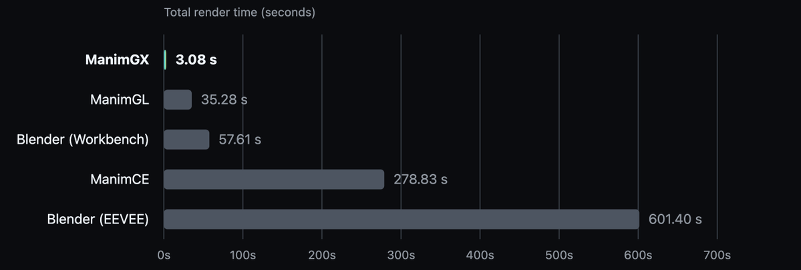
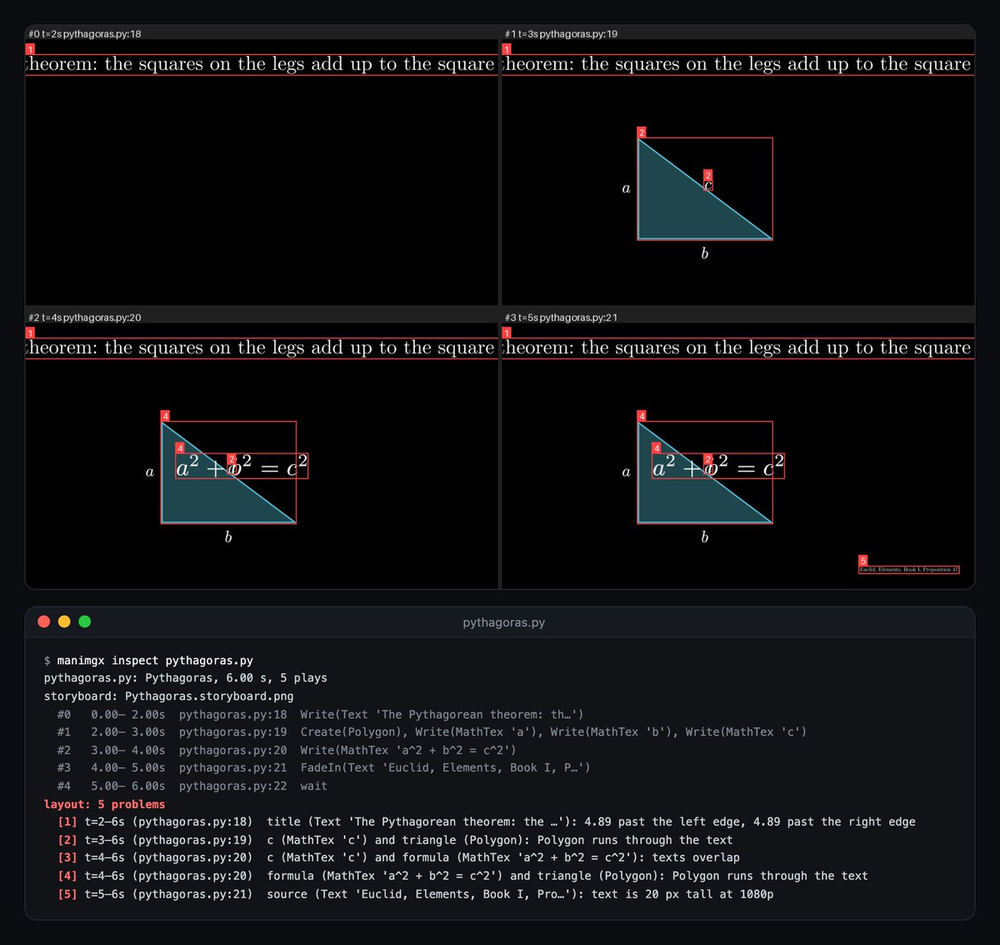
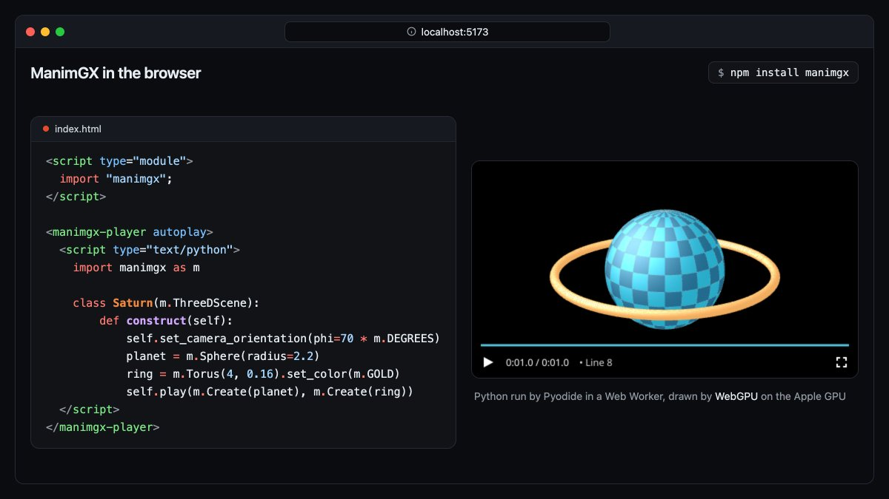

# Introducing ManimGX, the 3D animation engine for agents.
> Source: https://x.com/sinaatalay/status/2109045945149395421
> Author: Sina Atalay (@sinaatalay)
> Posted: 2026-10-10T22:18:32+00:00
> Captured: 2026-10-15T09:02:28+00:00
> Stats at capture: 243,429 views · 3,270 likes · 88 replies · 303 reposts · 5,402 bookmarks · 65 quotes

## Post

Introducing ManimGX, the 3D animation engine for agents.

- Blazingly fast: 90× faster than ManimCE
- Rust + wgpu core
- Compatible with Manim's Python API
- Lightweight: one pip install, no system dependencies

Open source: http://github.com/academa-labs/manimgx
Docs: http://manimgx.academa.ai

For 40 years we built GUIs for humans. Now we build APIs for agents.

Try it. Paste this into your favorite coding agent:

"Follow http://manimgx.academa.ai/llms.txt to make me a 3D animation of the solar system, and open it."

## Media

[Post media 1](media/video-01.mp4) — Source media: https://video.twimg.com/amplify_video/2109040311934889984/vid/avc1/1280x720/XsOF6cleTCQ2talg.mp4?tag=29
 — Post media 1 thumbnail. Source media: https://pbs.twimg.com/amplify_video_thumb/2109040311934889984/img/B1fDHPDTcsFhcH86.jpg
 — Reply 2109045946764153118 media 1. Source media: https://pbs.twimg.com/media/HUTSW7YagAAVDs0.png
 — Reply 2109045948664164368 media 1. Source media: https://pbs.twimg.com/media/HUTS9UwbQAAgijK.jpg
 — Reply 2109045950731915766 media 1. Source media: https://pbs.twimg.com/media/HUTUWPmbcAAJZFJ.jpg
[Reply 2109045953965838772 media 1](media/video-02.mp4) — Source media: https://video.twimg.com/amplify_video/2109044273970872320/vid/avc1/1920x1080/ECPEa3rZJ09FAOOJ.mp4?tag=29
[Reply 2109742031312683384 media 1](media/video-03.mp4) — Source media: https://video.twimg.com/amplify_video/2109740058681217024/vid/avc1/1280x720/uC2ENRf2-goTs-fI.mp4?tag=14
[Reply 2109474008626610667 media 1](media/video-04.mp4) — Source media: https://video.twimg.com/amplify_video/2109473956680138752/vid/avc1/1280x720/ZJwiuaD3GwdizPQb.mp4?tag=14
[Reply 2110006934644707397 media 1](media/video-05.mp4) — Source media: https://video.twimg.com/amplify_video/2110006924926484480/vid/avc1/1280x720/Z79yDs0LUyDO2qQV.mp4?tag=29
[Reply 2110348567810613509 media 1](media/video-06.mp4) — Source media: https://video.twimg.com/amplify_video/2110348365439332352/vid/avc1/1280x720/dTQZuI0w0oGruESe.mp4?tag=14

## Thread

### Sina Atalay ([@sinaatalay](https://x.com/sinaatalay/status/2109045946764153118)) — 2026-10-10T22:18:32+00:00

How fast? 36 s of 1080p60 video in 3.1 s, from launch to finished MP4.

90.6× faster than ManimCE
11.5× faster than ManimGL
18.7× faster than Blender Workbench

Method: https://t.co/3gq7AS9w6E https://t.co/Ntw8Ek1eE5
 — Source media: https://pbs.twimg.com/media/HUTSW7YagAAVDs0.png
### Sina Atalay ([@sinaatalay](https://x.com/sinaatalay/status/2109045948664164368)) — 2026-10-10T22:18:32+00:00

Made for agents:

- manimgx inspect (CLI command): storyboard PNGs your agent checks before rendering the video
- 2D layout checks: content cut off, text overlapping or too small, by variable and line
- Fully statically typed: TypedDict keyword arguments, typed .animate chains https://t.co/IRkLvcjuW1
 — Source media: https://pbs.twimg.com/media/HUTS9UwbQAAgijK.jpg
### Sina Atalay ([@sinaatalay](https://x.com/sinaatalay/status/2109045950731915766)) — 2026-10-10T22:18:33+00:00

pip install manimgx. That's the whole setup on macOS, Windows and Linux (Python 3.13+): 65–110 MB download, and no system dependencies like LaTeX or FFmpeg.

It runs in the browser too: npm install manimgx, and Pyodide and WebGPU render the scene. https://t.co/3H7FPmAuEl
 — Source media: https://pbs.twimg.com/media/HUTUWPmbcAAJZFJ.jpg
### Sina Atalay ([@sinaatalay](https://x.com/sinaatalay/status/2109045953965838772)) — 2026-10-10T22:18:34+00:00

Voiceover support, built in. self.say() speaks a line and starts each animation at its words in brackets:

self.say("The derivative of [x squared] is [two x].", anim1, anim2)

Any text-to-speech service can be the voice, and render writes the captions. https://t.co/GcqcwXpIYJ
 — Source media: https://video.twimg.com/amplify_video/2109044273970872320/vid/avc1/1920x1080/ECPEa3rZJ09FAOOJ.mp4?tag=29
### Sina Atalay ([@sinaatalay](https://x.com/sinaatalay/status/2109045955437920704)) — 2026-10-10T22:18:34+00:00

Thanks to the giants we stand on: Grant Sanderson (@3blue1brown), who created Manim, and @manimcommunity, whose API ManimGX targets.

And to the projects we build on: wgpu, Google's Filament, Typst, mitex, x264, FFmpeg, libopus, Pyodide and Mesa.

And to @fal for sponsoring us.
### Sina Atalay ([@sinaatalay](https://x.com/sinaatalay/status/2109338609212064057)) — 2026-10-11T17:41:28+00:00

@ecooai Yes, ManimGX's quality is very comparable to Blender's.
### Sina Atalay ([@sinaatalay](https://x.com/sinaatalay/status/2109338323622015433)) — 2026-10-11T17:40:20+00:00

@0xLiamVisionary Technically, it can make anything that can be created with 3D computer graphics. 

Though, we'll keep improving the API with better abstractions, such as 3D modeling operations like extrusion, revolution, boolean operations, like CAD software.
### Sina Atalay ([@sinaatalay](https://x.com/sinaatalay/status/2109772165809938740)) — 2026-10-12T22:24:16+00:00

@Cisco_research Thank you! Yes, it's ElevenLabs v4.
### Sina Atalay ([@sinaatalay](https://x.com/sinaatalay/status/2109187482348933577)) — 2026-10-11T07:40:57+00:00

@mongrlz Share the results!
### Sina Atalay ([@sinaatalay](https://x.com/sinaatalay/status/2109381916566921305)) — 2026-10-11T20:33:33+00:00

@audioascode I bet audio as code will be huge soon too. I'll check out your work!
### Sina Atalay ([@sinaatalay](https://x.com/sinaatalay/status/2109357732914733462)) — 2026-10-11T18:57:28+00:00

AI is so general that I don't think ManimGX should be limited to scientific use cases.

We envision ManimGX as a way to create any video that can be made with 3D computer graphics.

But thanks to its math typesetting support and all the features Manim has developed over the years, it's quite capable for scientific purposes.
### Sina Atalay ([@sinaatalay](https://x.com/sinaatalay/status/2109198842013053399)) — 2026-10-11T08:26:05+00:00

@flopsy42 This is the reply I’ve been waiting for 😎
### Sina Atalay ([@sinaatalay](https://x.com/sinaatalay/status/2109720956897997188)) — 2026-10-12T19:00:47+00:00

@xSneako7 I love my logo!

## Comments

### Ecoo ([@ecooai](https://x.com/ecooai/status/2109333517306155357)) — 2026-10-11T17:21:14+00:00

@sinaatalay looks cool.
have u compare the quality with blender or threejs with same ai agent.
and can you recommand tools for 3d modeling . i used blender and feel it not so gokd for agent use
### Liam Visionary ([@0xLiamVisionary](https://x.com/0xLiamVisionary/status/2109251316598132833)) — 2026-10-11T11:54:36+00:00

@sinaatalay can this make more commonplace 3d videos than just math and science concept vids? sounds impressive, but doesn't look too practical for most cases
### Francisco T. Barbosa ([@Cisco_research](https://x.com/Cisco_research/status/2109692250959790372)) — 2026-10-12T17:06:43+00:00

@sinaatalay This is nuts! And the narration is just incredible. The storytelling. Is that Eleven labs voice ?
### mongrlz ([@mongrlz](https://x.com/mongrlz/status/2109181140389310487)) — 2026-10-11T07:15:45+00:00

@sinaatalay im actually gonna test this on a vid im editing now
### audio as code ([@audioascode](https://x.com/audioascode/status/2109381495827677497)) — 2026-10-11T20:31:53+00:00

@sinaatalay Add us as the audio layer and take your video to the next level
### Saïd Aitmbarek ([@SaidAitmbarek](https://x.com/SaidAitmbarek/status/2109356122100355181)) — 2026-10-11T18:51:04+00:00

@sinaatalay looks pretty awesome

well done making it faster than blender

would you say it's more suited to scientific anims?
### David K. ([@flopsy42](https://x.com/flopsy42/status/2109198097163198765)) — 2026-10-11T08:23:08+00:00

@sinaatalay That will get my infra bill down by 90x
### SNEAKO ([@xSneako7](https://x.com/xSneako7/status/2109720521181143180)) — 2026-10-12T18:59:03+00:00

@sinaatalay Hey bro u famous now change your logo
### Andrew Chen ([@ndrewchenn](https://x.com/ndrewchenn/status/2109742031312683384)) — 2026-10-12T20:24:32+00:00

@sinaatalay insane edu alpha in videos rendered fast enough that you can actually ask followup questions live

tried this out while refreshing myself w/ CMU's 15-213 slides on memory hierarchy and it's about 60-90s from question to beautiful visuals (bottlenecked by agent speed) https://t.co/L2NKolyCfq
 — Source media: https://video.twimg.com/amplify_video/2109740058681217024/vid/avc1/1280x720/uC2ENRf2-goTs-fI.mp4?tag=14
### Clara ([@ClaraBySolgrid](https://x.com/ClaraBySolgrid/status/2109474008626610667)) — 2026-10-12T02:39:30+00:00

@sinaatalay Made this with ManimGX: 25 layered torus knots, rotating and breathing in a 12s loop.

Loop recipe: integer particle revolutions + periodic deformation + matching camera endpoints.

The equations describe the motion. Thanks for building this, @sinaatalay! https://t.co/wvmiC46jlo
 — Source media: https://video.twimg.com/amplify_video/2109473956680138752/vid/avc1/1280x720/ZJwiuaD3GwdizPQb.mp4?tag=14
### Tyson Maly ([@tysonmaly](https://x.com/tysonmaly/status/2109504730581872866)) — 2026-10-12T04:41:35+00:00

@sinaatalay @grok how capable is this for creating explainer videos for high school math?
### Amelia | AI & Tech ([@AmeliaonAI](https://x.com/AmeliaonAI/status/2109648755083313361)) — 2026-10-12T14:13:53+00:00

@sinaatalay 90x faster with Rust + wgpu is crazy — and keeping the Python API makes this an instant switch
### Ayushman Tripathi ([@ayushmanatr](https://x.com/ayushmanatr/status/2109214027822035143)) — 2026-10-11T09:26:26+00:00

@sinaatalay Holyyyyy this is insane 
I gotta test it out
### Marko ([@ljusmica](https://x.com/ljusmica/status/2109561457230913995)) — 2026-10-12T08:26:59+00:00

@sinaatalay Thank you for this gold!
### magnai ([@folibok](https://x.com/folibok/status/2110006934644707397)) — 2026-10-13T13:57:09+00:00

@sinaatalay Used luna. Thank you very much 🙏 https://t.co/ILU0A2BFoz
 — Source media: https://video.twimg.com/amplify_video/2110006924926484480/vid/avc1/1280x720/Z79yDs0LUyDO2qQV.mp4?tag=29
### Alex Ai | Tools & Updates ([@AlexWithAi_](https://x.com/AlexWithAi_/status/2109532784247357454)) — 2026-10-12T06:33:03+00:00

@sinaatalay ManimGX looks game-changing, 90x speed with agent-first API brilliant
### basetta ([@basetta](https://x.com/basetta/status/2110348567810613509)) — 2026-10-14T12:34:41+00:00

@sinaatalay hermes agent + minimax 3 , done in 5 min https://t.co/3ypus2OvZu
 — Source media: https://video.twimg.com/amplify_video/2110348365439332352/vid/avc1/1280x720/dTQZuI0w0oGruESe.mp4?tag=14
### Vantix AI Agency ([@VantixAgency](https://x.com/VantixAgency/status/2109571983302365576)) — 2026-10-12T09:08:49+00:00

@sinaatalay 90x faster and agent ready  ManimGX looks incredible
### RAZA | AI EXPLORER ([@razaaitech](https://x.com/razaaitech/status/2109651615154061515)) — 2026-10-12T14:25:15+00:00

@sinaatalay Building 3D animation tools for agents is a smart move. Excited to see what creators build with this!
### tau-home.com ([@tau_home](https://x.com/tau_home/status/2109493377960120351)) — 2026-10-12T03:56:28+00:00

@sinaatalay rust사랑해
### 𝒜ᴎⒾℜ𝒰𝕯∂ᖺᵃ 𝔸𝖉ᎯҠ ([@asi369_](https://x.com/asi369_/status/2109677709769298192)) — 2026-10-12T16:08:56+00:00

@sinaatalay Just bookmarked. We'll try this soon.
### axoss ([@axosss](https://x.com/axosss/status/2109474958199935109)) — 2026-10-12T02:43:16+00:00

@sinaatalay Was this video made with it ?
### Arnav ([@akAlwaysHehe](https://x.com/akAlwaysHehe/status/2109549267534970913)) — 2026-10-12T07:38:33+00:00

@sinaatalay Pretty sick stuff
### Irfan ([@IFirosh](https://x.com/IFirosh/status/2109348382066237547)) — 2026-10-11T18:20:18+00:00

@sinaatalay This is amazing
### CJ ([@cj2028down](https://x.com/cj2028down/status/2109204320163856430)) — 2026-10-11T08:47:51+00:00

@sinaatalay I will try this on a video I'm working on
### Jack ([@JacksAISites](https://x.com/JacksAISites/status/2109673014866629032)) — 2026-10-12T15:50:17+00:00

@sinaatalay 90倍？？卷疯了
### Enmaani ([@Enmaani1](https://x.com/Enmaani1/status/2109192007511904529)) — 2026-10-11T07:58:56+00:00

@sinaatalay 不错！但我有个小问题：使用这个库和我直接输入prompt让ai生成3D模型代码有什么区别？仅仅是包装的更好，更快速，有自带的样式嘛？（无意冒犯，真诚发问）
### Angelo Manalo 🇵🇭 ([@angelomanalo_](https://x.com/angelomanalo_/status/2109212118818169074)) — 2026-10-11T09:18:51+00:00

@sinaatalay I call it the best 3D animation engine in history!
### Ruben Alvarez ([@RubenAMtz](https://x.com/RubenAMtz/status/2109630349282009401)) — 2026-10-12T13:00:44+00:00

@sinaatalay @grok how does this compare to https://t.co/BYfyYWjvil?
### Chen Yu ([@CHEN_YU_bio](https://x.com/CHEN_YU_bio/status/2109453337372577998)) — 2026-10-12T01:17:22+00:00

@sinaatalay Now I can be 3b1b
### Blair Hayes ([@BlairHayesAi](https://x.com/BlairHayesAi/status/2109212111515857172)) — 2026-10-11T09:18:49+00:00

@sinaatalay 90x faster is wild — love the API-for-agents angle
### Justin Lord ([@Justin_lords](https://x.com/Justin_lords/status/2109247939143221672)) — 2026-10-11T11:41:11+00:00

@sinaatalay you rock man, thanks for open sourcing it
### ZenithAi ([@ZenithAiLab](https://x.com/ZenithAiLab/status/2109569819343540345)) — 2026-10-12T09:00:13+00:00

@sinaatalay Finally a proper 3D engine built for agents era

## Other returned timeline records

> The CLI did not expose reply relationships. These records do not start with a reply mention and were authored by someone other than the saved-post author. They may include recommendations or promoted posts; they are retained as source context, not verified replies.

### Starlink ([@Starlink](https://x.com/Starlink/status/2099964624640598175)) — 2026-09-15T20:52:36+00:00

Get fast, reliable home internet for seamless streaming, working from home, gaming, and more across multiple devices.

Order online in minutes.
### Starlink ([@Starlink](https://x.com/Starlink/status/2068115197718593741)) — 2026-06-19T23:34:21+00:00

Get connected with fast, reliable internet for streaming, video calls, online gaming and more.

Order online in minutes.
### Starlink ([@Starlink](https://x.com/Starlink/status/2099964624766730251)) — 2026-09-15T20:52:36+00:00

Get fast, reliable home internet for seamless streaming, working from home, gaming, and more across multiple devices.

Order online in minutes.

## Links

- https://github.com/academa-labs/manimgx
- https://manimgx.academa.ai
- http://github.com/academa-labs/manimgx
- http://manimgx.academa.ai
- http://manimgx.academa.ai/llms.txt
