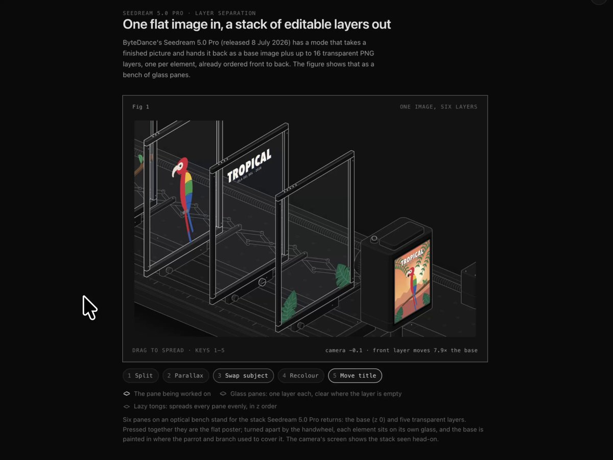

# Such a good skill for visual explainers. All SVG and animated.
> Source: https://x.com/MengTo/status/2109182449179836579
> Author: Meng To (@MengTo)
> Posted: 2026-10-11T07:20:57+00:00
> Captured: 2026-10-15T09:02:28+00:00
> Stats at capture: 108,638 views · 2,531 likes · 32 replies · 218 reposts · 3,486 bookmarks · 8 quotes

## Post

Such a good skill for visual explainers. All SVG and animated.

Prompt I used:

https://github.com/wheresryan22/anatomy install skill

/anatomy Explain how Seedream 5.0 is able to split an image into layers and what cool things you can produce with it. Do that in a single HTML file. 

Change the camera/zoom in for scene 1 to 5 to explain more clearly.

> Quoted post by R ([@wheresryan22](https://x.com/wheresryan22/status/2108948624004526516)):
>
> Introducing Anatomy
>
> Describe a machine in one line. Claude brings it to life.
>
> - Interactive isometric wireframes you can rotate, inspect and explore
> - WebGL shaders for fire, water, plasma and more
> - Real 3D motion, with individual parts that rotate and move
>
> Install it as an agent skill. Fully open source.

## Media

[Post media 1](media/video-01.mp4) — Source media: https://video.twimg.com/amplify_video/2109182060871176192/vid/avc1/960x720/COc7EwLytGU5RWGX.mp4?tag=29
 — Post media 1 thumbnail. Source media: https://pbs.twimg.com/amplify_video_thumb/2109182060871176192/img/KHUW4WbWAocaVffO.jpg

## Thread

### Meng To ([@MengTo](https://x.com/MengTo/status/2109197169677005174)) — 2026-10-11T08:19:26+00:00

@asmirkn the prompt pushes opus 5.5 to check the docs.

## Comments

### Asmir ([@asmirkn](https://x.com/asmirkn/status/2109196595417715009)) — 2026-10-11T08:17:09+00:00

@MengTo i think the follow up prompt does more than the skill. first pass is never clear, telling it which scenes to zoom in on is what fixes it. did you give it seedream's docs or let claude guess how the layers work?
### Brjan | AI Builder ([@MrBrjan](https://x.com/MrBrjan/status/2109314562399092809)) — 2026-10-11T16:05:55+00:00

@MengTo using a single HTML file for such a complex task really simplifies the process
### Alessia ([@alessia_orbit](https://x.com/alessia_orbit/status/2109272440283283909)) — 2026-10-11T13:18:32+00:00

@MengTo thx for always sharing such inspiring work 🫶
### Mr Rabbar ([@mrrabbar](https://x.com/mrrabbar/status/2109211553144680625)) — 2026-10-11T09:16:36+00:00

@MengTo Thanks for sharing!!
### Daniel White ([@dwhitedesign](https://x.com/dwhitedesign/status/2109251658882433297)) — 2026-10-11T11:55:58+00:00

@MengTo omdsss this is awesome dude !!
### Hilda Bliss ([@3xProduct_D](https://x.com/3xProduct_D/status/2109589134927155205)) — 2026-10-12T10:16:58+00:00

@MengTo Wow, this looks so cool 🔥

Love it!
### Cherif Tabouche ([@cherifdesigns](https://x.com/cherifdesigns/status/2109308704973549861)) — 2026-10-11T15:42:38+00:00

@MengTo Banger!
### mikun ([@mikun_ux](https://x.com/mikun_ux/status/2109345739537342853)) — 2026-10-11T18:09:48+00:00

@MengTo Can you export as SVG?
### OnFinality ([@OnFinality](https://x.com/OnFinality/status/2109335025720480193)) — 2026-10-11T17:27:14+00:00

@MengTo The single HTML file constraint is what makes this work as a skill, no build step or bundler to babysit. Curious how the WebGL shaders hold up when the isometric wireframe gets dense, that's usually where the frame budget goes.
### Ulad Luch ([@uladluch](https://x.com/uladluch/status/2109191353296937316)) — 2026-10-11T07:56:20+00:00

@MengTo one line prompt to an animated svg walkthrough is wild, does it hold up when the machine has like 30 parts or does the camera get lost
### Sujal ([@hecodesforme](https://x.com/hecodesforme/status/2109190530810642825)) — 2026-10-11T07:53:04+00:00

@MengTo animated SVG explainers are the kind of output people actually save and share
### Gav Elliott ([@gavinelliott](https://x.com/gavinelliott/status/2109205260791136609)) — 2026-10-11T08:51:35+00:00

@MengTo This has me thinking about product onboarding. Let someone change one input and see what happens, rather than watch the whole walkthrough. Especially useful for explaining something like permissions or pricing. Have you tried it with a product flow yet?
### Arin ([@rrindam](https://x.com/rrindam/status/2109366950891774406)) — 2026-10-11T19:34:05+00:00

@MengTo Wish they would build a cross over of mermaid diagrams to explain tech systems
### Guillermo ([@gmartidesign](https://x.com/gmartidesign/status/2109335650751365619)) — 2026-10-11T17:29:43+00:00

@MengTo all svg is the smart part, you can still tweak one piece instead of rerolling the whole thing. did the html come out in one go
### Anderson ([@ItsGoharr](https://x.com/ItsGoharr/status/2109276693676339401)) — 2026-10-11T13:35:26+00:00

@MengTo designers discovering AI can do their busywork and calling it a skill
### Bhavyaa Shree ([@bhavyaa__shree](https://x.com/bhavyaa__shree/status/2109298387078332856)) — 2026-10-11T15:01:39+00:00

@MengTo @kaustubh_kr_ let's use thissss
### Toyesh Chakravorty ([@Bhushindo](https://x.com/Bhushindo/status/2109250541113032964)) — 2026-10-11T11:51:31+00:00

@MengTo “documented” and “inferred” would make useful hover labels for your Seedream explainer.
### Jajwinder Singh ([@Jajwinder3362](https://x.com/Jajwinder3362/status/2109429618407342166)) — 2026-10-11T23:43:06+00:00

@MengTo The agent can draw every SVG. Choosing the 3 parts worth labeling is still the design job.
### David T Kramaley ([@simplydt](https://x.com/simplydt/status/2109243325119348976)) — 2026-10-11T11:22:51+00:00

@MengTo svg focus keeps output light and edit-ready, perfect for embedding into docs or interactive pages
### 晚晚 ([@An_yhl](https://x.com/An_yhl/status/2109234236532326526)) — 2026-10-11T10:46:44+00:00

@MengTo 动画好看是一回事，能把拆图逻辑讲清楚才值得收藏。
### Robin | Poker x AI ([@RobinHill85](https://x.com/RobinHill85/status/2109262899487068364)) — 2026-10-11T12:40:38+00:00

@MengTo The layered SVG output stays light, so the single file embed stays under a few hundred kilobytes with multiple scene zooms
### wiiiimm ([@wiiiimm](https://x.com/wiiiimm/status/2109204320365281776)) — 2026-10-11T08:47:51+00:00

@MengTo @bot add content of this post to our notion note db, linking it to the anatomy skill you previously logged
### zhaofinger ([@zhaofinger](https://x.com/zhaofinger/status/2109215151111217281)) — 2026-10-11T09:30:54+00:00

@MengTo @bot 帮我安装这个 skill
### ikhwanb ([@IkhwanB](https://x.com/IkhwanB/status/2109195755152142525)) — 2026-10-11T08:13:49+00:00

@MengTo Dope
### Ridham Trivedi ([@Uxridham](https://x.com/Uxridham/status/2109246061370073276)) — 2026-10-11T11:33:43+00:00

@MengTo How heavy is the single HTML file once all the scenes and animations are in? Wondering if it's light enough to embed on a landing page.
### BreezeOg ([@BreezeOg1](https://x.com/BreezeOg1/status/2109225346448937402)) — 2026-10-11T10:11:24+00:00

@MengTo this skill is so good for explainers, saving the prompt
### Abdulmuiz Adeyemo ([@AbdMuizAdeyemo](https://x.com/AbdMuizAdeyemo/status/2109369497807139174)) — 2026-10-11T19:44:13+00:00

@MengTo Crazy

## Other returned timeline records

> The CLI did not expose reply relationships. These records do not start with a reply mention and were authored by someone other than the saved-post author. They may include recommendations or promoted posts; they are retained as source context, not verified replies.

### Starlink ([@Starlink](https://x.com/Starlink/status/2099964624829640835)) — 2026-09-15T20:52:36+00:00

Get fast, reliable home internet for seamless streaming, working from home, gaming, and more across multiple devices.

Order online in minutes.
### Starlink ([@Starlink](https://x.com/Starlink/status/2068115197718593741)) — 2026-06-19T23:34:21+00:00

Get connected with fast, reliable internet for streaming, video calls, online gaming and more.

Order online in minutes.
### Eyad Nour ([@eyadnour](https://x.com/eyadnour/status/2109188303014572237)) — 2026-10-11T07:44:12+00:00

Love this direction. These explainers can go way beyond video and be fully interactive browser experiences. We're about to see new forms of video-like content.  Opus is surprisingly good at this. It built me this QR code explainer without any skills. We'll all be Meng Tos.
https://t.co/r4axHedGpA

## Links

- https://github.com/wheresryan22/anatomy
