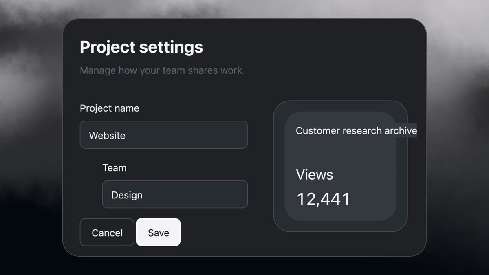
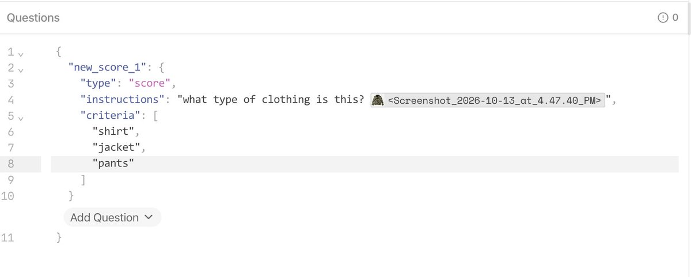
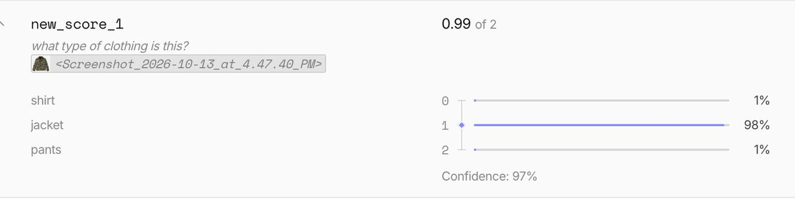

# It should be impossible for AI to make a bad UI.
> Source: https://x.com/Frozune/status/2109309297612013621
> Author: Gavin (@Frozune)
> Posted: 2026-10-11T15:45:00+00:00
> Captured: 2026-10-15T09:02:28+00:00
> Stats at capture: 117,220 views · 1,315 likes · 29 replies · 58 reposts · 2,654 bookmarks · 9 quotes

## Post

It should be impossible for AI to make a bad UI. 

Tell your agent today: "Install and set up https://github.com/gholtzap/lintapple in this project"

## Media

[Post media 1](media/video-01.mp4) — Source media: https://video.twimg.com/amplify_video/2108999775538282496/vid/avc1/1280x720/sFUTgsNLEwKKaPux.mp4?tag=14
 — Post media 1 thumbnail. Source media: https://pbs.twimg.com/amplify_video_thumb/2108999775538282496/img/gqzi-nSFnac1NvlW.jpg
[Reply 2110375346046746649 media 1](media/video-02.mp4) — Source media: https://video.twimg.com/amplify_video/2110374180395098112/vid/avc1/576x1024/t-hXvst_5sBLVpTc.mp4?tag=29
 — Reply 2110509898958008515 media 1. Source media: https://pbs.twimg.com/media/HUoH2yoXoAARpmr.jpg
 — Reply 2110509898958008515 media 2. Source media: https://pbs.twimg.com/media/HUoJjt-WQAAaGw-.jpg
[Reply 2110564814531797386 media 1](media/video-03.mp4) — Source media: https://video.twimg.com/amplify_video/2110564564559364096/vid/avc1/1920x1080/0IEKKVE3Qqpc4sEI.mp4?tag=29

## Thread

### Gavin ([@Frozune](https://x.com/Frozune/status/2109456823158034851)) — 2026-10-12T01:31:13+00:00

@badr_eladr please lmk if it's useful or not! I will keep coding until its useful for everyone 🙏
### Gavin ([@Frozune](https://x.com/Frozune/status/2109336802889003019)) — 2026-10-11T17:34:18+00:00

@iwanttobeinmars Thank you!! Lmk if you use it
### Gavin ([@Frozune](https://x.com/Frozune/status/2109456975062794441)) — 2026-10-12T01:31:49+00:00

@chrisgoingturbo what should it be instead?
### Gavin ([@Frozune](https://x.com/Frozune/status/2109614923152052673)) — 2026-10-12T11:59:27+00:00

@instaforg Correct! Codex one shotted the entire thing, even the demo video! The point was to increase the baseline (make it look less bad), not to make it look good.
### Gavin ([@Frozune](https://x.com/Frozune/status/2109317207075262497)) — 2026-10-11T16:16:26+00:00

@mlg27_ Ah sorry, I made it public now!
### Gavin ([@Frozune](https://x.com/Frozune/status/2109615594840477980)) — 2026-10-12T12:02:07+00:00

@pitus_ I agree. I wish this was my experience, but I made this tool because I would get so upset at codex like "why on earth did you think this was acceptable??" because it still makes these mistakes. Also, you may like this skill for cleaner copy: https://t.co/PyPwfyBYlR
### Gavin ([@Frozune](https://x.com/Frozune/status/2109456675103191144)) — 2026-10-12T01:30:37+00:00

@ZachWilsonATX let me know how it can be better!
### Gavin ([@Frozune](https://x.com/Frozune/status/2109456637907857589)) — 2026-10-12T01:30:28+00:00

@pseudo_tbd let me know why it looks off and I can fix it!
### Gavin ([@Frozune](https://x.com/Frozune/status/2109648859903238148)) — 2026-10-12T14:14:18+00:00

@_7obaid_ Try using this skill to delete all unnecessary text! https://t.co/PyPwfyBYlR
### Gavin ([@Frozune](https://x.com/Frozune/status/2109615670174654940)) — 2026-10-12T12:02:25+00:00

@simplygandan What looks off in your opinion?

## Comments

### badr | 1 iOS app a month ([@badr_eladr](https://x.com/badr_eladr/status/2109417041388003464)) — 2026-10-11T22:53:08+00:00

@Frozune i ll def try this out
### Maky ([@iwanttobeinmars](https://x.com/iwanttobeinmars/status/2109328771400778085)) — 2026-10-11T17:02:23+00:00

@Frozune I’ve been using paper for my ui designs and mock ups, this looks awesome too!
### Christian ([@chrisgoingturbo](https://x.com/chrisgoingturbo/status/2109418846473814505)) — 2026-10-11T23:00:18+00:00

@Frozune what the fuck is that corner radius bruh you're killing me
### InstaForg ([@instaforg](https://x.com/instaforg/status/2109566931439386809)) — 2026-10-12T08:48:44+00:00

@Frozune This looks so vibe coded even after fixing everything 😭
### Michael Goldstein ([@mlg27_](https://x.com/mlg27_/status/2109309751595237521)) — 2026-10-11T15:46:48+00:00

@Frozune Link is going to a 404
### Zachary Wilson ([@ZachWilsonATX](https://x.com/ZachWilsonATX/status/2109444612628816134)) — 2026-10-12T00:42:41+00:00

@Frozune Looks awful and has no taste
### Pseudo ([@pseudo_tbd](https://x.com/pseudo_tbd/status/2109414521169432729)) — 2026-10-11T22:43:07+00:00

@Frozune not bad but not good either, it still looks off
### Obaid ([@_7obaid_](https://x.com/_7obaid_/status/2109648241579221095)) — 2026-10-12T14:11:50+00:00

@Frozune good initiative man!

have you also added that retarded behavior of it always adding verbose fluff text  everywhere? need to nuke that behaviour 🧨
### gandan ([@simplygandan](https://x.com/simplygandan/status/2109552007136911477)) — 2026-10-12T07:49:26+00:00

@Frozune still kinda off ngl
### Afshin ([@heyAfshin](https://x.com/heyAfshin/status/2109414099889332453)) — 2026-10-11T22:41:27+00:00

@Frozune I'm gonna use this and report back
### Lazy.X ([@MaryPenn21547](https://x.com/MaryPenn21547/status/2109560719335387463)) — 2026-10-12T08:24:03+00:00

@Frozune 道理是这个道理，但AI做UI为啥老是一股模板味？是缺审美数据还是缺判断标准啊，和真人设计师比，差的到底是手还是眼？
### Anderson ([@ItsGoharr](https://x.com/ItsGoharr/status/2109416924480184579)) — 2026-10-11T22:52:40+00:00

@Frozune somehow AI still makes ugly interfaces daily
### Ashish ([@feat_ashish](https://x.com/feat_ashish/status/2109594161796219226)) — 2026-10-12T10:36:57+00:00

@Frozune Bruhh its still sooo bad
### origami ([@sevenfootpole](https://x.com/sevenfootpole/status/2109393451410428209)) — 2026-10-11T21:19:24+00:00

@Frozune No way any AI would actually make the before version.
### Cohen ([@cohenscrypto](https://x.com/cohenscrypto/status/2109372497338814673)) — 2026-10-11T19:56:08+00:00

@Frozune The corner rounding…. Why😭
### Solomon ([@solomonmithra99](https://x.com/solomonmithra99/status/2109366832578924799)) — 2026-10-11T19:33:37+00:00

@Frozune I’d make adding the layout markers part of setup. “Installed the linter” and “checked the spacing” can be very different milestones.
### Karwan Atta ([@KarwanAtta3](https://x.com/KarwanAtta3/status/2109735758496145556)) — 2026-10-12T19:59:36+00:00

@Frozune we love this take because we have all seen AI ship a button in 47 shades of grey and call it a design system 😅 if AI cannot make bad UI anymore, what excuse do we have left for ours? #AI #BuildInPublic
### Jimin ([@Mighty_Jimini](https://x.com/Mighty_Jimini/status/2109644145442828507)) — 2026-10-12T13:55:34+00:00

@Frozune Installing a UI package doesn't tell your agent whether people can actually use the result.
### 晚晚 ([@An_yhl](https://x.com/An_yhl/status/2109469507593048385)) — 2026-10-12T02:21:37+00:00

@Frozune 能查出界面规范问题挺好，但审美还得自己把关
### 3 ([@3weeksbuilding](https://x.com/3weeksbuilding/status/2110438247092662358)) — 2026-10-14T18:31:02+00:00

@Frozune banger farming
### 8 Bit Elon ([@EightBitElon](https://x.com/EightBitElon/status/2109395594435510600)) — 2026-10-11T21:27:55+00:00

@Frozune @grok verify & assess
### Rohan Jadhav ([@imRohan_25](https://x.com/imRohan_25/status/2109540956425093160)) — 2026-10-12T07:05:32+00:00

@Frozune Need to try this
### Mxrius ([@Mxrius](https://x.com/Mxrius/status/2109379001487946206)) — 2026-10-11T20:21:58+00:00

@Frozune @bot we need this
### Moriort ([@mor44595305](https://x.com/mor44595305/status/2110434761168785671)) — 2026-10-14T18:17:11+00:00

@Frozune Muchas gracias
### KrulHK ([@KrulestwoHK](https://x.com/KrulestwoHK/status/2109595398297846241)) — 2026-10-12T10:41:51+00:00

@Frozune Looks like shit
### 白 ([@hishn948957](https://x.com/hishn948957/status/2109429433539162453)) — 2026-10-11T23:42:22+00:00

@Frozune if i do ui.i well use it 🥹

## Other returned timeline records

> The CLI did not expose reply relationships. These records do not start with a reply mention and were authored by someone other than the saved-post author. They may include recommendations or promoted posts; they are retained as source context, not verified replies.

### Starlink ([@Starlink](https://x.com/Starlink/status/2068115197718593741)) — 2026-06-19T23:34:21+00:00

Get connected with fast, reliable internet for streaming, video calls, online gaming and more.

Order online in minutes.
### Phil Pitus ([@pitus_](https://x.com/pitus_/status/2109558019998535749)) — 2026-10-12T08:13:20+00:00

I think a good model wouldn’t make such mistakes as making the padding uneven or add a random text-nowrap

a more interesting problem to solve is figuring out what exactly to display on users screen, so they are not confused

AI seems to be particularly bad at designing with business goals in mind
### Starlink ([@Starlink](https://x.com/Starlink/status/2092706810285490310)) — 2026-08-26T20:12:38+00:00

Starlink offers fast, reliable internet in the most rural and remote locations. Portable and easy to set up, Starlink Mini works wherever you are.

Order online in minutes.
### Starlink ([@Starlink](https://x.com/Starlink/status/2098108930002211077)) — 2026-09-10T17:58:44+00:00

Starlink offers fast, reliable internet in the most rural and remote locations. Portable and easy to set up, Starlink works wherever you are.

Order online in minutes.
### Steven Cheng ([@stevencheng](https://x.com/stevencheng/status/2110375346046746649)) — 2026-10-14T14:21:06+00:00

Behold, the ESP32 ball. https://t.co/yx3PvWK7jb
 — Source media: https://video.twimg.com/amplify_video/2110374180395098112/vid/avc1/576x1024/t-hXvst_5sBLVpTc.mp4?tag=29
### Wes Bos ([@wesbos](https://x.com/wesbos/status/2110509898958008515)) — 2026-10-14T23:15:45+00:00

Jev images is here

One question about an image that is 850x850 cost one hundredth of a cent -  $0.000096936

about 10,000 images for a dollar. 

referencing the image more than once duplicates the token usage    - so asking two questions in a single request is equivalent to uploading two images
 — Source media: https://pbs.twimg.com/media/HUoH2yoXoAARpmr.jpg
 — Source media: https://pbs.twimg.com/media/HUoJjt-WQAAaGw-.jpg
### Theo - t3.gg ([@theo](https://x.com/theo/status/2110460406896746570)) — 2026-10-14T19:59:06+00:00

So cool seeing our weird UX experiments in T3 Code getting validated by the labs
### Luneri ([@itsluneri](https://x.com/itsluneri/status/2110564814531797386)) — 2026-10-15T02:53:58+00:00

Opus 5.5 with and without TasteSkill v2, same prompt on both.

Details, and my opinion about TasteSkill below! :) https://t.co/vq9mZnWLvl
 — Source media: https://video.twimg.com/amplify_video/2110564564559364096/vid/avc1/1920x1080/0IEKKVE3Qqpc4sEI.mp4?tag=29

## Links

- https://github.com/gholtzap/lintapple
