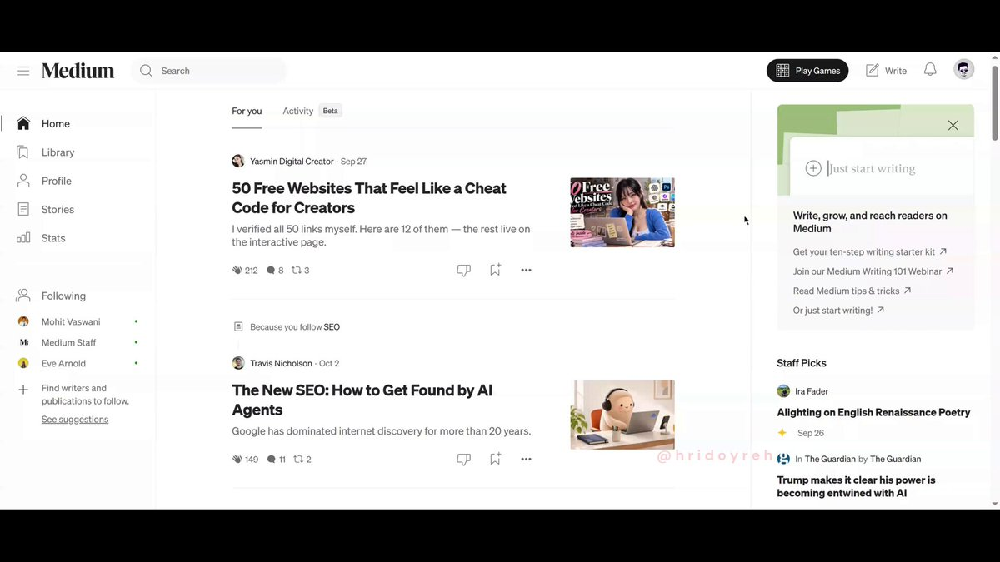
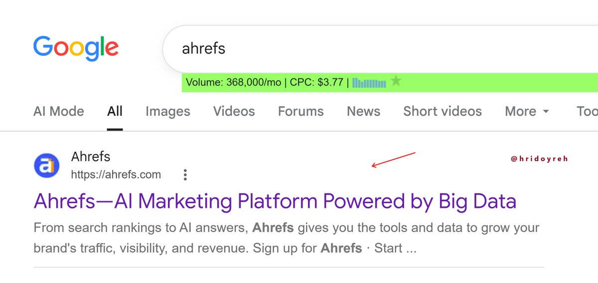
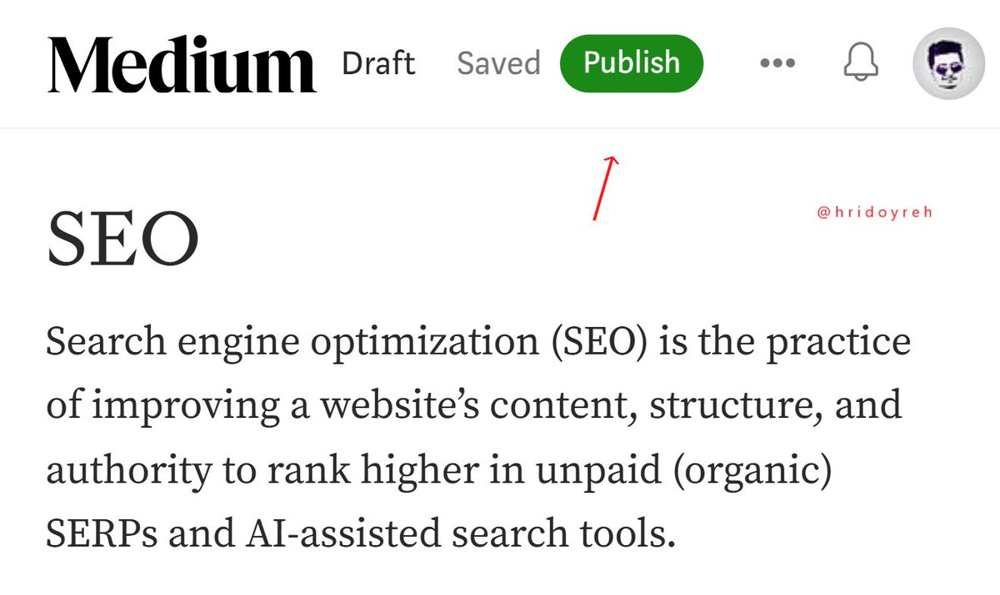
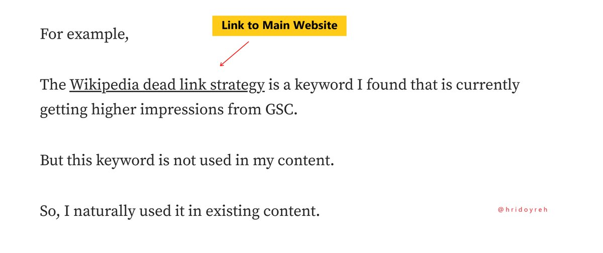
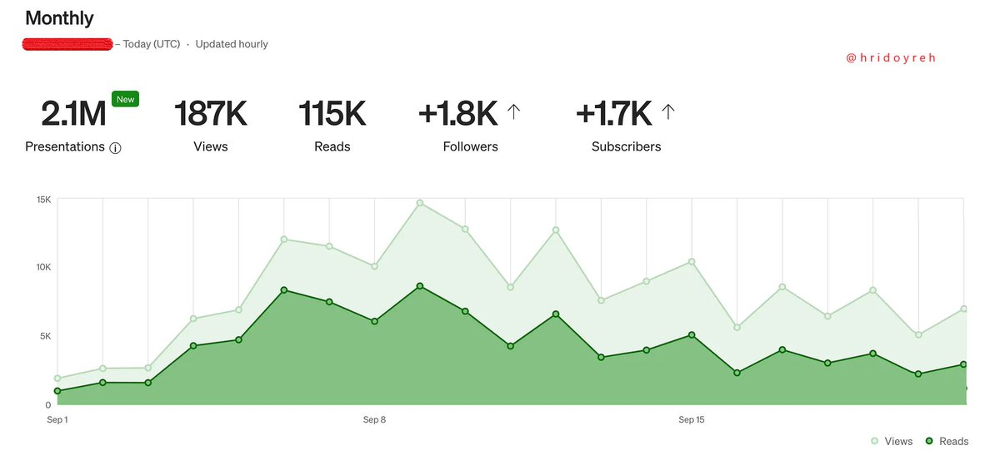
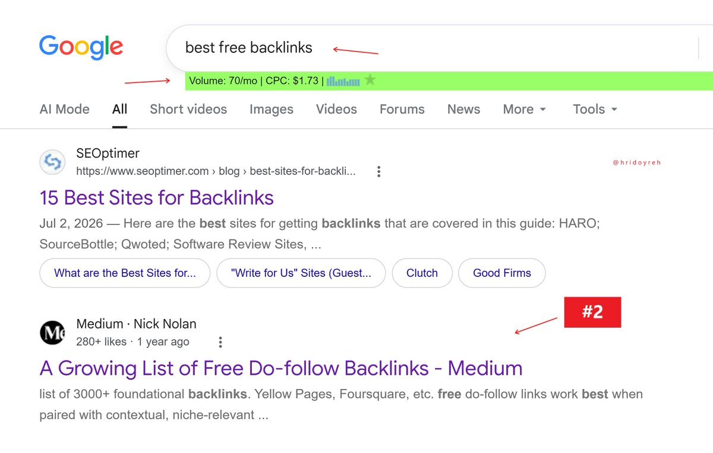
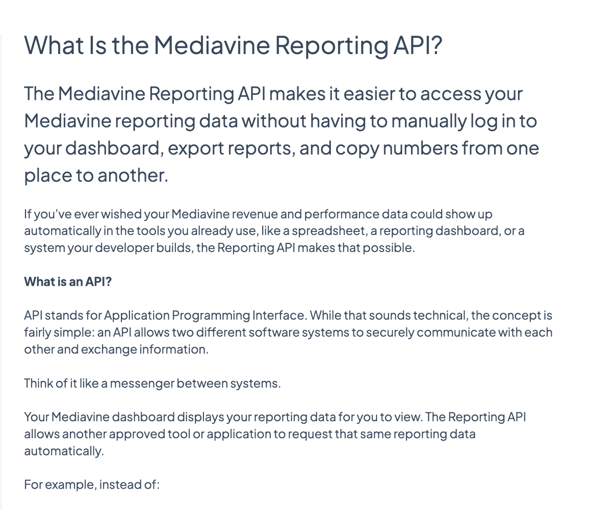

# Parasite SEO is a GREAT technique.
> Source: https://x.com/hridoyreh/status/2109580214594679003
> Author: Hridoy Reh (@hridoyreh)
> Posted: 2026-10-12T09:41:31+00:00
> Captured: 2026-10-15T09:02:28+00:00
> Stats at capture: 15,069 views · 116 likes · 7 replies · 10 reposts · 191 bookmarks · 3 quotes

## Post

Parasite SEO is a GREAT technique.

You can easily earn money by using this.

How to make $1,000+/m:

## Media

[Post media 1](media/video-01.mp4) — Source media: https://video.twimg.com/amplify_video/2109579589521727488/vid/avc1/1280x720/hpvpUYTgDBgI7g33.mp4?tag=29
 — Post media 1 thumbnail. Source media: https://pbs.twimg.com/amplify_video_thumb/2109579589521727488/img/9d1bzsySsjZrPUfc.jpg
 — Reply 2109580218143019061 media 1. Source media: https://pbs.twimg.com/media/HUa7kApagAAkKYk.jpg
 — Reply 2109580222232494386 media 1. Source media: https://pbs.twimg.com/media/HUa7n6ibwAANxbm.jpg
 — Reply 2109580226078617600 media 1. Source media: https://pbs.twimg.com/media/HUa7r1oaMAA25Ie.jpg
 — Reply 2109580232391057459 media 1. Source media: https://pbs.twimg.com/media/HUa7ynybUAEPtWW.jpg
 — Reply 2109580236249776204 media 1. Source media: https://pbs.twimg.com/media/HUa75tAbIAAgspM.jpg
 — Reply 2110575893462888905 media 1. Source media: https://pbs.twimg.com/media/HUlgYZObAAESTsR.png

## Thread

### Hridoy Reh ([@hridoyreh](https://x.com/hridoyreh/status/2109580218143019061)) — 2026-10-12T09:41:32+00:00

1. Find Keywords

Find a low-competition keyword.

Analyze SERPs to see if you can rank.

You can use Ahrefs for this. https://t.co/gDoud8eWKW
 — Source media: https://pbs.twimg.com/media/HUa7kApagAAkKYk.jpg
### Hridoy Reh ([@hridoyreh](https://x.com/hridoyreh/status/2109580222232494386)) — 2026-10-12T09:41:33+00:00

2. Write and Publish Content

Write a helpful, optimized article.

Include your target keyword naturally.

Publish it on Medium. https://t.co/telO4X4Ep7
 — Source media: https://pbs.twimg.com/media/HUa7n6ibwAANxbm.jpg
### Hridoy Reh ([@hridoyreh](https://x.com/hridoyreh/status/2109580226078617600)) — 2026-10-12T09:41:34+00:00

3. Add a Backlink

Link to your main website.

Use relevant and descriptive anchor text.

At the same time, make internal links. https://t.co/RNI7As60EC
 — Source media: https://pbs.twimg.com/media/HUa7r1oaMAA25Ie.jpg
### Hridoy Reh ([@hridoyreh](https://x.com/hridoyreh/status/2109580229140414872)) — 2026-10-12T09:41:35+00:00

4. Build backlinks

Build a few links to your Medium article.

Focus on quality over quantity.
### Hridoy Reh ([@hridoyreh](https://x.com/hridoyreh/status/2109580232391057459)) — 2026-10-12T09:41:36+00:00

5. Track Stats

Track stats from Medium.

Make the article more SEO-friendly.

Aim to reach Google's 1st page. https://t.co/TrTtxF6IZb
 — Source media: https://pbs.twimg.com/media/HUa7ynybUAEPtWW.jpg
### Hridoy Reh ([@hridoyreh](https://x.com/hridoyreh/status/2109580236249776204)) — 2026-10-12T09:41:37+00:00

6. Google Ranking

If you can do these things correctly,

You will rank on the 1st page of Google.

A real-world example: https://t.co/T88EroCJ6B
 — Source media: https://pbs.twimg.com/media/HUa75tAbIAAgspM.jpg
### Hridoy Reh ([@hridoyreh](https://x.com/hridoyreh/status/2109580239332634630)) — 2026-10-12T09:41:37+00:00

7. SEO Wins

If you want to grow your website's traffic and revenue, I recommend that you use the 'SEO Wins' database right away.

No SEO / AI SEO skills are required.

https://t.co/whiVPPhxCU
### Hridoy Reh ([@hridoyreh](https://x.com/hridoyreh/status/2109580241673036054)) — 2026-10-12T09:41:38+00:00

That's the end of the thread.

However, I can help you in 3 ways:

🔸 SEO Wins Database
🔸 1 on 1 Consultation Call
🔸 AI SEO / SEO Services

View Bio/Pin Post to get help...
### Hridoy Reh ([@hridoyreh](https://x.com/hridoyreh/status/2109639060860113314)) — 2026-10-12T13:35:21+00:00

@BlockByBlockHQ Yeap...
### Hridoy Reh ([@hridoyreh](https://x.com/hridoyreh/status/2109586245492113514)) — 2026-10-12T10:05:29+00:00

@floraoliviaa Thanks...
### Hridoy Reh ([@hridoyreh](https://x.com/hridoyreh/status/2110634024712716570)) — 2026-10-15T07:28:59+00:00

16 places to market your startup:

1. 𝕏 / Twitter
2. Reddit Subreddits
3. Medium
4. Substack
5. Product Hunt
6. Indie Hackers
7. Facebook Groups
8. Hacker News
9. HackerNoon
10. YouTube Shorts
11. LinkedIn
12. TikTok
13. Instagram Reels
14. AlternativeTo
15. OpenAlternative
16. SaaSHub

## Comments

### Block By Block Solutions ([@BlockByBlockHQ](https://x.com/BlockByBlockHQ/status/2109603787954585887)) — 2026-10-12T11:15:12+00:00

@hridoyreh The site selection is where the money is made
### Flora Olivia ([@floraoliviaa](https://x.com/floraoliviaa/status/2109585335680463330)) — 2026-10-12T10:01:52+00:00

@hridoyreh nice one
### Simon ([@Seymxn](https://x.com/Seymxn/status/2109769459447566835)) — 2026-10-12T22:13:31+00:00

@hridoyreh Tried with Quora once, got perm-banned, but at least I don't get three mails a day from them anymore

## Other returned timeline records

> The CLI did not expose reply relationships. These records do not start with a reply mention and were authored by someone other than the saved-post author. They may include recommendations or promoted posts; they are retained as source context, not verified replies.

### Starlink ([@Starlink](https://x.com/Starlink/status/2092706810314858684)) — 2026-08-26T20:12:38+00:00

Starlink offers fast, reliable internet in the most rural and remote locations . Portable and easy to set up, Starlink Mini works wherever you are.

Order online in minutes.
### ILIAS ISM ([@illyism](https://x.com/illyism/status/2110180038637408357)) — 2026-10-14T01:25:01+00:00

530 people asked for the system prompt I use to run SEO + AEO inside Claude Code and Cursor.

Instead of gatekeeping it in DMs, I just open-sourced the entire repo:

- Audits your codebase for technical SEO & broken metadata
- Reverse-engineers top 10 SERP titles & structure
- Writes comparison pages with real information gain
- Checks what ChatGPT and Perplexity cite for your niche

No $2,000/mo agency required.

Repo: https://t.co/7ZOsGjdJY0
### Van ([@HuuVanTran](https://x.com/HuuVanTran/status/2110575893462888905)) — 2026-10-15T03:38:00+00:00

Wait, guys. Am I the only one excited about this? 😍

With Mediavine's newly introduced reporting APIs, Insight Hive could now show you exactly how much EARNING each Facebook post generates from Mediavine ads, along with the RPMs, sessions for your URLs.

All WITHOUT having you to open your Mediavine dashboard!

As a publisher myself, I've wanted this feature for a LONG time. Imagine seeing your Facebook post's reach, engagement, traffic, and actual MV ad revenue, RPM all in one place.

The good news? I've already figured out the technical side, and it's ready to go. Just need to ship it!

Would love to hear from fellow publishers. Anything else you'd want to see in this feature?
 — Source media: https://pbs.twimg.com/media/HUlgYZObAAESTsR.png
### Jesper Nissen ([@JespernissenSEO](https://x.com/JespernissenSEO/status/2110241272623448135)) — 2026-10-14T05:28:20+00:00

This guy is building emd sites at scale. 

Why? Because it works to capture longtail keyword searches and convert into sales..
