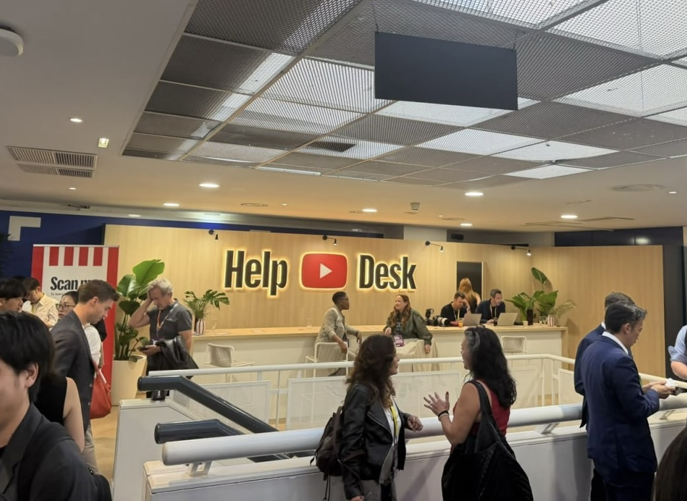
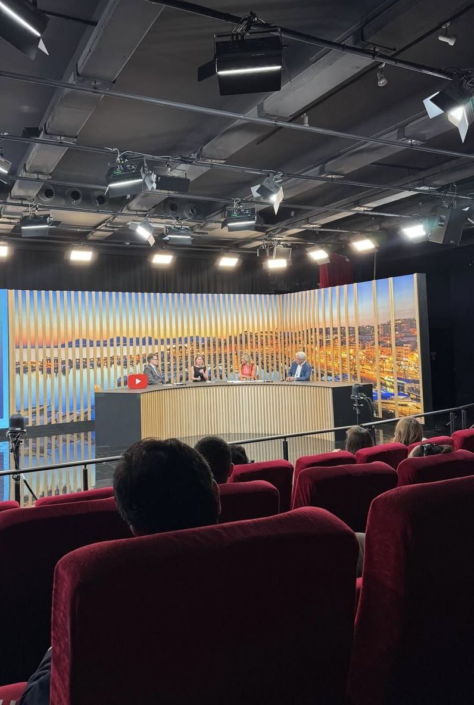
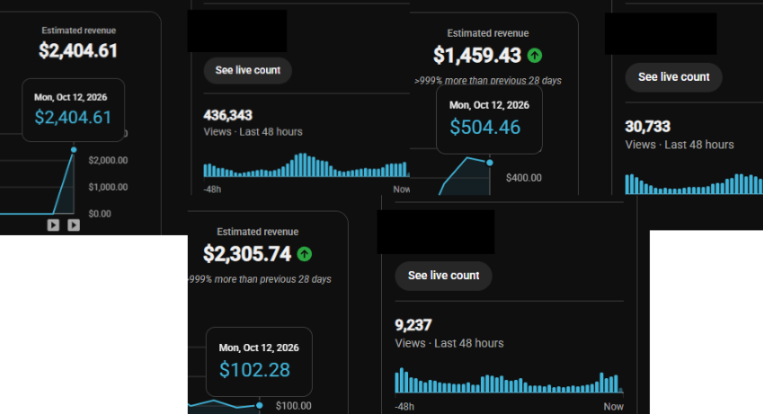
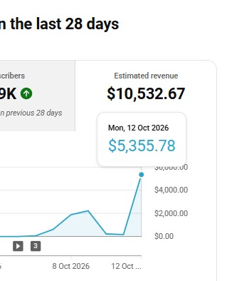
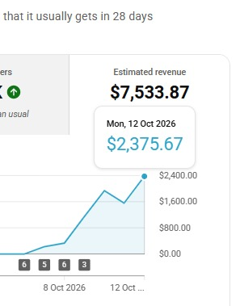
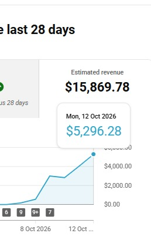
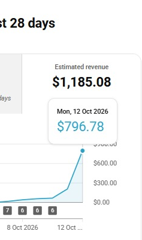

# 🚨 BREAKING: Someone just made a FREE library of hundreds of AI avatar channels that are scamming people on youtube 💀 https://t.co/a0fJ00q1F0
> Source: https://x.com/avatarchannels/status/2109592456203227516
> Author: Avatar Channels (@avatarchannels)
> Posted: 2026-10-12T10:30:10+00:00
> Captured: 2026-10-15T09:02:28+00:00
> Stats at capture: 13,783 views · 62 likes · 3 replies · 6 reposts · 96 bookmarks · 2 quotes

## Post

🚨 BREAKING: Someone just made a FREE library of hundreds of AI avatar channels that are scamming people on youtube 💀

## Media

[Post media 1](media/video-01.mp4) — Source media: https://video.twimg.com/amplify_video/2109591138873028608/vid/avc1/1280x720/n7GUFMYfOfPDAXtk.mp4?tag=29
 — Post media 1 thumbnail. Source media: https://pbs.twimg.com/amplify_video_thumb/2109591138873028608/img/zO95xpfG40ec81ts.jpg
 — Reply 2110431072043307419 media 1. Source media: https://pbs.twimg.com/media/HUnBOG2WkAA7uPL.jpg
 — Reply 2110431072043307419 media 2. Source media: https://pbs.twimg.com/media/HUnBOHPXMAEShd-.jpg
 — Reply 2110153456451215708 media 1. Source media: https://pbs.twimg.com/media/HUjAuGuXcAEVzAL.png
 — Reply 2110419799419363573 media 1. Source media: https://pbs.twimg.com/media/HUm3nazXgAAPxvS.png
 — Reply 2110419799419363573 media 2. Source media: https://pbs.twimg.com/media/HUm3nasW0AAFr_7.png
 — Reply 2110419799419363573 media 3. Source media: https://pbs.twimg.com/media/HUm3nawWwAACR-f.png
 — Reply 2110419799419363573 media 4. Source media: https://pbs.twimg.com/media/HUm3nauW8AAeB1K.png
 — Reply 2110390172806218200 media 1. Source media: https://pbs.twimg.com/media/HUklSj2WcAAOOUb.jpg
[Reply 2110390172806218200 media 2](media/video-02.mp4) — Source media: https://video.twimg.com/amplify_video/2110351872972185600/vid/avc1/1280x720/dipXuCi8f4E8wpeu.mp4?tag=14
[Reply 2110390172806218200 media 3](media/video-03.mp4) — Source media: https://video.twimg.com/amplify_video/2110354508748337152/vid/avc1/1280x720/4b0o8hrPYC66uYkq.mp4?tag=14
[Reply 2110390172806218200 media 4](media/video-04.mp4) — Source media: https://video.twimg.com/amplify_video/2110355948715827200/vid/avc1/1280x720/9YXMqs5ujQeA_N7E.mp4?tag=14

## Thread

### Avatar Channels ([@avatarchannels](https://x.com/avatarchannels/status/2109592459206643987)) — 2026-10-12T10:30:11+00:00

go look inside for 100% free 👇

(MCP available)

https://t.co/xIEf7s3OMb

## Comments

### wannercashcow ([@wannercashcow](https://x.com/wannercashcow/status/2109746880653689015)) — 2026-10-12T20:43:48+00:00

@avatarchannels Legend 🤣
### Primal Robin ([@primalrobin](https://x.com/primalrobin/status/2109592876636074062)) — 2026-10-12T10:31:50+00:00

@avatarchannels huuuge

## Other returned timeline records

> The CLI did not expose reply relationships. These records do not start with a reply mention and were authored by someone other than the saved-post author. They may include recommendations or promoted posts; they are retained as source context, not verified replies.

### Starlink ([@Starlink](https://x.com/Starlink/status/2068115197718593741)) — 2026-06-19T23:34:21+00:00

Get connected with fast, reliable internet for streaming, video calls, online gaming and more.

Order online in minutes.
### Andrew | Youtube Automation ([@wizofYT](https://x.com/wizofYT/status/2110431072043307419)) — 2026-10-14T18:02:32+00:00

some interesting takeaways from today’s YouTube event

Youtube reps literally say: 

"The way content gets made is changing fast. AI is opening up an entirely new creative space, and the interesting part isn’t just making more content with less effort, it’s figuring out what becomes possible that wasn’t before

the tools are evolving, the question is who actually uses them to build something bigger"

not sure if there’s something I should be reading between the lines here, but

they are aware of all AI tools and generative editing, and it's not specifically a bad thing for the platform

( ofc if AI is used for impersonalization or creating fake sensitive avatars like doctors it's another story and becomes risky)

another big opportunity is audience diversification

different audiences, different content, different formats

each segment can be its own business vertical, with its own strategy and growth potential

trying to make one format work for everyone is a choice so is leaving entire audiences untapped

(and also, diversity makes channels safer from Generic or repetitive content btw)
 — Source media: https://pbs.twimg.com/media/HUnBOG2WkAA7uPL.jpg
 — Source media: https://pbs.twimg.com/media/HUnBOHPXMAEShd-.jpg
### b0rio ([@b0rio](https://x.com/b0rio/status/2110153456451215708)) — 2026-10-13T23:39:23+00:00

first 3k day ever 🧙‍♂️

since the last 1k tweet i did , we made some money , then we tried to scale, failed, lost everything and kept running in the red.

we were headless for 2-3 months just wasting our time and money on useless and meaningless change.

1 month ago we launched 100 channels and "monetized" 30+ , thats more than 30% monetization rate of launched channels!

sadly after the "monetizations" , we lost all the channels because they were ai slop and sleep slop. Due to some generic, some offputing , some relateds and everything was gone.

we were back to 0. that's when we decided to start launching real channels, in less than 2 weeks we managed to launch a channel in a new niche and it just took off on the third video. all the lessons we had learned from the past year came down to here. 

now we are scaling in the right direction.
this is the real q4 entrance. stay tuned. 🫡
 — Source media: https://pbs.twimg.com/media/HUjAuGuXcAEVzAL.png
### Hennessy ([@hnsyjj](https://x.com/hnsyjj/status/2110419799419363573)) — 2026-10-14T17:17:44+00:00

Had to make a comeback because of this insane CMS

All brand new channels

All glory to God! https://t.co/KmywIomX3w
 — Source media: https://pbs.twimg.com/media/HUm3nazXgAAPxvS.png
 — Source media: https://pbs.twimg.com/media/HUm3nasW0AAFr_7.png
 — Source media: https://pbs.twimg.com/media/HUm3nawWwAACR-f.png
 — Source media: https://pbs.twimg.com/media/HUm3nauW8AAeB1K.png
### David Daly ([@Element_221](https://x.com/Element_221/status/2110390172806218200)) — 2026-10-14T15:20:01+00:00

China channels are crazy - so are many other niches that used to require a good team of editors or high end video editing saas charging $ p/mn

now claude can do this-
here is a 20mn video made with claude x the reaper in 5 different style

ab testing videos will be a thing soon https://t.co/Nl6yEo2T8T
 — Source media: https://pbs.twimg.com/media/HUklSj2WcAAOOUb.jpg
 — Source media: https://video.twimg.com/amplify_video/2110351872972185600/vid/avc1/1280x720/dipXuCi8f4E8wpeu.mp4?tag=14
 — Source media: https://video.twimg.com/amplify_video/2110354508748337152/vid/avc1/1280x720/4b0o8hrPYC66uYkq.mp4?tag=14
 — Source media: https://video.twimg.com/amplify_video/2110355948715827200/vid/avc1/1280x720/9YXMqs5ujQeA_N7E.mp4?tag=14
