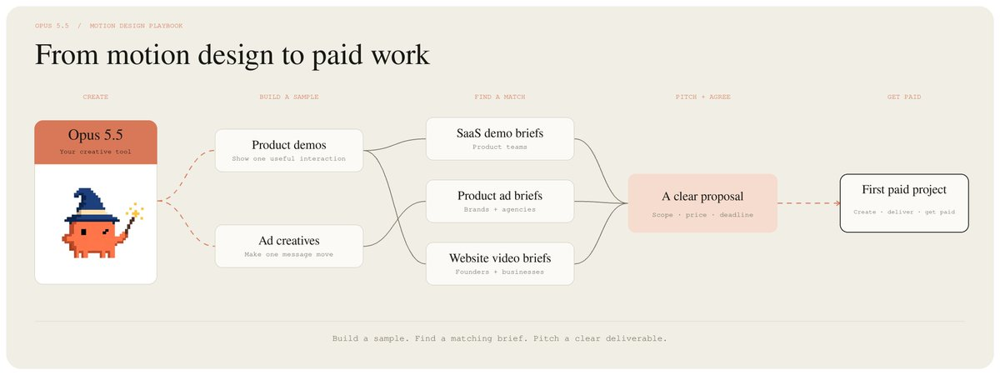
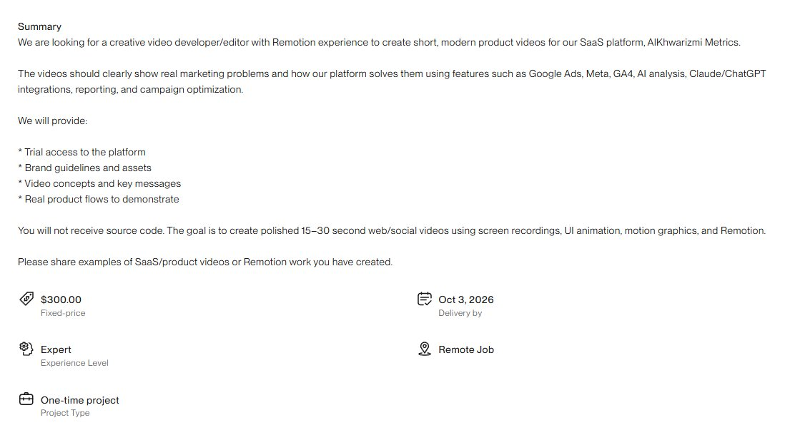
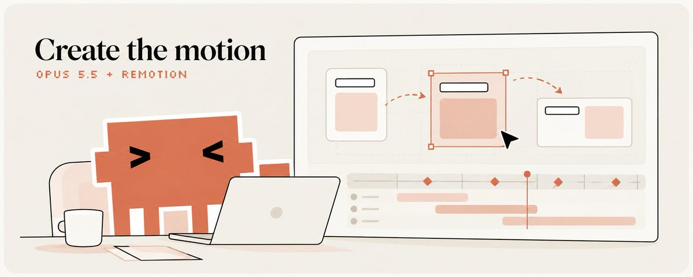
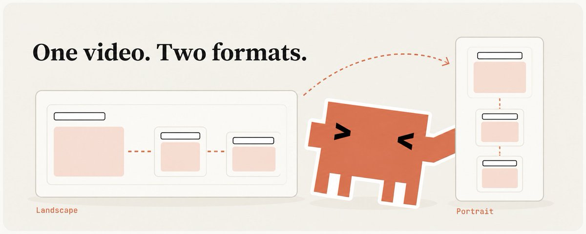
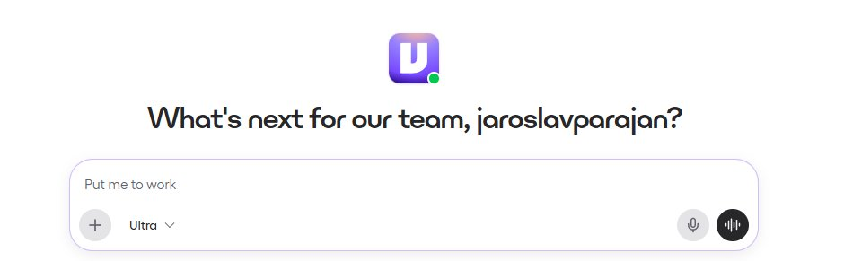
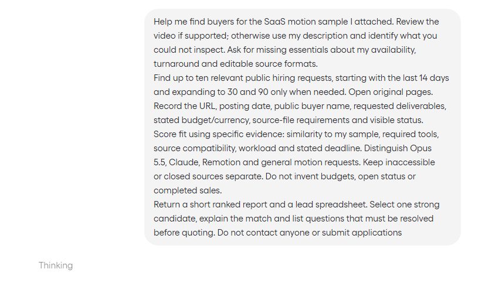
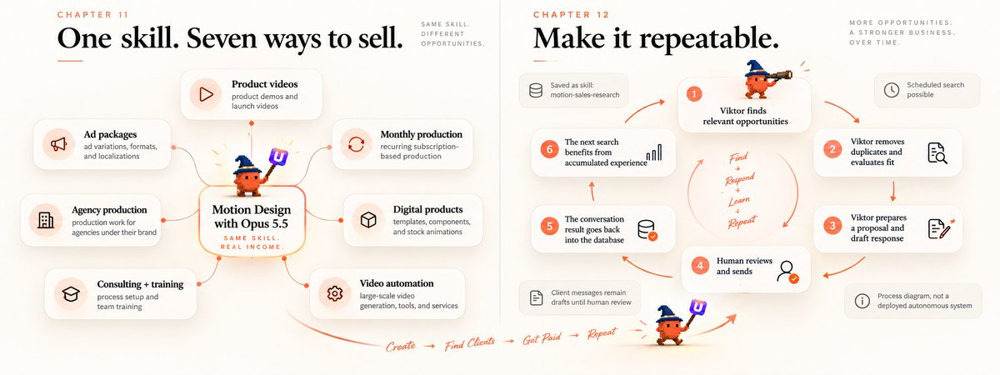
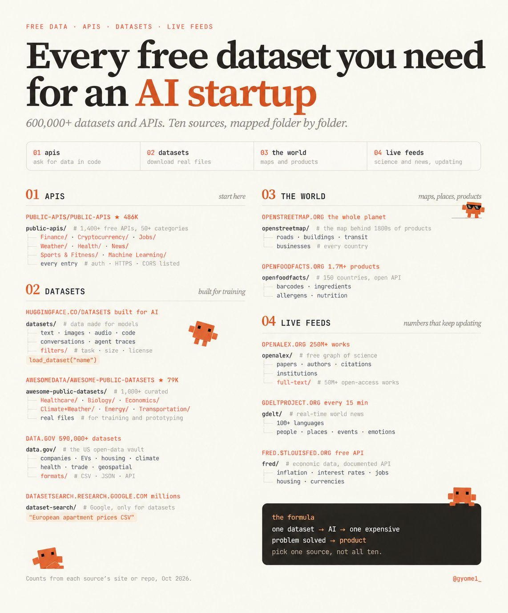
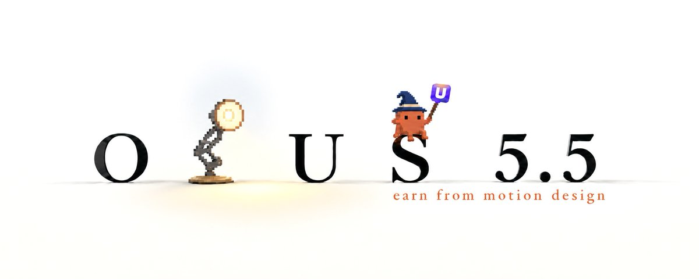

# holy sh*t, someone just mapped 600,000+ free datasets and APIs you can build an AI startup on today
> Source: https://x.com/Gyome1_/status/2109606016304214473
> Author: Gyomei (@Gyome1_)
> Posted: 2026-10-12T11:24:03+00:00
> Captured: 2026-10-15T09:02:28+00:00
> Stats at capture: 33,117 views · 543 likes · 19 replies · 64 reposts · 1,251 bookmarks · 2 quotes

## Post

holy sh*t, someone just mapped 600,000+ free datasets and APIs you can build an AI startup on today

finance, medicine, maps, science, news, food, government data, and most builders have no idea it’s free 

the drop:

→ http://github.com/public-apis/public-apis (486k ★ · 54k forks)
1,400+ free APIs across 50+ categories: finance, jobs, weather, health, crypto, news, sports, ML. every entry shows auth, HTTPS and CORS support

→ http://github.com/awesomedata/awesome-public-datasets (79k ★ · 12k forks)
1,000+ curated datasets on healthcare, biology, economics, climate, energy and transport, real files for training and prototyping

→ http://huggingface.co/datasets (22k ★ · 3.3k forks)
data built for AI: text, images, audio, code, conversations and agent traces, filterable by task, size and license, loadable straight from code

→ http://openstreetmap.org (2.8k ★ · 1.1k forks)
roads, buildings, businesses and transit for the whole planet, the map behind thousands of products

→ http://openfoodfacts.org (1.2k ★ · 662 forks · 1.7M+ products)
barcodes, ingredients, allergens and nutrition from 150 countries, with an open API

→ http://data.gov (1.1k ★ · 202 forks · 590,000+ datasets)
the US government’s open-data vault: companies, EVs, housing, climate, health, trade and geospatial data, much of it as CSV, JSON or API

→ http://openalex.org (250M+ scientific works)
a free graph of papers, authors, citations and institutions, with full text for 50M+ open-access works
→ http://gdeltproject.org (100+ languages · updates every 15 min)
real-time news from almost every country, with people, places, events and emotions extracted automatically

→ http://fred.stlouisfed.org (free documented API)
inflation, rates, jobs, housing and currencies, one of the best free economic databases

→ http://datasetsearch.research.google.com (millions of datasets)
Google Search, but only for datasets. type “European apartment prices CSV” and skip the giant catalogs

the formula:

one dataset → AI → one expensive problem solved → product

> Quoted post by codila ([@0xCodila](https://x.com/0xCodila/status/2107119130239185232)):
>
> It's probably the easiest way to make money with ONLY AI in 2026...
>
> Companies are already offering ~$500 for 15-sec videos made with Opus 5.5 & Fable 5.5
>
> In this article, I'll walk you through building a motion studio and share offers from scratch: https://x.com/i/article/2105263763951681536

## Quoted article: How to Get Money for Creating Motion Design with Opus 5.5 & Fable 5.5 (From Scratch)

Why is everyone hyping Opus 5.5/Fable 5.5 for motion design, but nobody talking about the SERIOUS money you can make with it?

Probably, I'll be the first to tell you about it... So listen:

-    Companies/clients that need design work for their products are actually willing to pay for videos like these and even state in their requirements: "The person must be highly skilled at using Opus 5.5."

In this article, I'll explain step by step how to go from zero to your first order using only Opus 5.5 + Viktor and I'll also provide these offers!

before the alpha -  subscribe to my substack for more fresh alpha - [https://substack.com/@0xcodila](https://substack.com/@0xcodila)



---

### Part One - Make something a buyer can use

01. Choose the job before the effects

I'm starting with a short SaaS product demo because the deliverable is specific: show one useful interaction clearly enough that a viewer understands the product.

There's a real example behind this choice. [AlKhwarizmi Metrics advertised for 15–30 second product videos made with Remotion](https://www.upwork.com/freelance-jobs/apply/Remotion-Video-Creator-for-SaaS-Product-Short-Videos_~022097601024365152669/)



- The brief offers product access, brand assets and real workflows to demonstrate. Its displayed project budget is $300 (damn $300 from 15 sec video

We'll return to that request when we reach the sales section, cause To get your first offer, you need to show the client a few examples of your work

So for now, make an independent concept: three marketing-report cards becoming one overview. Use original interface graphics and label the sample "Concept demo."

- That gives you something relevant to show without pretending you've worked for the company.

If you already have permission to use a real product, use its approved materials instead.

Your starting scope is one fifteen-second film, a widescreen master, a vertical adaptation and editable source files.

02. Get the studio running

- Install [Node.js](https://nodejs.org/en/download) and [Claude Code](https://code.claude.com/docs/en/quickstart). Sign in with access to Opus 5.5

[Opus 5.5 requires Claude Code 2.1.280 or later](https://code.claude.com/docs/en/model-config). Update an existing installation:

```
claude update
claude --version
```

Then follow [Remotion's official project setup](https://www.remotion.dev/docs/ai/coding-agents):

```
npx create-video --yes --blank --no-tailwind motion-studio
cd motion-studio
npm install
npx remotion skills add
npm run dev
```

Select Claude Code if the skill installer asks - leave the preview running and open another terminal in the same project folder:

Check /model before proceeding. Start at medium effort, use /effort high when a difficult implementation needs deeper investigation

```
claude --model claude-opus-5-5

```

You should now have a browser preview and a Claude session that can read the project. Keep the package lockfile once this setup works...

03. Give the video a story and a visual reference

Before asking for motion, decide what changes on screen. Our example has four beats:

- 0–3 seconds: three disconnected report cards. Headline: “Too many tabs.”

- 3–7 seconds: a cursor selects the cards; they move into one shared view.

- 7–12 seconds: the overview settles. Headline: “One clear view.”

- 12–15 seconds: a readable closing card: “Explore the demo.”

Keep the interface fictional. Use labels such as Ads, Social and Website, without fabricated performance results.

Next, attach one or two visual references. [P](https://x.com/rexan_wong/status/2103707054108299437)rocess below is useful for understanding how references guide production

[Embedded post](https://x.com/i/status/2103707054108299437)

I want Claude to extract typography, spacing and motion decisions. For a real client, supply its logo, fonts, screenshots and approved copy too.

Paste into Claude Code:

```
Read the installed Remotion skills and inspect this project. We are making an original, self-initiated SaaS concept demo, not a real client's advertisement.
Prepare brief.md, style-guide.md and storyboard.md for a 15-second, 1920x1080, 30 fps video. Use original interface graphics. Keep a small readable ‘Concept demo’ label throughout. Do not use third-party logos, testimonials or performance claims.
Storyboard: frames 0–89 show three report cards labelled Ads, Social and Website with ‘Too many tabs.’ Frames 90–209 show a cursor selecting and gathering them into one overview. Frames 210–359 reveal that overview with ‘One clear view.’ Frames 360–449 hold ‘Explore the demo.’
Analyze any references I supplied for visual principles, not assets to copy. If no reference is available, propose a restrained typographic direction using an available licensed font and two accent colors. List exact copy, assets, frame ranges, transitions and sound cues. Cover every frame. Preserve existing CLAUDE.md instructions and add these project rules. Show the storyboard for review before building.
```

- Read the storyboard. You should be able to explain what the viewer learns before any animation exists

For an actual brand, replace the concept material with its approved product behavior. Product below shows why recognizable product details matter:

[Embedded post](https://x.com/i/status/2103703135902740699)

04. Build the film so revisions stay manageable



Opus produces the code, Remotion renders it into video.

Every visual change should follow the frame number, so seeking and exporting reproduce the intended scene:

[Embedded post](https://x.com/i/status/2103485566570369333)

- This example uses the same idea through a seek function. We'll keep the renderer in Remotion for this project.

Approve the storyboard, then build a rough preview first. Check the interaction and reading time before spending effort polishing shadows.

Continue in Claude Code:

```
Implement the approved storyboard as a registered Remotion composition named SaaSDemo: 1920x1080, 30 fps, 450 frames. Preserve existing project work. Use the installed versions and their official APIs.
Separate editable copy, colors and asset paths from animation logic. Drive motion from useCurrentFrame and useVideoConfig; avoid wall-clock timers and unseeded randomness. Load the chosen font explicitly with the supported loading mechanism.
First render a low-resolution preview that covers all four scenes. Run the project's available type and lint checks. Fix errors before polishing.
Use Remotion spring() for the cards gathering into the overview. Start with mass 1, stiffness 180 and damping 22 as a tuning baseline, then inspect the result. Preserve element position when transitioning between states. Keep the headline still while it needs to be read. Do not animate every element simultaneously.
Export preview.mp4 and a contact sheet. Open the frames if supported, identify visible defects and fix the three most important ones. Save successful render commands and asset requirements in README.md. Report any checks you could not perform
```

[Remotion's spring controls](https://www.remotion.dev/docs/spring) let you tune the weight of that transition. Increase damping if the cards keep bouncing after the viewer should be reading.

- Look specifically at the moment separate cards become the overview. A jump in position or a sudden font change will break the illusion.

Pause near three and seven seconds. The cursor should touch the intended control, and the cards should land where the next scene expects them.

For longer films, expand the same brief into scenes with checkpoints. 

here's a useful reference:

[Embedded post](https://x.com/i/status/2102801469976248500)

also let a budget for paid tools and cap revision passes. Local work needs your computer available, save progress so another session can continue from it

btw in many job offers, companies cover all expenses; this is also something to keep in mind

05. Add sound and inspect the actual export

A few well-placed sounds are enough for this sample: a click at selection, a soft movement cue and a restrained sound when the overview settles.

Use original synthesized effects or assets you're licensed to publish.

- If you supply music, listen to the detected beats before aligning the whole film to them.

The [Remotion audio documentation](https://www.remotion.dev/docs/using-audio) covers placing and controlling sound within the composition.

Paste into Claude Code:

```
Finish the sound and review SaaSDemo against storyboard.md. Use approved audio if supplied. Otherwise synthesize a short click, a soft movement cue and a restrained completion tone as local WAV files; use no paid service.
Place cues at the actual interaction frames, with short fades and headroom. Integrate them into the Remotion composition so the MP4 contains the intended audio. Preserve a silent version if needed for comparison.
Render a contact sheet at one-second intervals and around every scene boundary. Inspect the images if supported. Check readable text at phone size, spacing, cursor continuity, scene coverage and the final three-second hold. Inspect the exported file's duration, dimensions, frame rate and audio stream. Check audio peaks for clipping; if you cannot listen, ask me to review the mix.
Fix the three most important defects and repeat for at most three passes. Save timestamped findings in review.md. Never mark an unavailable check as passed. Return the actual files and remaining issues for my review
```

Watch the export once muted and once with sound. Does the story still make sense? Can you read the closing line without pausing?

If you want a loop, check the end-to-start transition separately. Matching positions, movement and audio requires more than restarting the timeline.

06. Turn the render into a portfolio deliverable

Now make the vertical adaptation. Reposition the cards and resize the typography for the narrower screen.

Keep the same message and timing. The adaptation should look designed for its frame.



Final production prompt:

```
Create SaaSDemoVertical at 1080x1920, 30 fps, 450 frames by relaying out the approved film, not cropping it. Keep readable text, the concept label, the story and the audio timing.
Render both compositions as H.264 MP4s using the installed Remotion CLI. Verify each output opens and has the expected dimensions, duration and audio. Package the source project without secrets or node_modules, including the lockfile, permitted assets, license notes and exact install/render commands.
Create .claude/skills/motion-reel/SKILL.md with valid name and description frontmatter. Save the verified workflow and actual commands for future work, preserving unrelated instructions. Explain how to invoke /motion-reel and what must be supplied for a real client brief
```

You can also use [Remotion Studio's Render button or the CLI picker](https://www.remotion.dev/docs/render):

```
npx remotion render

```

open both MP4s yourself. Keep the source archive and check [Remotion's license](https://www.remotion.dev/docs/license/pricing) for your commercial setup.

Upload the sample somewhere a prospect can view it. Label it as self-initiated work and check the link opens without your login.

- Write a short portfolio caption naming the problem, your contribution and the delivered formats.

A buyer should understand your role without asking which parts you actually made.

> You now have something specific to show: a short SaaS interface film, two formats and an editable project. That's what we take into the sales work.
> 
> So of course, I didn't include absolutely every little detail of the video-making process, but that's a matter of taste and experience -as well as your own styl..

---

### Part Two - Find a buyer and prepare the proposal

07. Give Viktor the finished sample and a clear assignment

> [Set up Viktor](https://ref.viktor.com/codila-x), then give him the video, portfolio link and a short account of what you can deliver



Include your actual availability and supported source formats also if this is your first sample, say so!

Viktor's [research tools](https://viktor.com/docs/what-viktor-can-do) can investigate current sources. I want him to match the work to requirements, then explain the fit.

Useful searches include SaaS product video, UI animation, Remotion developer and product launch video.

Searching only for Opus misses buyers who describe the outcome they need.



Paste into [viktor.com](https://ref.viktor.com/codila-x):

```
Help me find buyers for the SaaS motion sample I attached. Review the video if supported; otherwise use my description and identify what you could not inspect. Ask for missing essentials about my availability, turnaround and editable source formats.
Find up to ten relevant public hiring requests, starting with the last 14 days and expanding to 30 and 90 only when needed. Open original pages. Record the URL, posting date, public buyer name, requested deliverables, stated budget/currency, source-file requirements and visible status.
Score fit using specific evidence: similarity to my sample, required tools, source compatibility, workload and stated deadline. Distinguish Opus 5.5, Claude, Remotion and general motion requests. Keep inaccessible or closed sources separate. Do not invent budgets, open status or completed sales.
Return a short ranked report and a lead spreadsheet. Select one strong candidate, explain the match and list questions that must be resolved before quoting. Do not contact anyone or submit applications
```

you can also try doing the same thing with your existing videos

I would open the selected source myself. "They need video" is too broad - I want matching deliverables and a realistic path to meeting the brief.

> If there is no good fit, keep searching or adjust the offer - the market is indeed full of offers. The shortlist should save you from unsuitable work too

Some of offers + places from Viktor:

- [Upwork](https://www.upwork.com/freelance-jobs/apply/Motion-Designer-Needed-for-SaaS-Product_~022104633244667679439/?utm_source=chatgpt.com) - SaaS Promo Video - $500

1. [Upwork](https://www.upwork.com/freelance-jobs/apply/Motion-Designer-Needed-Animated-SaaS-Product-Demos-for-Website-Enquiry-Estimate_~022105268799939404782/?utm_source=chatgpt.com) - Two UI Animations - $400 total

1. [Upwork](https://www.upwork.com/freelance-jobs/apply/Motion-Graphics-Demo-Video-Creation_~022105447902523111811/?utm_source=chatgpt.com) - Website Demo Video - $200

1. [Upwork](https://www.upwork.com/freelance-jobs/apply/Motion-Designer-Needed-Second-Logo-Animation_~022104484049520704157/?utm_source=chatgpt.com) - Podcast Logo Animation - $100

1. [Upwork](https://www.upwork.com/freelance-jobs/apply/Motion-Designer-for-Animated-Promo-Videos-Fintech-Startup_~022104323857664377965/?utm_source=chatgpt.com) - Fintech Promo Videos - $60–80 per video

1. [Upwork](https://www.upwork.com/freelance-jobs/apply/Senior-Video-Editor-Motion-Designer-for-Founder-Led-B2B-SaaS-Product-Demo_~022104663265826585186/?utm_source=chatgpt.com) - B2B SaaS Demo - approximately $2,000

1. [Upwork](https://www.upwork.com/freelance-jobs/apply/Second-Website-Explainer-Video_~022103981592014867848/?utm_source=chatgpt.com) - Website Explainer Video - $100

1. [Upwork](https://www.upwork.com/freelance-jobs/apply/Create-new-video-for-website_~022105334970080420846/?utm_source=chatgpt.com) - Website Animations - $100 total

1. [Freelancer](https://www.freelancer.com/projects/motion-graphics/lead-gen-saas-promo-video?utm_source=chatgpt.com) - SaaS Video Ad - $30–250

1. [Freelancer](https://www.freelancer.com/projects/adobe-premiere-pro/looping-led-logo-videos?utm_source=chatgpt.com) - Looping LED Visuals - approximately $42–62 total, converted from INR. [Wise](https://wise.com/in/currency-converter/usd-to-inr-rate/history?utm_source=chatgpt.com)

- [Upwork](https://www.upwork.com/freelance-jobs/motion-graphics/?utm_source=chatgpt.com)

- [Freelancer](https://www.freelancer.com/jobs/motion-graphics?utm_source=chatgpt.com)

- [PeoplePerHour](https://www.peopleperhour.com/freelance-motion-graphics-jobs?utm_source=chatgpt.com)

- [Contra](https://contra.com/opportunities?utm_source=chatgpt.com)

- [Twine](https://www.twine.net/jobs/motion-graphic-designers?utm_source=chatgpt.com)


And of course, you can also ask Viktor to look for startups and businesses on Instagram, Facebook, and so on - that’s a good starting point; there’s always someone who needs videos like that

08. Read the brief as someone who has to deliver it

Return to the [AlKhwarizmi Metrics request](https://www.upwork.com/freelance-jobs/apply/Remotion-Video-Creator-for-SaaS-Product-Short-Videos_~022097601024365152669/). It asks for real product flows, with access and materials supplied by the client.

Our concept demonstrates relevant animation skills - the paid film would need their actual interface and approved story.

> Have Viktor separate three things: requirements you can meet, missing information and work your sample doesn't demonstrate.

For this brief, clarify how many videos the project includes, required formats, revision rounds and source-file expectations before treating $300 as an acceptable quote

also published requests can close, these examples were checked October 2. Reopen the source before applying, or use Viktor to find a current equivalent.

For another angle, [this DTC brief explicitly prefers Opus 5.5 for motion graphics](https://www.upwork.com/freelance-jobs/apply/High-Volume-Video-Ads-Motion-Graphics-Product-Films-Ongoing-Work_~022103964650880764469/).

It also requests AI product films and multiple examples. A single SaaS demo would cover only part of its needs.

09. Calculate the offer before promising the price

For the SaaS example, I'd propose a bounded first assignment: one approved interaction, a fifteen-second film and the agreed aspect ratios.

Include a storyboard review, one revision round and the source project if the buyer wants it. Define what counts as a new request.

Give Viktor your real time estimate: briefing, asset preparation, animation, review, adaptation and delivery.

- Include direct costs and the applicable marketplace fee.

A repeatable template may reduce animation time. It won't remove client communication or revisions.

Here's an illustrative calculation: five hours at $40, including revision time, plus $20 in direct costs. That gives you a $220 base.

If the platform fee were 10%, dividing $220 by 0.90 gives a quote of $244.44 before tax. Replace every assumption with your own numbers.

Now check the quantity - If a $300 project includes several films, this single-film calculation cannot justify accepting the entire job.

Continue in Viktor:

```
Use the selected buyer's original brief and my confirmed capabilities to prepare a scoped offer. Ask me for missing production-time estimates, desired hourly earnings, direct costs, revision allowance and available delivery dates.
Calculate the quote transparently. Separate labor, direct costs and percentage fees; verify the current applicable fee from its official source. If the buyer's budget cannot cover the proposed scope, suggest a smaller paid pilot or recommend passing.
Produce offer.md and a client intake checklist. Specify exact deliverables, durations, aspect ratios, required assets, revision boundaries, source format, acceptance checks and when the delivery clock starts. Label proposed terms as proposed. Do not invent a price or deadline when inputs are missing
```

On [Upwork, fees can vary by contract](https://support.upwork.com/hc/en-us/articles/211062538-Learn-about-the-Freelancer-Service-Fee). Use the fee shown for your opportunity.

Your result here is an offer whose price and limits you can defend - send it only when you can deliver those terms.

10. Write a proposal the buyer can evaluate


I want the opening to show that you read the brief. Then give the buyer an example, a proposed first step and a useful question.

For our SaaS request, the core message could read:

```
Your brief calls for short videos built around real product workflows. I'd start with one interaction and turn it into a fifteen-second demo using your supplied access and brand assets.
My self-initiated sample shows the interface animation and pacing I can bring to that format. Before production, I'd share a storyboard with the exact screens and copy for approval.
Could you confirm how many videos the project covers and whether you need editable Remotion source files? That will let me confirm the scope and quote
```

Attach your actual sample, then add the price and timeline from the reviewed offer.

That passage is a proposed approach, not a claim of client results..

Have Viktor prepare the complete version:

```
Draft one concise proposal for the selected buyer using offer.md and my actual portfolio link. Refer to a specific requirement and explain how the sample demonstrates relevant work. Include the confirmed deliverables, proposed price and timeline, with any unresolved condition stated clearly.
Use only experience and results I supplied. If the sample is self-initiated, describe it that way. Ask for any missing detail needed for a send-ready proposal instead of inserting placeholders.
Return the proposal, source URL and proposed production brief for Claude Code. Do not submit it. After I provide a reply, help me resolve the buyer's questions and update the offer without silently expanding the scope
```

Review and submit through the appropriate channel yourself. Viktor's [email rules](https://viktor.com/docs/files-and-email) exclude cold outreach and bulk mail.

After agreement, confirm the [Upwork milestone is funded](https://support.upwork.com/hc/en-us/articles/211063718-How-payments-for-milestones-and-fixed-price-contracts-work) before starting paid production.

11. Let the first offer open other routes (+ a few more offers)

> The same sample can support more than one sales approach. I would have Viktor adapt the offer to evidence from each channel.



For [Upwork Project Catalog](https://support.upwork.com/hc/en-us/articles/360057397533-How-to-create-a-project-in-Project-Catalog) or Fiverr, have him turn the offer into a package with clear requirements and extras.

[Fiverr permits AI-assisted work under its rules](https://help.fiverr.com/hc/en-us/articles/34998793899665-Using-AI-on-Fiverr-Guidelines-for-freelancers-and-clients). Respect buyers who require a different production process.

For founder prospecting, Viktor can research a public launch and draft a relevant pitch.

For inbound work, he can turn your sample into a breakdown with a commissioning link.

For agencies, have him investigate production needs and accepted source formats. [Prismea's white-label request](https://www.upwork.com/freelance-jobs/apply/Motion-Designer-White-Label-Partner-Long-Term_~022099186542880280057/) provides a concrete example.

- [Viktor ](https://ref.viktor.com/codila-x)can also research referral partners and [Remotion's expert directory](https://www.remotion.dev/experts). I'd consider paid acquisition after an offer starts converting.

Once there is demand, expand the deliverable: launch bundles, ad-hook variations, localizations and product updates.

- [Viktor ](https://ref.viktor.com/codila-x)can price the additions from your actual production history.

For recurring work, have him scope monthly production, part-time support or agency capacity around what you can reliably deliver.

Reusable work opens another branch: branded motion kits, templates and components sold through [Gumroad](https://gumroad.com/pricing) or [Contra](https://contra.com/features/products).

- [Viktor](https://ref.viktor.com/codila-x) can research comparable products, prepare documentation and draft a listing.

For stock animations, have him check rules such as [Adobe Stock's AI-content requirements](https://helpx.adobe.com/stock/contributor/submit-your-content/submit-generative-ai-content/adobe-stock-generative-ai-faq.html).

At larger volumes, ask him to research demand for data-driven batches, client-owned generators or a subscription service.

> Those require engineering and ongoing support.

Consulting and training are options too: [this $1,000 workflow brief](https://www.upwork.com/freelance-jobs/apply/Video-Editing-Workflow-Consultant-Build-and-Train-Our-Team-Claude-Driven-Editing-Pipeline_~022104569420568154600/) already shows a hire.

Viktor can help turn your demonstrated process into a workshop and handover plan

12. Keep the work moving after the first proposal

Give Viktor the outcome of each conversation - with a connected [HubSpot workspace](https://viktor.com/integrations/hubspot), he can help maintain the deal and prepare follow-ups.

> Keep the approved scope beside the next action.

Send the agreed production brief into Claude Code, then return delivery notes so future estimates improve.

Log estimated versus actual hours and the reason for each revision.

[viktor.com](https://ref.viktor.com/codila-x) can use that history to flag underpriced packages and requests that repeatedly expand beyond the agreement.

Once the process is useful, save it as a [Viktor skill](https://viktor.com/docs/skills) and prepare a [scheduled search](https://viktor.com/docs/scheduled-tasks).

Final Viktor prompt:

```
Save our reviewed qualification, offer and proposal process as a reusable skill named motion-sales-research. Include my confirmed capabilities, actual source files, pricing inputs and evidence requirements.
Prepare a weekday 09:00 search for up to five new suitable buyer requests. Confirm my time zone, available capacity and delivery destination. Deduplicate against the saved lead file and include source links and checked dates.
Show a test result and the proposed schedule before activation. Keep outreach and submissions as drafts. Track replies and agreed work only through connections I authorize, or from updates I supply. Report where the skill and results are saved, what was activated and how to pause it. Flag blocked steps rather than claiming success
```

> You now have a concrete starting point: a finished sample, a researched buyer and a proposal based on what you can deliver.

Open [Viktor](https://app.viktor.com/signup), give him your sample and run the buyer-research prompt

Pick one request worth answering properly!

---

### The real example + the shift:

[Embedded post](https://x.com/i/status/2103918792845963545)

[chainpocket](https://chainpocket.pocketsflow.com/checkout/clientSecret/ch_mzC9vxISC7GPxgU?productId=6ab8dd49c644ea637375b94d&pw=0&c=USD) - https://x.com/achxvi 

This guy has literally created his own animation style and has already made several sales for $129, spending less than an hour (as he writes)

All of this was made possible by Opus 5.5, and this guy knows that there are actually a lot of people willing to pay for it...

 -So, as always, it all comes down to desire!

I’ve given you a complete guide on how to start your own one-person marketing agency from scratch.  

- Just try selling your first graphic - you’ll be inspired by how easy it is to find opportunities right now (speaking from personal experience)

Everything described in this article can also be done with Fable 5.5 - for those who already have early access (as of this post) or when it becomes available

Try free at @viktor_com $100 in credits, no card: https://ref.viktor.com/codila-x

Paid Partnership

## Media

 — Post media 1. Source media: https://pbs.twimg.com/media/HUbTOE-WoAAaYVT.jpg?name=orig
 — Quoted article media. Source media: https://pbs.twimg.com/media/HTtEBOcXsAAlEHg.jpg
 — Quoted article media. Source media: https://pbs.twimg.com/media/HTpXz2QWUAA05Ad.jpg
 — Quoted article media. Source media: https://pbs.twimg.com/media/HTpNcq0XoAAkrZQ.jpg
 — Quoted article media. Source media: https://pbs.twimg.com/media/HTpNiwxW0AA0TlC.png
 — Quoted article media. Source media: https://pbs.twimg.com/media/HTpN2DBWIAA3nZ6.jpg
 — Quoted article media. Source media: https://pbs.twimg.com/media/HTpNwgLX0AAwUkh.jpg
 — Quoted article media. Source media: https://pbs.twimg.com/media/HTtGZ3UXcAA_XAn.jpg
 — Quoted article media. Source media: https://pbs.twimg.com/media/HTpPgntWEAAyaIf.jpg
 — Quoted article media. Source media: https://pbs.twimg.com/media/HTpNrQtXIAA07Ie.jpg

## Comments

### bonesywonesy.eth ([@BonesyWonesy](https://x.com/BonesyWonesy/status/2109738868216111155)) — 2026-10-12T20:11:57+00:00

@Gyome1_ Just say "shit". You're being dumb censoring yourself.
### Fletch Featherhead ([@RealFeatherhead](https://x.com/RealFeatherhead/status/2110005753239200021)) — 2026-10-13T13:52:28+00:00

@Gyome1_ The reason this “announcement” has little traffic is that you promoters must not realize the outlandish claims made like “600,000” of any emerging AI tech would be IMPOSSIBLE TO ASSIMILATE, let alone 50. Time killers prevent progress.
### swapcherry ([@swapcherrycom](https://x.com/swapcherrycom/status/2109797677575831827)) — 2026-10-13T00:05:39+00:00

@Gyome1_ 600K DATASETS?? LFGGGG
### Payment Sandbox ([@BritJonovski](https://x.com/BritJonovski/status/2110418950144369077)) — 2026-10-14T17:14:22+00:00

@Gyome1_ 486k stars is a list of links, not a working integration. the hard part was never finding free data, it's the auth, rate limits, and schema drift when you actually wire it into an agent loop.
### orvexus ([@orvexus](https://x.com/orvexus/status/2109725366138884572)) — 2026-10-12T19:18:18+00:00

@Gyome1_ Check the license before building, plenty of those datasets forbid commercial use
### Skaly_Bull ([@Skaly__Bull](https://x.com/Skaly__Bull/status/2109629104567771382)) — 2026-10-12T12:55:48+00:00

@Gyome1_ GDELT updating every 15 minutes is the one on this list most people sleep on
### Bibi B ([@biancozirely3](https://x.com/biancozirely3/status/2110102263691952421)) — 2026-10-13T20:15:58+00:00

@Gyome1_ 100%
### Bibi B ([@biancozirely3](https://x.com/biancozirely3/status/2110101316458660045)) — 2026-10-13T20:12:12+00:00

@Gyome1_ Real


## Other returned timeline records

> The CLI did not expose reply relationships. These records do not start with a reply mention and were authored by someone other than the saved-post author. They may include recommendations or promoted posts; they are retained as source context, not verified replies.

### Starlink ([@Starlink](https://x.com/Starlink/status/2098481322268504487)) — 2026-09-11T18:38:29+00:00

Get fast, reliable home internet for seamless streaming, working from home, gaming, and more across multiple devices.

Order online in minutes.

## Links

- https://github.com/public-apis/public-apis
- http://github.com/public-apis/public-apis
- http://github.com/awesomedata/awesome-public-datasets
- http://huggingface.co/datasets
- http://openstreetmap.org
- http://openfoodfacts.org
- http://data.gov
- http://openalex.org
- http://gdeltproject.org
- http://fred.stlouisfed.org
- http://datasetsearch.research.google.com
- https://x.com/i/article/2105263763951681536
- https://wise.com/in/currency-converter/usd-to-inr-rate/history?utm_source=chatgpt.com
- https://gumroad.com/pricing
- https://x.com/rexan_wong/status/2103707054108299437
- https://ref.viktor.com/codila-x
- https://www.upwork.com/freelance-jobs/apply/Remotion-Video-Creator-for-SaaS-Product-Short-Videos_~022097601024365152669/
- https://www.remotion.dev/docs/spring
- https://help.fiverr.com/hc/en-us/articles/34998793899665-Using-AI-on-Fiverr-Guidelines-for-freelancers-and-clients
- https://app.viktor.com/signup
- https://www.upwork.com/freelance-jobs/apply/Senior-Video-Editor-Motion-Designer-for-Founder-Led-B2B-SaaS-Product-Demo_~022104663265826585186/?utm_source=chatgpt.com
- https://www.remotion.dev/docs/ai/coding-agents
- https://www.freelancer.com/projects/adobe-premiere-pro/looping-led-logo-videos?utm_source=chatgpt.com
- https://www.twine.net/jobs/motion-graphic-designers?utm_source=chatgpt.com
- https://www.upwork.com/freelance-jobs/apply/Motion-Graphics-Demo-Video-Creation_~022105447902523111811/?utm_source=chatgpt.com
- https://contra.com/features/products
- https://support.upwork.com/hc/en-us/articles/360057397533-How-to-create-a-project-in-Project-Catalog
- https://www.upwork.com/freelance-jobs/motion-graphics/?utm_source=chatgpt.com
- https://www.upwork.com/freelance-jobs/apply/Motion-Designer-Needed-for-SaaS-Product_~022104633244667679439/?utm_source=chatgpt.com
- https://nodejs.org/en/download
- https://viktor.com/integrations/hubspot
- https://support.upwork.com/hc/en-us/articles/211063718-How-payments-for-milestones-and-fixed-price-contracts-work
- https://www.peopleperhour.com/freelance-motion-graphics-jobs?utm_source=chatgpt.com
- https://www.remotion.dev/docs/using-audio
- https://support.upwork.com/hc/en-us/articles/211062538-Learn-about-the-Freelancer-Service-Fee
- https://www.freelancer.com/projects/motion-graphics/lead-gen-saas-promo-video?utm_source=chatgpt.com
- https://www.remotion.dev/experts
- https://www.upwork.com/freelance-jobs/apply/Video-Editing-Workflow-Consultant-Build-and-Train-Our-Team-Claude-Driven-Editing-Pipeline_~022104569420568154600/
- https://chainpocket.pocketsflow.com/checkout/clientSecret/ch_mzC9vxISC7GPxgU?productId=6ab8dd49c644ea637375b94d&pw=0&c=USD
- https://contra.com/opportunities?utm_source=chatgpt.com
- https://code.claude.com/docs/en/quickstart
- https://www.upwork.com/freelance-jobs/apply/Motion-Designer-Needed-Animated-SaaS-Product-Demos-for-Website-Enquiry-Estimate_~022105268799939404782/?utm_source=chatgpt.com
- https://www.upwork.com/freelance-jobs/apply/Motion-Designer-for-Animated-Promo-Videos-Fintech-Startup_~022104323857664377965/?utm_source=chatgpt.com
- https://www.remotion.dev/docs/render
- https://www.freelancer.com/jobs/motion-graphics?utm_source=chatgpt.com
- https://viktor.com/docs/what-viktor-can-do
- https://viktor.com/docs/files-and-email
- https://www.upwork.com/freelance-jobs/apply/Create-new-video-for-website_~022105334970080420846/?utm_source=chatgpt.com
- https://viktor.com/docs/scheduled-tasks
- https://substack.com/@0xcodila
- https://www.remotion.dev/docs/license/pricing
- https://helpx.adobe.com/stock/contributor/submit-your-content/submit-generative-ai-content/adobe-stock-generative-ai-faq.html
- https://www.upwork.com/freelance-jobs/apply/Motion-Designer-Needed-Second-Logo-Animation_~022104484049520704157/?utm_source=chatgpt.com
- https://code.claude.com/docs/en/model-config
- https://www.upwork.com/freelance-jobs/apply/Second-Website-Explainer-Video_~022103981592014867848/?utm_source=chatgpt.com
- https://www.upwork.com/freelance-jobs/apply/Motion-Designer-White-Label-Partner-Long-Term_~022099186542880280057/
- https://viktor.com/docs/skills
- https://www.upwork.com/freelance-jobs/apply/High-Volume-Video-Ads-Motion-Graphics-Product-Films-Ongoing-Work_~022103964650880764469/
