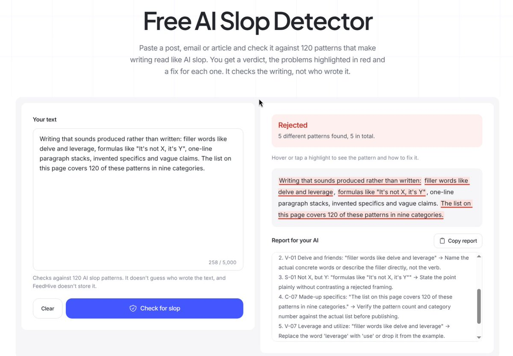
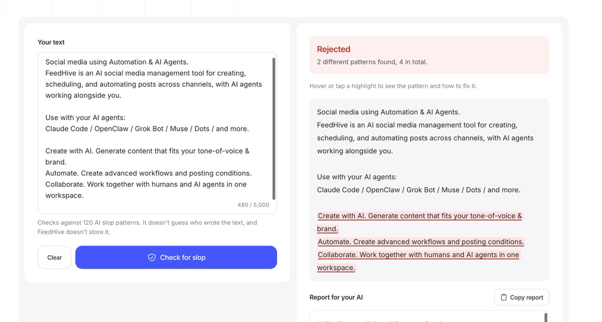

# I quietly launched something 👀
> Source: https://x.com/SimonHoiberg/status/2109612095763263987
> Author: Simon Høiberg (@SimonHoiberg)
> Posted: 2026-10-12T11:48:12+00:00
> Captured: 2026-10-15T09:02:28+00:00
> Stats at capture: 11,089 views · 115 likes · 50 replies · 12 reposts · 129 bookmarks · 2 quotes

## Post

I quietly launched something 👀 
And it changes EVERYTHING.

The best part?

...SLOP!

I can't fking take this AI slop writing anymore.

So we just open-sourced our internal list of AI slop writing patterns that we use in FeedHive, for YouTube script writing, and much more.

+120 patterns (and the list is growing).
Most comprehensive list on the internet.

Available on GitHub (including Claude skill).
And a tool you can use for free.

See links below 👇

...let's face it, we're all using AI to write now. At least, let's teach it how to not write total slop.

## Media

[Post media 1](media/video-01.mp4) — Source media: https://video.twimg.com/ext_tw_video/2109612072346451968/pu/vid/avc1/1280x720/HYYAHI_Rb86xU_PJ.mp4?tag=12
 — Post media 1 thumbnail. Source media: https://pbs.twimg.com/ext_tw_video_thumb/2109612072346451968/pu/img/P1mOdtYGy7ZVXZ-h.jpg
 — Reply 2109614650761662891 media 1. Source media: https://pbs.twimg.com/media/HUbbTSYboAAH640.jpg
 — Reply 2109619750938849702 media 1. Source media: https://pbs.twimg.com/media/HUbf2Z-aIAAErMz.jpg

## Thread

### Simon Høiberg ([@SimonHoiberg](https://x.com/SimonHoiberg/status/2109612097495523442)) — 2026-10-12T11:48:13+00:00

GitHub.
(Please drop a star)

https://t.co/rQNwpG15V2
### Simon Høiberg ([@SimonHoiberg](https://x.com/SimonHoiberg/status/2109612099257118929)) — 2026-10-12T11:48:13+00:00

Free tool.

https://t.co/bds9ikO9vJ
### Simon Høiberg ([@SimonHoiberg](https://x.com/SimonHoiberg/status/2109620754337648859)) — 2026-10-12T12:22:37+00:00

@tibo_maker Haha yeah? Would it have done a much better job? 😁
### Simon Høiberg ([@SimonHoiberg](https://x.com/SimonHoiberg/status/2109613852975358178)) — 2026-10-12T11:55:11+00:00

@virgilerietsch Let's goo!
### Simon Høiberg ([@SimonHoiberg](https://x.com/SimonHoiberg/status/2109619954207031723)) — 2026-10-12T12:19:26+00:00

@Monetisedev Right!
### Simon Høiberg ([@SimonHoiberg](https://x.com/SimonHoiberg/status/2109616093065060804)) — 2026-10-12T12:04:06+00:00

@nimi_101 I use this heavily when I have AI help me write for YouTube.
### Simon Høiberg ([@SimonHoiberg](https://x.com/SimonHoiberg/status/2109614262864011283)) — 2026-10-12T11:56:49+00:00

@heyandras I'm not just glad you think that. I'm thrilled 👏
### Simon Høiberg ([@SimonHoiberg](https://x.com/SimonHoiberg/status/2109615952736166220)) — 2026-10-12T12:03:32+00:00

@Manufussing Damn 😬

## Comments

### Tibo ([@tibo_maker](https://x.com/tibo_maker/status/2109620181295071482)) — 2026-10-12T12:20:20+00:00

@SimonHoiberg love this
i would have used Revid for this video though 😅
### Virgile RIETSCH ([@virgilerietsch](https://x.com/virgilerietsch/status/2109613152354685016)) — 2026-10-12T11:52:24+00:00

@SimonHoiberg instantly starring this!!
### Joakim William Hauge ([@Monetisedev](https://x.com/Monetisedev/status/2109616323412316626)) — 2026-10-12T12:05:00+00:00

@SimonHoiberg Sure, if you cant beat if you can't beat it, join it:D Its all about having something worth saying.
### Nimi ([@nimi_101](https://x.com/nimi_101/status/2109612685167886522)) — 2026-10-12T11:50:33+00:00

@SimonHoiberg this will be good especially for youtube creators
### Andras Bacsai ([@heyandras](https://x.com/heyandras/status/2109614154692559129)) — 2026-10-12T11:56:23+00:00

@SimonHoiberg Nice! :D
### Manufussing ([@Manufussing](https://x.com/Manufussing/status/2109614650761662891)) — 2026-10-12T11:58:22+00:00

@SimonHoiberg The FAQ seems to be AI Slop^^ https://t.co/HkitTKd4c3
 — Source media: https://pbs.twimg.com/media/HUbbTSYboAAH640.jpg
### Tux ([@tux404](https://x.com/tux404/status/2109704776330219946)) — 2026-10-12T17:56:29+00:00

@SimonHoiberg One of the most obvious ones has been in my agents rules for weeks: no em dashes. It's in a conventions file every session reads before writing anything.
The funny part? I used to use dashes all the time in my own writing. Now I've stopped using them altogether.
### Alan K ([@alanslkwong](https://x.com/alanslkwong/status/2109655475138760886)) — 2026-10-12T14:40:35+00:00

@SimonHoiberg Test it on a detector before and after. I hand-stripped every slop tell I could find from an essay and the score did not move, AI 100% both times. The detector is reading something a style pass does not change.
### Andy ([@andydevx2](https://x.com/andydevx2/status/2109900062654349546)) — 2026-10-13T06:52:29+00:00

@SimonHoiberg Thanks @SimonHoiberg I will definitely use it to clean up ai writing!
### Solar Studio ([@s_him88](https://x.com/s_him88/status/2109629579812061189)) — 2026-10-12T12:57:41+00:00

@SimonHoiberg slop be sloppin will defs have to try this
### Giacomo Masseroni ([@giacomomasseron](https://x.com/giacomomasseron/status/2109622171396170194)) — 2026-10-12T12:28:15+00:00

@SimonHoiberg slop detection should be a lint step honestly
### Ulrik Strandlyst ([@ulrikstrandlyst](https://x.com/ulrikstrandlyst/status/2109638854701658375)) — 2026-10-12T13:34:32+00:00

@SimonHoiberg Saving this, slop writting is still far from finished
### Yannis ([@yannnis](https://x.com/yannnis/status/2109644104418181345)) — 2026-10-12T13:55:24+00:00

@SimonHoiberg how does it compare to Pangram? for real
### geneoffline ([@geneoffline6](https://x.com/geneoffline6/status/2109899435560018283)) — 2026-10-13T06:50:00+00:00

@SimonHoiberg Half the slop is having nothing to say, no pattern list fixes that
### Buzz ([@BuzzMalx](https://x.com/BuzzMalx/status/2109630211956580491)) — 2026-10-12T13:00:12+00:00

@SimonHoiberg schools will love this
### Rik Nieu ⚡️ ([@RikNieu](https://x.com/RikNieu/status/2109637109426598124)) — 2026-10-12T13:27:36+00:00

@SimonHoiberg I just tell it not to write like a Buzzfeed article
### Andrew @ Distribute.so ([@andymewborn](https://x.com/andymewborn/status/2110122871397773651)) — 2026-10-13T21:37:51+00:00

@SimonHoiberg Too much AI slop is floating right now
### John ([@JohnArndt](https://x.com/JohnArndt/status/2109650377700458777)) — 2026-10-12T14:20:20+00:00

@SimonHoiberg The sad thing is that AI slop is probably better writing than 95% of people could do
### Jeremy Bosma ([@jeremybosma_](https://x.com/jeremybosma_/status/2109632415450931508)) — 2026-10-12T13:08:57+00:00

@SimonHoiberg whats the worst pattern on the list
### Parvez - ThriveDesk ([@parvezvai](https://x.com/parvezvai/status/2109619750938849702)) — 2026-10-12T12:18:38+00:00

@SimonHoiberg homepage hero seems to be SOP https://t.co/9i1dFEGVKp
 — Source media: https://pbs.twimg.com/media/HUbf2Z-aIAAErMz.jpg
### sayyid ali ([@Sayyidalijufri](https://x.com/Sayyidalijufri/status/2109620401550614763)) — 2026-10-12T12:21:13+00:00

@SimonHoiberg i hope this open source thing become a trend
### Matías Matthews ✈️ Backplane ([@MatiasMatthews](https://x.com/MatiasMatthews/status/2109703669214253419)) — 2026-10-12T17:52:05+00:00

@SimonHoiberg I’d test it against a few pieces I wrote before using AI. Some “bad patterns” may be part of someone’s actual voice. A way to keep those exceptions would be useful.
### Sam Ellis ([@CrazyCitizen01](https://x.com/CrazyCitizen01/status/2109677030501667056)) — 2026-10-12T16:06:14+00:00

@SimonHoiberg Do you catch the slop patterns in the harness before the model drafts, or only when you review what it wrote?
### Andrea Bruno ([@baronunread](https://x.com/baronunread/status/2109923329771790414)) — 2026-10-13T08:24:56+00:00

@SimonHoiberg Wanna collaborate send a PR to style-doctor? I haven't seen those patterns you mentioned.
https://t.co/wYUTwtJQlu
https://t.co/ADNEHTRJlZ
### Eric Solodev ([@ericsolodev](https://x.com/ericsolodev/status/2109619531991941380)) — 2026-10-12T12:17:45+00:00

@SimonHoiberg been thinking about something like this myself for a while :) with an extension or similar. gj
### Eggb4by ([@eggbaby](https://x.com/eggbaby/status/2110024170083885232)) — 2026-10-13T15:05:39+00:00

@SimonHoiberg The plain rewrites are the useful part. Much easier to show an AI what you mean than keep saying “less AI-sounding, please.”
### Glenn Thomas ([@GlennThomas_](https://x.com/GlennThomas_/status/2109628561506349510)) — 2026-10-12T12:53:38+00:00

@SimonHoiberg very nice, so many tells you start to notice.  Which pattern showed up most in your FeedHive drafts?
### Asrar ([@asrrrrrr217](https://x.com/asrrrrrr217/status/2109934291883069498)) — 2026-10-13T09:08:30+00:00

@SimonHoiberg Yes exactly man!!
### Iqbal.dev ([@Imheyhomees](https://x.com/Imheyhomees/status/2109784142091337951)) — 2026-10-12T23:11:52+00:00

@SimonHoiberg I liked the  goal but coming from ai is a slop and whatever human wrote was awesome is kind of slop
### Zeï ([@Zei_lani](https://x.com/Zei_lani/status/2109628537309466720)) — 2026-10-12T12:53:32+00:00

@SimonHoiberg good product but why the launching motion is itself an AI slop ? 😭
### Dédale ([@thededale_](https://x.com/thededale_/status/2109619448558883290)) — 2026-10-12T12:17:26+00:00

@SimonHoiberg i'd put rhythm first, models drop the em dashes easily but three short sentences in a row still reads as AI
### Aapakari ([@aapakari](https://x.com/aapakari/status/2109622434697498924)) — 2026-10-12T12:29:17+00:00

@SimonHoiberg That changes EVERYTHING energy is bold for a slop pattern list
### Eric Pereira ([@iamericpereira](https://x.com/iamericpereira/status/2109766497543565659)) — 2026-10-12T22:01:45+00:00

@SimonHoiberg Slop won because publishing became free. The scarce asset is no longer writing, it is the filter. Whoever owns the 'worth reading' verdict owns the feed. Every slop complaint is demand for exactly that.
### Duncan Trevithick ([@innermaps](https://x.com/innermaps/status/2109981135090422017)) — 2026-10-13T12:14:38+00:00

@SimonHoiberg Awesome! Have merged in a few things to https://t.co/EwEH3cbtXy
### ˗ˏˋ DC ˎˊ˗ ([@dcsan](https://x.com/dcsan/status/2109650377402368333)) — 2026-10-12T14:20:20+00:00

@SimonHoiberg Nice hack. Seeing AI slop patterns in the wild makes me prune my own prompts more aggressively
### Kea PM ([@keapmofc](https://x.com/keapmofc/status/2109618039213662589)) — 2026-10-12T12:11:50+00:00

@SimonHoiberg Probably need to run ads for this one @SimonHoiberg
### Giorgio Barilla ([@gibarilla](https://x.com/gibarilla/status/2109657987552006374)) — 2026-10-12T14:50:34+00:00

@SimonHoiberg Have you ran evals on this? I tried something similar and while some experiments worked others were a regression vs simply asking the model to sound more human.
### Gabriel le roux ([@coolsoftware_ws](https://x.com/coolsoftware_ws/status/2109613741339746372)) — 2026-10-12T11:54:45+00:00

@SimonHoiberg Very useful. Did you perhaps find that it improves views and engagements? By how much %?
### Saif Shaikh ([@saifgeeky](https://x.com/saifgeeky/status/2109656525618987180)) — 2026-10-12T14:44:45+00:00

@SimonHoiberg Take all the stars, Simon!
### Sergiu 🤖 AI Directories ([@s_chiriac](https://x.com/s_chiriac/status/2109650949816115375)) — 2026-10-12T14:22:36+00:00

@SimonHoiberg "Delve" is on the list I hope 😂 Bookmarking this one 💪

## Other returned timeline records

> The CLI did not expose reply relationships. These records do not start with a reply mention and were authored by someone other than the saved-post author. They may include recommendations or promoted posts; they are retained as source context, not verified replies.

### Starlink ([@Starlink](https://x.com/Starlink/status/2092706810310619298)) — 2026-08-26T20:12:38+00:00

Starlink offers fast, reliable internet in the most rural and remote locations. Portable and easy to set up, Starlink Mini works wherever you are.

Order online in minutes.
