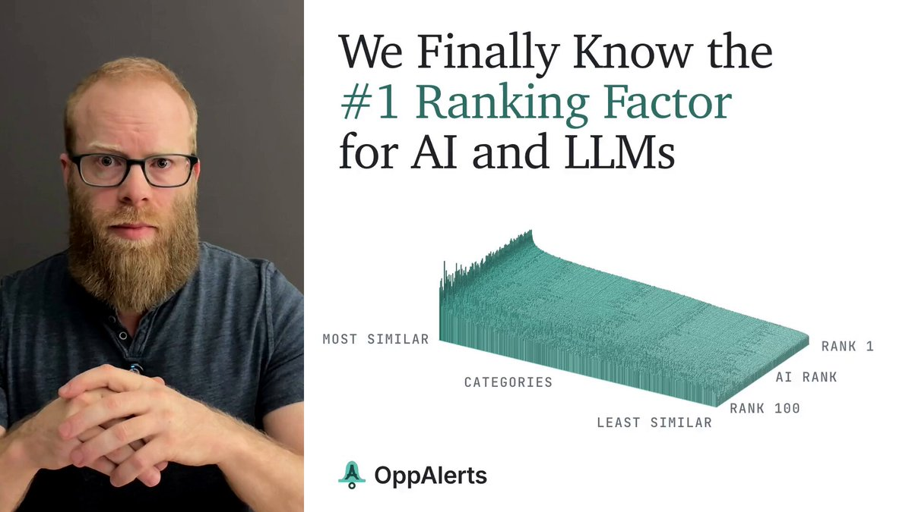

# We Finally Know the #1 Ranking Factor for AI and LLMs.
> Source: https://x.com/benwills/status/2109614670344573390
> Author: Ben Wills (@benwills)
> Posted: 2026-10-12T11:58:26+00:00
> Captured: 2026-10-15T09:02:28+00:00
> Stats at capture: 8,808 views · 107 likes · 27 replies · 6 reposts · 205 bookmarks · 4 quotes

## Post

We Finally Know the #1 Ranking Factor for AI and LLMs.

Across 100 industries, 16 LLMs, ChatGPT's web interface, and Google AI Overviews, I found the same pattern over 20,000 times:

The top-recommended sites have backlinks and brand mentions on pages that are more relevant to their industry.

And yes, that includes brand mentions without a link.

--

This kind of research involves more complexity and more layers than usual. So, I _highly_ suggest you take 12 minutes and watch the video.

Seriously. I can almost guarantee you will learn a lot about how LLMs work.

--

If you understand how LLMs are trained, this is _exactly_ what you would expect.

But, until today, we've had to rely on our intuition for that guidance.

That's no longer the case. We now have concrete evidence that this is the primary ranking factor for AI and LLMs.

In the end, for AI search visibility, your SEO, link building, content, PR, and reputation teams all need to be on the same page about who you're trying to reach and how you want to be referenced.

--

That's also what I built OppAlerts to help you do. It brings semantic similarity to your brand monitoring, competitor research, and link prospecting, so you can find opportunities most relevant to your business and target market.

Tomorrow, I'll have the blog post with all of the data.

Next week, I'll have a much longer video - probably about an hour - helping you and other marketers understand how AI and LLMs work at a much deeper level. This 12-minute video is a small sample of that.

Follow to stay tuned for all the updates around this and future research as well.

If you don't want to watch the video, or want a text version, the blog post is in the top comment.

## Media

[Post media 1](media/video-01.mp4) — Source media: https://video.twimg.com/amplify_video/2109611927483584512/vid/avc1/1280x720/2nb8XEX9ZIJTmhUE.mp4?tag=29
 — Post media 1 thumbnail. Source media: https://pbs.twimg.com/amplify_video_thumb/2109611927483584512/img/n7SdoXcZseenAwzp.jpg
[Reply 2109829163414950237 media 1](media/animation-01.mp4) — Source media: https://video.twimg.com/tweet_video/HUeeb6WbAAA0RKG.mp4

## Thread

### Ben Wills ([@benwills](https://x.com/benwills/status/2109642885448561021)) — 2026-10-12T13:50:33+00:00

@itsalexjardine I would agree. I think we're in a particular time right now where LLMs are still in their infancy. And so things like pure mentions are working.

But, especially as they evolve, things like contextually relevant + authority sites are going to have even more of an impact.
### Ben Wills ([@benwills](https://x.com/benwills/status/2109647769510314346)) — 2026-10-12T14:09:58+00:00

@scott_stouffer Definitely. And with how specific personalization can be with LLMs, it also means being more specific about who your customer is and what those conversations are.
### Ben Wills ([@benwills](https://x.com/benwills/status/2109617926613405939)) — 2026-10-12T12:11:23+00:00

@jdellamora That totally makes sense, especially at the local level where there's less global competition. Awesome you're seeing that.

## Comments

### Alex Jardine ([@itsalexjardine](https://x.com/itsalexjardine/status/2109641766412423617)) — 2026-10-12T13:46:07+00:00

@benwills For a small business, I'd read that as a mention from a trade association or supplier page being worth more than a generic guest post.
### Joe Della Mora ([@jdellamora](https://x.com/jdellamora/status/2109617399616213055)) — 2026-10-12T12:09:17+00:00

@benwills The unlinked-mention finding matches what we see at the local level. The pages a model cites about a plumber or a clinic are mostly directories, reviews and roundups, not the business's own site. The record other sites keep about you does most of the work.
### Alex Ai | Tools & Updates ([@AlexWithAi_](https://x.com/AlexWithAi_/status/2109650343089115405)) — 2026-10-12T14:20:11+00:00

@benwills Fascinating research confirms relevance of mentions drives LLM recommendations most
### Brian Hadu ([@BrianHaDu](https://x.com/BrianHaDu/status/2109874677237915901)) — 2026-10-13T05:11:37+00:00

@benwills context matters, but I've seen niche sites rank high with fewer backlinks
### Mark Fulton ([@ReinventingAI](https://x.com/ReinventingAI/status/2109829163414950237)) — 2026-10-13T02:10:45+00:00

@benwills Me looking for the blog post you mentioned was in the comments... https://t.co/eWQhismz6g
 — Source media: https://video.twimg.com/tweet_video/HUeeb6WbAAA0RKG.mp4
### Darryl Morley ([@morley_darryl](https://x.com/morley_darryl/status/2109813901839786208)) — 2026-10-13T01:10:07+00:00

@benwills @SEO You mean relevant backlinks! 🤯
### OliB ([@OliRBraithwaite](https://x.com/OliRBraithwaite/status/2109806008155664471)) — 2026-10-13T00:38:45+00:00

@benwills @VeryWellVersed Hey Ben. Wouldn’t query fan out and grounding basically guarantee this though? A search engine is used during query fan out which is built to surface the most relevant pages, and then from that corpus the consensus is synthesised and output. So, it would have to be relevant pages
### Ankit Solanki ([@solankith](https://x.com/solankith/status/2109961087366189229)) — 2026-10-13T10:54:59+00:00

@benwills Sent request for an oppalerts account.
### Waseit AI ([@Waseit_AI](https://x.com/Waseit_AI/status/2109945580210556973)) — 2026-10-13T09:53:21+00:00

@benwills We visited all 665 links ChatGPT and Gemini gave while recommending a named business. Of the 474 to a business's own site, 141 led nowhere - but the third-party pages held: 9 dead of 191 for directories and registers.

Both via API, no web search.

https://t.co/ulXUEXorns
### Muhammad Talha Javed ([@tallha_javed](https://x.com/tallha_javed/status/2109932324473180470)) — 2026-10-13T09:00:41+00:00

@benwills Matches what we've seen with clients. Relevance of the page mentioning you beats raw authority. One mention inside a "best X for Y" list that already ranks for the prompt's topic does more for AI recommendations than a DR 80 link from an off topic news site.
### SiteSignal ([@SiteSignalApp](https://x.com/SiteSignalApp/status/2110566581495570722)) — 2026-10-15T03:01:00+00:00

@benwills AI visibility is becoming a reputation game, not just a backlink game. AEO and generative engine optimisation need relevant brand mentions, trusted sources, and consistent positioning. If you want ChatGPT to recommend your brand, start tracking where and how your brand is mention
### Muntazir ([@cybr404](https://x.com/cybr404/status/2109755969672470838)) — 2026-10-12T21:19:55+00:00

@benwills Genuine question: did it hold as strongly for AI Overviews as for ChatGPT? I'd have guessed AIO leans more on normal Google rankings, so I'd expect the mention effect to be weaker there. Curious if the data agreed.
### catman ([@catmanyau](https://x.com/catmanyau/status/2109648993596604837)) — 2026-10-12T14:14:50+00:00

@benwills Relevant backlinks and unlinked brand mentions are a strong pattern, but calling them the #1 factor across AI search is stronger than the evidence described here alone can establish.
### Manish Balakrishnan ([@Iamnotmanish](https://x.com/Iamnotmanish/status/2109979856742297834)) — 2026-10-13T12:09:34+00:00

@benwills Makes sense that relevant mentions beat raw volume. For local service businesses the same thing shows up in AI answers: a handful of consistent citations and review pages beat a bloated directory dump evertime.
### Al ([@AlDev0](https://x.com/AlDev0/status/2110126142036332841)) — 2026-10-13T21:50:51+00:00

@benwills the backlinks correlation is the part i'd stress test. did you control for pages already ranking well organically?
### Veyra | AI & Tech ([@VeyraWithAI](https://x.com/VeyraWithAI/status/2109656196290675058)) — 2026-10-12T14:43:27+00:00

@benwills Twenty thousand tests proving relevant mentions beat links alone
### Elise Tech Ai ([@EliseTechAi](https://x.com/EliseTechAi/status/2109947389377470700)) — 2026-10-13T10:00:33+00:00

@benwills Fascinating research and really valuable insight for AI visibility
### Andre Porozny ([@NeverToOld60](https://x.com/NeverToOld60/status/2109824074079949053)) — 2026-10-13T01:50:32+00:00

@benwills Nice work

## Other returned timeline records

> The CLI did not expose reply relationships. These records do not start with a reply mention and were authored by someone other than the saved-post author. They may include recommendations or promoted posts; they are retained as source context, not verified replies.

### Scott Stouffer ([@scott_stouffer](https://x.com/scott_stouffer/status/2109647060391559480)) — 2026-10-12T14:07:09+00:00

This is the brand-identity problem I covered at SEO Week. Industry relevance puts a brand in the neighborhood; intent fit and distinctiveness explain why it belongs in the answer. At Market Brew we model those together to predict how a content change affects selection. That's the next step beyond mapping mentions.
