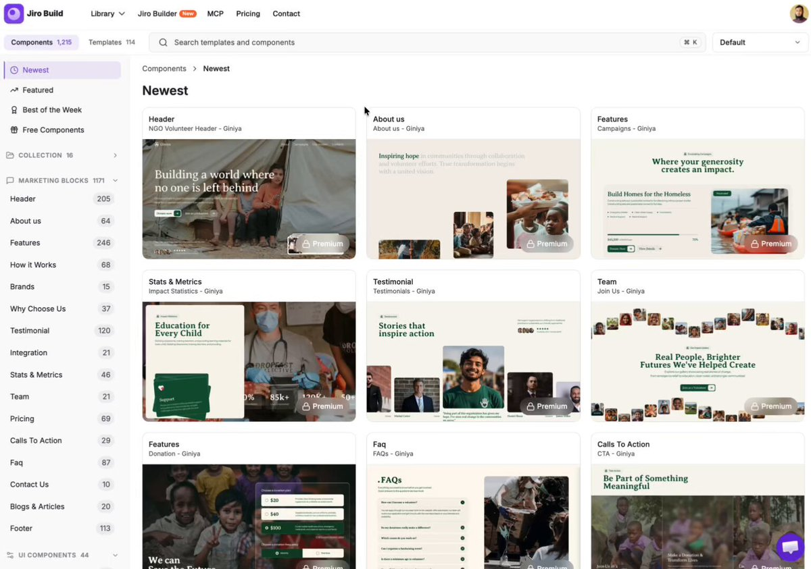

# If you are building websites with AI,
> Source: https://x.com/iamtanzil_/status/2109624423255048225
> Author: Tanzil Chowdhury (@iamtanzil_)
> Posted: 2026-10-12T12:37:12+00:00
> Captured: 2026-10-15T09:02:28+00:00
> Stats at capture: 1,027 views · 13 likes · 1 replies · 4 reposts · 14 bookmarks · 0 quotes

## Post

If you are building websites with AI, 
worth checking it out.  https://jiro.build

## Media

[Post media 1](media/video-01.mp4) — Source media: https://video.twimg.com/amplify_video/2109624335342460928/vid/avc1/1024x720/cyIh6X5jAmh6oh0s.mp4?tag=29
 — Post media 1 thumbnail. Source media: https://pbs.twimg.com/amplify_video_thumb/2109624335342460928/img/P-JvrqSK7V-JPqgI.jpg
[Reply 2109976098415288670 media 1](media/video-02.mp4) — Source media: https://video.twimg.com/amplify_video/2109976012167712768/vid/avc1/1538x1080/jDZITCePn_JW3MI0.mp4?tag=29

## Thread

### Tanzil Chowdhury ([@iamtanzil_](https://x.com/iamtanzil_/status/2109976098415288670)) — 2026-10-13T11:54:37+00:00

If you're a designer, bookmark this.

1. https://t.co/CgnzwKME3r - 1300+ design prompts with source code to build beautiful websites with AI in minutes.
2. https://t.co/rkr5EPVklx - navbar inspiration
3. https://t.co/r3M3UCRK0l -  better footers
4. https://t.co/yfP2cwbPtz -  CTA inspiration
5. https://t.co/xrnqcp6NRp -  Real product design styles
6. https://t.co/HBefRXMFVM  - Hero sections worth stealing
7. https://t.co/qaAFF77ntp  - 3D icons for modern interfaces
8. https://t.co/iFjZs9zCsW - Glass UI components and effects

What did I miss?
 — Source media: https://video.twimg.com/amplify_video/2109976012167712768/vid/avc1/1538x1080/jDZITCePn_JW3MI0.mp4?tag=29

## Comments

### Julien | Sublaunch ([@julienlevallois](https://x.com/julienlevallois/status/2109667160239046801)) — 2026-10-12T15:27:01+00:00

@iamtanzil_ curious which use case is converting better for you so far, people starting from a prompt or people tweaking an existing landing page idea

## Links

- https://jiro.build
