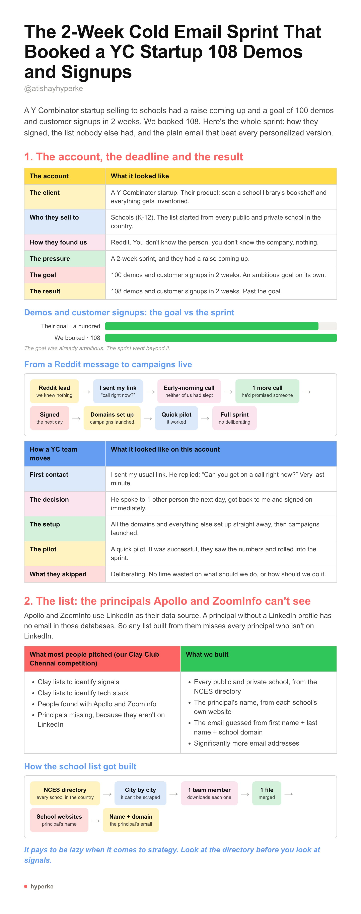
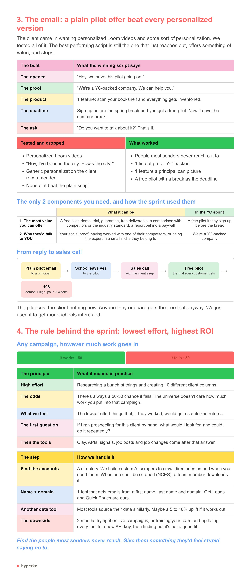

# I'm LEAKING the cold email playbook that got a YC-backed startup 108 demos and signups in 2 weeks:
> Source: https://x.com/atishayhyperke/status/2109645427775561870
> Author: Atishay (@atishayhyperke)
> Posted: 2026-10-12T14:00:39+00:00
> Captured: 2026-10-15T09:02:28+00:00
> Stats at capture: 10,874 views · 183 likes · 5 replies · 9 reposts · 365 bookmarks · 2 quotes

## Post

I'm LEAKING the cold email playbook that got a YC-backed startup 108 demos and signups in 2 weeks:

(bookmark)

## Media

 — Post media 1. Source media: https://pbs.twimg.com/media/HUb3UwLWQAAaLb1.jpg?name=orig
 — Post media 2. Source media: https://pbs.twimg.com/media/HUb3VTiW0AAusIk.jpg?name=orig

## Thread

### Atishay ([@atishayhyperke](https://x.com/atishayhyperke/status/2109660595867832613)) — 2026-10-12T15:00:56+00:00

Want us to book meetings for you with this engine? 

We'll run a risk-free 7-day pilot campaign for you first, so you get leads in your first 7 days before you commit.

(if you don't get leads, you don't pay)

Apply here: https://t.co/aQJX04QWIu

## Comments

### Vasanth K ([@benzene_phi_73](https://x.com/benzene_phi_73/status/2109949516657185030)) — 2026-10-13T10:09:00+00:00

@atishayhyperke Why does it look like a toddler made it?
### Mauro ([@MauroJPelle](https://x.com/MauroJPelle/status/2109944732805652506)) — 2026-10-13T09:49:59+00:00

@atishayhyperke did the deadline do the work or the free pilot? feels like the spring break line carried it
### Vanshika Tyagi ([@VTyagi9402](https://x.com/VTyagi9402/status/2109928537851666796)) — 2026-10-13T08:45:38+00:00

@atishayhyperke Gonna try this
