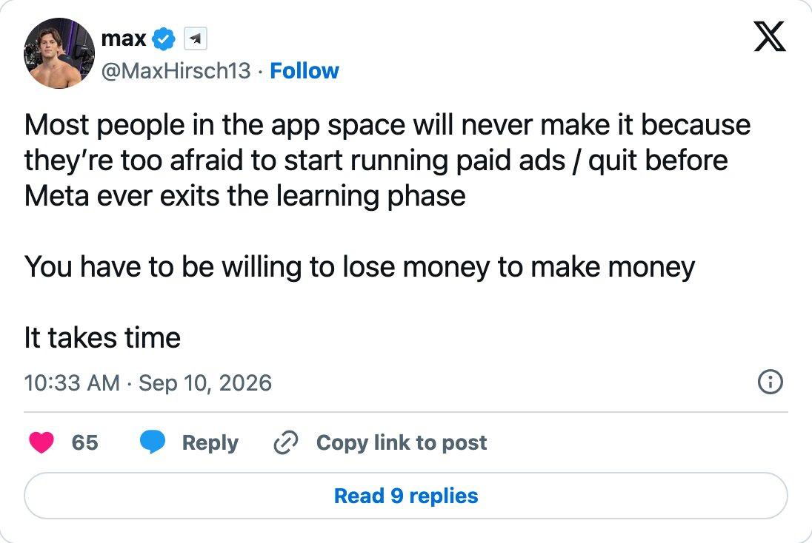

# The fastest-growing startups have turned the OLD B2B sales funnel → into this flywheel, where every stage feeds the next:
> Source: https://x.com/fivosaresti/status/2109645443961328081
> Author: Fivos Aresti (@fivosaresti)
> Posted: 2026-10-12T14:00:43+00:00
> Captured: 2026-10-15T09:02:28+00:00
> Stats at capture: 6,751 views · 80 likes · 18 replies · 9 reposts · 162 bookmarks · 1 quotes

## Post

The fastest-growing startups have turned the OLD B2B sales funnel → into this flywheel, where every stage feeds the next:

1. Traffic
• Outbound: email, LinkedIn DMs, cold calls, events
• Content: LinkedIn, X, YouTube, SEO
• Ads: LinkedIn, Meta, Google, Reddit
• Partnerships: directories, influencers, integrations, agency programs

2. Lead capture
• Social followers → LinkedIn
• Website visitors → Apollo
• Social signals → Jungler
• Gated content → Tally
• Form fills → HubSpot
• Free trials → Clerk

3. Nurture
• Digital: newsletter, email flows, retargeting, organic social
• Website: case studies, demos, free tools, webinars
• Field: gifts, dinners, partner events, community events
• All 3 run in parallel, timed to where each account is in the buying cycle

4. Data routing
• Clay, Claude Code: every lead + touchpoint syncs to the CRM, enriched on the way in

5. Qualification
• Every lead gets scored Tier 1, 2 or 3
• Qualified → sequences, a rep + a Slack ping
• Unqualified → a nurture sequence

6. Conversion
• Tier 1 → 1:1 manual outreach with Nooks + ABM Ads
• Tier 2 → Instantly + HeyReach sequences
• Tier 3 → Instantly bulk sequences

7. Close, retention + expansion
• 4 pipelines run in parallel: leads, deals, renewals, expansion
• PostHog track product usage
• Chili Piper route inbound demos
• Ergo, Nooks, Qwilr + HubSpot run the deal cycle

Then the stages start feeding each other:

→ People who engaged with a LinkedIn post yesterday get a personalized email today
→ A post that pulled 100k organic impressions gets a $5k boost and adds another 150k impressions
→ Ads hit the same accounts as your outreach.

## Media

[Reply 2110417670524776890 media 1](media/video-01.mp4) — Source media: https://video.twimg.com/amplify_video/2110417533664669696/vid/avc1/796x720/gD94p-WcVksKPLyj.mp4?tag=29
[Reply 2110449100608979450 media 1](media/video-02.mp4) — Source media: https://video.twimg.com/amplify_video/2110448576262266880/vid/avc1/1080x1920/CW6w-7OO-POZY2yo.mp4?tag=29
 — Reply 2110445767215259865 media 1. Source media: https://pbs.twimg.com/media/HUnPPJ6WsAAsqk6.jpg

## Comments

### Greg Glazewski ([@Greg_GL_87](https://x.com/Greg_GL_87/status/2109660181667975412)) — 2026-10-12T14:59:17+00:00

@fivosaresti Clerk under free trials is a stretch, it's a login tool
### Daniel A. Saedi (DataManDan) ([@TheRealDanSaedi](https://x.com/TheRealDanSaedi/status/2109822158713376838)) — 2026-10-13T01:42:55+00:00

@fivosaresti The best ones are running paid acquisition via @minerva
### Jamie ([@jamiejreach](https://x.com/jamiejreach/status/2109893375378043333)) — 2026-10-13T06:25:55+00:00

@fivosaresti The flywheel part sits in the last three arrows: a post engager getting an email the next day and ads hitting the same accounts as outreach are what the old funnel lacked, because each stage hands the next one its context.
### catman ([@catmanyau](https://x.com/catmanyau/status/2109667136125972671)) — 2026-10-12T15:26:55+00:00

@fivosaresti A sales flywheel is a pinball table: each interaction should route the account to the next useful touch, while engagement data improves where the next nudge lands.
### Al ([@AlDev0](https://x.com/AlDev0/status/2109989991103541558)) — 2026-10-13T12:49:50+00:00

@fivosaresti seo feeding outbound is the part most teams never wire up
### Alex Tash ([@Alextash](https://x.com/Alextash/status/2109660436429762858)) — 2026-10-12T15:00:18+00:00

@fivosaresti Somewhere in this stack is a founder paying 19 subscriptions to avoid calling five customers 😂

## Other returned timeline records

> The CLI did not expose reply relationships. These records do not start with a reply mention and were authored by someone other than the saved-post author. They may include recommendations or promoted posts; they are retained as source context, not verified replies.

### Starlink ([@Starlink](https://x.com/Starlink/status/2068115197718593741)) — 2026-06-19T23:34:21+00:00

Get connected with fast, reliable internet for streaming, video calls, online gaming and more.

Order online in minutes.
### Brilliance | Ads & Funnels ([@brillaas](https://x.com/brillaas/status/2110445561426149486)) — 2026-10-14T19:00:06+00:00

My typical flow for making landing pages

Research:
-> Go through onboarding and figure out what our client is even selling in the first place lol
-> Who is the customer
→ What is the product
-> What do they WANT right now
-> What are they avoiding
-> What have they tried
-> What are they currently being compared to

Positioning:
-> What is the offer being compared to?
-> What are the direct outcomes & benefits for each deliverable
-> What are the benefits that competitors aren't focused on
-> Use the standout one to make the headline

Copy:
-> Think through who we're selling to again
-> What do they want to see when they land on the page
-> Create copy around what they want to see in sequential order
### EcomBos ([@Ecombos_Ai](https://x.com/Ecombos_Ai/status/2110417670524776890)) — 2026-10-14T17:09:16+00:00

You have $1K to spend on one skincare ad.

A: A real-looking creator on her bed raving about the balm she tried yesterday.

B: A claymation world where a tiny ant saves a woman from her endless skincare routine.

Which one gets the budget, A or B? https://t.co/2Q5TjT9eDi
 — Source media: https://video.twimg.com/amplify_video/2110417533664669696/vid/avc1/796x720/gD94p-WcVksKPLyj.mp4?tag=29
### SendIt! Podcast ([@SendItpod](https://x.com/SendItpod/status/2110449100608979450)) — 2026-10-14T19:14:10+00:00

Prospect intent has a shelf life.

→ Follow up while interest is high.
→ Give proven buyers more patience.
→ Stop putting both groups on the same win-back clock.

A prospect still needs a first order. Waiting until they go cold makes that job harder.

@jimmykim @ecomchasedimond
 — Source media: https://video.twimg.com/amplify_video/2110448576262266880/vid/avc1/1080x1920/CW6w-7OO-POZY2yo.mp4?tag=29
### Tim Keen ([@maestrotimk](https://x.com/maestrotimk/status/2110445767215259865)) — 2026-10-14T19:00:55+00:00

i was chatting with the CMO at an established $6M ARR B2B saas. they were booking dozens of sales calls a day. only about half of them ever actually happened.

all of their ads ran on meta, and on the dashboard, the calls looked cheap.

but sales saw it differently... the leads were low quality, and a lot of people booked a call and never showed up. this was demoralizing for the sales reps. 

that's when the CMO brought me in to work on their ads.

one of their salespeople sent me a message the day i joined. he said he couldn't wait for the changes, because "it has been a struggle lately".

the plan was a four-week sprint.

the changes would go live in week one, and by the end of week two we'd start to see what was working.

so i sat with sales and turned what they told me into changes:

1. the audience

> we moved the ads toward the customers sales actually wanted to talk to

2. the booking window

> it went from 8 calendar days out to 3 weekdays, so people had less time to ghost

3. follow-up emails

> we set up emails for new leads to go out straight away, an hour later and a day later

4. the call itself

> we swapped the generic demo for something specific the buyer would walk away with

a few days later, another salesperson shared their day: 

> 3 calls
> 100% show rate (1 rescheduled)
> 2 paid and signed.

none of this is rocket science.

the right approach can go a LONG ways. 

PS

running ads on LinkedIn / meta / google? 

DM me and i’ll roast your ad account, free of charge.
 — Source media: https://pbs.twimg.com/media/HUnPPJ6WsAAsqk6.jpg
