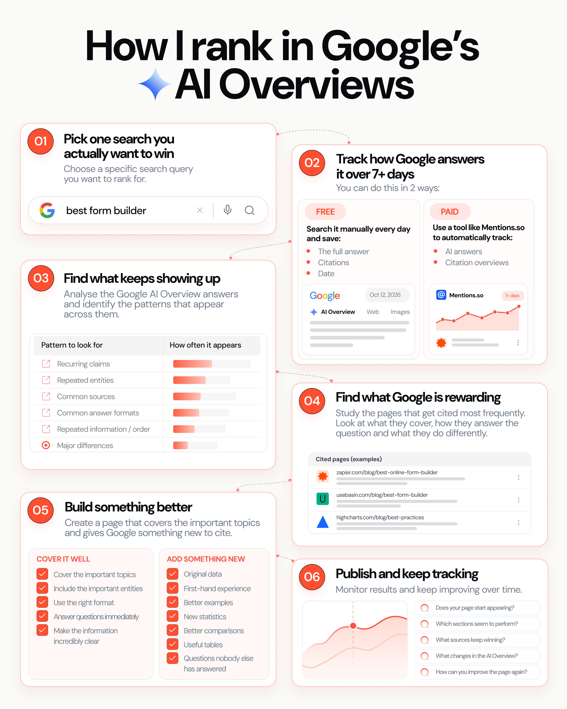

# 2,400 people bookmarked this, so I turned the entire process into a one-page SOP.
> Source: https://x.com/jakezward/status/2109646772347777364
> Author: Jake Ward (@jakezward)
> Posted: 2026-10-12T14:06:00+00:00
> Captured: 2026-10-15T09:02:28+00:00
> Stats at capture: 11,608 views · 129 likes · 22 replies · 13 reposts · 319 bookmarks · 0 quotes

## Post

2,400 people bookmarked this, so I turned the entire process into a one-page SOP.

Here's my 6-step process (and prompts) for ranking in Google's AI Overviews:

1. Pick one search you actually want to win

Ideally a buying-intent query that already triggers an AI Overview.

2. Track how Google answers it

Collect the AI Overview over 7+ days.

You can do this in 2 ways:

FREE

Search it manually every day and save:

- The full answer
- Citations
- Date

PAID

Add the prompt to a tool like http://Mentions.so and automatically track the answers + citations over time.

3. Find what keeps showing up

Paste all the answers into ChatGPT or Claude and add the following prompt:

--

Analyse these Google AI Overview answers and find the patterns that appear across them.

Identify:

- Recurring claims
- Repeated entities
- Common sources
- Common answer formats
- Repeated information/order
- Major differences

For each pattern, show how often it appears (e.g. 8/10 answers).

Then summarise the most consistent patterns Google seems to favour.

--

You’re basically building a picture of what Google consistently includes for that search.

4. Find what Google is rewarding

Now study the pages that get cited most frequently by using the following prompt:

--

Analyse these pages that Google cites in the AI Overview and tell me what they have in common.

[paste URLs]

Focus on:

- How quickly they answer the question
- Topics and entities they cover
- How they structure the information
- What evidence, data or examples they include
- Whether they use lists, tables, comparisons or steps
- What gaps or differences exist between them

Then summarise:

1. The main patterns across the cited pages
2. What Google seems to be rewarding
3. What a better page should include to compete

--

You want to understand both what they have in common AND what’s missing.

5. Build something better

Use everything you found to create or improve your page.

- Cover the important topics
- Include the important entities
- Use the right format
- Answer questions immediately
- Make the information incredibly clear

Then give Google something NEW to cite:

- Original data
- First-hand experience
- Better examples
- New statistics
- Better comparisons
- Useful tables
- Questions nobody else answered

Don’t just copy what’s already winning, use it as the baseline and then make yours better.

6. Publish and track

Monitor the same search over time.

- Does your page start appearing?
- Which sections seem to perform?
- What sources keep winning?
- What changes in the AI Overview?

Then use what you learn to keep improving the page.

> Quoted post by Jake Ward ([@jakezward](https://x.com/jakezward/status/2107453596107219294)):
>
> I’m begging you:
>
> - Pick ONE Google AI Overview
> - Track how it changes over 7 days
> - Find the patterns with AI
> - Reverse engineer the citations
> - Build your page around the findings
>
> I’ve used this process to rank in 1,000s of AI Overviews.
>
> Here’s how it works:

## Media

 — Post media 1. Source media: https://pbs.twimg.com/media/HUbWeLZXUAEWeuB.jpg?name=orig

## Thread

### Jake Ward ([@jakezward](https://x.com/jakezward/status/2109662669162557701)) — 2026-10-12T15:09:10+00:00

@cybr404 Lovely tip

## Comments

### Muntazir ([@cybr404](https://x.com/cybr404/status/2109655481325175083)) — 2026-10-12T14:40:36+00:00

@jakezward Good one. Small add for step 4: if the cited link ends in #:~:text=, keep that part. It's the exact passage Google lifted from the page, so you see what it used, not just which page it picked.
### SiteSignal ([@SiteSignalApp](https://x.com/SiteSignalApp/status/2110208606692069405)) — 2026-10-14T03:18:32+00:00

@jakezward Great process! This is where AI visibility meets AEO and generative engine optimization. Tracking AI Overviews is a great start, but LLM SEO also means understanding why ChatGPT recommends certain brands.
### Brian Hadu ([@BrianHaDu](https://x.com/BrianHaDu/status/2109658274580901897)) — 2026-10-12T14:51:42+00:00

@jakezward if you target queries triggering AI Overviews, your content's visibility can skyrocket
### Alex Wolk ([@alexwolk1](https://x.com/alexwolk1/status/2109692946039632131)) — 2026-10-12T17:09:29+00:00

@jakezward Answering the exact query in the first couple of sentences is the step most people skip. Curious whether you track AI Overview citations manually or with a tool?
### Bryan Pollard ([@bpolla4](https://x.com/bpolla4/status/2109777718485319808)) — 2026-10-12T22:46:20+00:00

@jakezward So important for brands to align on what topics they care about and go a mile deep on those.
### Azhar Ahmed ([@learnwithazhar](https://x.com/learnwithazhar/status/2109805175875813788)) — 2026-10-13T00:35:26+00:00

@jakezward This is exactly we had done in the past to get rank for best queries buying intent in the Google AI.
### Prashant ([@lifedesignshare](https://x.com/lifedesignshare/status/2110372297236484195)) — 2026-10-14T14:08:59+00:00

@jakezward Have started to implement this approach. Lets see how it goes
### Cam Trew ([@camtrew](https://x.com/camtrew/status/2109647647137305006)) — 2026-10-12T14:09:29+00:00

@jakezward Great breakdown! Simple steps like these make AI search easier to understand and use.

## Links

- http://Mentions.so
